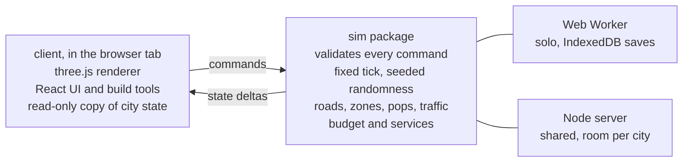

# City Council: Project Map & PRD

Exported from the planning doc on 11 November 2026. Once this file is in the repo, it is the copy to keep current.

## Summary

City Council is a city builder that runs in a desktop browser. One city can be built by several people at once, joined by a shared link. It borrows the feel of Cities: Skylines, with free-form roads, zoning along them, RCI demand, traffic that punishes bad road layouts, and services that cost money.

The plan rests on one bet. The simulation is a headless TypeScript package that takes commands and produces state, and it never touches rendering or the DOM. In single player it runs in a Web Worker. In multiplayer the same package runs on a server. If we hold that line from the first commit, multiplayer becomes a hosting and sync job at the end and not a rewrite.

We build one module at a time, in the order of the roadmap below. Each module ends in something playable and has exit criteria. This doc is the map. When a module starts, it gets its own short spec that links back here.

Four decisions are already made.

| Decision | Choice | What it means |
| --- | --- | --- |
| Map | Procedural terrain | A seed generates land, water and resources. The save file stores the seed, not the heightmap. |
| Roads | Free-form | Straight and curved segments at any angle. Zoning cells grow along road edges. |
| Simulation depth | Grouped pops | Households and workers are grouped into blocks that share a home and a workplace. No per-citizen agents. |
| Multiplayer | One shared city | Everyone edits the same city with one treasury. The owner sets roles. |

## Vision and design pillars

The player is someone who likes Cities: Skylines and wants to build a city with friends without installing anything. They open a link and are placing roads within a minute.

**Roads are the game.** Layout decisions should show up as traffic, land value and commute times. If a player cannot see why a junction is jammed, the traffic module has failed.

**Readable over realistic.** Every number the sim produces must be explainable in an overlay or a tooltip. We prefer a simple model the player can reason about to an accurate one they cannot.

**Built for a browser tab.** The game has to open without a long wait, run on a laptop with integrated graphics, and survive a refresh. That rules out per-citizen simulation and pushes us toward pops and aggregate flows.

**Co-op by default.** Every feature is designed as if multiple people were editing the same city, even before multiplayer ships. That means no hidden local state, no actions that only make sense for one cursor, and an activity log from day one.

### What we take from Cities: Skylines

- Free-form road drawing with snapping, and zoning cells that attach to roads
- RCI demand bars that drive what grows
- Info-view overlays for traffic, land value, coverage and so on
- Service buildings with a coverage radius measured along the road network
- Milestones that unlock buildings as population grows

### What we leave out

- Individual citizens with names and life stories
- Per-vehicle traffic simulation and lane-level AI
- Modding, asset editor and Steam Workshop equivalents
- Disasters, tourism, specialised industry chains and the other DLC-sized systems
- Mobile and touch support in v1

## Goals, non-goals and success criteria

v1 is done when two people can open a link, build a working city of 500,000 residents together, and come back the next day to find it as they left it.

### Goals

- A solo player can grow a city from an empty map to 500,000 residents with a balanced budget.
- Traffic responds to road layout, and a transit line measurably takes cars off a parallel road.
- Services have a visible effect on demand, land value and the workforce.
- A city is shareable by link, with owner, editor and viewer roles.
- The city state survives refresh, disconnect and server restart.

### Non-goals for v1

- Competitive play, trading between cities, or a shared region of several cities
- Social features beyond a link and a display name. Payments, accounts and public online hosting. At launch the project owner runs the only server.
- Photorealistic rendering. Buildings are lightly stylised and generated in code, as described under Art direction.
- A city that keeps simulating while nobody is connected

### Proposed targets

These are starting numbers to tune, not measurements. The buildable map is 12 km × 12 km.

The targets come in two kinds, and they are held differently (#197). In a shared city every player waits on the slowest tick and on the round trip of an edit, so the sim and multiplayer targets are hard. No client feature may be paid for with sim time, and a system over its share of the tick is fixed before the next module starts. The client targets are softer. Most games, native or in a browser, take 15 seconds to a minute to open a large world behind a loading screen, and a 500,000 resident city with sound, demand and transport may need the same. That is acceptable as long as the game stays playable on the weakest reference machine once it is open. A client target that is missed gets an issue, not a stop.

Sim and multiplayer, hard:

| Area | Target |
| --- | --- |
| Sim tick | 10 ticks per second at 1x speed, under 20 ms of worker time per tick at 500,000 residents |
| Edit latency | A placed road is visible to other players within 250 ms |
| Players per city | 8 editing at once |
| Save size | Under 10 MB compressed for a 500,000 resident city. A player who joins downloads it |

Client, soft:

| Area | Target |
| --- | --- |
| Frame rate | At 500,000 residents, 30 fps minimum at Low on the Low reference class, and 60 fps at Balanced on the Balanced class. The classes are under the open questions |
| New city | Under 5 s from opening the page to an interactive map on broadband, with detail still filling in after that. About 1 s at M0 on a faster machine than CI's. 1.35 s on WebGL 2 in the development container, where the M0 build takes 1.2 s, after #203 took back most of the 0.9 s that M1 and M2 had added. Up to 3.7 s on the slowest CI runners before that fix. Held after every deploy and nightly, reported only in pull request CI (#154) |
| Opening a large city | A saved, loaded or joined city of 500,000 residents is interactive within 30 s on broadband on the Low class, behind a loading screen that shows progress |
| Tab memory | About 500 MB at 500,000 residents |

Frame rate and memory are what keep weaker machines playable, so they are not traded for looks. Heavier visuals go in Balanced or High (see "Graphics presets"). Load time is what may grow as the game gets richer.

## Business model

The game is free to play locally, and anything that needs a server is paid.

|  | Free | Paid |
| --- | --- | --- |
| Full single-player game | Yes | Yes |
| Where the city is stored | In the browser, on that device | Online, reachable from any device |
| Download and import a city file | Yes | Yes |
| Multiplayer by link | No | Yes |
| Account | None needed | Required |

The split follows cost. A free player's sim runs in a worker on their own machine and their city sits in IndexedDB, so they cost almost nothing to serve. Server CPU and storage are only spent on paying players.

The free tier needs one safeguard. Browsers can evict local storage, and a city does not follow a player to a new browser or computer. So a free player can download their city as a file at any time and import it anywhere. The game asks the browser for persistent storage and reminds the player to download a copy now and then.

Upgrading is a small step. The player's local city uploads to the server and carries on from where it was, which works because the server runs the same sim package.

Only the host of a shared city pays. Friends join by link for free and need no account. Every invite then shows the game to someone new at no cost to them.

The paid tier is a monthly subscription, because the server costs it pays for are ongoing. The price is not set yet. It has to cover one host's share of server time and storage with room to spare, and that share is measured at M5.

If a subscription lapses, the host's online cities become read-only. The host and their guests can still open and look around them, and the host can download each one as a file and carry on playing it locally for free. Nothing is deleted. Resubscribing makes the cities editable again.

**Timing.** Monetisation is not a priority. This section records the intended model so nothing built earlier blocks it, and billing itself is deferred. At launch there is no online tier for the public. The project owner runs the only server and is the only host, and friends join those cities by link. Public hosting, accounts and subscriptions come later.

## Technical architecture

The code splits into three packages. `sim` owns all game state and rules, `client` draws it and collects input, and `server` hosts `sim` for shared cities. `sim` imports nothing from the other two.

The client only sends commands and receives state. Whether the sim sits in a worker or on a server, that exchange is the same.

### Stack

| Layer | Choice | Why |
| --- | --- | --- |
| Language | TypeScript, strict mode | One language across sim, client and server. slop-newyork uses plain JS modules, which is fine for a demo but not for a sim this size. |
| Build | Vite, pnpm workspace | Fast dev server, worker bundling built in |
| Rendering | three.js `WebGPURenderer` with TSL shaders, pinned to `three@0.187.0` (exact, from npm) | Same renderer as [slop-newyork](https://github.com/mrdoob/slop-newyork/). It falls back to WebGL 2 where WebGPU is missing, and `?webgl` forces the fallback. slop-newyork loads the unpinned dev build from a CDN. We pin a version. |
| UI | React over the canvas, Zustand for UI state | Panels, budget tables and toolbars are ordinary web UI |
| Sim runtime | Web Worker in single player, Node on the server | Same package, two hosts |
| Local saves | IndexedDB | No backend needed until multiplayer |
| Static hosting | GitHub Pages, deployed by a workflow on every push to `main` | Free, next to the repo, no extra account. It cannot set response headers, which matters only if we want `SharedArrayBuffer` (see M0). |
| Server | Node with WebSockets, one room per city | See the multiplayer section for the hosting options |
| Tests | Vitest for sim, Playwright for client walkthroughs | The sim is headless, so most tests need no browser |

### Rules the sim follows

1. **Commands in, state out.** The only way to change the city is a command such as `BuildRoad`, `ZoneCells` or `SetTaxRate`. The UI never mutates state. Every command carries the player id and is validated before it applies.
2. **Fixed tick.** The sim advances in fixed steps, independent of frame rate. Slow systems such as demand, land value and traffic assignment run every N ticks on a stagger, so no single tick is expensive. The heaviest run in background workers, and their results are applied on a fixed later tick so the outcome never depends on timing.
3. **Seeded randomness.** All random numbers come from one seeded generator stored in the state. The same seed and the same command log give the same city on the same machine. That gives us replay tests and bug reports that reproduce.
4. **Flat data.** Roads, cells, buildings and pops live in typed arrays indexed by id, not in object graphs. Snapshots are then a handful of buffers that copy to a worker, a file or a socket with no serialisation step.
5. **State is serialisable at every tick.** No closures, class instances or DOM references in sim state. Save, load and join-in-progress all use the same snapshot format.
6. **The client is a view.** It keeps a read-only copy of state, applies deltas, and interpolates for smooth motion. Cars on screen are drawn by the client along routes the sim has already assigned. The sim does not move them.
7. **Derived data is rebuilt, never saved.** Some structures are only a faster way to read state: the terrain, the road spatial index, from issue 15 the routing graph, from issue 18 the blocks, from M2-03 where the zoning cells are and whether each is blocked, from M2-09 which building stands on each cell and which chunk each building is in, from M2-10 the grower's list of free cells by the road, and from M2-11 the list of buildings to check once a change of roads settles. They live outside `SimState` and are never saved, hashed or sent. The terrain is cached by seed, because it depends on nothing else; commands that check the ground, such as `BuildRoad`, read it through that cache, so a worker, a server and a replay check against the same map. The page reads it through the same cache, for the map it draws and for the mirror's cell index, so it generates a map once. The worker tells the page the seed it is opening before it generates its own copy, and the page generates its copy then, at the same time (#203). The others are cached by the state object they come from. Each is built from the graph arrays the first time it is asked for, then kept current by the functions that change the graph. A city loaded from a save, cloned or replayed is a new object, so it builds its own. A host calls `prepareDerived` after it creates or loads a city, so the rebuild lands at load and not inside a tick. A derived structure must give the same answers whether it was kept current through a city's whole history or built a moment ago, and every structure has a test that proves it. Every list inside one stays sorted by id and every query breaks ties by the lower id, so nothing depends on the order changes arrived in.

### Why this keeps multiplayer cheap

Single player already talks to the sim through a message channel, because the sim is in a worker. Multiplayer swaps that channel for a WebSocket and moves the worker to a server. The client code path is the same.

The message types live in `sim` (`protocol.ts`) and both ends import them. Every message carries a protocol version `v`. The client sends `command` and `requestSnapshot`. The sim sends `snapshot`, `delta` and `commandResult`. A delta carries only what changed: the tick, the speed, new log entries and, from M1, the road nodes and segments added, changed or removed, and, from M2, the zoning cells that changed (see "Cells in the protocol" under M2), and how the undo history changed (see "Undo"), plus the host's per-system timing of its last step for the debug panel. Road changes go as whole rows read when the delta is built, so an id removed and reused between two deltas arrives once, as the new row. The sim records which ids a step touched in a list kept outside state, like the spatial index, so it is never hashed or saved, and the host drains it after each step. Deltas are numbered and a snapshot says which number comes next, so a client that misses one asks for a snapshot. The mirror tells its listeners which 500 m chunks the road rows touched. In the client, a `SimTransport` with `send` and `onMessage` hides whether the other end is a worker or a socket, and a `SimMirror` holds the read-only copy of state. A host knows who is on each connection and stamps that player id on every command, ignoring the id the message claims, so no client can act in another player's name. The worker stamps its one player, `local`. The host steps from real time at 10 Hz times the speed and, after a stall, catches up by at most 8 steps and drops the rest of the missed time. The server is authoritative and sends state deltas, so clients do not need to agree bit for bit and we avoid lockstep.

Build tools show a local preview while a command is in flight, and the server's answer confirms or rejects it. That preview is the only client-side prediction we need.

## Module roadmap

Twelve milestones, built in order. Each one ends in a build you can play, and the next does not start until the exit test passes.

Your list put Map & Zoning first. I split it. With free-form roads, zoning cells only exist along a road, so roads have to come before zoning. Terrain moves into the foundation milestone.

| # | Milestone | Depends on | Exit test |
| --- | --- | --- | --- |
| M0 ✓ | Foundation and terrain | none | A seeded map renders with camera controls. The sim runs in a worker, accepts a no-op command, and the state saves and reloads from IndexedDB. |
| M1 ✓ | Road networks | M0 | Draw straight and curved roads that snap and form intersections. Delete and upgrade work. Undo works. A pathfinder returns a route between any two connected points. Blocks enclosed by roads are detected. Angle guides hold a road at 90 degrees, and the grid tool lays out a block grid in one action. Roads at different levels cross without forming an intersection. Rail (tram, subway, heavy rail) should be kept in mind so road tools can be reused when rail is going to be implemented. |
| M2 ✓ | Zoning and buildings | M1 | Paint R, C, I, O, and M on cells along roads. Buildings appear on zoned cells at a fixed rate and disappear when the road is removed. Each zone can have a level 1-3 which indicates density & impact. Three graphics presets exist, and buildings set the default look. |
| M3 | Demand | M2 | Growth follows four demand bars for residential, commercial, office and industrial. Pops move in, take jobs, and leave when there are none. An all-residential city stalls. Each cell builds at the density it is zoned for. A first land value orders which lots fill. Population shows in the top bar and its history is graphed. Pops turn over at a steady yearly rate. The tools make sounds. |
| M4 | Economy | M3 | Taxes, upkeep and construction costs hit one treasury. A monthly budget panel balances. Running out of money blocks building. Allow borrowing. Demolishing an occupied building charges compensation. Property and business taxes and development charges work. The first population milestones unlock density 2 and pay grants. City Hall can be placed, and clicking it opens the budget. |
| M5 | Traffic | M3 | Commutes load onto roads. A traffic overlay shows congested segments. Widening a road or adding a bypass visibly changes the overlay. Long commutes lower demand. Decorative cars visualize the traffic levels. Assignment stays inside its time budget on a 500,000 resident test city. Roads can be raised and lowered, with ramps, overpasses and tunnels, so a highway interchange can be built. |
| M6 | Public transport: buses | M5 | Draw a bus line with stops. Pops choose it when it beats driving. Road volume on the parallel route drops. Fares show in the budget. Bike lanes on a street shift short trips from cars to cycling. Pedestrians walk to stops and shops at street zoom. |
| M7 | Rail transport | M1, M6 | Lay tram, subway and commuter rail track with the same tools as roads. Stations, tunnels and elevated track work. Lines, mode choice and fares from M6 also work for heavy (commuter) rail, trams, and subways. A subway line carries more people per hour than the avenue above it. The central station landmark can be placed. Off-street bike paths work, and a station reached by bike lanes draws riders from further away. |
| M8 | Services | M4, M5 | Clinics, schools, childcare, fire and police have capacity and network coverage. Parks and recreation raise satisfaction and land value within walking distance. Each changes a number the player can see, such as health, education level or the share of parents who work. |
| M9 | Utilities | M8 | Power, water and sewage plants are placed on the map and add capacity, with no grid to draw. A shortage lowers demand across the city. Pollution from plants feeds land value and satisfaction. |
| M10 | Multiplayer | M4 minimum | Two browsers edit one city through a server. Roles work. A third player joins mid-game and sees the same city. The project owner moves a local city online. No accounts or payments yet. |
| M11 | Polish and launch | all | Tutorial, music and the final sound mix, the remaining six landmarks, a performance pass against the targets above at 500,000 residents, public link. |

M10 is listed late but it can start any time after M4. I would run a short spike right after M1. Host the sim in a Node process, connect two tabs and draw roads together. It costs a few days and tells us early if any sim rule broke the architecture.

There are no dates on these, by choice. The order is the plan, and nobody has been promised a delivery date.

## Module specs: foundation, roads and zoning

### M0 Foundation and terrain

The world unit is one metre. The map is a 12 km square with a heightmap at 16 m resolution, which is 750 × 750 samples. A 4 km map cannot hold 500,000 people at a believable density. A seed generates height, water level, and resource masks for fertile land, forest and ore. Layered noise with an erosion pass is enough for v1.

The ground is coloured by height and slope only. The resource masks are not painted on it; a resources overlay will show them. Forest shows as decorative trees within 3.5 km of the camera, and open lowland gets grass tufts near the camera. Further out, where trees are not drawn, forest ground takes a canopy green that fades in from 1.5 km, so the map still reads as wooded from the city band (issue 47). Decoration is placed from the seed by the client, so it is the same on every load and for every player. It is not sim state and nothing in the game reads it.

This milestone also builds the parts every later module leans on.

- The command bus and the worker message protocol
- The snapshot format, with save and load to IndexedDB
- The tick loop with speed controls for pause, 1x, 2x and 4x
- Camera with orbit, pan and zoom, plus ground picking
- A debug panel that shows tick time per system, toggled with the backquote key. The UI shell is React over the canvas, with Zustand for UI state only; components read sim state through the `SimMirror` and a lint rule stops them importing anything that writes state
- Download a city as a file and import it back, so a free player can move browsers or keep a backup

The random generator is xoshiro128**, seeded from the city's 32-bit seed with splitmix32. Its four words of state live in the sim state, so a snapshot carries it.

A snapshot is one byte layout used for local saves, city files and, later, for sending a city to a player who joins. It starts with a 40-byte header: the magic bytes `CITY`, the file format version, the state version (`SNAPSHOT_VERSION`), the seed, the tick, the body length and a 64-bit checksum of the body. The body is a list of named sections, each on an 8-byte boundary. Every typed array in state gets its own section, named by its path, and everything else goes in a JSON section with references to those arrays. A second JSON section holds the log entries that have left live state, so a snapshot can carry the whole activity log. File format 2 lets a snapshot leave that section out, for a host that keeps those entries itself (`serializeDetached`); a snapshot that carries them is still written as format 1. Formats 1 and 2 use FNV-1a as the checksum, a byte at a time. File format 3 changes only the checksum, to two 32-bit sums taken four bytes at a time, which is several times faster. A snapshot without its paged log is written as format 3, since that is the one an autosave writes while the city runs; a build from before format 3 refuses it as a save from a newer version. `serialize` and `deserialize` live in `sim`, with `serializeSteps` and `serializeDetachedSteps`, which write the same bytes a part at a time. `deserialize` migrates old state versions up to the current one, and it refuses a save from a newer build, a cut-short save and a damaged one, each with a message a player can read. No compression yet.

In single player the worker loads the most recently opened city from IndexedDB at start (for saves that never recorded an open, the most recently saved), and with nothing saved it starts a city from seed 1. The city menu starts a new city from any seed and switches between saved cities; either one saves the running city, stores or marks the other, and reloads the page into it. Terrain is rebuilt from the seed. The worker autosaves every 30 seconds, and it also saves when the tab is hidden and when the player presses Save. An autosave must not hold up the ticks of a running city, so the worker copies the city on the tick the save is due (`captureState`: the typed arrays are copied, and log entries and undo records, which never change once made, are shared) and writes the copy in parts with a pump between each: the typed arrays found, the JSON written, then the bytes laid out and their checksum taken 2 MB at a time, about a dozen parts for the 17.5 MB scale town (issue #204). Every other save is written at once, because the player is waiting or the tab is going away and its timers may not run again. Such a save also ends the pauses of an autosave still being written, so it is never held behind one. Each city keeps its latest snapshot and the good one before it. A local save holds only the live part of the activity log, at most 4,096 entries. Entries leave live state 1,024 at a time, and the worker writes each such page to IndexedDB once, in the same transaction as the first save that needs it, so the cost of a save does not grow with the age of the city. Both snapshots read the same pages. A save whose pages are missing counts as damaged. Saves from before log pages, and imported files, have the log inside the snapshot; they load as they are and move to pages on their next save. The worker still holds the whole log in memory, for city files. A damaged latest snapshot is reported and the one before it is loaded. A save from a newer version is reported and left untouched, and a new city starts under a new id so nothing writes over it. The page asks for persistent storage and says so when the browser declines.

One tab runs a city at a time. Each tab has its own worker and its own copy of the sim, so two tabs on one city would save over each other. The worker takes a Web Lock named after the city before it hosts it and holds it until the tab closes or reloads. A tab that cannot get the lock runs nothing and saves nothing: it says the city is open in another tab and offers to try again, start a new city, open another saved city or import a file. A tab remembers its city for as long as it lives, so a reload comes back to it whatever other tabs have opened since; a new tab opens the most recently opened city. A browser without Web Locks runs unguarded. Joining a city from a second tab or a second browser is multiplayer and waits for M10, where the server runs the one sim and a link lets others in.

A city file is a snapshot with the whole activity log inside, in one file named after the city with the extension `.city`. The worker writes it from live state, so a download works even when IndexedDB does not. Import decodes the whole file before storing anything: a file that is not a city, is cut short, is damaged or is from a newer version is refused with a message and nothing changes. An accepted file is stored under a new id, never over an existing city, and is named after the file, with a number added if the name is taken, so importing one file twice gives two cities. The page then reloads into the imported city. The page reminds the player to download a copy when a city has gone three days of real time without one, counted from the last download or from when the city was first stored. The interval is `EXPORT_REMINDER_INTERVAL_MS` in the client's save config.

Speed is part of the sim state and changes only through the `SetSpeed` command, since in multiplayer there is one sim and one speed. While paused the host keeps stepping at the 1x rate: queued commands still apply, including the one that unpauses, but the tick counter and the systems do not move.

No terraforming in v1. The terrain is fixed after generation, which keeps the save small and removes a class of sync problems.

The game is served from GitHub Pages at <https://bunge12.github.io/city-council/>. A workflow builds the client on every push to `main`, publishes it, and runs the M0 walkthrough against the public address. The build uses relative asset paths, so the same files work at a site root and under the repository path. Cloudflare Pages was the alternative. We would move there only for a response header Pages cannot send. Saves live in the origin's IndexedDB, and on Pages every project of the same GitHub account shares the `bunge12.github.io` origin, so the database name `city-council` must stay unique among them.

`SharedArrayBuffer` is not used. The worker sends deltas and moves snapshot buffers with `postMessage` transfer, which costs little at M0 sizes. Shared memory needs the page to be cross-origin isolated, which takes two response headers (COOP and COEP) that GitHub Pages cannot set. If a later module wants it, most likely M5 for traffic assignment in background workers, the choice is between a service worker that adds the headers (it costs one reload on the first visit) and a move to Cloudflare Pages with a `_headers` file. That decision waits until something needs shared memory.

M0 exit numbers, measured by the walkthrough on the production build. Cold load to an interactive map on a throttled 25 Mbit/s line with 20 ms latency, with the HTTP cache off: about 1.0 s from navigation start to the first frame with terrain, on both WebGPU and WebGL 2, and under 2 s measured from outside the page. Those figures came from a faster machine than the development container or a CI runner, and the walkthrough no longer measures them. On 18 November 2026, in the development container (4-core Xeon at 2.1 GHz, software rendering, Chromium under Xvfb), median of 5 cold loads each, gzip on as `vite preview` serves it: the M0 build (`b708342`) took 1.22 s on WebGL 2 and 1.04 s on WebGPU, the M1 close-out (`3a27aed`) 1.54 s and 1.43 s, the M2 walkthrough build (`f24e089`) and `main` before #203 2.12 s and 1.93 s, and `main` after #203 1.35 s and 1.27 s. Without compression every figure is about 0.25 s higher (1.47 s, 1.88 s, 2.43 s and 1.78 s on WebGL 2). The gap of about 0.9 s was the terrain, generated more often and in a worse order, while each generation still took about 0.4 s. M1 (outside connections, #75) made `createState` place the connections on the terrain, so the worker generated the map before it sent the first snapshot, and the page generated its own only after that snapshot: two generations one after the other where M0 had one (+0.3 s). M2 (zoning cells, #117) built the mirror's cell index on the page through the sim's terrain cache, while the page drew the map from its own `generateTerrain` call, so the page generated the map twice (+0.4 s of M2's 0.6 s). #203 fixes both. The page draws the map from the same cache (`terrainOf`), and the worker names the seed it is opening on the saves channel before it generates anything, so the page generates its copy at the same time as the worker. What is left, about 0.13 s on WebGL 2, is the bigger bundles: the page script went from 303 KB to 441 KB gzipped, the worker from 24 KB to 211 KB once it held the whole sim, and between the snapshot and the first frame the page now builds the cell index, the building layer and a larger UI, about 0.15 s more than at M0 in a profile. That is the cost of the features and is kept. Moving the terrain to the worker alone and sending it to the page would save the page's 0.4 s of CPU but not the wait, since the worker's generation is then the critical path. On CI the walkthrough measured up to 2.1 s on WebGPU and 3.7 s on WebGL 2 in the page, and 3.85 s around the navigation, on EPYC 7763 runners. The soak run (`pnpm soak`) hosts a city at 4x for one hour of game time, 36,000 ticks with a NoOp every 4 ticks: no step near the 20 ms budget (worst about 1 to 2 ms), heap back to about 11 MB after GC, and a replay of the 9,000-entry log gives the live city's hash. An autosave in that run writes about 0.7 MB and takes about 13 ms of worker time, outside the step timings, and stays there however long the log gets; writing the whole log each time took 27 ms at 9,000 entries and grew with every command. The soak holds the budget per source of work: each road command type, the steps that walk a slice of zoning cells, the idle steps and each autosave's slowest part. A source fails the run if it passes the budget more than twice, which is more than a CI runner's pauses (a garbage collection, another tenant) put on one source. Autosaves may pass it three times in all, since each allocates a 13 MB snapshot and an old-generation collection tends to land in one of its parts. Until issue 91 it failed on any one step, and then on more than 5 of the 36,000 in all; once M2 added zoning cells the slow steps of a few grids filled that allowance, and runner pauses failed about half the runs. For a while a grid at the cap could pass it twice more, until issue #128 made those grids fit. One late step delays the next tick by that much and changes nothing else, and a source that is too slow in earnest passes the budget every time it runs, however rarely that is. The soak writes the counts to the CI job's summary.

Terrain is gradient noise on an integer hash: a lowland layer tilted toward a sea on one of eight sides, ridged mountains under a noise mask, and a thermal erosion pass. The water surface sits at the height that leaves 20 percent of the map under water. If less than 45 percent of the map is dry and no steeper than 10 percent, the relief is scaled down and the map shaped again. These numbers live in `packages/sim/balance/terrain.json`. The code in `packages/sim/src/terrain/` uses only exact operations, and lint bans the other `Math` functions there. The same seeds hash the same in Node, Chromium and JavaScriptCore, so the save stores only the seed and the fallback of saving the heightmap is not needed.

### M1 Road networks

Roads are a graph of nodes and segments. A segment is a straight line or a single curve between two nodes, with a road type. Each type sets the lane count, speed, capacity, cost and upkeep.

| Road type | Lanes | Notes |
| --- | --- | --- |
| Street | 2 | Zonable on both sides |
| Avenue | 4 | Zonable, higher capacity |
| One-way | 2 | Zonable, needed for sane junction design |
| Highway and ramps | 3 per direction | Not zonable. Lands with traffic in M5. |

The build tool needs most of the work here.

- Straight, curved and continuous drawing modes
- Snapping to nodes, segments, angles and the terrain grid. Snapping to zoning cells moved to M2, since the cells arrive there
- Splitting a segment when a new road crosses it, which creates an intersection
- Slope limits against terrain, and automatic bridges over water, with the deck a set height above it
- Upgrade in place, bulldoze, and a cost preview before the click

**Building a straight road.** `BuildRoad` carries a start, an end and a road type id. The sim rounds both ends to a 1/8 m grid, so two points are either the same node or apart and no later check needs a tolerance. An end within 4 m of an existing road node joins that node. Then it refuses, with a reason the player reads: a type that is not buildable (highway, until M5), an end off the map, a road under 10 m, a duplicate of an existing segment, an angle under 25 degrees against a segment at a shared node, an end in water, and ground too steep. These numbers live under `build` in `roads.json`. A check that passes at submit can fail when the command applies, because of an earlier command in the same tick, and is then dropped and not logged.

**Intersections.** A new road splits every segment on its own network and level that it crosses, and becomes a chain of segments in order along the line. An end that is not within 4 m of a node but is within 4 m of a segment's body joins that segment at the nearest grid point, which splits it into a T-junction. A split keeps the type, network and level of the segment it splits. Segments on another network or level do not split and are not split. The crossing point is computed from the two segments with their ends put in a fixed order, then rounded to the 1/8 m grid, so it lands in the same place whichever road was drawn first. A crossing that would leave a piece under 10 m moves to the node or road end it is near when that is within 4 m, and is refused otherwise. A crossing under 25 degrees is refused. A command's new ids are handed out in a fixed order: new nodes from start to end, then each split segment's two pieces, then the new road's pieces from start to end.

**Curves.** `BuildRoad` takes an optional control point. With one, the road is a single quadratic curve from its start through that point to its end; a control point on the line between the ends makes a straight road. A quadratic needs only add, subtract, multiply, divide and `Math.sqrt`, so curves keep the sim to exact arithmetic. A segment always stores a control point, and a straight one has it exactly at its midpoint. A curve's length is measured on a fixed 16-piece polyline, so every machine gets the same number. Its tightest radius has a closed form, and a curve tighter than its type's `minCurveRadius` in `roads.json` is refused with the radius in the reason. Issue 47 relaxed these to 12 m for a street and a one-way and 25 m for an avenue, from 20 m and 40 m, so a player can bend a road round the map's features; rail in M7 sets wider limits on its own types. Slope and water are sampled along the curve, not its chord. Where a curve meets another segment, both are cut in halves a fixed way until each piece is within 0.1 mm of its chord, and the chords are met, which finds every crossing, two where a curve crosses a line or another curve twice. A split curve becomes curves that take the control points of their parts, so they trace the original. Its split point is the exact point on the curve, not rounded to the grid, because rounding would bend the pieces off the path by up to 9 cm. Crossings of two straight segments are rounded to the grid as before. The spatial index files a curve under every cell its shape touches, and nearest-point queries refine a fixed set of samples with a fixed number of Newton steps.

**Bridges.** The roadmap line "automatic bridges over water above a height" came to mean this, in issue 11: where a road crosses water, that stretch becomes a bridge with its deck a set height above the water, and there is no bridge tool. Bridging a dry valley, tunnels and elevated roads wait for M5, which builds them for highways, and M7 reuses them for track (see "Levels and grade separation"). The sim samples the ground along each piece of a new road at the points the slope check uses. Each run of wet samples becomes one segment with its level set to bridge, between a new node on each bank. The deck runs level at `bridgeClearance`, 5 m, above the water. At each end a ramp at the type's `maxSlope` joins it to the bank node, which sits on the ground like any other node. The sim puts each bank node at the sample nearest the water from which that ramp reaches the deck by the shore. On a low bank that moves the node back from the water; a bank high above the water needs room for the ramp down. If no such point is left before the road's end or the junction before it, the road is refused with the grade the ramp would need. Two runs of water with too little ground between them for a ramp down and up share one bridge. A bridge's length, ramps included, may not pass its type's `bridge.maxLength`. Issue 47 set that to 38.4 km for every type, the Lake Pontchartrain Causeway, the longest bridge over water. That is longer than the 12 km map, so no bridge on the map is too long for its type; the check stays for a type that needs a shorter limit later. A metre of bridge costs `bridge.costMultiplier` times the type's price per metre. Both are per type in `roads.json`. The multipliers come from Arkansas DOT's 2023 average of $339.54 per square foot of deck, for a deck as wide as the road plus 2 m of barriers, so a street bridge costs 31 times as much a metre as the street. The deck height is not stored: it follows from the water level, the bank nodes' heights and the slope limit, and the renderer gets it from the same sim function. A road may not start or end in water, and a junction may not form there, so nothing branches off a bridge between its banks. Only ground segments split each other, so a bridge is never split. Since issue 22 a road that meets a bridge away from a shared node is held to the crossing rule in "Levels and grade separation": the deck stands only 5 m over the water and the bank is above it, so a ground road never clears one and is refused with the gap in the reason, and two bridges that cross over water meet at the same height and are refused too. Ships and bridge height classes are not planned. The renderer draws the deck at its height, a fascia and railing along each edge, and piers at most 36 m apart under the level deck, down to the ground or the lake bed. The road tool's preview marks the bridge part in violet and shows its length beside the cost.

**How a road meets the ground.** A road follows the terrain; there is no terraforming. Its nodes take the ground height, and the slope check samples the ground along the path at most 8 m apart and refuses the road if the grade between any two samples passes its type's `maxSlope`. Issue 47 relaxed that to 16 percent for a street and a one-way and 13 percent for an avenue, from 12 and 10; the highway stays at 6. So a road can climb a hill only where every stretch of it is gentle enough, which is what a draped road needs to look right. If draped roads look wrong on rolling ground once they render (issue 06), the fallback is a straight grade between node heights with short embankments drawn by the client, which changes the check but not the graph. Issue 06 draws them draped, with a cross-section at most every 8 m, and they sit cleanly on the ground in the fixture city, so the fallback stays unused for now.

**Bulldozing and upgrading.** `BulldozeRoad` takes a list of segment ids and removes them. Each end node left with no segments goes too. A node left joining exactly two segments stays where it is, unmerged, so a bulldoze never moves or joins anything the player did not name. Segments go in ascending id order, then nodes, so the free lists come out the same whatever order the list was in. A segment flagged fixed (`SEG_FIXED`, for the outside connections in issue 16) cannot be bulldozed or changed, and a fixed node stays when its segments go. `UpgradeRoad` takes a list of segment ids and a buildable type and changes their type in place: the id, shape, nodes and level stay, and in M1 only the width changes. It is refused with a reason when the new type breaks a limit the old one met on that segment: the ground's slope, the curve radius, or on a bridge its length and the grade of its ramps. A limit the old type already broke, as a piece split off a longer road can by a hair, does not count. A one-way runs from its node A to its node B. An upgrade to a one-way runs each segment from node A unless the optional `from` list names node B, and upgrading a one-way to its own type reverses it by swapping its ends, which keeps every node's list of segments in the same order. Each command also carries `ends`, one `[ax, az, bx, bz]` per segment, and `types`, one road type id per segment: where the segment's end nodes stood and what type it was when the player picked it, on the click or, for a drag, as the pointer passed over it. The sim refuses the whole command, changing nothing, when any segment's ends are anywhere else now or its type has changed (issue 94). The type matters because an upgrade of a one-way to its own type reverses it: two "make it one-way" commands picked while the road was a street, from a double click or two players, would otherwise build the one-way and then reverse it. An id outlives its road: a split leaves it on one piece, and a removed road's id goes to the next one built. Node ids are reused the same way, so the check is on where the ends are, not which nodes they are. A reversed one-way has its ends the other way round, so an edit picked before someone reversed it is refused too. A log recorded before this carries no `ends` or `types`, so its bulldozes and upgrades are refused when it is replayed and it no longer rebuilds its city; the save itself still loads, since a save is its state. The replay fixtures were re-recorded with the ends each command would have seen, and build the same roads as before. A command that names a missing segment, or one segment twice, is refused whole. So is one that names more than `editMaxSegments` segments, 5,000 in `roads.json`: that many apply in about 15 ms on the 30,000 segment city, inside the tick budget, where the whole city took 100 ms (M1 review, issue 80). No drag reaches the cap, so the tools do not split a list. Both commands price themselves from `roads.json`, and nothing is charged until M4. A bulldoze costs the type's `demolitionCostPerMetre`, times the bridge multiplier on a bridge. An upgrade costs the full price of the new type less `upgradeCredit`, a half, of the old type's build price, never below zero; reversing a one-way costs nothing. Both numbers are placeholders until M4 prices demolition and refunds. `planBulldoze` and `planUpgrade` return the plan and price without changing anything, for the tools in issue 13.

**Part of a segment** (issue 86). Either command can take part of each segment it names instead of the whole: the optional `sections` list gives each one a stretch as `[from, to]`, curve parameters along it from node A (0) to node B (1), and `[0, 1]` is the whole. The issue asked for two distances along the segment; parameters are used because turning a distance along a curve into a point needs the curve's length inverted, which the exact-arithmetic rule makes awkward, and the parameter is what the junction split already works in. The sim cuts the segment at the stretch's ends the way a crossing road splits it (`splitSegment` in `build.ts`): at the exact point on a curve, at the nearest build grid point on a straight, each piece keeping the type, levels, build order and cell anchor, so the outer pieces keep their cells and houses. Then it removes or changes the middle piece. An end of the stretch that would leave a piece under `minLength` moves to that end of the segment, so no stub is left, and a stretch that ends up shorter than `minLength` itself is refused. A stretch that reaches a dead end takes the end node with it. Bridges and ramps are only taken whole, since nothing else splits them either. The price is the middle piece's length at the usual rates, and `planBulldoze` and `planUpgrade` work it out on the cut piece, upgrade limits included, so the readout matches. A bulldoze's preview counts the buildings with a cell on the stretch (`buildingsOnStretch`), which are the ones that lose their ground. A one-way's `from` still names one of the segment's own ends, and the piece runs from that side. Reversing part of a one-way is refused, since that half would meet the other half head on. An upgrade of a stretch to a type of another width puts a change of width at each cut, and a lot only carries on across a node where the strip's edges meet, so a building whose lot straddles a cut loses its ground and goes, as one straddling a junction does when either road is upgraded. The upgrade readout does not count those buildings yet; that is a follow-up. The cuts, the edit and the new nodes are one journal, so one undo takes them all back and joins the pieces under the old id. The zoning of a stretch that goes is kept in the undo record: a road record used to treat the zones of a segment as carried whenever the command added a piece on the same anchor, and now counts them carried only where pieces still standing with cells cover the old segment's whole stretch of anchor. The cuts go first, segment by segment in ascending id order, then the removals in ascending id order, then the nodes, so every machine hands out the same ids. A cut costs about nine times a whole segment, about 45 µs on the 30,000 segment city on a development container, so one command may cut at most `editMaxSections`, 200, in `roads.json`; that is about 8 ms, and no drag comes close. Payloads with no `sections` are what they always were, and every log replays as before, so no state or snapshot version changed. The new balance number moved the balance stamp, and the replay fixtures were re-stamped after checking they build the same cities.

**The bulldoze and upgrade tools.** Decided in issue 13. Since issue 116 the bulldozer is a tool of its own for everything the player can remove, with B as its key; its rules are under "Removing things" below M2, and what this paragraph says about picking roads and dragging holds for it. V turns the upgrade tool on and off, which upgrades to the type in the road type picker, so Z, X and C pick the type for it as they do for drawing. Hovering a road marks it: orange for a bulldoze, and for an upgrade the road as it would look, at the new type's width. A readout by the cursor gives the price from `planBulldoze` or `planUpgrade` on the mirror's copy of the roads, or the sim's reason, and a click the preview refuses sends nothing. A fixed road reads as one that cannot be removed or changed. A click sends one command for one segment; a left drag with either tool collects every segment the pointer passes over and sends one command on release, so one log entry. Since issue 86 the mark is a stretch of the segment, 20 m centred on the pointer (`EDIT_SECTION` in the client's tool config), drawn where the sim would cut it; holding Shift marks the whole segment, as both tools did before. A drag grows the stretch of each segment it passes over to cover everything it touched, from the first point to the last, and a segment passed over with Shift held is taken whole. Reversing a one-way with a right-click still takes the whole segment, since half a road reversed would meet the other half head on. While either tool is on, a left drag picks roads instead of panning, and so does a left drag with Shift held, which used to orbit; the right drag orbits, as it does everywhere, and the keys still pan. The zone brush keeps Shift-drag as an orbit. A drag leaves out a segment it could not act on alone, a fixed one or one already the type picked, so one such road does not refuse the whole drag. A right-click with the upgrade tool reverses a one-way. Picking is in screen pixels: the spatial index finds the segments near the ground under the pointer and near where the pointer's ray meets the bridge deck level, and each is measured on screen at the height it is drawn at, so a curve is picked along its curve and a bridge at its deck. Of two roads under the pointer the nearer centre line wins, and a drag keeps the segment it took last while the pointer is still on it, so a drag along a road over a junction does not take the roads crossing it. The pick distance and drag step are in `packages/client/src/tools/config.ts`. Undo in issue 14 is the safety net, so there is no confirmation dialog.

**Undo.** Decided in issue 14. An `Undo` command carries no target: the sim takes back its sender's newest road change that has not been undone. Each `BuildRoad`, `BuildRoadGrid`, `BulldozeRoad` and `UpgradeRoad` that applies leaves an undo record in `SimState.undo`, tied to its log entry by index. The record is a journal of every change the command made to the road graph, written as plain data while it applied: each node and segment added, with whether its id came off the free list or grew the arrays; each one removed, with its fields and its place in its nodes' lists; and each type change. Ids are reused, so an id in a record can come to name a different road. Since snapshot version 7 a removed segment therefore also records where its two end nodes stood, and a type change the two ends the segment had, and an undo is refused when they no longer match: a bulldozed road is not put back between other junctions that took its nodes' ids, and an upgrade or a reverse is not taken back on one piece of a road someone has since split (M1 review, issue 80). The version 7 migration fills these in from the save. Undo runs the reverse of each, newest first. A command of any size is one record, so `BuildRoadGrid` in issue 20 needs no new shape. A node or segment a command removed and did not hand out again is held: its row is zeroed but its id stays off the free list until its record is undone or forgotten, so no one else can take it and it comes back under the same id. Ids a command frees and reuses itself, as a split does, are handed out as before. Built and then undone with nothing in between, the network is byte for byte what it was, arrays and free lists included, so the state hash matches apart from the log and the history. An undo that takes back the newest ids shrinks the arrays again, so a road delta's id limits can go down. Each player keeps the newest `undoSteps` records, 50, in `roads.json`; past that the oldest is forgotten and frees what it held. `SetSpeed` leaves no record, and there is no redo. The undo is checked first on a copy of the rows it touches and refused whole with a reason when the network has moved on: someone else changed or bulldozed a road it would remove, another road now joins a junction it would remove, or a road built since crosses or touches one it would put back, or, since the M2 review, buildings stand on ground a road it would put back would take (see "An undo that would take built ground is refused" under M2). **A refused undo stays at the top of the player's history.** A refusal changes nothing, like every refused command, so the player clears what is in the way, or the other player undoes it, and tries again. Dropping it instead would let a player reach the step below, but that step often depends on the one dropped, and a refusal that silently ate history would be hard to read. Ctrl+Z or Cmd+Z, or the undo button in the top bar, sends `Undo`. The button is grey when the player has nothing to undo, and a refusal's reason shows under the build bar until the history next changes. A snapshot carries the whole history. A delta carries only how it changed, since issue 155: the places, in the history last sent, of the records it kept, and the new records whole (protocol version 11). A record is never changed in place, so the host finds the change by comparing records by identity, and the mirror keeps its own copy of each record it already had. Sending the whole history in every delta that changed it cost the host megabytes a stroke once it held fifty zone strokes at the cap. Since issue 111 a `ZoneCells` leaves a record too, and a road record can hold the zoning it takes away; see "Undo of zoning" under M2.

**How roads are drawn.** The client builds road meshes from its read-only copy of the graph; the sim knows nothing about them. Each segment is a strip as wide as its type, cut back at each end by the junction there. A junction is one polygon round its node that meets every strip's cut exactly, so strips and junctions cover the road once, with no gaps and no overlaps. Between two roads under 180 degrees apart the kerbs meet at a corner and both roads are cut back to clear it. Since issue 87 that corner is rounded: the kerbs turn through an arc of 6 m between streets and one-ways, 9 m with an avenue on both sides and 12 m between highways, the smaller radius of the two roads, and each road is cut back the arc's tangent length further, at most 14 m. A corner stays sharp where a wide road's kerb at the node would stand outside the arc, as at a sharp fork. Where two roads of different widths meet at a node with nothing else, bent by at most 0.8 radians, the narrow one widens into the wide one over five metres of road for each metre of difference in half-width, 20 m from a street to an avenue. Where a narrow road meets a wide one nearly head on at any other junction, the narrow one tapers into it as before. Round the outside of a bend the kerbs join at a miter point, or at a bevel when the miter would reach more than 2.5 half-widths from the node. A dead end stops square and flush at its node. A curved segment is drawn along the true curve, cut into straight pieces that each turn at most 0.05 radians on the surface and 0.25 radians in the city band's lines, so it looks smooth at street level and costs less from far away. A junction measures how far to cut back a curved arm along its curved kerbs, and its polygon meets the strip's cut edge on the curve, so curved arms join with no gap. Strips split at chunk lines, so each 500 m chunk has one merged mesh per layer, and a delta rebuilds only the chunks its changed rows reach: where each changed segment was and is, and how far each junction at a changed node or segment end can cut back its roads. Surfaces sit a little above the terrain, more with distance from the camera, which the vertex shader adds, so roads never flicker against coarser terrain levels. Decorative trees and grass are left out within a few metres of a road, its junction polygons included, since a rounded kerb or a taper reaches past the strips.

**Crossings, signals and signs** (issue 87). Each street, avenue and one-way at a junction of three or more roads on the ground gets a zebra crossing 3 m long, 0.8 m past the junction's cut, where it fits between the cut and the segment's middle, and its lane lines and arrows stop short of it. A junction with an avenue among its roads gets a traffic light on each road that brings traffic in, and one of streets and one-ways a yield sign on each; a one-way brings traffic in only at its node B. Each stands a metre outside the kerb on the incoming traffic's right, just back from the crossing, facing it, and is left out where that spot is on another road. Lights and signs are instanced per chunk and drawn in the street band only; the crossings draw with the markings. All of it is client decoration drawn from the mirror's graph: the sim has no signals and nothing reads them. If M5's junction delays give a junction a control type, the lights and signs will follow that instead. A one-way runs from its node A to its node B, and its arrows point that way.

**The road tool.** A click sets the start and a second click sends `BuildRoad`; Escape or a right-click drops the road being drawn, and Escape with nothing drawn leaves the tool. R turns the tool on and off, and Z, X and C pick street, avenue and one-way. B was the road tool's key until issue 116 gave it to the bulldozer; camera tilt moved from R and F to Page Up and Page Down then. Players are assumed to have a mouse, and a right drag tilts, so the tilt keys are a backup. Clicks are rounded to the build grid before they are sent, so the command and the log carry the point the preview showed. A press that ends a camera drag is not a click. The preview runs `planRoad`, the function the sim validates `BuildRoad` with, on the mirror's copy of the roads, so it shows what the sim would build: the ends where they would join, the road's real width, a marker at every junction it would form, and its length and cost, the length times the type's price, in the short money format. A road the sim would refuse turns red and shows the reason next to the cursor, and a click on it sends nothing. A sent road stays on screen until the answer comes back: a refusal removes it and shows the reason, and an acceptance keeps it until the first delta from a step after it, which carries the real road. A server answers later than the worker, and the tool does not change for it. Tool state lives in the UI store and never touches sim state. The mirror copies road rows in place, past the network's observer hooks, so `applyRoadDelta` keeps a spatial index the copy already has current itself.

**Drawing modes.** The road tool has three modes, picked in the build bar or with T, Y and U: straight, curved and continuous. Switching mode, or leaving the tool, drops the road being drawn; changing the road type does not. Curved takes three clicks: the start, a point that sets the direction, which becomes the curve's control point, and the end. Until the direction is set a line shows it; after, the preview runs `planRoad` with the control point, so a curve that is too tight turns red with its radius in the reason, and the length and cost are measured along the curve. A curve started from the end of a road, a node with one road segment, holds its control point on the line that road carries straight on along, so it leaves with no kink; holding the free-hand key lets it go. The end of a curve snaps to nodes, segments and the grid but not to angle or length guides, which measure a straight road. Continuous mode draws straight segments end to end, each its own `BuildRoad` and its own log entry. The next segment starts where the last one ended, at the node it joined if it joined one. A segment is not sent until the one before it is built, because the sim checks a command against the city as it stands, and the next segment must be checked against the last, for the angle where they meet among other things; until then it waits on screen. Escape, a right-click, a double click or a click back on the end just built ends the road. A segment the preview or the sim refuses also ends it: the segments before it stay built, and any clicked after it and still waiting are dropped.

By zoom band: the street band draws surfaces, lane markings, crossings and one-way arrows, and the traffic lights and yield signs; the district band draws surfaces coloured by type, with markings, crossings and arrows while the camera is below 1,400 m; the city band draws avenues and highways only, as grey and red lines of a fixed width on screen. Issue 47 kept avenues grey there, as on the ground, and drew markings further out. The bands switch without the fade the zoom band table below describes; that waits until there is more on the map to fade.

#### Angle and spacing guides

Free-form roads make tidy layouts hard without help, so the road tool guides the cursor while leaving it free to ignore the guide.

| Guide | What it does |
| --- | --- |
| Angle snap | A road started from another road or a node snaps to 90 and 45 degrees from it, with lighter snaps at 15 degree steps. A right-angle marker shows when it is square. |
| Guide lines | Faint lines run perpendicular and parallel from nearby roads and nodes. The cursor snaps to them, so a new street lines up with one two blocks away. |
| Parallel offset | Drawing beside an existing road snaps to offsets that zone cleanly. The main one is twelve cells between roads, which is two back-to-back strips of six with no gap. |
| Length snap | Segment length snaps to multiples of 8 m, so zoning cells fit the frontage exactly. |
| Readout | The cursor shows the angle to the source road and the length in metres and in cells. |

Each guide has a toggle in the toolbar, and holding one key suspends them all for a free-hand segment.

How snapping works, decided in issue M1-08. The snap is a list of sources tried in priority order, and the first that catches the cursor gives the point: an existing node, then a point on an existing segment, then an angle guide, then the 16 m terrain grid. On a segment, the point where the new road would meet it square wins over the nearest point when the cursor is near it. Length snap comes after, and only moves a point from an angle guide or from no snap at all, along the road's direction. Angle snap measures from every road at the start node, or from the segment a road starts on, and never offers a direction the sim would refuse as too sharp. 90, 45 and straight on reach 14 pixels, the 15 degree steps 6, and a strong step wins when both reach. Snap distances are screen pixels turned into metres at the cursor, so they feel the same at every zoom. The free-hand key is Alt. It turns every guide off, but node and segment markers still show inside the sim's 4 m merge distance, because the sim joins those whatever the client sends. Angle and length snap start on and the terrain grid starts off. The toggles live in the UI store for the page's life. The distances and steps are in `packages/client/src/tools/config.ts`, since they are feel, not balance.

Guide lines and parallel offset, decided in issue M1-19. Both are sources in the same list, and the full order is: node, segment, crossing, angle, offset, guide line, terrain grid. A crossing is where two guides meet: two guide lines, a guide line and an offset, or either of those and the angle ray from the start; it reaches 14 pixels. Angle comes before offset and guide line because it is measured from the road the new one starts on, which is the clearest sign of what the player means, and an offset or a guide line on its own only fixes one coordinate. Where the angle ray crosses one of them, the crossing wins, so a street drawn square off a road ends exactly on the line of the next parallel street or in line with a node two blocks away. Length snap does not move a crossing, an offset or a guide line point. Guide lines run through each road node within 260 m of the cursor, one in line with each road there and one square to it, but not through the road's own start. A curve gives the line of its tangent at each end node. They show only while a road is being drawn. At most four lines are tried, nearest the cursor first, and only the one or two that catch are drawn, in faint blue, from their node through the point. A guide line reaches 10 pixels. The parallel offset works beside straight roads, and up to 48 m past their ends. It offers gaps between the two road edges of two zoning strips, twelve cells or 96 m, and one strip, six cells. The strip depth is read from the zoning depth in the tool config, so if M2 changes the six-cell depth the offsets follow. The centre distance adds half of each road's width from `roads.json`, so a street beside a street sits 106 m out and an avenue beside a street 110 m. The twelve-cell offset reaches 14 pixels and the six-cell one 8, and twelve wins when both reach. The offset also catches a road's first click, so both ends of a parallel street land on it. It is drawn in orange along the road with a line across the gap, and the readout gives the gap in cells. It is off for a curve's end. Both start on, each has a toolbar toggle, and the free-hand key suspends both.

Zoning cells, decided in issue M2-08. Two more sources, a cell corner and a cell edge, and the full order is now: node, cell corner, segment, crossing, angle, cell edge, offset, guide line, terrain grid. Only zoned, open cells count. An unzoned cell is not drawn outside the zone tool, and the parallel offset already lines a road up behind an unzoned strip. Each edge of a zoned cell is sorted by what lies just past its middle, not by matching corners, because the strips of two roads seldom line up and the cells of two segments never do at a bend. An edge facing the road gives nothing: in the first row the road is there, and further back a road would run beside the street already there. An edge with a zoned cell past it is inside: across the road it is a cell line, and a road on it crosses the strip between two lots; along the road it gives nothing, because a road there would cut every lot. An edge with no zoned cell past it is the outline, the back or an end of the zoned area, and its line sits out from the cells by half the width of the road being drawn plus 0.25 m, so a road drawn on it runs beside the cells. The 0.25 m covers the sim's rounding to its 0.125 m build grid, which would otherwise push the edge of an angled road onto the cells it runs beside. An outline line is dropped when a road on it would still cover a zoned cell or lie on another road's surface, as between two strips back to back or in the wedge at a bend. So every line and corner offered leaves the cells it runs beside whole. The cell edge source catches the cursor on the outline lines and the cell lines across, except where the point would be on a road's surface without joining it; it reaches 10 pixels and at most 2 m, a quarter of a cell. The cell corner source catches where two outline lines meet, where a cell line meets the outline, and where a cell line or the end of the zoned area meets the strip's own road, on that road's centre line where the sim joins a new road; it reaches 12 pixels and at most 3 m. A corner where a road would cover a zoned cell is dropped. A node wins over a cell corner, because the sim joins a node whatever the client sends. A cell corner comes before a segment, so a road started on a street beside a zoned strip starts on a cell line rather than anywhere along it; the point is on the street, so the join is the same. Once a road is being drawn and the angle guide is on, the points on roads are left out, so the square join and the angle steps decide where the road meets a street: they say more about what the player means, and from a start on a cell line the square join is that line's point anyway. A point on the road a new road starts from is never offered. The cell edge comes after angle, which measures from the road being left and is the clearer sign of what the player means, and before the offset and the guide lines, because it comes from cells the player zoned. Behind a straight strip the cell edge and the six-cell offset are the same line give or take the 0.25 m, and the cell edge wins. Cell lines do not take part in crossings, and a curve's end ignores the cells, since the setback assumes a straight road along the line. The source is off past 1 metre a pixel, where a cell is a few pixels across and the lines would catch nearly every point. A Cells toggle sits beside the other guides and starts on; the free-hand key suspends it. The mark is the cell edges the snap came from and, for an edge, the line the road runs on, in pink, with a diamond at a corner. The grid tool's corners snap to the same two sources, after nodes and segments as above, when the toggle is on. The distances live in `CELL_SNAP` in `packages/client/src/tools/config.ts`.

#### Grid tool

The grid tool lays out a whole street grid in one action.

1. Drag along one side of the grid, then move the pointer to set how far it reaches, and click. The side snaps as a road does, so it lines up with the road it starts on and with the roads and zoning around it.
2. Set the block size in cells, by default twelve deep, and the road type.
3. A preview shows every street, the total cost, and anything in the way.
4. Confirm, and the streets are built and joined to the roads they touch.

The grid bends to what is there. Streets stop at water and at slopes too steep to build, and the preview marks those cuts before the click. If the rectangle covers existing buildings, the preview shows the eminent domain cost.

One grid is one command. It costs the sum of its streets, it is validated as a whole, and one undo removes it. That matters in multiplayer, where a half-built grid would be a mess for everyone else.

**The grid command.** Decided in issue 20. `BuildRoadGrid` carries three corners on the build grid (`origin`, `along` and `across`, so the two sides run from `origin`), a block `depth` and `width` in metres between road edges, and a road type. The client works out the rectangle's angle and the sim takes the corners as they come, so it needs no trigonometry: each lattice point is the origin plus a share of each side. The corners must make a rectangle to within a degree, every block must be at least 10 m each way, and the grid at least one block each way. Street centre lines are a block plus a road width apart. The last block along each side takes what is left, and if that is under `gridMinBlockShare`, a half, of a block, it joins its neighbour, so leftovers land on the sides away from the origin. How much one grid may build is capped in street sections, `gridMaxSections` (see "The cap" below); the numbers are under `build` in `roads.json`.

`planRoadGrid`, exported from the sim entry, turns the command into straight streets without changing anything, so the grid tool runs it on the mirror and previews what the sim builds. Each grid line is cut into links where it meets the lines across it. A link on water or on ground too steep for the type, by the ground check `BuildRoad` uses, is dropped, and a stub reaches from the last junction toward the water as far as the ground allows, stopping at least 10 m short of the next line across. So every street ends at a grid junction or well clear of one, and the plan marks each end the ground cut. A link that lies along an existing ground road, within 4 m of one running within 25 degrees of it, is left out, so a grid started on a road joins that road and builds nothing on top of it; a link the road covers only part of starts at the road's end node. The plan reports the length and the cost, which is not charged until M4.

The sim builds the grid one link at a time through `planRoad` and `buildRoad`, the lines along the origin to `along` side first, from the origin out, then the lines across. Each link joins the node the link before it made, so grid junctions come out exact, the grid splits and joins existing roads as a hand-drawn street would, and new ids come out in a set order. Every link must pass `planRoad`. Water and steep ground only cut streets, but anything else that refuses a link, such as a crossing under 25 degrees, refuses the whole grid with the reason and the street it came from, as "Street 3 of 10 in the grid: ...". A link that would need a bridge refuses the grid too, since a grid never builds one. To check the whole grid, `submit` rehearses it on the live network with the undo journal open, then reverses every change, which leaves the network byte for byte as it was. The step does not rehearse and then build again: a command may define `applyIfValid`, which checks and applies in one pass and leaves state as it was if it refuses, and the grid's builds with the journal open and reverses it if a link is refused. A refused grid is dropped and not logged, like any command made invalid within its tick. The undo record is the journal of the whole grid, so one `Undo` takes it all back and rejoins the roads it split, and no snapshot change was needed.

**The cap.** Changed in issue 88. A step's cost is about one `BuildRoad` per link, and a link that meets an existing road costs several times one on open ground, since the split or join it makes changes the blocks and relays the zoning cells around it. So the cap counts what a grid builds, not its lines. Each link, the street section between two neighbouring junctions of the grid, counts one; each place a built link meets an existing ground road counts `gridMeetingSections`, 6, more. A link's end counts when a ground road is within the merge distance of it, since `BuildRoad` joins the end to that road there; between its ends, each crossing counts, and an existing node the link runs through counts once for that link however many roads meet there. A curve crossed twice counts twice. One grid may come to `gridMaxSections`, 360. The plan checks the bare lattice first, so a rectangle far too big is refused before any link is looked at, then counts the meetings once it knows which links are built. A refusal says which: "Too big for one grid: it has 391 street sections, and one grid can lay 360", or "Too big for one grid here: it has 220 street sections and meets existing roads 33 times. One grid can lay 360 sections, and each meeting counts as 6", each followed by "Make it smaller, or lay it in parts." The plan reports `sections`, `meetings` and their total, `work`.

The numbers come from timing on the 30,000-segment scale city, with the spatial index, routing graph, blocks and zoning cells kept current, on the development container. The step that applies a grid over the city's streets at the old cap of 14 lines (84 links, each splitting a street) took 14.6 ms, and 17 to 18 ms on CI runners, with a p99 over the 20 ms tick; the soak run went over budget on it now and then. On open ground in the same city, with a hole cleared for it, 84 links took 2.7 ms, 220 took 6.6 ms and 312 took 8.2 ms: about 0.025 ms a link plus a millisecond, and a link that splits a street about six times that. At 360 the worst case is about 9 ms here: **a 13 by 14 line grid, 12 by 13 blocks, on open ground**, where the old cap allowed 6 by 6. Over a street grid at the same spacing, where every link splits a street, the most is a 5 by 6 line grid, 49 links and 343 of the 360, which took 6.6 ms. Long thin grids fit more blocks than square ones, at the same cost per link. Bigger areas take several grids.

**The build dock.** Decided in issue 47, changed in issue 116. With no tool on, the dock at the bottom shows the road, bulldoze and zone buttons and the hint. Any road tool, the grid included, opens the road menu above the road button, in labelled groups: Actions (upgrade), Road type, Build mode (straight, curved, continuous and grid) and Snapping. Upgrade shows only Actions and Road type. The grid shows Actions, Road type and Build mode, with its sizes below them. Pressing upgrade or the grid while it is on goes back to drawing roads rather than closing the menu. The bulldozer's button sits beside the road button and opens its own menu with one filter toggle per target kind (see "Removing things").

**The grid tool.** Decided in issue 21, and how a rectangle is drawn changed in issue 88. G turns it on and off. Its button was beside the road tool's; since issue 47 it is a build mode in the road menu. A rectangle is drawn in two moves, because a diagonal drag could only be lined up with something by its corners' snaps. First a drag draws one side, from the corner pressed to the corner released; a press that does not move does nothing, and a side under 10 m is dropped. The first corner snaps to road nodes and segments and zoned cells' corners and edges, as before. The side's end snaps as the end of a road does, with the guides that are on: the angle guide from the road the side starts on, the length guide in whole cells, guide lines from nearby nodes, parallel offsets, and cell lines. The road tool's angle guide leaves out the directions along the road a road starts from, since a road there would lie on top of it, but a grid's side along its road is how a grid lines up with it, so the grid adds them back: from a road it also catches straight along it either way and square to it, and from open ground the four map axes, from as far as the strong angle steps. Then, with no button held, the pointer sets how far the grid reaches, square to the side, on whichever side the pointer is; with the length guide on, the reach is whole cells unless a node, segment or cell snap caught the pointer or Alt is held. A click or Enter fixes the rectangle, which then waits for Confirm or a second Enter, so the buildings it would clear are counted and shown before it is sent; Confirm shows only then. A new drag starts over, but a drag too short to be a side, under 10 m, is taken as the click it nearly was and keeps the rectangle. Alt draws the side free-hand and turns the snaps off, as it does for the road tool; there is no turning with Alt any more, since the side sets the angle. The side is `along`, so block width runs along it and block depth away from it. The build bar takes the depth and width in whole cells, 2 to 100, starting at 12 deep, two zoning strips back to back, and 24 wide. The street type is the one picked in the road type picker. The preview runs `planRoadGrid` on the mirror and then `planRoad` on each link, which finds the junctions with existing roads and the refusals `BuildRoadGrid` would give, named by street the same way. The sim checks each link on a network the links before it have changed, which the client cannot do without writing its copy, so in rare cases the sim refuses a grid the preview passed, and its reason shows under the build bar as for any refused command. The preview skips `planRoad` on a link when no road, at any level, is within the merge distance of it, since `planRoad` looks no further for what a road joins, crosses or passes over; such a link can have no junction and no refusal but the ground's, which the plan has checked. On open ground that is nearly every link. At the cap, 337 links on open ground, the preview takes 2 to 4 ms on the development container, so it runs on every pointer move with no delay. The preview draws the streets, a disc at each junction with an existing road, the rectangle's outline, and a red cross at each street end that water or steep ground cuts. The build bar shows the street count, length, cost and junctions and how many street ends are cut, or the reason in red. The buildings the grid would clear are counted once the rectangle is placed, not while the reach follows the pointer. Confirm or Enter, also from a size field, sends one `BuildRoadGrid`; a refused grid greys out Confirm and Enter only shows the reason. Escape or a right-click drops the rectangle, and Escape with none leaves the tool. A sent grid stays on screen until the delta from the step after it, as a sent road does.

The guides come first in M1, since ordinary road drawing needs them. The grid tool follows once straight roads and intersections are solid.

#### Levels and grade separation

Roads can pass over and under each other. The work is split across three milestones so that M1, already the heaviest, takes only the part that is painful to add later.

| Milestone | What is built |
| --- | --- |
| M1, after bridges are complete | Every segment stores a vertical level. Segments at different levels cross without forming an intersection. |
| M5, with highways | The control to raise and lower a road, ramps, overpasses, underpasses, road tunnels and the underground view |
| M7 | Rail reuses all of it for elevated track and subway tunnels |

The M1 part follows the bridge work, which is done. A bridge is the first elevated segment, with its level set automatically by the water beneath it. Once bridges are done, the same level field is made general.

| Piece | Rule |
| --- | --- |
| Levels | Tunnel, ground, and two elevated levels. The height of each is a config value. |
| Crossing | Where two segments cross, the tool compares their heights at that point. With enough clearance they pass with no intersection. At the same height they split and join as now. In between, the build is refused with a message. |
| Ramps | A ramp is a segment that changes level along its length, held to the slope limit of its road type. It is what joins a highway to the street below. |
| Zoning | Elevated segments, tunnels and ramps get no zoning cells. |
| Blocks | Only segments wholly at ground level bound a block. |
| Routing | Nothing changes. Segments connect only where they share a node, so an overpass is simply two roads that do not share one. |

Decided in issue 22:

- **Five level values.** A segment stores a level at each end, `segLevelA` and `segLevelB`, in snapshot version 6. The values are ground 0, bridge 1, tunnel 2, elevated 1 3 and elevated 2 4, so the bridge and tunnel values saves already held keep their meaning. The two ends differ only on a ramp, which M5 builds. M1 builds none, but the field is there so M5 needs no new save version. Height above the ground under a ramp runs evenly from one end's level to the other's along the curve's parameter, a placeholder until M5 shapes ramps to the slope limit. A bridge is a bridge at both ends.
- **The bridge keeps its own value.** Its deck height comes from the water and its bank nodes, as issue 11 set out, so it is not one of the fixed-height levels. Its ramps run down to bank nodes on the ground, so a ground road joins a bank node as before.
- **Heights.** In `levels` in `roads.json`, in metres above the ground under the segment: tunnel -10, ground 0, elevated 1 at 7.5 and elevated 2 at 15. An elevated road follows the ground at that height rather than running level. All placeholders, chosen so each level clears the one below it.
- **Clearance.** `levels.clearance` is 6.5 m between the two road surfaces: FHWA's 16 ft (4.9 m) vertical clearance for Interstates plus 1.6 m of deck, the deck depth a placeholder. Where a new road meets a segment it does not split, away from a node they share, the sim compares the two surfaces' heights there using only exact arithmetic. 6.5 m or more apart, they pass with no node. Closer, the road is refused with the gap and the clearance in the reason. A meeting at the same height with a segment the road cannot split, a bridge or a ramp, is refused the same way.
- **What splits.** A road splits and joins only segments with its own level at both ends, and joins only nodes where a segment has its level. A ground road also joins a bridge's bank nodes. Different levels never share a node in M1.
- **Building at a level.** `BuildRoad` takes an optional `level`: `ground`, `tunnel`, `elevated1` or `elevated2`. No player tool sends it in M1. Tests and a road level picker in the debug panel do, so an overpass is an ordinary logged command that saves and replays. A road at any level but the ground makes no bridges and is refused over water.
- **Index filter.** The spatial index queries take a level filter beside the network filter. A segment matches by either end's level and a node by the level of any segment at it. The road tool's snapping looks at ground-level roads only, as the sim joins them.
- **Drawing.** A segment on another level is drawn as a deck at its height, with the bridge's fascia and railing and plain piers at most 36 m apart where it stands above the ground. A junction whose roads all share a level is drawn at that height. A tunnel is drawn below the ground, where the terrain hides it until the underground view in M5.
- **Cost.** A raised road costs what the same road on the ground does until elevated roads and tunnels are priced.
- **Speed.** On the 30,000 segment grid, planning a 5 km elevated road over 52 streets takes about 0.2 ms with its 52 height checks, against about 2.6 ms for the same road on the ground, which splits them all (`pnpm bench`). The check asks the spatial index once per road for segments on other levels only, so on a city mostly at one level it finds nothing and costs next to nothing.

The M5 additions, their costs and their side effects are specified under M5.

The sim side stores the graph in typed arrays and keeps a spatial index for snapping and picking. The index is a grid of 125 m cells, four to each side of a 500 m chunk. Each cell lists the nodes inside it and the segments that touch it, and positions off the map fall in the nearest edge cell. Until issue #128 a cell was a whole chunk, the grid the renderer uses. A chunk of dense street grid holds hundreds of segments, and checking a planned road scanned all of them for every piece of the road, which was half the time of a grid at the cap. The cell size changes how much a query reads, never what it answers. It answers three queries, each with a network type filter: the nearest node within a radius, the nearest point on any segment within a radius, and every segment that touches a box. The queries are pure functions exported from the sim entry, so the client runs the same ones on its read-only copy. On a 30,000 segment network a nearest-segment query averages about 0.005 ms at a 50 m radius and 0.03 ms at 250 m (`pnpm bench`, on the development container). Rebuilding the whole index takes about 9 ms on the scale city, against 5 ms with chunk-sized cells, and about 110 ms on the bench's random network, whose segments run for kilometres across many cells. A host pays that once, at load. It also derives a routing graph with one edge per direction per segment. That is enough for pops and aggregate traffic, so we do not model individual lanes.

The routing graph (issue 15) gives each edge a travel time in seconds, worked out by an edge cost function kept apart from the search. M1 uses free-flow time: the segment's length over its road type's speed. Rail and path have no types yet, so each gets one placeholder speed from `packages/sim/balance/routing.json`. A one-way has only its A to B edge. M5 swaps the cost function for congested time and the search stays as it is. The search is Dijkstra over a binary heap, with a network type filter. Ties break by id: the heap pops the lower node id first, and of two equally quick ways into a node the one over the lower segment id wins, so a route never depends on build order or on the machine. `findRoute` goes between two nodes. `findRouteBetween` goes between two points: each joins the nearest segment on the filtered networks and may leave it either way the segment allows, and a start and end on the same segment go straight along it unless going round is quicker or a one-way forces it. Both return the segments in order with their direction, the nodes passed, the distance and the time, or "no route". Each route takes a few milliseconds on a 30,000 segment network: corner to corner on a 123 by 123 street grid averages about 7 ms, and between random points on the grid about 5.5 ms. Between random points on the random network the spatial index bench uses, it averages about 11 ms, with the slowest near 25 ms; those are mostly searches that run through a whole fragment before they report no route. Rebuilding the whole graph takes about 13 ms (`pnpm bench`, on the development container). The debug panel has a route tool that highlights the route between two clicked points with its length and time, run on the client's read-only copy.

The sim also derives blocks from the graph (issue 18). Roads split wherever they cross, so the ground-level road segments form a planar graph and every area fully enclosed by them is one bounded face of it. Bridges, tunnels, rail and paths are left out, so they neither split a block nor close one. The faces come from a walk over half-edges, one per direction per segment, numbered like the routing graph's edges: `2 * seg` from node A to node B and `2 * seg + 1` back. Around each node the half-edges are ordered by the direction they leave in, a curve by its tangent, using exact comparisons only: the half plane, then a cross product, then for two that leave on the same tangent, which bends further. A face with positive area is a block. The outside of each separate piece of network and a piece with no loop come out with negative or no area, so the unbounded face and an area closed partly by water or the map edge are never blocks. A dead end inside a block is walked out and back, so it stays in the boundary and adds no area. A curve adds the area between its chord and itself, two thirds of the triangle made by its ends and control point. Each block has an id, its boundary as an ordered loop of segments with their direction, and its area in square metres.

**Block ids come from the geometry.** A block's id is the lowest half-edge on its boundary, and the loop starts there. Both follow from the graph alone, so a block kept current through a city's history and one rebuilt after a reload get the same id, and M8 can name a block in a command or a save without saving the block list. A road through a block makes two new blocks, and one of them may keep the old id if it keeps the old lowest half-edge. One limit to settle when M8 needs it: a separate network that sits inside a block without joining its roads is a block or a tree of its own, and the block around it does not subtract its area.

Blocks are derived data like the spatial index and the routing graph. A change only marks the faces at the nodes it touches, and the next read walks those faces again. On the 123 by 123 street grid of 30,000 segments, one `BuildRoad` across a block with the blocks brought up to date takes about 0.14 ms, against 0.011 ms for the same road with no blocks. Listing all 14,884 blocks takes about 0.26 ms and rebuilding them all about 49 ms (`pnpm bench`, on the development container). The debug panel has a toggle that outlines every block on the client's read-only copy and shows its area. Blocks are used by whole-block parks in M8, by through-lots for large buildings, and by the per-block overlays.

The map has two or three fixed highway connections at its edge. They are where new residents and outside trade arrive.

**Outside connections** (issue 16). Each connection is a fixed node on the map edge and one fixed highway segment, 200 m long, running straight in to a node the player builds from. A new city has no other roads. `SimState.connections` lists the edge nodes in the order they were placed. Placement is a function of the seed alone, with its own generator seeded from it rather than the one in state, so it uses only exact arithmetic and gives the same places on every machine. Candidates sit every 64 m along each side, at least 600 m from a corner. One qualifies when its whole stub is dry, a metre or more above the water, and no steeper than 5 percent at every ground sample, and passes the highway's own grade check. The seed picks the count, two or three, and an order of the four sides. Each side in turn gives one qualifying candidate at random that is at least 2.5 km from those already chosen, and only once every side has had a turn does a side give a second. The coast lies on one side, so some cities have all their connections on two or three sides. If too few qualify the slope limit relaxes to the highway's 6 percent. The numbers are in `packages/sim/balance/connections.json`. The player cannot bulldoze or upgrade a stub, and a new road may not join a stub's edge node or meet the stub anywhere but its inner end. `reachesOutside` and `nearestOutside` say whether, and which, connection a node reaches by road, one-ways included. A save from before version 5 gains its connections in the migration: placed as a new city of its seed would place them, but clear of the roads it already has, under new ids. Its command log was recorded without them, so it no longer replays to the migrated state. The client marks each connection with a blue disc and an arrow pointing in, sized in screen pixels so it shows from the city band, and the camera opens on the first connection, looking in along its stub from beyond the edge. Issue 16 opened it in the city band to spare software rendering the trees; issue 47 moved it down to the district band, about 2 km up, because from the city band a player had to zoom in before doing anything.

**M1 exit numbers** (issue M1-17). Every number here was measured, not estimated, on one generated city: `buildScaleCity` in the sim builds 30,000 segments on seed 2026 through ordinary commands, so the city has a log and replays from its seed. It is 217 street grids at the 14-street cap, avenues joining them, a curved one-way through some of their blocks, avenues along the middle of their blocks and 13 bridges. That gives 777 curved segments and 11,826 blocks. Nothing in the game calls it; the bench, the sim tests, the soak run and the e2e scale test do. On the development container (`pnpm bench`):

| Measurement | Result | Budget |
| --- | --- | --- |
| One `BuildRoad` that splits ten segments, with the spatial index, routing graph and blocks kept current | 3.2 to 3.6 ms, including taking it back | 20 ms tick |
| One `BuildRoadGrid` at the cap over existing streets | 12.7 ms at worst as the step that applies it, timed in the soak; 24 ms including taking it back in the bench. With M2's zoning cells it reached 20 to 28 ms, and since issue #128 it is back to about 15 ms, see below | 20 ms tick |
| A route across the map, from the north-west grid to the south-east one, 22 km over 312 segments | 10 to 19 ms. Not part of a tick in M1: the route tool runs it on the client's copy | none in M1 |
| Bringing the blocks up to date after one `BuildRoad` through a block | about 0.8 ms | 20 ms tick |
| A tick with nothing queued | under 0.001 ms. M1 has no per-tick systems | 20 ms tick |
| Snapshot of the city | 3.3 MB, serialised in about 9 ms. An autosave writes it in parts, the slowest 3 to 4 ms once warm | 20 ms tick, each part |

The soak run now hosts this city for one hour of game time at 4x and sends a road command every 40 ticks in a fixed cycle: a street through a grid's blocks, a grid at the cap, an upgrade, two bulldozes and an undo. It picks the segments to change from a `SimMirror` fed by the host's messages, as the page does, and times the step that applies each command on its own. In that run no step passed the budget (worst 12.7 ms, a grid; with M2's zoning cells laid out in the same step, a few grids at the cap landed at 18 to 28 ms on a machine a little slower than a CI runner, until issue #128 brought them back to 14 ms there), the city ended about 1,800 segments larger, the heap stayed under 80 MB and came back to about 29 MB after GC, and a replay of the full log, the city's own commands included, gave the live city's hash. An autosave of this city writes 3.6 MB and took 60 ms of worker time at the median, three ticks in one block (issue #83). About 45 ms of that was the FNV-1a checksum, taken with a function call per byte. With the format 3 checksum, the JSON written without copying the log and undo records first, and the save written in parts from a copy, an autosave takes about 10 ms in all at the median, and the longest the sim waits on one is its slowest part: 7 to 11 ms on the first save of a run, before the engine has compiled the code, and 3 to 4 ms after. `pnpm bench` holds the mean of each part to the tick budget, and the soak allows three slow parts a run (see M0 above). Since issue #158 an autosave copies the city into, and writes its bytes out to, buffers the host keeps from the last save, growing them by a quarter when the city outgrows them, and the saver hands them back once the store has its own copy. On the M2 scale town a save had made about 30 MB of fresh memory, 12 MB of copied typed arrays and 17.5 MB of output, and the major collection after every second save landed in the next step and pushed it past the tick. A save started while the last one still holds the buffers uses fresh ones, as before. The bytes are unchanged. A save of this city taken half way through a scripted session of builds, grids, upgrades, bulldozes and undos, loaded into a new state and run on, ends on the same hash as the same session run straight through (`scale.test.ts`). Until issue #204 the bytes were laid out in one part and their checksum taken in the next, each over the whole snapshot, so both grew with the city: 8 to 10 ms mean on the M2 scale town, and 11.4 ms on the slowest CI runner, under twice the tick's headroom. Now the layout and the checksum go together, a run of at most 2 MB per part (`PART_BYTES` in `snapshot.ts`; a quarter of that for a city file, whose byte-at-a-time checksum costs about four times as much, and JSON text counts four times its bytes, since it is written a code unit at a time). A part then costs about 2 ms on the development container however big the city, and the town's save takes 12 parts instead of 4. The slowest parts are now the first two, finding the typed arrays and writing the JSON, 4 to 5 ms mean on the scale city, which do not split this way. The bytes are unchanged. In the soak the worst part of any autosave went from 28 to 18 ms and the median of each save's slowest part from 12.6 to 11.2 ms, the JSON part now the slowest.

**The grid step** (issue #128). With M2's zoning cells, the step that applies a `BuildRoadGrid` at the cap over existing streets of the scale city sat at the 20 ms budget. Split on the development container, it was about 20 ms of building the roads and keeping the spatial index, the routing graph and the blocks current, 2 ms of bringing the blocks up to date, and 5 ms of laying out the zoning cells: about 2 ms building the new segments' shapes, 2 ms copying the zone and density arrays into the new layout and 1 ms more. Half the road building was the spatial index: checking that each piece of each street meets nothing it should not asks for the segments in its box, and with one cell per 500 m chunk each ask read every segment in a chunk of dense grid. With 125 m cells the road building takes about 10 ms. In `pnpm bench` the step went from 20.1 ms to 15.3 ms (p99 23 ms) on the development container, and to 10.3 ms (p99 14 ms) on a CI runner. In the soak the slowest grid steps went from 26 and 28 ms to 14 ms on the development container, and the slowest on CI is 16 ms, so the soak no longer allows grids any extra steps over the budget. The cell layout is the next part to cut if grids grow (issue #88).

Issue #204 took the step from 7.7 ms to 6.2 ms mean on the development container, p99 from 11.5 to 7.9 ms, and its garbage from 6.0 to 4.0 MB a step. The road checks ask the spatial index for the segments in a box thousands of times a grid, and each answer was a new list sorted with a comparator. The answers are now gathered in a buffer kept between calls, and sorted only when the box spans more than one index cell, since each cell's list is in order already. The plan sampled every link for roads running along it even where no road was near. The blocks made an object for each half-edge at every node they relinked and sorted them. The cell shapes copied their stations through arrays of their own. The answers are the same, bit for bit. What is left is about 2.2 ms that does not grow with the grid, plus about 0.0085 ms per unit of the grid's work. Most of the fixed part is copying the 2.9 million zone and density bytes into the new layout, 0.9 ms, and walking the city's outer face again when a grid reaches the edge of the city, about 3,000 half-edges spread across the network's arrays, 0.7 ms. Both are bound by memory, not by the code around them. On the slowest CI runner, an EPYC 7763, the step went from 15.6 ms to 6.8 and 6.6 ms mean in this change's first two CI runs, p99 10.2 and 9.4 ms, about 3 times headroom. That is more than the development container's gain suggests: going by the old ratio between the two, it should have been about 12 ms. The slow runner seems to gain more from the smaller garbage.

In the browser (`e2e/scale.spec.ts`, which loads the same city as a city file), the road layer builds 435 chunk meshes holding 33,158 segment pieces in about 1 s at load. On the development container, which has no GPU and draws WebGL 2 in software, a frame takes 300 to 430 ms in every zoom band with or without the city, so the roads add nothing that software rendering can separate from the terrain; the test only fails if the roads triple the empty map's frame. A machine with a GPU is needed to put a real number on frame time, and the guides and road rendering tests from issues 06 and 19 already hold it on the same 30,000 segments. The JavaScript heap after GC is 44.5 MB in the page and 7.2 MB in the worker with the city loaded, against 33 MB and 1.6 MB on the empty map. Those figures leave out typed-array storage, which for the road arrays is about the 3.3 MB the snapshot takes, so the tab is far inside the 500 MB budget.

The M1 walkthrough (`e2e/m1-walkthrough.spec.ts`) runs the thirteen exit test steps in M1.md on the production build, on WebGPU where the browser has an adapter and on WebGL 2, with a screenshot of each step. CI runs it on a runner of its own beside the M0 walkthrough, and the deploy workflow runs both against the public address.

**M1 review** (issue 80). The exit test was run from a clean clone on WebGPU and on WebGL 2 and passed on both. A scripted session of 1,000 ticks on the 30,000 segment city, saved and reloaded half way, ends on the same hash as one run straight through (`packages/sim/test/scale.test.ts`). The soak's slowest step was 13 to 15 ms and the slowest part of an autosave 17 to 19 ms, against the 20 ms budget, on a container with nothing else running; with other work on the machine one step passed the budget in one run of four.

The review fixed four things in the sim. A `BuildRoad` whose control point was finite but astronomically large overflowed in the grid snap and never returned; a control point more than one map width off the map is now refused as off the map, which no curve on the map needs. Two undos went to the wrong road after ids were reused, described under "Undo" above. Closing a command's journal copied the free list once for each id the command removed, so a bulldoze of the whole 30,000 segment city took 720 ms to apply; it now takes about 100 ms, and 15 ms for 5,000 segments.

It also found that the road screenshots in `e2e/roads.spec.ts` could not see a change of colour: they still passed against baselines from before the forest canopy and the grey avenues. The baselines are redrawn and the per-pixel threshold is 0.1, down from 0.25, at which the old baselines fail. The line of a single avenue is still too few pixels to fail the 1 percent ratio on its own. In CI the walkthroughs and the road screenshots now fail if the default backend is not WebGPU, where before they would have passed on WebGL 2 twice.

What the review leaves for the two-tab spike, because each is a protocol decision and none can go wrong with one player:

- **A command accepted is not a command applied.** Done in issue 94; see "Conflicts" under M10.
- **Bulldoze and upgrade name segments by id.** Done in issue 94: the payload carries each segment's ends and the sim checks them (see "Bulldozing and upgrading" above).
- **The host is one connection.** `SimHost` lives in the client package, stamps one player id and sends every message to one transport. The protocol has no message that tells a client its player id.
- **The undo history goes to every player**, though the client only reads whether its own player has anything to undo. Since issue 155 a delta carries only the records added and which ones stayed, not the whole history.
- **Limits on what one player can send.** The queue holds 1,024 commands a tick for everyone together, and a payload has no byte cap (see the open questions). A bulldoze or upgrade is capped at `editMaxSegments` segments.

Decided after the review. `BuildRoad` goes on taking `tunnel`, `elevated1` and `elevated2` from any sender: M5 builds them, so the sim does not refuse them in the meantime, and the debug panel keeps its level picker. The first two items above, the dropped command and the stale segment id, were one ticket for the spike (issue 94), now done. Grey avenue lines over forest in the city band are fine as they are.

**The balance stamp.** A city is its seed and its log played under one set of balance numbers. Issue 47 changed a slope limit and a bridge in a recorded log landed its bank node somewhere else, so that log no longer replayed to its city. Since snapshot version 8 a city carries `balance`, a hash over every file in `packages/sim/balance/` taken when the city was created, and `replaysUnderThisBalance` says whether the build running it has the same numbers. The hash covers numbers and switches only: keys that start with an underscore and a price's `source`, `sourceUrl` and `note` are left out, so rewording a note does not move it. A save from before version 8 gets an empty stamp, since it does not say what it was made under. The stamp never changes after creation, and a city loaded under other numbers plays on under them; the stamp only says its log is no longer a way to rebuild it. The stamp is part of the state hash, so a balance change moves every replay fixture's hash. Each fixture records the stamp it was made under, and the failure says whether the new numbers changed what the commands built or only the stamp.

Two things it leaves for M2. A segment has no age, and "the older segment keeps its cells" needs one, so M2 adds an array and a snapshot version. The zoning cell size and depth are client constants in `tools/config.ts` today and become sim balance data. Both are done in M2-01 (issue 96), described under "M2 Zoning and buildings".

### M2 Zoning and buildings

Every zonable segment generates 8 m cells along both sides, six cells deep. Where two roads compete for the same ground, the older segment keeps its cells. Cells are blocked by water, steep slopes and other roads.

**Zoning numbers and segment age** (M2-01, issue 96). The cell size, the zoning depth, the five zones with their letters and the three densities are in `packages/sim/balance/zoning.json`, checked when the sim loads and exported as `ZONING_BALANCE`. The file is part of the balance stamp. The road tool's length step, the parallel offset gaps and the grid tool's default block depth of two strips read it, so `tools/config.ts` holds no copy. Since snapshot version 9 each segment has a build order number, `segOrder`, beside its other fields, and the network keeps `segOrderNext`, the number the next new segment takes. A lower number is an older segment. Each new segment takes the next number, the pieces of a new road in order from its start. A split gives both pieces the number of the segment they were cut from, so a road keeps its age when another crosses it. An upgrade and a reverse keep it. A bulldoze records it in the undo journal with the rest of the row, so an undo puts the segment back with the number it had. Undoing a build gives its numbers back only while they are still the newest, so two roads never share a number unless they are pieces of one split road or, since M2-03, streets of one `BuildRoadGrid`. A road delta carries the counter. The version 9 migration numbers live segments in id order, the only order every machine agrees on, then the segments the undo history holds, and sets the counter past them all. No cell exists before version 9, so the made-up order changes nothing a player built.

**Zoning cells** (M2-03, issue 98). Every ground-level road segment of a zonable type has cells along both sides, `zoneDepthCells` deep. A cell is named by its segment, its side (left or right, travelling from A to B with north up), its place along from node A and its depth back from the road's edge, and that name is what state, commands and deltas use. Bridges, tunnels, elevated roads, ramps, rail, paths and highways have no cells, so the outside connection stubs have none.

Cell anchors. Cells are measured along a segment's cell anchor, not along the segment itself. A new segment is its own anchor. When a road is cut, each piece keeps its parent's anchor, with the curve parameters of its own two ends on it, so cutting a road leaves every cell exactly where it was, to the bit. A segment owns the anchor's whole cells, counted every `cellSize` from the anchor's start, whose midpoints lie between its two ends, from its low end and short of its high end. So the pieces of a cut road own every cell of the road between them: the cell that straddles a cut goes to the piece its midpoint is on, keeps its zone, and is blocked only where the cutting road's surface covers it. At a T-junction the straddling cell on the far side stays open, and when the leg is bulldozed the pieces stay split but every cell is back. A part cell past the anchor's last whole cell is never owned. An upgrade keeps the anchor, and a reverse swaps its two parameters with the nodes. The anchor is eight numbers per segment in the network (`segAnchorAX` to `segAnchorTB`) and in every undo row. The version 10 migration makes every existing segment its own anchor.

Where cells live. State holds only what a player sets: since snapshot version 10, `SimState.cells` has a zone and a density per cell in two flat `Uint8Array`s, unzoned as 0, and an `offset` array with one entry per segment id and one more, where each segment's run starts. Runs are in segment id order and go by place, side and depth within a segment, and a segment's cell count follows from its type, level and anchor, so the layout is a function of the road graph. Where each cell is and whether it is blocked are derived data (rule 7 under "Rules the sim follows"), rebuilt from the graph, the terrain and the build orders, never saved or hashed. A 30,000 segment city carries about 2.9 million cells, 5.8 MB of zone and density in a save. The step lays the arrays out again after every command that changes the roads, and a save that does not fit its roads is refused as damaged. The version 10 migration gives an old city unzoned cells.

Shape. An anchor is measured at stations every cell size from its start along the same sixteen-piece polyline `curveLength` measures. A cell spans two stations in a row, pushed out along their normals from the road's edge, so along a curve the cells follow the road, fanning out on the outside and closing up on the inside, and neighbours share their corners exactly. A road surface is built the same way along the segment itself, one road width across. Shapes use only exact arithmetic, and two shapes overlap only by more than 1 cm, so cells that share an edge, and a cell that starts at a road's edge, do not count as overlapping.

A cell is blocked when a corner leaves the map, its centre or a corner is water, the ground at its centre is steeper than `maxSlope` in `zoning.json` (0.25, a starting value), it folds over itself on the inside of a bend too tight for it, the surface of another segment on the ground or a bridge covers it, whatever its network, or it overlaps an open cell that claimed the ground first. A fold is `CELL_BEND`. Losing ground to an earlier cell is `CELL_TAKEN` whoever the winner is, an older road or an earlier cell of the same strip on the inside of a bend, because the buckets below are in no order and a label read from the first overlap found would depend on it. A tunnel or an elevated road over a cell does not block it. Cells claim ground in a fixed order: the older segment first, by build order. Between roads of one age, the pieces of a split and since this issue all the streets of one `BuildRoadGrid`, which take one build order number between them, the anchor that starts further west, then further north, then by its other end and control point. On one anchor, the cell nearer its start, then its left side, then nearer the road, so on the inside of a tight bend the earlier cell of a strip stays. The issue said the lower segment id wins between roads of one age. Anchor order is used instead because a cut gives a piece a new id but leaves its anchor alone, so cutting a road never changes who holds ground. A blocked cell claims nothing, so the next cell in the order can have that ground. The answer is the one a single walk of every cell in that order gives. Kept current, only the cells near a change are walked again: the changed segments' cells that are not on the same anchor cell as a removed one, the cells a surface that went used to block, the cells a removed cell held ground against, and then, in claim order, any cell whose neighbour gained or lost its claim. A cell on the same anchor cell as a removed cell, with the same road width, has the same corners and the same place in the claim order, so it starts from that cell's status. A cell a new surface covers is blocked without a walk. So when an older road goes, the younger road's cells take the freed ground. Tests check the kept-current answer against a fresh walk after random changes to a random network, and after random commands through `submit` and `step`, upgrades included, with a twin city reloaded from a save along the way. The index finds cells through 32 m buckets whose lists are in no order; every query sorts what it returns, so nothing depends on the order changes arrived in.

What a change does to zoning. Each new cell takes the zone of the removed cell on the same anchor cell, whatever the road's width. So a split, an upgrade, a reverse and an undo that joins pieces again all keep each zone on its ground, and an upgrade moves the cells out with a wider road's edge, where a cell that lands on an older road's cell is blocked. An undo that puts back a bulldozed road gives it back its zoning from the undo record (issue 111, see "Undo of zoning" below).

Settling over a few ticks. The command's step lays out the zone and density arrays, gives cells on the same anchor cell their old status, and blocks the cells a new surface covers. The rest of the walk is a job: each later step, paused or not, walks at most `settleCellsPerTick` cells of it; the step that applied the change walks none, since laying it out was that step's work, (3,000 in `zoning.json`, about a quarter of the tick budget on a CI runner, so a garbage collection in the same step still fits). Finding the cells a change reaches counts against that too, at weights in `zoning.json` measured on the 30,000 segment city: `settleSurfacePieceCost` for each piece of road surface that comes or goes, and `settleFiledCellCost` for each cell filed in or out of the index. A change that walks no more than that settles in its own step: a straight street of a few hundred metres through other roads does. A 550 m curve through a curved street takes three ticks, and a 750 m curve through two takes six, well under a second of game time. A bigger one, such as a grid laid over existing streets, gets `state.cellsReadyAt`, the tick it must be settled by: the command's tick plus the walk's size times `settleRewalkAllowance` (1.5) over `settleCellsPerTick`, rounded up. The allowance is there because a cell that changes sends the cells after it round again, so a walk can take more than its counted size; without it the step before the ready tick was left the overrun plus a full slice. The size counts the new cells with nothing to start from and the removed cells nothing took over, so every machine that applies the command gives it the same tick. The step before that tick walks whatever is left, however long it takes (rule 5). Nothing in the sim may read which cells are blocked before that tick (`cellsSettled`); the grower in issue 10 waits for it. While paused the tick stands still but the walk goes on, a slice a step, so a grid built while paused finishes its walk in a few steps and stays unsettled until the player unpauses. A view does not wait for the tick: it shows a new grid's cells once `cellsWalked` says the walk is done, paused or not. The sim never reads `cellsWalked`, since how many steps a paused host runs is not in the log. The client's copy of state is not told about cells yet: road deltas carry neither the zone and density arrays nor `cellsReadyAt`, so its cells go stale after a road change until issue 05 (#100) adds cell deltas. Nothing on the client reads them before then. A new change that arrives while one is settling joins its walk; its own ticks start after the earlier change's ready tick, from state alone, so a city loaded mid-settle agrees. A test checks that walking a slice a step, all at once or faster ends on the same city. Queries finish any pending walk before they answer. A save carries `cellsReadyAt`, so a city loaded while settling waits for the same tick as one that kept running. This keeps a step inside the budget however big a grid gets, which issue 88 needs. Commands that read open cells, `ZoneCells` and `BulldozeBuilding`, wait for that tick too (M2 review, #147). Before that, a stroke sent while a grid at the cap settled walked the rest of the change inside `submit`, 72 to 89 ms on the scale city against 0.5 ms once settled. Now the step keeps such a command queued until `cellsSettled`, and with it the same player's later strokes, clears and undos, in their order, so an undo takes back the stroke the player just made. Everything else goes on: other players' commands, so one player's stroke holds up no one else; the player's own road commands, since a stroke names ground and paints whatever roads it finds when it applies; and `SetSpeed` and `NoOp`, so a player can still pause. Holding road commands behind a stroke as well, as a first version did, let a backlog of them apply in one step once the cells settled, 20 to 35 ms in the soak. and `submit` checks only its payload's shape until then. The full check runs when it applies, and a refusal then reaches the sender as a dropped command. While paused it applies at once, walking what is left, since nothing moves. What waited lands over the next ticks, not in one: a tick applies at most `cellCommandsPerTick` (1, in `zoning.json`) commands that read the cells, about 10 ms for a stroke at the cap, and the rest, each player's in order, wait for the next tick. Without that limit the soak's zoning player, held through the scale city's first few thousand ticks of settling, landed its whole backlog in one step of about 400 ms. The count is `cellReads` in state, reset when the tick advances and counted only for commands that applied and only while the game runs, so a replay, which applies a tick's log in one step, counts what a host counted over several paused steps. The wait is read from state alone, so a replay applies it on the tick the log gives. Since whether a stroke waits depends on whether the game is paused, the speed must change only by `SetSpeed`, as every other part of state changes only by commands: the M2 walkthrough's city file used to be saved paused by writing the speed into state, and its replay then ran a tick the page had paused and held a stroke the page had painted at once. It pauses by a logged command now. Every delta carries `cellReads` and the commands still queued, the ones waiting (protocol version 12), so the page's copy hashes the same as the sim's and knows which of its commands are still to come. A log from before this whose strokes landed mid-settle replays to a different city; the zoning replay fixture was recorded again, and its strokes over the new grid now land on tick 7 instead of 4.

Queries through the sim entry file: `cellAt` gives the cell whose ground holds a point, an open one before a blocked one; `cellsInBox` and `cellsInChunk` give the cells whose centres lie in a rectangle or a 500 m chunk, each cell in exactly one chunk; `cellCorners` and `cellStatuses` give shapes and statuses. On the 30,000 segment city, with its 2.9 million cells, `pnpm bench` gives these means: generating every cell takes about 2.7 s, which a host pays at load through `prepareDerived`; one `BuildRoad` crossing ten segments with the cells kept current, there and back, 11 ms; the step that applies a `BuildRoadGrid` at the cap over existing streets 14.4 ms (p99 17 ms), one step's slice of its cells settling 2.5 ms (p99 5 ms) at 6,000 cells a slice, half that at 3,000 since the CI fixes, and the step that takes it back 6 ms (p99 10 ms), each inside the 20 ms tick; the same grid with every cell walked at once, there and back, 116 ms, which is why it settles over ticks. The sim benches run without Vitest's export getter tracking (`packages/sim/vitest.config.ts`), which wraps every call across modules and took the grid step to 27 ms; a built game has no such getters. The scale bench gives its slowest cases fixed run counts so CI's unit job stays inside ten minutes. Building the scale city through its commands went from about 3 s to about 13 s.

**The zoning command** (M2-04, issue 99). `ZoneCells` carries a `zone`, a `density` and `rects`. The zone is a zone id from `zoning.json` or `none`, which clears. The density is 1, 2 or 3, and may be left out when clearing. Every open cell whose centre lies inside a rectangle, edges included, gets that zone and density. A blocked cell is left as it is, so a zone that sits on a cell a later road blocked cannot be cleared until the cell is open again. The command names ground and never cell ids, so a stroke sent before another player's road split or removed a segment paints whatever cells are on that ground when it applies (issue 94). A rectangle is the line down its middle, `from` to `to`, and its `width` across that line, half on each side. The issue said each rectangle has its own angle. The line carries the angle instead of a number of degrees, so the sim turns nothing and needs no trigonometry, as with the corners of a `BuildRoadGrid` (rule 6): a centre is inside when its projection on the line falls between the ends and its squared distance from the line is at most the squared half width. One command takes at most `maxRectsPerCommand` rectangles, 64, and no side of one may pass `maxRectSide`, 256 m; both are in `zoning.json`. The side cap is not in the issue: without it one rectangle could cover the map, and the cap on their number would bound nothing. The command is refused with a reason when the zone or the density is unknown, when there are no rectangles or more than the cap, when a rectangle is malformed, has no length or is too big, and when no cell would change, which covers ground with no open cells and cells zoned that way already. Painting a zoned cell rezones it. The command is free and instant and touches no building.

`planZoneCells` returns the zone and density as state holds them and the slots of the cells that would change in the zone and density arrays, ascending, each once however many rectangles cover it. The command paints from the same list, and a test checks the two agree. Whether a cell is open is derived, and a big change of roads settles over a few ticks. The command does not wait for `cellsReadyAt`: like every query it finishes any walk still under way and then reads, so what it paints follows from the roads alone, on every machine and in a replay, and a player can zone a new grid at once and while paused. A test paints during a settle, across a save and load, and after a paused walk, and gets the same city. The cost is that a stroke in the few ticks after a big grid pays for the rest of that grid's walk in its own step, once. That step can pass the 20 ms budget: the bench above puts a grid at the cap, walked all at once and taken back, at 116 ms. Each `ZoneCells` leaves an undo record, so Ctrl+Z takes back a stroke like any road change (issue 111). On the 30,000 segment city `pnpm bench` times a command at both caps, 64 rectangles of 256 m square side by side, which changes 31,698 cells: the step that applies it takes 7.4 ms on average (p99 12 ms), inside the 20 ms tick, and `planZoneCells` for the same stroke 5.8 ms. Issue #204 took the step to 6.0 ms and `planZoneCells` to 4.4 ms, and the same stroke over the M2 scale town's built ground from 9.5 to 7.8 ms, where the slowest CI runner had measured 11.3 ms. Finding the cells read the buckets of each rectangle in turn, so where two rectangles met their buckets were read twice, and a cell is filed in every 32 m bucket it touches, so each was looked at up to four times, working out its corners each time only to find it belonged to another bucket. Now the buckets under all the rectangles are read once, and each entry says whether it is in the bucket the cell's centre is in, so the others are passed over without any geometry. The undo journal hashes each segment's anchor from its arrays in place, with no object made for it, to the same hash.

**Cells in the protocol** (M2-05, issue 100). Protocol version 5. A snapshot carries every cell's zone and density, as state holds them. A delta carries a `cells` part only when a cell changed. Only zones and densities travel. Where a cell is and whether it is blocked are derived on the client by the same sim code, `cellAt` and `cellsInChunk` from the sim entry file, run on the mirror's own copy of the roads. The layout of the arrays is derived too: how many cells a segment has follows from its road row.

A cell delta names cells by segment and place in the segment's run, grouped by segment. It holds two kinds of change. Cells a `ZoneCells` painted go one by one, each with the zone and density it has now, so a stroke of 100 cells is 100 entries. A segment whose cells a road change laid out again goes in a `relaid` list: its run starts unzoned on the client, and the delta carries each of its cells that has a zone. The client does not work out which zones a cut or upgraded road kept, because that depends on the order the sim saw the changes in, and a delta can cover several steps. The delta also carries `cellsReadyAt`. Like road rows, cells are read when the delta is built, so a cell painted and then moved by a road between two deltas goes out once. The sim keeps the list of what changed outside state, like the road change list.

The mirror applies the road rows first and then the cells. A cell delta that does not fit the copy changes no cell and the mirror asks for a snapshot. `SimMirror.cellsInChunk` and `SimMirror.cellAt` answer for the renderer and the tools. Each delta update lists `cellChunks`, the 500 m chunks holding a cell that came, went, was painted or changed whether it is blocked. The list stays empty until something has asked the mirror about cells, because working it out needs the client's cell index, and nothing can be out of date before the first question. Building that index is a full walk of every cell.

Measured on the 30,000 segment city with all 2,889,612 cells zoned: a snapshot message holds 9.9 MB of typed arrays, of which the cells are 5.9 MB (two bytes a cell and the offsets) and the roads 4.0 MB, plus about 1 MB of log and undo history as plain objects. The buffers behind those arrays are 11.9 MB, because the cell and road arrays keep room to grow and a structured clone copies the whole buffer. The save file of the same city is 11.9 MB. A delta for one bulldozed segment is 8 bytes of cell data and applies in 6 ms on the client, nearly all of it copying the arrays into the new layout. A delta for a 256 m square of 552 cells is 3.5 KB and applies in under 1 ms. The client's first question about cells builds its index in about 4 s on that city, on the main thread. Issue 06 has to decide where that cost goes before it draws cells.

**Cell rendering and the zoning overlay** (M2-06, issue 101). The cells are drawn from the mirror alone, one mesh per 500 m chunk. `cellShapesInChunk`, through the sim entry file, gives a chunk's cells with their slots, statuses and corners in one pass, in `cellsInChunk` order. Each open cell is a quad on the ground at its corners; a blocked cell is not drawn. A chunk is rebuilt only when a delta lists it in `cellChunks`, and the debug panel counts the chunks each change rebuilt. The overlay is off until the player opens it. Issue 07 merged its toggle into the zone tool: one Zone button in the build dock, or K, shows the overlay and opens the painting tool together, and closing it hides the overlay. A separate Zoning button and O did the first and were removed, since two buttons for one job confused more than they helped. No chunk mesh is built before the first time it is turned on, and a chunk that changes while it is off is rebuilt when it comes back on. Chunks are built nearest the camera first, a few each frame within `CELLS.buildBudgetMs` (6 ms), so a big change fills in over frames instead of stopping the page. Where the cost of the client's first question about cells goes has moved twice. Issue 06 put it on the first time the overlay opens: the mesh building was spread over frames, but the cell index was not, and on the 30,000 segment city the longest frame was 6.3 s in the development container's software renderer, against about 10 s before the build was spread. Since buildings arrived (M2-12), the building layer asks about cells on its first frame, so the client's cell index and building index are built when a city loads. Issue #163 moved the rest of the zone tool's first-use cost to load as well. `SimMirror.prepareTools` builds the road spatial index and the block index after each snapshot, about 20 and 50 ms on the scale town, and both then follow the copy's roads through every delta. The overlay's two shaders are compiled at load on stand-in quads. The frame that turns the overlay on builds no chunk, since it already holds the tool's first preview and its panel. Each chunk looks up the buildings on its own cells (`buildingsOnSlots`); it used to copy every cell's building in the city for every chunk. Issue #164 likewise hands the lot marks the cells the chunk has already read. `e2e/zone-open-scale.spec.ts` measures the opening on the scale town with drawing stopped: the longest main-thread task from the key press until the overlay has filled in is 24 to 30 ms over three runs on the development container, against 108 ms before. A player who never opens the overlay still pays for no chunk meshes, but every city pays for the indexes at load, where the cell index and the building index take about 3.5 s in one task on the scale town (in Node, on the development container). Moving that off the main thread is open.

Colours. Each zone has its own hue and density changes lightness only, density 1 the lightest: residential green and industrial yellow, as in other city builders, commercial blue, office cyan and mixed magenta. The fifteen shades live in `CELLS` in `packages/client/src/render/config.ts`, with the unzoned outline colour, and the legend shown while the overlay is on reads them from there. They were picked so that two cells of one zone, or of one density, stay at least 0.045 apart in OKLab, and every shade at least 0.04 from the grass, sand and road greys, under normal vision and simulated protanopia, deuteranopia and tritanopia; a unit test holds them to that. Green costs the most: it is the hue closest to the grass. An unzoned cell is a white outline. The overlay's material is unlit and neither casts nor takes shadows, so a cell is its legend colour at every preset.

Zoom bands. The street and district bands show each cell's lines, drawn in the shader from where a pixel is in its cell, a darker shade of the cell's colour and a little over a pixel wide, never more than a tenth of a cell. The city band shows flat colour and no lines, so an unzoned cell, which is only an outline, is not drawn there. Since #133 the city band has meshes of its own: zoned cells only, one quad per straight run of cells of one colour along a road, at most 16 cells long, and one mesh per 4 × 4 chunks. A run breaks where the road turns, so a quad never cuts a curve, and where the ground under a joint between two of its cells stands more than 0.25 m above the quad, so it does not sink into a rise. The runs are made from the same read of the mirror as the chunk's detailed mesh, so the two never disagree, and a group's mesh is joined again from its chunks' runs in the frame one of them changes. Cells are lifted in the shader as the roads are but less, so they lie over the terrain without flicker and under the road beside them at every distance. Decorative trees still stand on zoned ground until buildings take it (issue 12).

On the 30,000 segment city in the development container's software WebGL 2, the overlay with every open cell zoned took the mean frame from 586 to 633 ms in the street band, 423 to 493 ms in the district band and 171 to 270 ms in the city band. No machine with a GPU has been measured yet, and the scale check runs on `?webgl` only. Its assertion catches only a gross regression; the frame rate target itself is not checked. The city band cost the most for what it showed: every cell was a full quad in a mesh per chunk, and an unzoned one was drawn only to be discarded, though at that height a cell is under a pixel. Issue #133 gave it the coarser meshes above; the numbers are under "M2 exit numbers".

**Zone tool** (M2-07, issue 102). The Zone button in the build dock, or K, opens the tool and shows the overlay; closing it, or picking another tool, hides the overlay. There is no separate overlay toggle. A menu above the button picks one of the five zones or Erase, a density from 1 to 3, Fill or Brush, and for Fill a depth from one to six cells, which [ and ] also step. Fill takes the segment under the pointer, or the segment of the cell under it, and the side the pointer is on. Brush takes the open cell under the pointer, sampled every few pixels along a drag. The tool turns the cells it means into ground the way `ZoneCells` wants it: one thin rectangle, 2 m wide, through the centres of each run of cells one behind the other in a column, which lie on one line, and a 2 m square around any other cell. No two cell centres are that close, so the sim paints exactly those cells. A stroke with more rectangles than `maxRectsPerCommand` goes as several commands. Each of them carries the same `stroke` id in its payload, the seq of the first, which no earlier command of the player has even across a reload, and one Ctrl+Z takes all of them back: the parts of a stroke are one undo step, and count as one of the player's `undoSteps` (M2 review, #147). A part leaves alone cells that already hold what it paints, so the parts of a stroke paint different cells, unless another player's command between two parts changed a cell the first painted and the second painted it again. The undo takes the parts back one after another, so it checks every part and refuses whole, as rezoned, when two parts hold one cell. A step holds at most `undoSteps` parts, so a client that names one stroke on every command still gets a bounded step. Another player's commands between the parts do not split the step, since each player's history is their own. A fill of one side of a segment is one rectangle per place, so it is one command up to 512 m. The preview runs `planZoneCells` on the mirror and shows the cells that would change in the colour they would take, white for erase, with their count beside the cursor. A click where nothing would change sends nothing and says why, and so does a click on cells a stroke already sent will paint. Fill and brush send only open cells, and the cells shown and counted are the plan's own, so the preview is what the sim paints. A sent stroke stays drawn until a delta with a step arrives, as the road tool's roads do. Shift-drag orbits while the brush is on.

The road tool snaps to existing zoning cells once they exist. This was in the M1 list but moved here, since M1 has no cells. It joins the snap sources from M1 ("How snapping works" under M1) as two more sources, a cell corner and a cell edge, placed there by issue M2-08. The parallel offset and the length snap read the strip depth and the cell size from `zoning.json`, so a change to either carries over.

The player paints cells with a zone type. v1 has five, each at three densities.

| Zone | Low density (1) | Medium density (2) | High density (3) |
| --- | --- | --- | --- |
| Residential | Houses | Mid Rise Apartments / Townhomes | High Rise Towers |
| Commercial (selling goods and services) | Corner store / Small business / Bars & Restaurants | Retail and mixed blocks / Small shopping malls / Strip malls / Small office parks | Large retail complexes |
| Office (producing services) | Small offices (dentist / accountant / lawyer / hair salon) | Mid-rise office towers  | High Rise office towers |
| Industrial (producing goods) | Small factory | Medium factory | Large factory |
| Mixed | Small 2-3 story buildings with commercial on the ground and residential above | Mid Rise towers with commercial on the lower levels and residential above | High rise towers with commercial and office space in the lower levels and residential up top |

A building is a rectangle of same-zone cells from 1 × 1 up to 6 × 6, with a level from 1 to 3. The grower picks a free lot beside a road, picks a footprint that fits, and spawns a building when demand for that zone is positive. Meshes are generated boxes with a few roof and facade variants per zone and level, drawn with instancing.

#### Residential building types

Each residential zone spawns its own kinds of housing, and the size of the lot decides which kind. A lot is a rectangle of free cells with the same zone and density, fronting a road. Width runs along the road and depth runs back from it.

Lots are counted in cells, and a cell is 8 m on a side. A 2 × 4 lot is 16 m by 32 m, a 4 × 4 lot is 32 m by 32 m, and the largest, 6 × 6, is 48 m by 48 m, or about 2,300 m².

| Zone | Building | Lot, width × depth in cells | Residents |
| --- | --- | --- | --- |
| R1 | Single family home | 1 to 2 wide, 2 to 4 deep | 1 to 4 |
| R1 | Duplex, triplex or fourplex | 3 wide, 3 to 5 deep | 8 to 16 |
| R2 | Townhomes, a row of one to five | 1 to 5 wide, 2 to 3 deep | 4 to 20, at 4 per home |
| R2 | Low-rise to mid-rise apartments | 3 to 4 wide, 4 to 6 deep | 50 on the smallest lot, rising to 100 |
| R3 | Low tower | 4 × 4 up to 4 × 6 | 300 to about 550 |
| R3 | High tower | 5 × 5 up to 6 × 6 | about 600 up to 1,000 |

The lot sizes are my starting proposal. The resident numbers are fixed by design.

**Capacity and residents are different numbers.** The figure for a lot is the building's capacity, the most people it can hold. The number living there is whatever its households add up to, and it changes over time. A single family home has room for four and may hold one person living alone, a couple, or a family. A tower with room for 1,000 is rarely full. Population counts the people who live in a building, not its capacity.

How the grower chooses:

1. It finds the free zoned cells beside a road and takes the largest lot that fits a building type for that zone. Since M2-10 it takes the largest lot of a type drawn among those that fit, so a long strip does not fill with the biggest type alone: see "The grower" below.
2. The lot's shape picks the type. In R1 a wide lot gets a plex and a narrow one gets a house. In R2 a shallow lot gets townhomes and a deep one gets apartments. In R3 a bigger lot gets a taller tower.
3. Within a type, residents scale with lot area between the low and high figure. For a single family home the number is drawn per building, so a street of houses holds households of different sizes.

So the player shapes housing through how they lay out blocks and how deep they paint. Shallow R2 strips along a street become townhomes. A deep R2 block becomes apartments. An R3 lot smaller than 4 × 4 is too small for a tower and stays empty, and the zoning overlay marks it so the player can see why.

Per cell, this runs from about 0.3 residents for a house, through about 4 to 6 for apartments, to about 20 to 28 for towers. A city of houses alone tops out far below 500,000 on this map, which is intended.

**Note on tower height.** A residential tower's floor plate is around 750 m², which fits a 48 m lot with room for a podium. At that size, 1,000 residents takes roughly 55 storeys. That is the top of the range, and most R3 buildings should sit well below it.

**Large commercial and industrial lots: through-lots** (M2-14, issue 109). Decided. The 6 × 6 cap is fine for housing and offices but too small for a big-box store, a mall or a large factory, and zoning stays six cells deep. So a block between two parallel roads that carries the same zone and density on both back-to-back strips may take one lot across both, up to 12 cells deep, which is 96 m, and up to 12 cells wide. Only C3 and I3 have types that use them to start with; housing, offices and mixed do not.

The lot finder builds a through-lot from the strip the grower drew a cell on, the front, and the strip behind it, the back:

- The block is the M1 block index's: every column of both lots faces the same block. Two parallel streets with open ends make no block and so no through-lot, and a strip around a corner never counts as behind.
- Each lot is the same number of columns wide, and every column is free all the way to its strip's back, with the same zone and density on both strips.
- The two backs meet. Each back corner of the front lot lies within `throughLotMaxGap` (4 m in `zoning.json`) of the matching back corner of the back lot. That covers a block drawn by hand a little deeper than two strips, and bounds how far the two strips' cells may be out of line along the road. A grid's default block, 12 cells between road edges, has the backs meet exactly.
- Roads closer than two strips still give a through-lot: the older road keeps its six cells and the back strip is cut short where they meet, so the lot is 8 to 11 deep.

A through-lot type's depth runs from one more than the zoning depth to twice it, so a lot's depth alone says whether it is a through-lot, and its shape still picks the type. When a through-lot fits at the drawn cell, the grower takes one, drawn among the through-lot types that fit. That lets a big building claim the block before smaller ones fill both strips. If through-lots crowd out every smaller C3 and I3 building, the grower gets a share in `buildings.json`.

A through-lot building fronts both roads. It stands while every cell of both lots is there and open, so bulldozing either road, or building one through the block, removes it. A split of either road under it leaves it standing on the same ground, as for any building. The block and the gap are rules for finding a lot, not for keeping one. Bulldozing an end street opens the block, and narrowing the back road moves its strip a metre off. Either way the building keeps its cells and stands, the same as a rezoned building does. `BulldozeBuilding` names a through-lot by its id and its front lot's first cell, like any building. Since snapshot version 12 a building's row also names the back lot by its first column, which stands across the block from the front lot's first column and runs the same way on the ground, and how many of the lot's cells are on the back strip. On a lot on one strip those fields are 0. The version 12 migration gives every older building zeros there. The four corners a view draws a building to run from the front road's edge to the back road's edge.

#### Commercial, office, industrial and mixed building types

Proposed in M2-09 as starting values, and marked `proposal` in `packages/sim/balance/buildings.json`. Lots are width × depth in cells, as for housing. Within one zone and density no two types take the same lot shape, so the shape picks the type. Jobs per building are still open (see "Open questions"). Mixed buildings house people above their shops, so they carry residents.

| Zone | Building | Lot, width × depth in cells | Residents |
| --- | --- | --- | --- |
| C1 | Corner store | 1 to 2 wide, 1 to 2 deep | none |
| C1 | Bar or restaurant | 1 to 2 wide, 3 to 4 deep | none |
| C1 | Row of small shops | 3 to 4 wide, 1 to 3 deep | none |
| C2 | Retail block | 2 to 3 wide, 2 to 3 deep | none |
| C2 | Small office park | 2 to 3 wide, 4 to 6 deep | none |
| C2 | Strip mall | 4 to 6 wide, 2 to 3 deep | none |
| C2 | Small shopping mall | 4 to 6 wide, 4 to 6 deep | none |
| C3 | Retail podium | 3 to 4 wide, 3 to 4 deep | none |
| C3 | Department store | 3 to 4 wide, 5 to 6 deep | none |
| C3 | Big-box store | 5 to 6 wide, 3 to 4 deep | none |
| C3 | Shopping centre | 5 to 6 wide, 5 to 6 deep | none |
| O1 | Converted house office | 1 to 2 wide, 2 to 4 deep | none |
| O1 | Low office block | 3 to 4 wide, 2 to 4 deep | none |
| O1 | Office pavilion | 5 to 6 wide, 3 to 4 deep | none |
| O2 | Mid-rise office | 2 to 3 wide, 3 to 4 deep | none |
| O2 | Office slab | 4 to 6 wide, 3 to 4 deep | none |
| O2 | Mid-rise office tower | 3 to 4 wide, 5 to 6 deep | none |
| O3 | Slim office tower | 3 wide, 4 to 6 deep | none |
| O3 | Office tower | 4 to 5 wide, 4 to 6 deep | none |
| O3 | Tall office tower | 6 wide, 5 to 6 deep | none |
| I1 | Workshop | 1 to 2 wide, 2 to 3 deep | none |
| I1 | Yard depot | 1 to 2 wide, 4 to 6 deep | none |
| I1 | Small factory | 3 to 4 wide, 2 to 4 deep | none |
| I2 | Light industrial unit | 2 wide, 3 to 4 deep | none |
| I2 | Warehouse | 3 to 4 wide, 3 to 5 deep | none |
| I2 | Medium factory | 5 to 6 wide, 4 to 6 deep | none |
| I3 | Tank farm | 3 wide, 3 to 6 deep | none |
| I3 | Processing plant | 4 wide, 4 to 6 deep | none |
| I3 | Large factory | 5 to 6 wide, 4 to 6 deep | none |
| M1 | Corner walk-up | 1 to 2 wide, 2 to 3 deep | 3 to 8 |
| M1 | Row of flats over shops | 3 to 4 wide, 2 to 3 deep | 8 to 16 |
| M1 | Main street block | 3 to 4 wide, 4 to 5 deep | 16 to 30 |
| M2 | Walk-up over shops | 2 to 3 wide, 3 to 4 deep | 20 to 40 |
| M2 | Mid-rise over retail | 4 to 5 wide, 3 to 6 deep | 50 to 120 |
| M2 | Perimeter block | 6 wide, 4 to 6 deep | 120 to 200 |
| M3 | Slab over retail | 5 to 6 wide, 3 to 4 deep | 150 to 300 |
| M3 | Podium tower | 4 wide, 4 to 6 deep | 200 to 400 |
| M3 | Tall podium tower | 5 to 6 wide, 5 to 6 deep | 400 to 800 |
| C3 | Big-box centre, on a through-lot | 6 to 8 wide, 7 to 12 deep | none |
| C3 | Regional mall, on a through-lot | 9 to 12 wide, 7 to 12 deep | none |
| I3 | Distribution centre, on a through-lot | 6 to 8 wide, 7 to 12 deep | none |
| I3 | Heavy industrial plant, on a through-lot | 9 to 12 wide, 7 to 12 deep | none |

The four through-lot types (M2-14) are proposals like the rest, added at the end of `buildings.json`, since a building stores its type by its place in that list.

#### Jobs per building

**Decided at the M2 close-out (#147).** The owner took the table below as drafted by the M2 review, to be tuned once the game is played with demand. A building's jobs follow from its type and its lot, as residents do for the types that scale with lot area: `jobs = max(1, round(jobsPerCell × width × depth))`. They are a function of fields every building row already has, so no state column and no snapshot version is needed; M3 adds `jobsPerCell` to each type in `buildings.json`. The rates assume half of each 64 m² cell is built on, about 40 m² of floor per retail job, 18 m² per office job and 100 m² per industrial job, and a typical number of storeys for the density. Starting values to tune, with no source behind them.

| Zone | Density 1 | Density 2 | Density 3 | Through-lot types |
| --- | --- | --- | --- | --- |
| Commercial | 1 per cell (one storey) | 2 per cell | 4 per cell | big-box centre 0.6, regional mall 1.5 |
| Office | 3 per cell | 9 per cell | 35 per cell | none |
| Industrial | 0.3 per cell | 0.5 per cell | 0.8 per cell | distribution centre 0.3, heavy plant 0.5 |
| Mixed | 0.8 per cell, shops below homes | 1.5 per cell | 6 per cell, shops and offices | none |

So a corner store on a 1 × 1 lot has 1 job, a strip mall on 6 × 3 has 36, an office tower on 4 × 6 has 840, a small factory on 4 × 4 has 5, and a regional mall on 12 × 12 has 216. Residential types have none.

**How much land keeps a city employed** (worked out at the M2 close-out, to check the table before M3 tunes it). Real cities give a target. About 0.5 jobs per resident: US metro areas employ 59 to 62% of people 16 and over (USDA ERS, 2008 to 2017), which is close to half the whole population, and Toronto planned for 1.5 residents per job, 0.67. Of US jobs in 2024, roughly 31% were in health care, education and government, which the game has no zone for until services in M8 (BLS: health care and social assistance 14.2%, state and local government 12.8%, federal 1.9%, education 2.5%). The rest split close to evenly between what the game calls commercial (retail, hospitality, other services), office (professional and business services, finance, information) and industrial (manufacturing, construction, wholesale, transport and warehousing). Land follows a different split. In Milwaukee and Racine (SEWRPC, 2020) homes take 34 to 36% of the city and commercial and industrial about 6% each, so among the three, homes take about 75%.

With this table, 100,000 residents and 50,000 jobs split 35% commercial, 32% office and 33% industrial need, in built cells of 64 m²:

| Everything at density | Homes | Commercial | Office | Industrial | All |
| --- | --- | --- | --- | --- | --- |
| 1 | 128,600 (62%) | 17,500 (8%) | 5,300 (3%) | 55,000 (27%) | 13.2 km² |
| 2 | 34,000 (44%) | 8,800 (11%) | 1,800 (2%) | 33,000 (43%) | 5.0 km² |
| 3 | 4,200 (14%) | 4,400 (15%) | 460 (2%) | 20,600 (70%) | 1.9 km² |

Homes average 0.78, 2.9 and 24 residents a cell at densities 1, 2 and 3, over each type's lot and resident ranges. Two things follow. Industry at the real share takes about twice the share of land real cities give it at density 1, 27% of the three against about 12%, since 0.3 jobs a cell is sparse next to 1 for shops and 3 for offices. And industry barely densifies, 0.3 to 0.8 a cell against homes going from 0.78 to 24, so a dense city holding a real share of industrial jobs would be mostly factories. Real dense cities shed industry to offices instead. M3's demand has to let office jobs stand in for industrial ones as density rises, rather than ask for a fixed mix, or the industrial rates rise; that is the first thing to tune in play.

The scale town, measured with this table (57,345 buildings, zoned 60% residential, 20% commercial, 10% mixed and 5% each office and industrial, mostly density 1): 475,467 residents and 247,877 jobs, 0.52 a resident, on 509,000 built cells. Commercial holds 41% of the jobs, office 38%, mixed 17% and industrial 4%. The ratio is the real one; the mix leans on shops and offices because the town zones little industry.

Sources: [USDA ERS, employment-to-population ratios, metro and nonmetro](https://www.ers.usda.gov/media/29182/81114-chart-data-file.html); [BLS, 2014 to 2024 projections against actual shares](https://www.bls.gov/emp/evaluations/2014-2024-industry-table-share-analysis.htm); [Neptis, jobs-housing balance in Toronto](https://neptis.org/publications/chapters/employment-segregation-land-uses-and-jobs-housing-balance); [SEWRPC, City of Milwaukee land use](https://sewrpc.org/Files/Info-Data/Land-Use/City-of-Milwaukee-land-use.pdf) and [City of Racine land use](https://www.sewrpc.org/Files/Info-Data/Land-Use/City-of-Racine-land-use.pdf); for floor space per job, [Metropolitan Council](https://metrocouncil.org/Handbook/Files/Resources/Fact-Sheet/LAND-USE/How-to-Measure-Employment-Intensity-and-Capacity.aspx) (600 ft² an office job, 920 a retail job, 1,500 a warehouse job). Read 18 November 2026.

**Buildings and lots** (M2-09, issue 104). The types above and the six housing types are in `buildings.json`, checked when the sim loads: every field present, zones and densities from `zoning.json`, lots from 1 to `maxLotWidth` (6) wide and from 1 to the zoning depth deep, or for a through-lot type up to `maxThroughLotWidth` (12) wide and from one more than the zoning depth to twice it deep, and no lot shape claimed by two types of one zone and density. The file is part of the balance stamp.

Since snapshot version 11, `SimState.buildings` holds every building in flat typed arrays by id, with a free list, like the road network: the lot's first cell (segment, side and place), which way along the road the lot runs from it, its width and depth, the zone and density it was built under, its type, its residents, a variant number and the tick it was built. A removed id's row is zeros. The row does not list the lot's cells, because a lot can run into the next segment. Which building stands on each cell, and which 500 m chunk each building is in, are derived, rebuilt from the buildings and the cells and never saved, so a save grows by about 30 bytes a building and not 4 bytes a cell. The version 11 migration gives an old city no buildings. Version 12 adds the back lot of a through-lot, 11 bytes more a building (see "Large commercial and industrial lots" above). Internal functions add and remove a building. The grower (M2-10) adds them, and `BulldozeBuilding` and changes of roads remove them (M2-11, below). Adding one refuses a lot with any cell that is blocked, zoned for something else or already built on, so two lots never overlap.

A lot's columns follow the strip along one side of the road, and run on into another segment where the two meet edge to edge: the far edge of the last column, at the road and at the back, lies on the near edge of the other segment's end column, to 1 cm. That covers the two pieces a T-junction across the street cuts a road into, and two streets drawn end to end in a straight line on the cell grid. Where roads meet at an angle or change width the edges part and the strip ends.

Lots along a curve. A curved strip's cells fan out on the outside and close up on the inside, but neighbours still share their corners exactly, so a lot is fitted there the same way as on a straight road, at any width, and its ground is the cells it covers. A cell on the inside of a bend too tight for it is already blocked. The issue offered limiting curved lots to one cell wide; that would leave curved streets with houses and corner stores only and no R3 at all, so it was not taken. The renderer (M2-12) fits a building to the lot's four corners, which on a curve are not a rectangle.

The lot finder takes a free zoned cell, one that is open, zoned and has no building, and returns the largest lot holding that cell that fits a type of the cell's zone and density, and the type. A lot is free cells of that zone and density from the road back. Between lots of one area it takes the deeper, then the one whose first column comes first along the strip. When nothing fits it returns a reason for the overlay: the cell does not exist, is blocked, unzoned or built on, a cell between it and the road is not free, the cell is further back than any type of its zone and density reaches, or the free ground is too shallow or too narrow for the smallest type that reaches the cell, with the size needed and the size there ("R3 needs a lot at least 4 wide and 4 deep; the zoned ground here is 3 wide").

**The grower** (M2-10, issue 105). A system in the step adds buildings at a pace that scales with the free frontage (issue 135), so any amount of zoning fills in about a game month from the last of it: a 200 m street zoned R1 on both sides fills in about 21 game days, about three and a half minutes at 1x, and ten such streets in about 32. Before the grower built from the ends of the frontage (issue 194) one street took about 25: it now leaves fewer one-cell gaps, so it fills with fewer, wider buildings. It is a placeholder until demand sets the pace in M3. On the first tick of each game day the grower counts the free zoned front cells, F, and plans the day. It keeps a deadline, and counts `used`, the front cells it built on itself since the last plan, so the cells that came since are F less what the last plan counted and the grower did not use: new zoning, or a building gone, even on a day the grower built more than came. Those cells get a deadline `fillDays` (30) away and the cells already planned keep theirs; the new deadline is the two weighted by their cells, rounded up. Moving the whole frontage to a new month whenever any came would hold back every street before it each time a player zoned one more. The day's quota is F over `frontCellsPerBuilding` (2) times the days left to the deadline, rounded up and held between `growthPerDayMin` (1) and `growthPerDayMax` (1,000), all in `buildings.json`. Planning against a deadline rather than a fixed share of F is what makes ten streets take as long as one: a rate of F / 60 a day alone would slow down as the street filled, and ten streets would take about three times as long as one. When the deadline comes and nothing came, the deadline moves to tomorrow while the grower built anything since the last plan, so the last few cells fill at once. Once it built nothing, the cells left are ones no lot fits, and the deadline moves `fillDays` on, so they cost few draws. The draw is uniform over every free cell, so a street zoned early fills with the rest, not on its own month: ten streets zoned three days apart all fill between days 48 and 53, 21 to 26 days after the last (`grower.test.ts`). M3's land value is what can favour older land. Tick t of the day adds floor((t + 1) r / T) - floor(t r / T) buildings, for r the quota and T ticks a day. The plan (quota, day, deadline, the F it was made from and `used`) is in state, because F changes during the day, so a city loaded mid-day lands the same buildings as one that never stopped. That was snapshot version 13; a version 12 save keeps one building for the day it was saved on and plans afresh the next day. Delta messages carry the plan, as they carry the generator, so a view's copy hashes the same (protocol version 10). The grower holds the quota to `growthPerDayMax` when it reads it too, so a save that says more cannot stall a tick. M2 has no demand, so every zone grows, mixed included. A tick that falls while a change of roads is still settling (`cellsSettled`) adds nothing, and a day that starts while one is settling is planned on its first settled tick. Buildings due before then are not made up later.

The cap is set from the bench. The 30,000 segment city has about 108,000 front cells, which by the rule asks for 1,800 buildings a day, 18 a tick. Issue 135 estimated that at 21 ms from the 1.2 ms worst case of one building, but the slow ones are rare, so a tick's cost grows far slower than its count. In `grower.bench.ts` with every cell zoned, a tick of 10 buildings (the cap of 1,000 a day) takes 0.65 to 1.15 ms at the mean and 3.4 to 5.6 ms at worst over several runs, and the same on a city zoned C3 throughout. The first tick of a day, which counts the free cells and plans before it grows, takes 0.7 ms at the mean and 3.6 ms at worst at the cap. At 18 a tick the mean is 1.2 to 1.6 ms, but the worst reached 7.5 to 9.7 ms in two runs of four. The grower's share of the tick is a quarter of the 20 ms budget, 5 ms, as for a slice of settling cells, and the bench holds the mean at the cap to that share and the worst to the whole budget. So the scale city zoned all at once fills in about 55 game days instead of 30. A city zoned a few streets at a time, as players zone, never reaches the cap.

For each building the grower draws one of the free zoned cells by the road from the generator in state: a front cell, at depth 0, that is open, zoned and has no building, counted in the order of their slots. M3 replaces this draw with land value. The grower builds at an end of the free frontage that cell lies on, not at the cell itself (issue 194). The frontage is the run of free front cells of the cell's zone and density along its strip, running on across a segment's end where a lot would, and it ends at a junction, a road's end, a building, other zoning or a blocked cell. The grower asks the lot finder what fits at the nearer end, then at the farther, and only if neither fits, at the cell drawn. A lot holding an end cell runs from it, so each building stands against whatever ends the run and the free ground it leaves stays in one piece. Built around the cell drawn, a 3-wide office tower on a strip 7 wide could stand in the middle and leave 2 cells either side that nothing of O3 fits. The draw still sets which frontage builds, and the end nearest it, so land value can steer it in M3. A strip whose frontage closes on itself, with no end, builds at the cell drawn. At an end the grower also looks at what a lot leaves. Each type's lot is narrowed, within the type's widths, until the frontage left beside it is empty or at least as wide as the narrowest type of its zone and density on one strip, and a type no width of which does that drops out of the draw, unless every type does. So a 7-wide O3 strip takes a 3-wide and a 4-wide tower, not a 6-wide one and a cell nothing fits, and a C3 or I3 strip built on one strip at a time leaves no gap under 3 cells. Through-lots keep their place: when nothing at the end is a through-lot but one fits at the cell drawn, the grower builds that one there, as before, and a through-lot is never narrowed, so one can still leave a gap beside it. The walk to an end stops at `FRONTAGE_REACH` (lots.ts), 128 columns each way, about a kilometre, so it costs a bounded amount on every draw. A free run longer than that with no end in reach builds at the end that is in reach, or at the cell drawn. That limit is in code, not the balance files, as it bounds the walk rather than setting a rate. Two cases are left for later. The frontage and its ends are measured on the front cells, so where an end column is too shallow for any lot, as at a skewed junction, on the inside of a curve or against water, that end builds nothing and the grower tries the other, then the cell drawn; and those shallow columns count as room when the grower narrows a lot. A narrowed lot also keeps the depth of the type's largest lot, which on ground of uneven depth can be shallower than the best lot of that width. Zones whose narrowest type is 1 wide, such as R1, R2 and C1, never lose a type this way. A zone with no mix of widths for a frontage, such as R3 on 7 cells, where 4, 5 and 6 each leave 1 to 3, builds as before. When nothing fits at any of them, as on an R3 strip under 4 × 4, it draws again, up to `growthTries` (16) cells, then gives that building up; the overlay in issue 15 shows why such a cell stays empty. When something fits, the draw also picks the type, because taking the largest lot made a long R1 strip zoned six deep all plexes: the types that fit whose largest lot reaches the back of the free ground at the cell are each as likely, or, when none does, every type that fits. The type takes its largest lot there, narrowed as above. So a deep R2 strip grows apartments, with townhomes only on gaps under three cells wide, a shallow one townhomes, and an R1 strip six deep, which neither type reaches the back of, houses and plexes both. Residents scale with lot area between the type's low and high figure, rounded half up; a type marked `drawResidents`, the single family home, draws them per building. The variant number is drawn from 0 to 255, and the client picks a model from it. Its colours come from its id (see "Building rendering").

The list of free cells by the road is derived data, never saved. A city loaded mid-growth builds the same list, so it draws the same cells as one that never stopped, and a test saves and loads a growing city at several ticks and gets the same hash. The list is kept by segment and kept current as things change: a `ZoneCells` notes the cells it painted, adding or removing a building notes its lot's columns, and the cell index notes the segments a change of roads laid out again, the nodes at their ends and the front cells whose status its walk changed. Because a lot can run past a segment's end, a change of roads also looks again at the segments a lot could reach from those nodes, on through shorter segments while the places passed are fewer than the widest lot, 12 cells since through-lots (M2-14). Counting places rather than segments keeps a 12-wide reach from walking the whole of a street grid. A randomised test of roads, bulldozes, zoning and growth checks the kept list against a fresh one after every step. Its tick time shows in the debug panel as `grower`. On the 30,000 segment city with all 2.9 million cells zoned (`pnpm bench`, `grower.bench.ts`), a growing tick takes 0.1 ms at the mean and 1.2 ms at worst, a tick whose 16 draws all find no lot 0.6 ms at worst (2.4 ms since issue 194, when each draw asks the lot finder at both ends of its frontage and then at the cell), and the first growing tick after a street across a grid 6 ms and after a grid at the cap over existing streets 10.5 ms at worst. With every cell C3, so each draw also looks for a through-lot, a growing tick takes 0.3 ms at the mean and 4.5 ms at worst, and 0.3 ms at worst when no two strips meet, so every look fails (M2-14, on the development container). Measured again after issue 194, where a draw walks to an end of its frontage and asks the lot finder up to three times: with every cell C3, a growing tick takes 0.1 ms at the mean and 0.3 ms at worst, 1.0 ms at the mean and 3.1 ms at worst at `growthPerDayMax`, and 5.0 ms at worst when no two strips meet. Building the list from scratch takes about 25 ms on that city, which is why `prepareDerived` builds it at load and no tick does. Issue #204 looked at the worst first growing tick after a grid at the cap, 17.4 ms on one CI run, and after a street through the grown city, 13.4 ms on another. Each is the slowest of 30 single ticks. On the same CI runners those ticks take about 1 ms at the mean and 2.4 ms at worst on a typical run, and 1.4 ms and 3 to 4 ms on the development container, where the slowest ticks either had a young-generation collection of 2 to 5 ms in them or had none and were still under 4 ms. So the grower's own work leaves these figures five to ten times inside the tick, and a run that reads 13 or 17 ms had a pause of 10 to 15 ms land on one tick: a garbage collection, as issue #166 found ("Slow grower steps" below). Collecting the bench hooks' garbage before each tick did not help: a full collection left the tick slower, at 1.0 and 1.8 ms mean, and a young-generation one changed nothing measurable.

Those first-tick figures are for a city with no buildings yet. Since M2-11 the building index is kept current across a change of roads, like the grower's list, so with 38,762 buildings standing the first growing tick after a street across a grid takes 0.9 ms at the mean and 2.5 ms at worst. Before, the index rebuilt itself whole for each new cell layout, at about 3 µs a building, and that tick took 100 ms.

One more limit of the placeholder. A front cell where no lot fits, such as a gap under 4 cells wide in R3, stays on the list, so as a city fills with such gaps more draws find nothing, and once 16 in a row do, the rest of that tick's buildings are lost. The plan counts such cells as free, so near a deadline it asks for buildings they cannot hold: while fillable cells remain among them the quota stays high and most draws fail, each tick ending at its first building with no lot, about 0.5 ms. Once a day builds nothing it waits a full `fillDays` before pressing again. Land value replaces the draw in M3.

**Roads and buildings** (M2-11, issue 106). A building stands while every cell of its lot is there and open. Its zoning does not count, so a rezoned building stands (see "Rezoning").

- A road that goes takes its cells, and every building with a cell on them goes on the command's tick. That covers `BulldozeRoad` and the undo of a build.
- A road that comes blocks the cells under its surface, and every building with one of them goes once the cells settle: on the command's tick for a small change, and on the tick `cellsReadyAt` names for a big one, the same on every machine. That covers `BuildRoad` and `BuildRoadGrid`. The undo of a bulldoze is refused instead whenever it would take ground a building stands on (below). The same check catches any other way a cell stops being open, such as an upgraded road's cells moving out onto water or onto another road.
- A split, a join, an upgrade and a one-way reversed keep each cell on its ground (issue 98), so a building on the road keeps its ground too. Its row moves with it: the first cell is renamed to the new segment, side and place that hold the same ground, and the direction the lot runs is turned to match. A split under a building's frontage leaves it standing, and a save of that city loads.
- Removals go in ascending id order, so every machine frees the same ids in the same order.

Which buildings to check once the cells settle is derived, not saved. A city loaded mid-settle builds its building index with the cells settled, lists every building whose lot does not stand, and removes them on the same tick the city that never stopped does. A test saves and loads a grid over houses at every tick of its settle and gets the same hash.

The building index is kept by segment. A change of roads tells it which segments were laid out again and the nodes at their ends, and only the buildings on those segments, and on the segments a lot could reach from those nodes, are filed again, as the grower's list does. A randomised test of roads, bulldozes, undos, upgrades and growth checks the kept index against a fresh one after every step. On the 30,000 segment city with 38,762 buildings standing, the upkeep after a grid at the cap over it takes 2.7 ms at the mean and 5.5 ms at worst. It shows in the debug panel as `buildings`, which runs first in each step.

`BulldozeBuilding` clears the buildings it names. Building ids are reused from a free list, so the payload names each building by its id, its lot's first cell (segment, side, place) and the tick it was built (`builtAt`) as the player saw them, and the sim refuses the whole command, with "This building changed after you picked it", when any of them no longer match. The tick is there because the grower can build again on the lot it cleared and hand the new building the same id and first cell; the M2 review (#147) added it. A log recorded before then replays its `BulldozeBuilding` commands as refused, so an old log replays to a different city; the balance stamp does not catch it. At most `bulldozeMaxBuildings` (5,000, in `buildings.json`) a command. The lot is free at once and the grower may build on it under the current zoning. It costs nothing until M4 prices eminent domain. It has no undo record: the grower owns buildings, and undo never brings one back (issue 111).

For the previews in issue 110, `previewBuildRoad`, `previewBuildRoadGrid` and `previewBulldozeRoad` return the plan with the buildings it would clear and the residents they hold. A bulldoze clears the buildings on the segments it removes. A road or a grid is rehearsed on the network and taken back, and clears the buildings with an open cell under a new segment's surface, the test the cell index uses when the road arrives. A test shows the previews and the applied commands clear the same buildings on straight streets, T-junctions, crossings and grids. The previews do not run the claim walk, so three cases are not counted, though the command removes the buildings all the same:

- A bulldozed road that blocked an older road's cells frees them. If those cells overlap a newer road's built cells, the older ones take the ground back once the cells settle, and the newer buildings go. (The undo of a bulldoze is not among them: it is refused when it would clear a building, below.)
- The mirror of that for a new road. A cell under the new surface lets its ground go, a later cell that had lost ground to it opens, and that cell takes ground from a still later built cell that it overlaps. This needs three overlapping strips, as at an angled junction.
- An upgrade to a different width under only one of the two segments a lot runs across. The two strips no longer meet edge to edge, so the lot ends there and the building goes on the command's tick. There is no upgrade preview yet.

Issue 110 decided the previews do without them. Each needs roads overlapping at an angle or an upgrade, and the command still removes the buildings. Undo does not bring them back (issue 111): it brings back the roads and the zoning, and the grower builds again. Counting them would mean running the claim walk in the preview, which a grid at the cap cannot afford on every pointer move.

**Tools and buildings** (M2-15, issue 110). The road tool's preview runs `roadClears` on the mirror with the plan it already has, and the grid tool's `gridClears`. The lots of the buildings a click would clear are drawn in red through the terrain and the buildings, like the road preview, so a lot shows behind the house on it, and those of a road or grid in flight stay fainter until it is built. The road readout and the grid tool's summary say "Clears 3 buildings, 12 residents", leaving out residents when the buildings hold none. Rehearsing a grid at the cap over a built city takes about 24 ms, so the grid tool finds the buildings once the rectangle is placed, not on every pointer move; while the side is drawn and the reach follows the pointer the count is blank (issue 88). While the rectangle waits it counts again only when a building it counted goes, or one comes or goes within 140 m of the rectangle (`GRID_TOOL.clearsReachMetres`, more than the diagonal of the largest lot), so growth elsewhere in the city costs it nothing. The road tool, the marks and the hover readouts are worked out again only when roads, cells or buildings change, not on every tick. A road or grid in flight keeps the lots it would clear as they were when it was sent, since building ids are reused. The eminent domain price joins the count in M4.

**Undo of zoning** (M2-16, issue 111). Ctrl+Z takes back a zone stroke the way it takes back a road change, and undoing a road change brings back the zoning it took. What undo brings back is the roads and the zoning, never buildings. The grower owns buildings and the player owns roads and zoning, so a building a command cleared stays gone and the grower builds again on the zoning that comes back. This matters more in M4, when clearing a building costs money. `BulldozeBuilding` has no undo record.

**An undo that would take built ground is refused** (M2 review, #147). A road that an undo puts back comes back as old as it was, so its cells win back the ground from any newer road's, and its surface blocks whatever grew under it. In a shared city that would clear another player's buildings without a word: player A bulldozes a street, player B builds one beside the gap and houses grow on ground the old street's cells held, and A's undo would clear them. So the undo is refused with "Cannot undo: buildings now stand on ground that road would take back" when any open cell it would take holds a building. It is found without changing anything: `openCellsTakenBy` shapes each segment coming back from its row in the undo record and finds the open cells under its surface and the open cells its own cells overlap and claim first, by the walk's claim order, where no surface covers them; cells of the segments the same undo removes or changes, and cells on a returning segment's own anchor, are left out. It does not look at water or slope under the returning cells, so it can refuse where such a cell would not in fact have taken the ground; it never lets a building be cleared. Zoning alone does not refuse an undo: the cells keep their zone while blocked, as any blocked cell does. Segments carry no owner, so the rule covers every building, the undoer's own too: undo never clears a building, as it never brings one back. Clearing the buildings first, with the bulldozer, lets the undo through. An undo of a change of road type is checked the same way, with the road at its old type, since taking back a narrowing widens the road and moves its cells out. A road the same undo removes covers no cell in the check, since it is gone once the undo applies. The check needs settled cells, so an `Undo` whose record puts roads back waits while a change settles, like `ZoneCells` (see "Settling over a few ticks"); any other undo applies at once.

- **A stroke.** Each `ZoneCells` leaves an undo record in the sender's history, among their road records and under the same `undoSteps` cap. It holds, for each segment the stroke changed, what each changed cell held before. Undoing it puts those back. The houses on the cells stay, by the rezoning rule above. The undo is refused, and stays at the top of the history as in M1, when someone has rezoned any of those cells since ("someone has rezoned those cells since"), or when a segment the stroke painted is gone or is no longer the same road ("someone has changed or removed a road those cells are on"). A segment counts as the same road while its id names a segment with the same cell anchor, ends included, and the same number of cells. So another player's road across the street refuses it until they undo theirs. The player's own later road changes are newer in the history and are undone first, which joins any split pieces back under their old ids.
- **A bulldoze.** A `BulldozeRoad` record keeps the zoning of every segment it removed that had a zoned cell. Undoing it puts the segments back under their ids, and the next layout of the cells gives each cell the zone the record holds for it. The same goes for an `UpgradeRoad` to a type with no cells, though no such upgrade can be built yet.
- **A build or a grid.** A `BuildRoad` or `BuildRoadGrid` that splits a zoned road needs nothing new. Its pieces carry the zones on their anchor, cells it blocks keep their zone while blocked, and its undo joins the pieces back with every zone on its ground, as under "What a change does to zoning" above. A test checks this for a street, a crossing and a grid over zoned streets. The record keeps zones only for a removed segment that no segment the command added carries on the same anchor, so a split stores no zoning.

The record holds this zoning as `zones`, one `Int32Array` of journals, each the segment id, a 32-bit FNV-1a hash of its cell anchor, a run count and the runs. A run is a number of cells with one zone and density, in the order side, depth, place along the road, so a strip painted along a street is a few runs per segment, however long. A stroke's runs mark the cells it left alone with zone 255. A `ZoneCells` record also has `painted`, the zone and density it gave, to check the cells still hold it. Snapshot version 14 adds `zones`, and the migration gives every older record an empty one. Snapshot version 15 lets a `ZoneCells` record carry `stroke`, the id of the stroke it is a part of, and adds `cellReads` to state; its migration gives `cellReads` 0 and changes nothing else, since no older record had a stroke id. A bulldozed road saved before it still comes back unzoned. The rule change also means an old log replays to a different city wherever an `Undo` followed a stroke, which used to take back the road change before it, or took back a bulldoze of a zoned road. The balance stamp does not catch this, since no number changed. The replay fixtures were recorded again; only `through-lots.json` builds a different city, and its description says so.

Measured on the 30,000 segment city with fifty strokes at both caps, each changing about 32,000 cells over about a thousand segments: the records hold 36,500 numbers each on average, the save grows from 11.9 MB to 19.7 MB, a structured clone of the history, as a delta sent it when the history changed, takes 14 ms, and the step that applies a stroke takes 12 ms at the median (24 ms at worst) and one that undoes one 11 ms (20 ms at worst). The first try kept each journal as an object with the anchor's eight numbers; the same history then grew the save by 14 MB and took 104 ms to clone, so the anchor became a hash and the journals one typed array. Strokes of a few streets, the usual case, take a few hundred numbers each.

Issue 155 found that this was still too much on the soak's grown town. A host whose zoning player kept fifty strokes at the cap cloned the whole history into every delta after a stroke, and the transport copied it again, so each stroke left tens of megabytes behind it, and the collections that followed landed in later steps. The step itself also made a few megabytes of garbage: the cells it painted as a list of numbers, sorted twice, a mark array and a new hasher per segment for the journal, and the painted cells for the delta kept as a set of keys past 2^31, which boxes every one. The step now writes the journal and the cell list into buffers it keeps from one stroke to the next, sorts once, and keeps the painted cells as a flat list of keys that the delta sorts and drops repeats from, and a delta carries only the new record (see "Undo" under M1). On a development container, a stroke at the cap on the bare scale city went from 13 to 15 ms a step and about 4.5 MB of garbage to 5 to 7 ms and 0.5 MB, and undoing one from 9 ms and 2 MB to 5 to 6 ms and 0.4 MB, the city ending on the same hash. A delta after a stroke now spends 0.1 ms on the history instead of 13 ms. Over built ground, in `town.bench.ts`, the stroke went from 14.6 ms at the mean and 22.6 ms at worst to 10.2 ms and 14.6 ms.

With no tool on, the pointer over a building reads it out: its type, zone and density, lot size in cells and residents, and its lot is drawn in white. The building is the one on the cell under the pointer on the ground, so near the top of a tall building the pointer can be over the ground behind it. The bulldozer's price tag shows the same lines (issue 116), but picks the building by the box it is drawn as under the pointer's ray, so the top of a tall building counts.

Lot marks. The zoning overlay hatches free zoned ground where no building type fits, in dark diagonal stripes, in the street and district bands; the city band has no lines, and no hatch. The zone tool's readout over such ground adds the lot finder's reason: "Nothing can grow here: R3 needs a lot at least 4 wide and 4 deep; the zoned ground here is 3 wide". A lot always starts at the road, so any lot holding a cell holds the front cell of its column; if nothing fits at the front cell, nothing fits on the free ground behind it. `lotMarksInChunk` answers once a column, at its front cell, and marks the free run of that cell's zone and density when the lot finder's answer is too shallow, too narrow, or a zone and density no type grows on; the reason given is the front cell's. Since #164 most columns never reach the finder: `plainLotFits` walks the strip as the finder does and says yes when the run of columns free to some type's depth is as wide as that type's narrowest lot. Only where it cannot say, a column no plain type fits, does the finder run, through-lots and reasons included. A check in `scale.test.ts` holds the marks to `lotMarkAt` for every cell of the scale city, zoned and bare and then part grown. So "no building type fits" here means the ground would need to be bigger. Zoned ground that cannot hold a building for another reason is not hatched: the back two rows of a six-deep C1 strip, which no C1 type reaches; ground behind a building, a road or ground of another zone, which no lot from the road can reach; and a C3 or I3 strip whose only fitting type is a through-lot, which the finder reports as too deep. In each case a lot by the road takes the front of the column, or the column is fine as it is, and hatching the rest would cover most of every zoned street. They are built with the chunk's overlay mesh, from the cells the mesh read (`cellShapesInChunk`). Before #164 they read the chunk's cells a second time, which was most of their cost: on the scale town, timed in the page on the development container, a chunk's marks took 2.0 to 2.4 ms at the mean and 5 to 6 ms at worst, and on the 30,000 segment fixture of `cells.spec.ts`, whose random roads pile 1.2 million cells into one chunk, 1.1 to 1.2 s for that chunk. Now they take 0.46 to 0.57 ms at the mean on the scale town and 2.5 ms at worst once the page has run them once. With the overlay turned on over the whole scale town in `building-lod-scale.spec.ts`, the slowest chunk after the first spent 3.1 ms on its marks. The first chunk after a load also builds the M1 block index the finder needs for through-lots, 23 to 95 ms once, which goes with the cell index the first frame builds (#163). A chunk that allocates tens of megabytes of cells can have a garbage collection land in its marks, so the worst figure in a run varies; forcing a collection before each chunk takes it out. The `cells.spec.ts` fixture still has a chunk at 8 to 10 ms in the page, 2.4 to 3.6 ms in Node: its roads cross without junctions, and the finder's through-lot search, which still runs for every column it marks, finds a pile of cells near each one. The debug panel's "Cell chunk rebuilds" line gives the longest one frame and one chunk's marks took after the first. A mark follows from ground a lot could take, up to a through-lot's reach, which can cross into the next chunk, so a change to a chunk's cells or buildings queues the eight chunks round it too. Queued chunks are built only while the overlay is on. With the zone tool open in a growing city, each new building therefore costs about nine chunk rebuilds, some 50 to 80 ms spread over at least nine frames, once a game day at 1x. Keeping marks per column and redoing only the columns a change reaches is the next step if that shows.

Protocol version 6. A snapshot carries every building. A delta carries a `buildings` part when one came or went: the id limit, the changed ids, each one's whole row read when the delta is built, and the free list when it changed. The mirror applies it after the roads and cells, and `SimMirror.buildingsInChunk` lists the buildings in a chunk with their lot's corners. Each delta update lists `buildingChunks`, the chunks a changed building was or is in, empty until something has asked the mirror about buildings. Protocol version 7 (M2-10): every delta carries the generator's four words, since the grower draws from it and a copy whose generator fell behind would hash differently from the sim.

**Building rendering** (M2-12, issue 107). The North American theme pack is `packages/client/src/theme/north-american/`: one generator per building type in `buildings.json`, each three or four variants of a shared kit (a house, a row of units, a block, a tower on a podium, a shed, a tank farm), and `palettes.json`, which gives each type a family of wall, roof and trim colours. Loading the theme fails if a type has no generator or no palette. A model is a type's variant at one lot width, built the first time a building needs it and drawn as one instanced mesh; the sim's variant number modulo the type's variant count picks it. Lot depth is not part of the model: an instance stretches its model back from the road to its lot's depth, and the window pattern takes the stretch out so windows keep their spacing. The model count stays near 250 at most, since widths run 1 to 6 and most types span two. Each vertex marks its surface (wall, roof, trim, glass or paving) and where it sits on its facade; the shader tints wall, roof and trim from three colours on the instance and draws windows, shop fronts, glass walls or loading doors from the facade. A building's three colours come from a hash of its id alone, so they are the same for every player and after every reload. A building stands at the middle of its lot facing its road, at the highest ground under it, with a base reaching 13 m down to meet the ground on a slope. Buildings fill in by 500 m chunk from the camera outward, a few milliseconds a frame. A delta that adds or removes buildings writes only their instances; a change of roads places every building in its chunks again. Cells under a building are not drawn by the zoning overlay, and trees and grass keep off built lots. Full meshes draw only near the camera since M2-13, below.

**Building levels of detail** (M2-13, issue 108). Each 500 m chunk of buildings takes one of four forms. In the street band a chunk whose nearest point is within 600 m of the camera, across the ground, draws its buildings in full, from the instanced models above; it stays near until 750 m, so a chunk on the line does not flick. Beyond that, in the street and district bands, a chunk within 2 km draws each building simplified: its own model without its paving and its small parts, all of the chunk's in one mesh. It keeps them until 2.25 km and frees them after, and chunks further out draw each building as a plain box round its model, in its wall and roof colours, also one mesh per chunk; at that distance a building is a few pixels. A part is one shape the generator built, such as a box, a roof or a prism, and it goes when its middle size above the ground is under 1.5 m (a post, a stoop or a canopy) or its largest under 3 m, unless it stands 6 m or more above the ground, so masts and chimneys stay on the skyline. A porch roof stays without its posts; at that distance they are under a pixel. What stays is the model's own geometry, stretched and turned as the instance is, in the building's tints, with the same window pattern drawn by the same shader code, so a tower on a podium stays a tower on a podium and a glass tower stays glass when its chunk changes form. The first version drew boxes everywhere past the full form; they read as grey slabs behind the full towers in the street band, and a tower swelled to its podium's width as the camera crossed into the district band. Two other ways were measured on the scale city below. Simplified models merged for every chunk held 157 MB of vertices in the page, and the same again on the GPU, against 37 MB for boxes, since a simplified building is about 95 vertices and a box 20. Simplified models drawn instanced cost a few MB, but nothing culled them by chunk, so every far building went through the GPU each frame: frames in the street and district bands took 3 to 4 times as long as with boxes. Within 2 km the simplified meshes take 20 to 24 MB on that city, the boxes beyond 29 to 34 MB, and frames are within about 15 percent of boxes alone. A simplified vertex is 28 bytes: its position, its normal in four signed bytes, its colour in four bytes whose fourth is the facade's pattern, and two floats for where it is on the facade. Boxes use the same format with no pattern, so one material draws both. The city band draws each building as a flat block of the same footprint in its zone's colour at its density, from the overlay's palette, unlit. Every chunk is in view from there, so since #133 the blocks of 4 × 4 chunks share one mesh, 36 at most on the 12 km map, built again when a building in any of them changes. Each chunk still fades on its own: a block's vertices carry its chunk's slot in the group, and the shader reads that slot's fade. A chunk that leaves the full form frees its instances, and a model no near building uses frees its mesh. A chunk changing form shows both for 0.35 s, the new one dithered in on the pixels the old one leaves, so nothing pops; the dither is a mask, so a form's shadow fades with it. A chunk keeps what it shows until the form it wants is built. Merged forms are built again only when a building in their chunk changed, and with time left in a frame the ones a chunk keeps are built ahead, so a zoom finds them ready: simplified buildings within reach, boxes beyond it, and blocks everywhere. A chunk frees a merged form it no longer keeps once it is not drawn. Shadows follow the preset: none in Low, and in Balanced and High the full models, the simplified ones and the boxes cast within the shadow map's range round the camera (320 m and 1 km). Blocks cast none. The debug panel's "Building detail" line gives the buildings and meshes each form drew in the last frame, each mesh one draw call. The numbers are in `BUILDINGS` in `packages/client/src/render/config.ts`.

The scale check for buildings fills the 30,000 segment city through 45 `ZoneCells` commands and the grower's own draw (`growScaleCity` in `packages/sim/src/scale.ts`). It stops at about 57,000 buildings, not the 100,000 M2.md names: every lot fronts a road, and the network has about 108,000 cells of frontage, so at two cells of frontage a building on average it is full. A city of 100,000 buildings needs a denser network, which belongs with the 500,000 resident checkpoints from M3. The buildings come from `growOne` called directly and not on ticks, since at one a game day they would take thousands of game years, so a replay of the log gives the roads and zoning and the city file carries the buildings.

Measured on that city of 57,345 buildings in the development container's software WebGL 2, with no GPU (`e2e/building-lod-scale.spec.ts`), the mean frame was 553, 631 and 616 ms in the street, district and city bands at Low, and 775, 814 and 790 ms at Balanced, with the tab's JS heap at about 110 to 120 MB plus 34 MB in the sim worker. Draw calls were 186, 222 and 1,370 at Low. The street band drew 968 buildings in full in 118 model meshes and the rest in view as boxes; the district band 2,640 buildings as boxes in 30 meshes; the city band all of them as blocks in 436 meshes. The district and city bands do not hold 60 fps on a machine with no GPU, and nothing in a software renderer can say whether they would on the reference machines. The city band's one mesh per chunk was the largest cost: 436 draw calls for blocks that cover under a pixel each, cut to 32 by #133 (see "M2 exit numbers"). Flying a loop of eight stops twice left the heap, the models and the instances where one loop left them.

**Before demand exists.** In M2 there are no pops yet. Buildings appear on zoned lots at a fixed rate and stand empty. Each one records the residents its type and lot give it, and its jobs follow from its type and lot (see "Jobs per building" above), so M3 can fill it without touching the building. Until then the top bar shows homes built in place of population.

**Homes built in the top bar** (M2-18, issue 148). The top bar counts every standing building put up under residential zoning, whatever its type, so a rezoned house still counts and a mixed building does not. Its tooltip gives the residents those homes hold room for, as capacity. The count is the client's, from its read-only copy: in full when a snapshot replaces the copy, and after that from the rows each building delta overwrites and the rows it brings, so no update walks every building. The sim keeps no running total. In the soak's growing town the count kept from the deltas matched a count from scratch at every sample (M2-17).

Removing a road removes its cells and their buildings. The pops inside are displaced and look for a new home or job.

#### Art direction

The look to aim for is the first Cities: Skylines. That means clean, lightly stylised buildings with readable shapes and soft colours, not photorealism. We build our own models in that spirit and do not copy its assets.

**Colour variation.** One house model appears in many colours, as it does in that game. Each model marks which of its surfaces can be tinted, such as brick, siding, roof and trim. Each building picks a tint for each from a small palette that suits the building type. The pick comes from the building's id, so the same house is the same colour for every player and after every reload. With instanced drawing this is one extra colour per building and costs almost nothing.

**Window variation.** Windows vary the same way (issue #137). Each building's id also picks its look: one of four window shapes for each kind of facade, such as square, tall, wide or paired windows, or a curtain wall with a grid, floor bands or deep fins, and one of the theme's glass tints. Each pane is a little lighter or darker than the next, lighter towards its top where it reflects the sky, and a few have a blind part way down. The glass stays well lighter and bluer than asphalt. The look travels with the tint, so it costs no extra draw calls.

**Themes.** A theme is a data pack of models, palettes and street furniture, kept apart from the sim. v1 ships one North American theme. A European theme is planned for v2 and should need no code changes.

| Zone | North American theme, v1 |
| --- | --- |
| Residential | Detached houses with driveways, townhomes and mid-rise apartments, glass and concrete condo towers |
| Commercial | Corner stores, strip malls with parking in front, big-box retail and malls |
| Office | Converted houses and low office blocks, mid-rise slabs, glass towers |
| Industrial | Workshops, warehouses, large plants with yards |
| Mixed | Brick walk-ups over shops, podium towers with retail at the base |

The model count stays small. Three to six models per building type, each with a few palettes and window looks, already give a varied street. The downtown types, the office slabs and the office, residential and podium towers, have five each, so a skyline mixes set-backs, split slabs, stepped and pyramid tops and ribbon windows (issue #137). They can start as simple shapes in M2 and be replaced with better models later without touching the sim.

**Where the models come from.** Claude generates them, as code. Each building type is a small generator function that builds its geometry from parameters such as footprint, floors, roof shape, window rhythm and porch or storefront. Surface detail like brick, siding and glass comes from shaders, not image files.

This suits the project in three ways. The models are text in the repo, so they are MIT like everything else and anyone can review or change one in a pull request. The download stays tiny, because no mesh or texture files ship. And one generator yields many buildings, since changing its parameters gives a different house.

The limit is worth stating plainly. Code-built models are clean and regular, which fits this art direction at district and city zoom. Up close they will look simpler than hand-modelled assets. If street-level detail later matters more, authored models can replace individual generators, because the theme pack is the only thing that knows where a model came from.

#### Rezoning

Rezoning changes what is permitted on a cell. It does not remove what already stands there.

| Situation | What happens | Cost to the city |
| --- | --- | --- |
| Empty zoned land | Builds at its zoned density as soon as demand is above zero | None |
| Built land, zoned up to a higher density | The existing building stays. Each one redevelops on its own over time, sooner where land value and demand are high. | None |
| Built land, zoned down or to another use | The existing building stays indefinitely as a permitted existing use. The new zoning applies only once the building is abandoned or cleared. | None |
| Built land, cleared by the player | The building is demolished and the lot rebuilds under its current zoning straight away | Eminent domain, priced in M4 |

The rezoning command itself is free and instant. The player then chooses between waiting for owners to redevelop, which is cheap and slow, and paying to force it, which is expensive and immediate.

Redevelopment is the one place a land-value check applies to construction. A building is replaced when the new one would be worth clearly more than the old. Tenants of a redeveloped building are displaced and look for a new home or job, at no cost to the city.

Rezoning has to stay cheap. Every city starts at density 1, because densities 2 and 3 unlock later. If built land could only densify through expropriation, growth toward 500,000 would stall.

**M2 exit numbers** (issue M2-17). Measured, not estimated, on the scale town: the M1 scale city with every cell zoned through 45 `ZoneCells` commands and grown out by `growScaleCity` to 57,345 buildings, about 650,000 zoned cells of 2.9 million. That is short of the 100,000 buildings M2.md names, for the frontage reason given under "Building levels of detail" above. The reference machines for Low and Balanced were still open when these were taken, so every number here names the machine it came from. The sim numbers are from `pnpm bench` (`packages/sim/test/town.bench.ts`) on the development container, a 4-core cloud container with no GPU:

| Measurement | Result | Budget |
| --- | --- | --- |
| A step with nothing queued on the full town, over two game days | 0.09 ms mean, 1.3 ms worst. The town is full, so the grower's draws find no lot | 20 ms tick |
| The grower on its own on the full town | 0.08 ms mean, 1.0 ms worst | 5 ms, its share at `growthPerDayMax` |
| A step while the grower builds back cleared ground | 0.26 ms mean, 5.4 ms worst | 20 ms tick |
| The step that applies one `ZoneCells` at the cap over built ground, 64 rectangles of 256 m, every open cell under them changing | 9.9 ms mean, 17 ms worst. 7.8 ms mean since issue #204 | 20 ms tick |
| The step that applies one `BuildRoad` across a grid through rows of houses, 23 buildings cleared on average | 3.4 ms mean, 11 ms worst | 20 ms tick |
| The step that applies one `BulldozeRoad` of a built street, 62 buildings on average | 2.3 to 3.2 ms mean, 8.5 ms worst | 20 ms tick |
| The step that applies one `BulldozeBuilding` at its cap of 5,000 buildings | 9.7 to 13.8 ms mean, 15.6 ms worst in three runs of `pnpm bench`, since issue #162. Was 14 to 17 ms mean, 19 ms worst, and past the budget in the M2 review rerun | 20 ms tick |
| Snapshot of the town | 17.5 MB. Written whole in 14 ms; an autosave writes it in four parts, the slowest 8.3 ms mean, 10 ms worst. Since issue #204 in 12 parts, the slowest the first, 2.0 to 5.2 ms mean, raised to 5.2 by one run with a collection in it; the parts that lay out the bytes 3.1 ms mean or less | 20 ms tick, each part |
| Cell queries: `cellAt`, `cellsInBox` over 64 m | 0.006 ms, 0.06 ms | none |
| A built chunk's cells, cell corners and lot marks, as the overlay reads them | 3.4 to 3.6 ms, 3.4 to 3.6 ms, 4.1 to 5.0 ms per chunk. Since #164 the marks take the corners' read and add about 0.5 ms to it at the mean (see "Lot marks") | read on a chunk change only |
| Lot queries on a free zoned cell by the road, where a lot has to be fitted: `findLot`, `lotOptions`, `lotMarkAt` | 0.004 to 0.006 ms | none |
| `buildingInfo` for one building, and a chunk's buildings | 0.005 ms, 0.003 ms | none |

The soak run now also zones, rezones and clears buildings while it runs: a `ZoneCells` at the cap over a grid and the ground round it, a rezone of half that ground, and a `BulldozeBuilding` of 50 buildings the mirror shows standing, each on a cycle of its own beside the road commands. The zoning cycle sends as a player of its own, so the road cycle's `Undo` takes back a road change and not a stroke of zoning. The grower builds on that zoning through the hour, to 47,245 buildings of which 8,569 are homes. The top bar's homes count, kept by the mirror from the deltas, matched a count from scratch at every one of 60 samples. The grower's own time per step was 0.11 ms at the median and 0.9 ms at p99, with a single step of 18 to 34 ms in a run. The snapshot grew to 20.8 MB, and an autosave of it took 37 to 42 ms of worker time in all at the median, its slowest part 10 to 12 ms at the median. The heap peaked at about 150 MB and came back to 92 MB after GC. A replay of the full log gave the live city's hash. Getting the soak inside its allowance took two fixes. At first `ZoneCells` steps passed the 20 ms budget 3 to 5 times in 518 on the development container, worst 28 to 38 ms, against a median of 7 ms, and undos of a zone stroke did the same at a median of 10 ms: a stroke at the cap made megabytes of garbage, and the host cloned the whole undo history into every delta. Issue #155 cut that, and `ZoneCells` fell to a median of 5.7 ms and undo to 1.5 ms. The steps that still passed the budget, a few a run spread over every source, each came 7 ticks after an autosave, on a major collection of 16 to 30 ms: every save of the grown town made about 30 MB of fresh memory. Since issue #158 a save writes into buffers kept from the last one, and on the development container, slower than a CI runner, the soak went from failing every run, with 6 to 8 steps over the budget, to passing three in three, with 1 to 3, most of them in its first few thousand ticks. That left a `ZoneCells` at the cap now and then holding one full, non-incremental collection of 47 to 90 ms: the soak kept its page, the `SimMirror`, in its own thread, so one heap held both copies of the grown town. In the browser the sim and the page have a heap each, so the soak now runs the mirror in a worker thread of its own (`soak/mirror-worker.ts`) and asks it what the page shows, and those steps are gone. Before the zoning cycle had a player of its own, the road cycle's undos took back strokes of zoning. Comparing two saves of the grown town as arrays of numbers took the soak to 2 GB at the end of the run, so they are compared as bytes.

A save taken half way through a scripted session of 1,000 ticks on the scale city, with the cells settled first, that zones, rezones, clears buildings, runs streets through ground zoned a round earlier, bulldozes built streets and undoes, while the grower builds 833 buildings, loaded into a new state and run on, ends on the same hash as the session run straight through, and a replay of its log agrees (`scale.test.ts`). The save is taken with 202 buildings standing and lots half built.

In the browser (`e2e/building-lod-scale.spec.ts` at Low and `e2e/building-lod-scale-balanced.spec.ts` at Balanced, which load the scale town as a city file), on the development container's software WebGL 2 with no GPU, the mean frame was 387, 559 and 449 ms in the street, district and city bands at Low, and 506, 600 and 516 ms at Balanced, with 189, 225 and 1,373 draw calls at Low. Software rendering says nothing about 60 fps on a real GPU, so these only catch a gross regression; frame time on the reference classes waits for a measurement on one (#165). The tab's JavaScript heap after GC was 110 to 121 MB in the page and 34 MB in the sim worker, and the merged building meshes held 34 to 54 MB more, about 190 MB in all against the 500 MB budget. The top bar read 35,228 homes, every residential building of the town. A save of the whole town from the page, the snapshot in the worker and the write to IndexedDB together, took 534 ms the first time and 475 to 490 ms after. The player does not wait on it: an autosave is written a part at a time between ticks, and its parts are the sim numbers above.

**City band meshes** (#133), on the same container and town, from the same spec run before and after. In the city band at Low the frame had 1,373 draw calls and now has 969: the building blocks went from 436 meshes to 32, and the mean frame from 679 to 589 ms at Low and from 754 to 654 ms at Balanced, in software. Screenshots of every band before and after match pixel for pixel, and the overlay's reference images pass in every band on both backends. The block meshes hold 5.4 MB, up 0.9 MB for the slot of each vertex. Building a group's blocks again took 1.6 ms for the average group of 1,600 buildings and 3.8 ms for 8,000. With the overlay on over the whole town (`e2e/building-lod-overlay.spec.ts`), 158,423 zoned cells drew as 44,197 runs in 32 meshes, and the city band had 1,001 draw calls. The runs cost about 1 ms for every 10 ms spent reading the chunks' cells from the mirror, about 0.6 s on the 30,000 segment city with every cell zoned, so turning the overlay on fills in about 8 percent slower. What is left in the city band is one terrain mesh per chunk, 576, and the avenue and highway lines, 375 meshes, also one per chunk.

**M2 review rerun** (#147), on the same development container, after the review's fixes. The soak now lets the generated scale city's zoning cells settle before its hour starts: the generator leaves a walk of about 4,200 ticks behind, and strokes sent into it wait for it now, so the backlog measured the generator, not play. On `main` those strokes did the whole walk inside `submit`, which the soak does not time. In three runs the soak passed, with no step over the budget in two (worst 17.6 and 18.1 ms) and two in the third, a `ZoneCells` at 52 ms and a grid at 23.6 ms, within the allowance; `main` had 2 over and a worst of 38 ms the same afternoon. The grower's step was 0.11 to 0.13 ms at the median and under 1 ms at p99; the snapshot was 20.6 MB, an autosave 39 to 41 ms of worker time at the median and its slowest part 12 ms at the median. A CI run while every delta still copied the waiting strokes had a `ZoneCells` step at 66 ms, likely a collection of that garbage; a delta now carries the queue only when it changed. The soak's count of commands applied on the step after they were sent is lower than on `main`, since a command that waits for the cells lands later and some undos are now refused for taking built ground. In `pnpm bench` the `BulldozeBuilding` of 5,000 buildings measured 20.0 to 27 ms on this branch and 32 ms on `main` in runs back to back, so it fails its 20 ms check on this container either way; it was already the closest to the budget, and `bulldozeMaxBuildings` is still the number to lower. Everything else in `town.bench.ts` is within its budget.

Issue #162 made that step cheaper and left `bulldozeMaxBuildings` at 5,000. Before, it measured 17 ms mean and 21 ms worst on the development container. Most of the time went on bookkeeping per building, not on the removal itself: the step wrote the 5,000-item payload out as JSON a second time to prove it was JSON (2 ms) and checked it twice. Each row was cleared through one store shared by eighteen kinds of typed array. The building index was caught up once per building. And the grower's list of front cells to look at again was a `Set` of keys too large for it to hash cheaply, about 13,000 of them. Now `removeBuildings` clears the whole list in one pass, the front cells are a plain list, the command is checked once in the step, and a queued payload is not proven JSON again. After that, the two largest costs left are unfiling the buildings (3 to 4 ms) and the grower's recount of the 4,300 or so segments they stood on (about 4 ms). Both are memory reads spread over the town's heap. In three runs of `pnpm bench` the step measured 9.7 to 13.8 ms mean and 15.6 ms worst.

**Slow grower steps** (issue #166). The single grower steps of 14 to 34 ms were garbage collections that landed in the grower's step. A collection pauses whatever runs on the sim's thread, and the grower is the step that runs most. It also made most of the garbage. Replaying the soak's log on the bare sim, it made 5.5 GB of short-lived objects an hour, 87% of what the sim allocated, and that drove a minor collection about every 50 ticks. Nine in ten of its 525,000 questions to the lot finder an hour were refusals, and each refusal wrote out the overlay's reason in words. The grower now asks without the reason and gets the problem alone. Its walks along a strip mark the columns they pass in a table kept between calls instead of a new set of string keys, and the lot finder tries sizes as numbers before it makes a lot. It reads places from the cell index instead of measuring the segment again. The grower allocates about half as much. In the soak on the development container its step went from 0.17 to 0.12 ms at the median and from 1.0 to 0.8 ms at p99, minor collections fell from about 450 to 300 an hour, and the city ends on the same hash. The major collections, 7 to 9 an hour of 5 to 7 ms and one of about 38 ms, did not change. V8 starts most of them when typed-array buffers grow, and none of those come from the grower. On the bare sim most came from a scratch array in `ZoneCells` sized to the city's cells exactly, so the first stroke after any road made a new 2.8 MB one, 110 times an hour; it grew with room to spare after that, and since issue #204 the stroke reads each cell once and keeps no array per cell at all. In the soak the rest come from the cell delta, each stroke's cell list and undo journal, the cell layout after a road change and the autosave, about 400 MB an hour (issue #209). The soak report now counts the collections on the sim's thread and names the ones that ran in each step over the budget and each grower step over 5 ms. Four runs still had a worst grower step of 7 to 12 ms, each a major collection, a minor one of about 6 ms, or tick 5112, where the through-lot search takes 4 to 6 ms of its own (issue #210).

The M2 walkthrough (`e2e/m2-walkthrough.spec.ts`) runs the fifteen exit test steps in M2.md on the production build, on WebGPU where the browser has an adapter and on WebGL 2, with a screenshot of each step. It starts from a city file of streets built in Node, and everything after that goes through the page's own tools. CI runs it on a runner of its own beside the M0 and M1 walkthroughs, and the deploy workflow runs all three against the public address. On the development container it takes about 7.5 minutes on software WebGPU and 3 minutes on WebGL 2. Two steps wait on the grower's draw: the second house of one type in step 3 and apartments on the deep R2 strip in step 5, each with a long timeout.

### Removing things

Decided in issue 116. The bulldozer is one tool for everything the player can remove. B turns it on and off; its button sits beside the road button in the build dock. With it on, the thing under the pointer is marked in the bulldoze orange, a price tag above it says what a click removes and what it costs, and the click removes it. Each milestone that adds something removable registers it as a target kind of this tool. **Nobody builds a second bulldozer or a delete button of its own.**

| Target | Lands in | Command | Notes |
| --- | --- | --- | --- |
| Road segment: street, avenue, one-way, bridge | M1, a target since M2 | `BulldozeRoad` | Removes the road's cells and the buildings on them (M2-11). Undo takes it back |
| Building, any zone or density | M2 | `BulldozeBuilding` | The lot rebuilds under its current zoning. No undo. Eminent domain price from M4 |
| Elevated roads, ramps, road tunnels | M5 | `BulldozeRoad` | Tunnels are picked only in the underground view |
| Bus stops | M6 | new | M6 sets the rule for a line that loses its stops |
| Track, stations, depots, off-street paths | M7 | `BulldozeRoad` on their networks, and new for stations and depots | |
| Service buildings, recreation facilities, natural areas, trees | M8 | new | Trees need a cleared-forest mask in sim state, with a snapshot version bump |
| Power, water and sewage plants | M9 | new | |

Never targets: an outside connection's fixed stub (the tag says it cannot be removed and a click sends nothing), zoning and park cells (the zone tool's eraser clears them, and a bulldozer that unzoned would wipe zoning on a road drag), bus lines (the line panel deletes them), and road attributes such as bus lanes, bike lanes and street trees (removing one is an upgrade).

**Pick order.** Where two kinds are under the pointer at once, the earlier kind in the order wins. M2's order is building, then road: near a building's front the pointer is on the building and inside the road's pick radius of a few pixels, and at a tilt a tall building covers the road behind it on screen, and in both cases the building wins. A building is picked by the box it is drawn as (its model's extent without the paving, stretched to its lot, or its flat block in the city band) under the pointer's ray, nearest first, and no further along the ray than the ground under the pointer, so a building behind a hill or not yet drawn is never picked. A road keeps the screen-pixel pick from issue 13. A new kind takes a place in this order when it lands, and says why there.

**Drags and filters.** A click sends one command. A left drag collects every target of the kind it touched first and sends one command on release, so one log entry: a drag that starts on a building collects buildings and passes over roads, and one that starts on a road collects roads and removes the buildings on them, as a road bulldoze does. A target a click on would refuse, such as a fixed stub, is left out of the drag. A road is taken a stretch at a time, or whole with Shift held, as under "The bulldoze and upgrade tools" (issue 86); a drag along a road grows its stretch. A right drag orbits. The bulldozer's menu has one filter toggle per kind, Roads and Buildings in M2, all on; with one off the pointer ignores that kind. Since a drag keeps the kind it started on, the Buildings filter's use for a drag is that it starts on the road even where a house stands in front of it on screen.

**The price tag.** Every target shows a tag while hovered, and a drag one tag with the total for everything collected. The price comes from the kind's plan function on the mirror's copy, never from client arithmetic, so the tag and the charge agree. A road gives its length and price from `planBulldoze` and the buildings and residents that go with it, which are marked too. A building gives the hover readout's lines (type, zone and density, lot, residents), a price line, and "Can't be undone". M2 has no money, so a building's price is $0 until M4 puts the eminent domain price in it. Removing a building has no undo record and asks for no confirmation: the tag is the warning. Roads have undo as their safety net, so they ask for none either. Something a bulldoze already sent takes is passed over by the pointer and by a drag until the sim has answered, so a second click cannot send it again.

**The registry.** Each kind is one entry in `BULLDOZE_TARGETS` (`packages/client/src/tools/bulldoze-tool.ts`), in pick order. An entry supplies its filter label, how a target is seen when picked so the command names what the player saw (`see`), whether a drag may take it alone (`takes`), and its plan: what the tag shows, the road segments and buildings to mark, whether it can be undone, and the command a click sends (`plan`). How a kind is found under the pointer is the page's work, since it needs the camera, and goes in `main.ts` beside the road and building picks. The tool's state lives in the UI store and the sim knows nothing of it.

## Module specs: demand and economy

### M3 Demand

A pop is a block of people who share a home building, a workplace and a profile. It is the unit the whole sim counts in.

| Pop field | Values | Used by |
| --- | --- | --- |
| Home building | building id | Traffic origin, service coverage |
| Workplace | building id, or none if unemployed | Traffic destination, demand |
| Size | 1 to about 100 people, set by the home building's density | Everything |
| Education | Low, medium, high | Which jobs it can take |
| Wealth | Low, medium, high | Taxes, value of time in mode choice |
| Has children | yes or no | Schools and childcare in M8 |
| Satisfaction | 0 to 100 | Whether the pop stays, demand, land value. Specified in M8. |

Pop size is what makes 500,000 residents affordable. A house is one small pop. A plex or a townhome row is a few pops. A tower of 1,000 residents is ten or more pops of up to 100 people each, split by where they work. A full-size city is then between about 40,000 and 150,000 pops, more when it is mostly houses and fewer when it is mostly towers. Either fits in a small typed array, and traffic works on zones and not on pops.

#### What each zone supplies

The five zones from M2 play different parts in the economy.

| Zone | Holds | Jobs it offers | What density changes |
| --- | --- | --- | --- |
| Residential | Pops | None | People per cell, pop size, traffic generated |
| Commercial, selling goods and services | Shops | Low and medium education | Customers served, freight received, traffic attracted |
| Office, producing services | Offices | Medium and high education | Jobs per cell. Almost no freight. |
| Industrial, producing goods | Factories | Low and medium education | Jobs per cell, freight shipped, pollution radius |
| Mixed | Pops above, shops below. Offices too at density 3. | Same as commercial, plus office at density 3 | Both of the above. Many trips stay inside the building or the block. |

Your table gives each zone a density from 1 to 3, set by the player. So density is zoned, not grown. What you zone is what gets built. That holds for empty land. Built land follows the rezoning rules in M2, where existing buildings stay until their owners redevelop or the city clears them. The "impact" half of your note is the last column. Higher density means more traffic, more service load and more noise per cell.

#### Four demand bars

Each runs from -100 to 100 and is recomputed about once per game day.

- **Residential** rises with open jobs and falls with unemployment, high residential tax, long commutes and poor services.
- **Commercial** rises with resident spending power and available workers, and falls when shops outnumber customers.
- **Office** rises with the supply of educated workers and with the number of residents and businesses that buy services. Newcomers arrive with a mix of education levels, so small offices can grow from the start. Large office districts need local schools to raise that mix.
- **Industrial** rises with unemployed low and medium education workers, with commercial buildings that need goods, and with a good outside connection for exports.

Mixed has no bar of its own. A mixed building grows when residential and commercial demand are both positive, and it satisfies some of each.

Positive demand lets the grower spawn buildings in that zone and brings pops in through the outside connections. Negative demand makes pops leave and buildings go vacant, then get abandoned.

Which density gets built depends only on the zoning. A cell zoned R3 gets an R3 building as soon as residential demand is above zero. There is no climb through densities 1 and 2, and no check on how strong demand is. The one gate is a population milestone that unlocks painting density 2 and density 3 in the first place.

#### Job matching

Job matching borrows from [Subway Builder](https://www.subwaybuilder.com/simulation), which assigns workplaces with a distance-based gravity model. A pop looking for work picks among open jobs it qualifies for, weighted toward nearer ones by travel time. This gives realistic cross-town commutes without hand tuning.

One correction to the question I asked you at the start. I described Subway Builder as using grouped pops. Its page says it simulates millions of individual commuters. We borrow its demand and mode-choice ideas, not its agent model. At 500,000 residents, pops matter even more.

Before M5 exists, commute length uses free-flow travel time from the M1 pathfinder.

#### Turnover

Pops do not age and nobody is tracked through a life. A pop is a household slot, and over time the household in it changes.

| Event | What happens | Effect on population |
| --- | --- | --- |
| Birth | A pop gains a person and is marked as having children, if its home has room | Up by one |
| Child grows up and leaves | A pop with children loses a person. After about 18 game years on average it no longer counts as having children. | Down by one |
| Death | A pop loses a person | Down by one |
| Household replaced | The household moves out and a newcomer takes the home. Size, education, wealth and children are all drawn again, the old job is freed, and the newcomer looks for work. | Up or down |
| Spare room fills | When residential demand is positive, free capacity in apartments and towers fills before anything new is built | Up |
| Home empties | A pop that falls to zero people is removed. The home stands vacant until demand fills it. | None further |

The rates live in the balance file. They are applied a little every game day from the seeded generator, so replays stay identical and change is smooth.

Smooth rates are the point. A district that fills in one month does not empty in one month decades later, which is the death-wave problem age-based games have.

What turnover gives the game:

- **Districts change.** A newcomer is drawn from who is moving to the city now, shaped by the building's land value. An old suburb drifts toward current conditions and does not stay frozen at the day it was built.
- **School demand moves.** As children arrive and grow up, the number of pops with children in a neighbourhood rises and falls.
- **Schools get their slow effect.** From M8, a newcomer replacing a pop in an area with good school and university coverage draws a higher education level. This is how the workforce becomes educated over time.
- **Births and deaths as statistics.** The statistics panel shows births, deaths, arrivals and departures per year. From M8, clinic and hospital coverage lowers the share of replacements counted as deaths, so households stay longer where healthcare is good. There are no cemeteries to build.

So the population moves in three ways. Natural change is births minus deaths. Migration fills or empties room in existing buildings. Construction adds new room. A city can shrink a little with every building still standing, and grow a little with nothing new built.

A neighbourhood's population therefore dips and recovers, and does not simply decline. A new street of houses fills with families. As their children grow up and leave, the street holds fewer people. Then households are replaced, some of the newcomers have children, and the count climbs back toward a steady level.

How deep the dip goes depends on two rates set against each other, how fast children leave and how fast households are replaced. One replacement rate applies to all housing. The game does not model owning or renting.

The recovery is not guaranteed. Newcomers are drawn from who wants to live there now, so a street with poor schools or low satisfaction refills with fewer families and settles at a lower count. Its roads cost the same to maintain either way.

#### City statistics

Population is the sum of the sizes of all pops. The sim keeps it as a running total in its state, along with the other counts the game leans on, and saves them with the city.

| Kept as a running total | Used by |
| --- | --- |
| Population, and the number of pops | Top bar, milestones, credit limit, the 500,000 goal |
| Residents by zone density, education and wealth | Demand, statistics panel |
| Workers employed and unemployed | Demand |
| Jobs offered and filled, by commercial, office and industrial | Demand |
| Pops with children | Schools and childcare in M8 |
| Buildings by zone and density | Statistics panel |

The totals are adjusted when a pop moves in, moves out or changes, and are not recounted every tick. A test recounts them from the pops and checks they match, so a drifting total is caught.

Once per game month the sim records a sample of each total. The history is a fixed-length series saved with the city, long enough for a hundred game years.

What the player sees:

- **Top bar.** Population with an arrow for its recent trend. The treasury joins it in M4 and the approval rating in M8.
- **Statistics panel.** A graph of population over time, with the breakdowns above. Each later module adds its own lines, such as income and spending in M4, average commute in M5, mode share in M6 and satisfaction in M8.

Milestones read the highest population the city has reached, so a city that shrinks does not lose what it has unlocked.

### M4 Economy

One treasury per city. The budget closes once per game month.

**Bulldozer.** M4 puts the eminent domain price in the bulldozer's price tag, for a building and for the buildings a road bulldoze takes with it. See "Removing things".

| Income | Expenses |
| --- | --- |
| Residential tax on property value | Road and rail upkeep per metre by type |
| Commercial tax | Service and utility building upkeep |
| Office tax | Transit operating cost |
| Industrial tax | Loan repayments and interest |
| Transit fares, from M6 | Construction, charged at placement |
| Milestone grants |  |
| Development charges, a lump sum per new building |  |

Each zone type has a tax slider, and each feeds back into that zone's demand. The base differs by zone.

- **Residential** pays a yearly rate on property value. Property value comes from building size and land value, so dense and desirable homes pay more.
- **Commercial** pays a rate on sales, which follow the customers a shop serves.
- **Office** pays a rate on output, which follows the jobs it has filled.
- **Industrial** pays a rate on output, which follows the goods it ships.
- **Mixed** buildings pay property tax on their homes and sales tax on their shops.

Business tax follows activity. A shop customers cannot reach, or a factory stuck behind congestion, pays less, so traffic problems show up in the budget. Rates and their ranges live in the balance file. Service budgets are a slider per service that scales capacity and cost together.

**Development charges.** When a private building is constructed, its developer pays the city a lump sum. The charge scales with the building's size, so a tower pays many times what a house pays. Redevelopment pays only on the floor space it adds.

The player sets the rate with one slider per zone type. A higher rate brings in more per building but slows construction in that zone, because fewer projects are worth building. At zero the city grows fastest and collects nothing.

This money arrives when the city grows and stops when growth stops. A fast-growing city can fund new roads and schools from charges alone, then find its yearly budget does not cover their upkeep once building slows. That is a real trap for real cities, and it pairs with the suburb subsidy below. The budget panel shows charges on their own line, apart from recurring tax, so the player can see how much of their income depends on growth.

Tax scales with density. Cost to serve mostly does not. A street costs the same to maintain whether it fronts ten houses or ten towers, and the same goes for the bus that runs along it and the clinic at the end of it.

So low density roughly breaks even and the dense core carries the city, as in real life. Starting ratios to tune:

| Density | Tax per cell | Net after its share of roads and services |
| --- | --- | --- |
| 1 | 1x | About zero. Slightly negative on long cul-de-sacs and wide roads. |
| 2 | About 10x | Clearly positive |
| 3 | About 50x | The city's main income, but only where transit and services keep it full |

This comes from the cost model and not from a penalty on suburbs. Upkeep is charged per metre of road and per service building, and tax is collected per resident and per job. A suburb simply has few taxpayers per metre of road. A compact low-density grid can still pay for itself, and a sprawling one cannot.

A budget overlay shows net income per block, tax minus the upkeep of the roads and services that block uses. The player can see which districts pay for which.

One thing to watch is the early game. A new city is all density 1, so it must be able to break even before density 2 unlocks. The starting grant covers the first roads, and density 2 unlocks at a low population.

**Borrowing.** The city can take loans. Each loan has a principal, an interest rate and a term, and repays monthly. The credit limit grows with population and with the last year's tax income, so a large city can borrow for a subway line and a small one cannot. Two or three loans can be open at once.

#### Eminent domain

Demolishing an occupied private building is expensive. The city pays compensation, and the price appears in the tool preview before the click.

| What is removed | Cost |
| --- | --- |
| Occupied home, shop, office or factory | Building value, plus a relocation payment per displaced resident or job, plus a premium on top |
| Abandoned or vacant building | Demolition cost only |
| City-owned building, road or track | Demolition cost only, with part of the build cost refunded |
| Empty zoned cells | Free |

Building value rises with density and land value, so clearing a block of towers downtown costs many times what a row of houses costs at the edge.

The charge applies however the building goes. Bulldozing it directly, removing the road it fronts, widening a road into its lot and driving a highway or rail line through it all count. Rezoning does not, because it only changes what is permitted. The existing building stays until its owner redevelops, and nobody is expropriated. Forcing a rezoned lot to change now means demolishing it, and that is charged.

This changes how the game plays, and that is the point.

- Reserving a corridor for a future avenue or rail line while land is empty is cheap. Cutting one through a built-up district later is not.
- Subways cost more to dig than surface rail, but they pass under buildings without buying them. In a dense core that often makes the tunnel the cheaper option.
- In multiplayer, one player cannot casually flatten a district. The cost hits the shared treasury and the activity log names who spent it.

**Satisfaction.** Expropriation should also hurt politically. Satisfaction is a per-pop score, specified in M8. Displaced pops and their neighbours within a few blocks take a hit to it that fades over a game year or so, scaled by how many people were moved. The sim records every expropriation with its location and the number displaced, so the hit can be traced in the overlay.

#### Prices in 2026 dollars

Money in the game is real money. Build costs, upkeep, taxes and budgets are set from published North American figures and shown in in-game dollars. The currency is not tied to a real one, so US and Canadian sources sit side by side with no conversion. A subway line costs billions and the player feels it.

The reference figures below are the starting point. They come from different years and some rest on a single project, so each row says what it is.

| Item | Reference figure | Basis | Source |
| --- | --- | --- | --- |
| Urban arterial, 4 to 6 lanes | $2.8M to $4.2M per km | 2023 costs, one city's fee study | [City of Phoenix](https://web-prod.phoenix.gov/content/dam/phoenix/pddsite/documents/impact-fees/2025-if-update/Major%20Arterial%20IIP%20Final.pdf) |
| Urban freeway | $3M to $12M per lane-km, more with bridges and interchanges | Undated, no primary source. Low confidence. | [The Pricer](https://www.thepricer.org/how-much-does-a-lane-of-highway-cost/) |
| Road bridge | $339.54 per square foot of deck, about $3,655 per square metre | Arkansas DOT, off-NHS bridges let in the 2023 federal fiscal year, 15 bridges. One state. | [ARDOT](https://media.ark.org/ardot/Bridge-Cost-2023.pdf) |
| Transit bus | About $500,000 diesel, about $1.1M battery-electric | US median prices, 2024 | [Brookings](https://www.brookings.edu/wp-content/uploads/2025/09/Paying-Less-for-Public-Transit-Buses.pdf) |
| Light rail | About $520M per km | Austin Phase 1, $8.23B for 15.8 km. One project, on the high side. | [FTA project profile](https://www.transit.dot.gov/sites/fta.dot.gov/files/2025-11/TX-Austin-Light-Rail-Phase-1-Profile-AR26-11-19-25.pdf) |
| Subway, tunnelled | About $320M per km for a US example. $80M to $200M per km in lower-cost countries. | Boston Red Line extension, and international projects in 2020 dollars | [Transit Costs Project](https://transitcosts.com/?p=14795) |
| Elementary school | About $51M each | North Carolina contract average, 2025, three schools | [NC DPI](https://www.dpi.nc.gov/documents/schoolplanning/nc-school-construction-costs-year-2020-2025/download) |
| High school | About $105M each | Same source, 2025, two schools | [NC DPI](https://www.dpi.nc.gov/documents/schoolplanning/nc-school-construction-costs-year-2020-2025/download) |
| Hospital | $1.5M to $3M per bed | Industry guide, not checked against primary data | [iRecruit guide](https://www.irecruit.co/guides/hospital-construction-cost-per-bed) |
| Power plant | Gas $1,176 to $1,330 per kW, solar $1,448, onshore wind $2,098 | 2022 dollars | [EIA](https://www.eia.gov/aeo/assumptions/pdf/elec_cost_perf.pdf) |
| Water treatment plant | About $2.5M per million gallons a day | One project, $50M for 20 MGD | [EPA](https://www.epa.gov/node/242229) |
| City operating budget | Toronto C$18.9B for 2026, Chicago $16.6B for FY2026 | Adopted budgets | [City of Toronto](https://www.toronto.ca/news/city-of-torontos-2026-budget-now-final-focuses-on-affordability-service-stability-and-financial-sustainability/), [Civic Federation](https://civicfed.org/chicagos-fy2026-adopted-budget) |

Older figures need raising. The US highway construction cost index rose about 59 percent from mid 2021 to the end of 2025, according to the [Eno Center](https://enotrans.org/?p=72173). The balance file stores each price with its source year and applies one escalation factor to reach 2026. The factor is yearly: 59 percent over 4.5 years is 1.1085 a year, applied once for each year between the source year and 2026. The road prices in `packages/sim/balance/roads.json` work this way. The avenue starts from the low end of the Phoenix figure. The highway uses the low end of the freeway range for six lanes, and because that source has no date it is taken as a 2026 price. Upkeep has no source yet, so every upkeep figure is a placeholder.

Still to price, because the research found no usable source: local two-lane streets (FDOT's cost-per-mile models price a two-lane urban arterial, which is a bigger road, so the street is a placeholder scaled from Phoenix by lane count), elevated roads and road tunnels, road upkeep, road demolition and the credit an upgrade gets for the old road, commuter rail per km, bus operating cost per hour and household property tax.

What this does to the game:

- **Income has to be real too.** Toronto's budget works out to roughly C$6,000 per resident a year. A 500,000 resident city at that rate has a budget near $3B a year, most of it already spoken for by upkeep and services.
- **Big projects cannot be paid from cash.** A 10 km subway at $320M per km is $3.2B, about a year of the whole city's budget. Loans from the Borrowing section become the normal way to build rail, hospitals and freeways.
- **Grants from above.** Real cities rarely pay for rapid transit alone. Higher levels of government fund part of the city, and the grants are part of progression. Each population milestone pays a one-time grant. Later milestones add standing programs that cover a share of rail, freeway and hospital projects. Without them, rail may never be affordable at honest prices.
- **Upkeep is a share of build cost.** Each asset's yearly upkeep is a fixed percentage of what it cost to build, tuned per type. Cheap roads laid everywhere become the suburb subsidy described above.
- **Numbers need short forms.** The UI shows $3.2B and $480M, never a row of zeros.

Construction is instant in v1, and the full price is charged at the click. Construction that takes time and is paid in stages is deferred to v2. A new building does show a short construction animation (issue 136): scaffolding goes up, the building rises inside it, and the scaffolding comes down, over about 12 seconds of game time at 1x. It only changes how the building is drawn. The sim builds the whole building on one tick, and its residents are in it from that tick. The length and stages are client constants, not balance data.

The treasury cannot go below a small overdraft. Past that, building and zoning commands fail with a clear message, and upkeep keeps running. There is no game over in v1. A broke city shrinks until it balances.

Game time starts at one game day per 10 seconds at 1x, which is 100 ticks, so a month is about five minutes and a budget cycle fits in a play session. The calendar has 365-day years with no leap years and starts on 1 January, Year 1. The date is worked out from the tick alone (`gameDate` in `sim`, numbers in `balance/time.json`), so every host shows the same date. We tune the day length once M4 is playable.

**Pacing.** The target is 500,000 residents after about three weeks of playing one to two hours a day. That is roughly 30 hours of play, or about 17,000 new residents per hour, when demand is healthy. At one game year per hour it is about 30 game years. Growth is never guaranteed. It follows demand, so a badly run city grows slower or shrinks.

## Module specs: traffic, buses and rail

### M5 Traffic

Traffic is computed as flows on road segments, not as vehicles. Each pop with a job produces a commute. Households produce shopping trips to commercial and mixed buildings. Industry ships freight to commercial buildings and to the outside connections. Offices produce almost no freight.

**Bulldozer.** M5 registers elevated roads, ramps and road tunnels as bulldoze targets, tunnels picked only in the underground view. See "Removing things".

The day is split into four periods, which are morning peak, midday, evening peak and night. Each period has its own share of trips. Commutes go to work in the morning peak and home in the evening peak.

The screen shows permanent daylight in v1. The four periods are still computed, because peak traffic is what breaks a road network. The traffic overlay and the cars on screen show the morning peak by default, and a picker switches to the other periods. A visible day and night cycle is deferred to v2.

#### Traffic zones

A 500,000 resident city has around 100,000 buildings. Routing between every pair of them is out of reach, so trips are grouped first. The map is cut into traffic zones about 250 m across, which is roughly 2,300 zones on a 12 km map. Every building belongs to one zone, and each zone connects to its nearest road nodes.

Most zone pairs have no trips between them, so the trip table is stored sparse. A short trip inside one zone loads straight onto the local streets.

#### Assignment

Assignment runs per period.

1. Collect trips into origin and destination pairs between traffic zones.
2. Route each pair on the routing graph with current travel times.
3. Add the pair's volume to every segment on its route.
4. Recompute each segment's travel time from its volume and capacity with the standard BPR curve, `t = t0 × (1 + 0.15 × (v/c)^4)`.
5. Repeat with a share of trips re-routed each pass until volumes settle.

Three things keep this inside the budget at full size.

- It runs in its own worker thread, apart from the main sim tick, and hands back finished segment volumes about once per game day.
- Only pairs touched by a road change, a new line or a shifted pop get re-routed.
- Long trips route on a coarse graph of arterials and highways, then on local streets only at each end.

Intersections add a fixed delay by type. Signals cost more than a priority junction, and a roundabout or a grade-separated ramp costs less. That is what makes junction design matter without lane simulation.

#### Overpasses, underpasses and tunnels

Highways need grade separation, so the tools for it arrive here. They build on the level field and the crossing rule from M1.

- **Raise and lower.** A key steps the road's level up or down while drawing. The cursor shows the height, and the preview shows pillars or a tunnel mouth.
- **Ramps.** Changing level partway along a road creates a ramp over the length its slope limit needs. The preview shows where the ramp starts and lands.
- **Underground view.** A view that hides buildings and shows tunnels, for laying and inspecting them. Rail reuses it in M7.

|  | Ground road | Elevated road | Road tunnel |
| --- | --- | --- | --- |
| Cost | 1x | Several times a ground road | Much more again |
| Land beneath | Its own right-of-way | Must be clear of buildings | Passes under buildings with no eminent domain |
| Noise and land value nearby | Normal for the road type | Worse than a ground road | None along the tunnel, some at each mouth |
| Zoning along it | Yes, where the type allows | No | No |
| Cycling and walking | Yes | Only where the road type allows | No |

The cost multiples are placeholders until elevated roads and tunnels are priced.

This gives the player a real choice in a built-up district. An elevated road is cheaper but needs a cleared strip and drags down the blocks beside it. A tunnel costs far more and disturbs nothing above. An interchange is built from ramps and overpasses by hand, with no prefabricated pieces in v1.

In traffic assignment a grade-separated crossing has no intersection delay, which is the whole reason to build one.

What the player sees:

- A traffic overlay that colours segments by volume over capacity
- A click on any segment that shows where its traffic comes from and goes to
- Cars that each stand for a real pop. When the camera is at street level, the client picks trips passing through the view in proportion to volume. Each car drives the route the assignment gave that trip, from the pop's home to its workplace, slower where the road is congested. Clicking a car shows who it is and where it is going, and the camera can follow it.

The cars are still drawn by the client and not simulated. The sim already knows each pop's home, workplace, mode and assigned route, so the client only has to look them up and animate along them. A pop of 80 people may show as a few cars, not 80. Transit riders and cyclists appear the same way once M6 exists, so a followed commuter can walk to a stop, ride and transfer.

What it feeds back into:

- Average commute time lowers residential demand
- Congestion near a building lowers its land value
- Freight delay lowers industrial and commercial demand

Roads alone cannot carry a dense city. A density 3 district produces more peak trips than any avenue can move, and that is deliberate. It is what makes M6 and M7 necessary and not optional extras.

### M6 Public transport: buses

This milestone builds everything transit needs except track. A line is an ordered list of stops with a vehicle count. Headway comes from line length and vehicle count, and capacity from the vehicle type.

**Bulldozer.** M6 registers bus stops as a bulldoze target, with the rule for a line that loses its stops. A bus line is deleted in the line panel, not with the bulldozer. See "Removing things".

Mode choice follows Subway Builder's method. For each trip, compare the perceived time and money cost of driving, transit and walking, and split the pop's trips between them. Its page publishes perceived-time weights relative to riding a train, and they are a sensible starting table.

| Activity | Perceived time, relative to riding |
| --- | --- |
| Riding transit | 1.0 |
| Walking | 1.39 |
| Waiting at a stop | 1.37 |
| Driving in congestion | 1.33 |
| Parking | 1.6 |

Money converts to time through the pop's wealth band, so wealthy pops need a much faster line before they leave the car. Subway Builder does the same with per-commuter income. Parking gets scarcer and dearer as density rises, which pushes dense districts toward transit.

Subway Builder routes on real timetables with the RAPTOR algorithm. We do not need timetables. A frequency-based transit graph is enough, where boarding a line costs half its headway and a transfer costs a walk plus another wait. If a pop splits 60/40 between car and bus, 60 percent of its trips load onto roads and the rest onto the line.

Lines have capacity. An overloaded line adds waiting time, which pushes riders back to cars on the next assignment pass. Buses use the road graph, so they sit in the congestion they are meant to relieve unless the player builds bus lanes. Bus lanes are a road type added in this milestone.

The overlay shows riders per line and per stop, and the budget shows fares against operating cost.

#### Cycling

Cycling is a fourth mode in the same comparison as driving, transit and walking. It has no vehicles to simulate. It is one more share of each pop's trips.

Every road segment gets a cycling attribute. It is a property of the segment and not a new road type, so the road list does not double.

| Cycling attribute | Cost | Effect |
| --- | --- | --- |
| None | Free | Cycling is possible but carries a comfort penalty that grows with the road's speed and traffic |
| Painted lane | Low | Small penalty |
| Protected lane | Moderate | No penalty. Takes road width, so on a narrow street it replaces a car lane or parking. |

Cycling time is distance over a fixed speed, plus the comfort penalty along the route and a steep penalty for hills. It competes mainly for trips under about 5 km. Those trips only exist where homes, shops and jobs are close, so cycling pays off in mixed and dense districts and does little in sprawl.

At honest prices a bike lane costs a tiny fraction of a rail line. That gives a small or broke city a real way to cut traffic.

The Subway Builder table has no cycling weight. The cycling weight, the comfort penalties and the 5 km range are my starting guesses and need a source before balancing.

The cycling overlay shows riders per segment and where the lane network has gaps.

#### Pedestrians

People on foot appear at street zoom. Like the cars, each stands for a real pop and is drawn by the client from trips the sim has already assigned.

- **Who walks.** Pops on a walking trip, and transit riders on the walk between a building and their stop.
- **Where.** Along the sidewalks of every road that is not a highway. Off-street paths join in M7 and park cells in M8.
- **How many.** A share of the real number, set by the graphics preset. A pop of 80 people shows as a few figures.
- **Clicking one.** The same panel as a car: its home, where it is going and how long the trip takes. The camera can follow it onto a bus and off again.

The figures are simple generated shapes with varied colours, drawn as instances. Pedestrians are not simulated. They do not queue, crowd a sidewalk or delay cars at a crossing in v1.

### M7 Rail transport

Rail is what lets a city pass a few hundred thousand residents. One subway line moves more people per hour than several avenues, and it does not share their congestion.

**Bulldozer.** M7 registers track, stations, depots and off-street paths as bulldoze targets. See "Removing things".

Track is a second network type in the same graph that holds roads. It uses the M1 tools for drawing, snapping, curves, splitting, upgrading and bulldozing. For that to work, M1 has to keep three things general from the start.

- Segments carry a network type of road, rail or path, so the pathfinder can filter by it
- Segments carry a vertical level, so tunnels and elevated sections are data and not special cases
- Curve and slope limits come from the segment type, since rail needs wider curves and gentler grades than a street

| Mode | Runs on | Stops | Capacity and cost | Role |
| --- | --- | --- | --- | --- |
| Tram | Track in the street, or its own surface strip | Close together | Medium capacity, cheap | Dense corridors inside districts |
| Subway | Tunnels and elevated track | Stations with entrances at street level | High capacity, expensive to dig | The backbone of a large city |
| Commuter rail | Its own surface right-of-way | Far apart, large stations | High capacity, fast | Suburbs to the centre, and the outside connection |

Lines, headways, mode choice, capacity and fares all come from M6 unchanged. A rail line is a line whose vehicles run on track. What M7 adds:

- Track segment types, with tunnel and elevated variants and their costs
- Track in the underground view that M5 built for road tunnels
- Stations as placed buildings that join track to the street network, with a walking catchment
- Depots, which cap how many vehicles a line can run
- Transfers between lines and modes at shared or nearby stations
- A rail connection at the map edge, so commuters and new residents can arrive by train

M7 also finishes cycling with two additions that need the network work done here.

- **Off-street paths.** A third network type beside road and rail, drawn with the same tools. Paths are cheap and not zonable, and they can cut through parks and along water where no road goes.
- **Bike to transit.** A station's catchment grows from walking distance to cycling distance wherever lanes or paths reach it. Each station then serves far more people, which is the most valuable thing cycling does for a large city.

Stations raise land value around them. That is the player's cue to rezone the blocks around a stop to a higher density.

Freight rail and passenger capacity on the same track is a tempting addition. I would leave it until after v1.

## Module specs: services and the rest

### M8 Services

Every service building has a capacity, an upkeep cost and a catchment measured in travel time along the road network. A clinic across a river with no bridge serves nobody on the far bank. One shared coverage system handles all services, so adding a new one is mostly data.

**Bulldozer.** M8 registers service buildings, recreation facilities, natural areas and trees as bulldoze targets. Trees need a cleared-forest mask in sim state, with a snapshot version bump and a migration. See "Removing things".

| Service | Buildings | Serves | Effect when covered | Effect when missing |
| --- | --- | --- | --- | --- |
| Healthcare | Clinic, hospital | All pops | Health score up, which raises land value and residential demand | Pops lose work days, then leave |
| Education | Elementary, high school, university | Pops with children, then young adults | Pops gain education level over time and qualify for office jobs | The workforce depends on educated newcomers, and office demand stays low |
| Childcare | Daycare | Pops with children | Both parents can work, which raises labour supply and household income | Half the pop's workers stay home |
| Fire | Fire station, fire headquarters | All buildings within response time | Fires are put out before a building is lost. Land value up. | Buildings burn down and their pops are displaced. Industry and dense blocks are most at risk. |
| Police | Police station, police headquarters | All buildings within response time | Crime stays low, which holds up land value and commercial demand | Crime rises with unemployment and density. Shops close and residents leave. |

Childcare is the unusual one and worth getting right, because it turns a service into a labour-market lever. Few city builders model it.

It is also the cheapest of the three to build. It uses the shared coverage check, and its whole effect is one multiplier on how many people in a pop with children can hold a job. If balancing it proves awkward, it can be cut without touching anything else.

Density sets the load. A density 3 residential block needs many times the school and clinic capacity of a block of houses on the same land. Each service therefore comes in a small and a large building, so a big city is not carpeted with 400 clinics.

School trips load onto the traffic model like commutes, so a school on a cul-de-sac causes the jam it would in real life. Older students can ride transit.

Fire and police are in v1. Both use response time and not a simple radius, so a station behind a jammed road covers less ground, and congestion becomes a safety problem as well as a commute problem. Fires are random events weighted by building type, and crime is a per-cell value. Parks and recreation are also in M8 and have their own section below. Garbage collection comes after v1.

#### Parks and recreation

Green space is its own system in M8. It differs from the other services in one way. People walk to a park, so its catchment is walking distance and not travel time by road.

| Kind | How it is placed | Serves | Notes |
| --- | --- | --- | --- |
| Park cells | Painted on zoning cells like a zone, in any shape | Homes within a short walk | Covers pocket parks, playgrounds, plazas and neighbourhood parks. Good use for a leftover lot too small to build on. |
| Recreation facilities | Placed buildings: sports fields, community centre, pool, arena | A wider catchment, weighted toward pops with children | Each has a capacity, like a school |
| Natural areas | A free-form area drawn anywhere on the map | Homes nearby, and the whole city a little | Protects forest and shoreline from building. No facilities, very low upkeep. |
| Street trees | An attribute on a road segment, like the cycling attribute | Buildings along that street | Cheap. Softens road noise for the homes beside it. |

**Whole-block parks.** A block is an area fully enclosed by roads. If a block has zoning cells and every one of them is zoned as park, the entire block becomes park. The fill covers the whole polygon between the roads, including the corners and the middle that square cells never reach, whatever the block's shape or size.

This is also how to make a large park. Enclose a wide area with roads, paint its cells as park, and the interior beyond six cells deep fills too. The full area of the polygon counts as park space for nearby residents, and upkeep is charged on that area.

| Situation | What happens |
| --- | --- |
| One cell in the block is rezoned to another use | The fill goes away and the block returns to ordinary park cells |
| A new road is drawn through a filled park | It becomes two blocks, and each stays filled if all its cells are still park |
| A dead-end street runs into the block | Still one block. Cells along the dead end count like any others |
| The block has no zoning cells, such as one ringed by highways | The rule cannot apply. A natural area can be drawn there |
| A bridge, tunnel or off-street path crosses it | These do not split a block. Only roads at ground level do |
| The block is bounded partly by water or the map edge | Not enclosed by roads, so it does not fill |

What green space does:

- **Satisfaction.** Each pop scores the park area it can walk to, shared among everyone else who can walk to it. A pocket park that delights a street of houses does little for three towers.
- **Land value.** Homes near green space are worth more, most of all beside large parks and water.
- **Health.** A small boost, on top of clinics.

So demand for park space rises with density. A density 3 district needs real parkland within walking distance or its residents' satisfaction sags, however good its transit is.

What it costs:

- **Land.** Park cells pay no tax and hold no homes or jobs. In a dense core that is the most expensive land in the city.
- **Timing.** Painting a park on empty land costs little. Making one in a built-up district means clearing buildings at eminent domain prices. Like transit corridors, parks reward planning ahead.
- **Upkeep.** A yearly cost per cell, higher for recreation facilities.

Forest already on the map counts as green space while it stands. Building over it removes that benefit, and drawing a natural area around it keeps it.

The overlay shows park area per resident by block, so underserved districts stand out. An arena or stadium arrives as a landmark in M11. Zoos and other attractions wait until after v1.

#### Satisfaction

Satisfaction is a score from 0 to 100 held by each pop. It is per pop because everything that feeds it depends on where the pop lives and works.

| Input | Comes from | Arrives in |
| --- | --- | --- |
| Has a job, and one that fits its education | Job matching | M3 |
| Tax rate on its home | Economy | M4 |
| Commute time, and congestion on its street | Traffic and mode choice | M5 to M7 |
| Coverage by clinic, school, childcare, fire and police | Services | M8 |
| Parks nearby | Services | M8 |
| Pollution and noise at home | Industry, plants, busy roads | M9 |
| Power and water shortages | Utilities | M9 |
| Recent displacement of itself or neighbours | Eminent domain and redevelopment | M4 on |

The score is a weighted sum of these, recomputed about once per game day. Weights differ by profile. A pop with children weighs schools and childcare heavily, and a wealthy pop weighs taxes and noise more than a poor one does.

The field exists on every pop from M3 with only the job input. Each later milestone adds its inputs, so there is never a separate satisfaction build.

What it drives:

- **Staying or leaving.** A pop whose score stays low for long enough moves out. This replaces the separate leave rules scattered through earlier modules.
- **Demand.** Average satisfaction of residents feeds residential demand, so a well-run city attracts people faster.
- **Land value.** Blocks full of satisfied pops are worth more.
- **An overlay and a click-through.** The map colours homes by satisfaction. Clicking a building lists what is pulling its residents' score up and down, which is the readable-over-realistic pillar applied to people.

The city-wide average is shown as an approval rating in the top bar. It is only a summary of the pops and has no logic of its own. If council votes arrive after v1, they can read from it.

### M9 Utilities

**Bulldozer.** M9 registers power, water and sewage plants as bulldoze targets. See "Removing things".

#### Utilities

Power and water are buildings you place on the map. Nothing connects them. There are no power lines, pipes or substations to draw.

Each plant adds to a city-wide supply. Each building adds to city-wide demand according to its zone and density. If supply covers demand, every building is served, wherever it stands.

| Utility | Buildings | Placement rule | Local effect |
| --- | --- | --- | --- |
| Power | Coal or gas plant, wind farm, solar farm, and a larger plant unlocked later | Any flat land with road access. Wind and solar need open ground. | Fuel plants pollute and lower land value nearby |
| Water | Pumping station, water tower | Pumping station on a shoreline. Tower anywhere. | None for towers. Pumps downstream of a sewage outlet lose capacity. |
| Sewage | Outlet, treatment plant | Outlet on a shoreline | Outlets pollute water. Treatment plants cost more and do not. |

So the decisions left to the player are how much capacity to buy, which type, and where to put it. Placement still matters because of pollution, noise and the land the plant takes up.

A shortage is city-wide and shows as a warning with the size of the gap. It lowers demand and land value everywhere until capacity catches up. At 500,000 residents the player will have built many plants, and larger plant types unlock with milestones so the count stays manageable.

### Land value and progression

Neither is a milestone. Both start small in M3 and M4 and gain inputs as modules ship, the same way satisfaction does.

#### Land value

A per-cell value computed from service coverage, parks, transit stations, congestion, pollution and distance to water. It does two jobs.

- It sets the order lots fill in. When demand is positive, the highest-value zoned lots get built on first. It does not change which density is built on empty land. On rezoned built land, it decides how soon an owner redevelops.
- It sets the wealth of pops a residential building attracts and the tax a building pays.

| Land value input | Arrives in |
| --- | --- |
| Road access, distance to water and to the city centre, pollution from industry | M3 |
| Congestion and road noise nearby | M5 |
| Bus stops, then rail stations | M6, M7 |
| Service coverage, parks, crime, satisfaction of residents | M8 |
| Pollution from power and sewage plants, utility shortages | M9 |

#### Progression

The milestone system is built in M4, where its first jobs are the starting grant and unlocking density 2. Each later module registers its own unlocks. Population milestones unlock road types, densities, rail modes, services, larger plants, landmarks and bigger loans. Each one also pays a grant from a higher level of government, and the later ones open cost-sharing programs for rail, freeways and hospitals. They pace the tutorial and stop the build menu overwhelming a new player. With a 500,000 ceiling there is room for about ten milestones, with density 3 and subways arriving in the middle of the curve.

#### Landmarks

A landmark is a unique building. There is one of each per city, the player places it, and it is paid for at honest prices. Milestones unlock them, so passing a milestone earns something to build and not only more tools.

| Landmark | Arrives in | Unlocked by |
| --- | --- | --- |
| City Hall | M4, with the milestone system | The first milestone |
| Central station | M7, with rail | A mid-game milestone, once a rail line exists |
| Central library | M11 | Early milestones |
| Museum | M11 | Mid-game milestones |
| Arena or stadium | M11 | Mid-game milestones |
| Concert hall | M11 | Mid-game milestones |
| Convention centre | M11 | Late milestones |
| Observation tower | M11 | The last milestone |

**City Hall** is the first and the one the rest of the game leans on. It gives the budget panel a home on the map, and clicking it opens the city's finances. It grows visibly at three points as the city passes milestones. If council votes arrive after v1, they happen here.

**The central station** is a rail station with a much larger capacity and catchment than an ordinary one. Lines that meet there transfer for free.

What every landmark does:

- **Lifts its surroundings.** Land value and satisfaction rise across a wide area around it.
- **Draws trips from the whole city.** Each landmark attracts visits, mostly in the midday and evening periods. That makes placement a real decision. A stadium on a street with no transit jams the district around it.
- **Costs upkeep.** A yearly cost like any city building.

A landmark needs road frontage and a large lot, and its cells cannot be zoned. It is city-owned, so removing one costs only demolition. In a shared city, placing one shows in the activity log.

There is no tourism system. A landmark's visitors are the city's own residents.

The list stays short on purpose. Ordinary buildings share a generator that yields many variants, but each landmark needs a generator of its own. Eight is about what that work justifies in v1. City Hall and the central station come early because other things depend on them. The rest are rewards, so they wait for M11.

### Running through every milestone

These are not milestones of their own. Each module adds its piece.

- **Overlays.** Every sim value that affects growth gets an info view. This is how the readable-over-realistic pillar is enforced.
- **Activity log.** Every command is recorded with who issued it and when. Each road and zoning change in it has an undo record in state, tied to its entry (see "Undo" under M1 and "Undo of zoning" under M2), and in multiplayer it answers the question of who bulldozed the hospital. Live state keeps the newest 4,096 entries and drops the oldest 1,024 at a time past that. The host reads new entries after each step and keeps the full log in the save, so a replay always has every command. To make that safe, the sim refuses a command once 1,024 are already queued for the next step, so no single step can push entries out before the host has read them.
- **Save format versioning.** Each module that adds state bumps `SNAPSHOT_VERSION` and adds a migration to the registry in `packages/sim/src/migrate.ts`, with a test. A change to the byte layout itself bumps `SNAPSHOT_FORMAT_VERSION` instead. Committed snapshot fixtures for each version keep old saves loading.
- **Balance data in files.** Costs, capacities and weights live in JSON, not in code, so tuning does not need a developer.
- **Scale checkpoints.** Each milestone from M3 on is measured on generated test cities of 50,000, 200,000 and 500,000 residents before it closes.

### Sound

Sound is built in three steps, each when the thing it describes exists.

| When | What |
| --- | --- |
| Start of M3 | The audio engine, volume settings, and interface sounds for the tools already built |
| M5 to M8 | Ambient layers, each added by the module that creates its source |
| M11 | Music, if any, and the final mix |

**Interface sounds.** Short cues for placing a road, painting a zone, bulldozing, a rejected action, money spent, and a milestone reached. They make the tools feel responsive, which is why they come early.

**Ambience.** What you hear follows what is on screen and how far out the camera is.

| Layer | Heard when | Arrives in |
| --- | --- | --- |
| Wind and open air | Always, strongest in the city zoom band | M3 |
| Construction | A building goes up in view | M3 |
| Traffic | Roads in view carry cars, louder with volume and congestion | M5 |
| Industry | Factories in view | M5 |
| Buses, trams and trains | One passes in view | M6, M7 |
| Street life | Pedestrians in view, most in dense and mixed districts | M6 |
| Birds and leaves | Parks and natural areas in view | M8 |
| Water | Shoreline in view | M8 |
| City hum | The district zoom band, scaled by how dense the view is | M5 |

At street zoom the layers are distinct and placed left or right by where their source sits on screen. Pulling out blends them into the hum, and at city zoom only wind and a faint hum remain.

How it is built:

- **In the client only.** Sound never touches the sim, so it cannot affect replays or a shared city. Each player hears their own view.
- **Web Audio.** Browsers block audio until the player first clicks, so sound starts on the first interaction.
- **A small number of voices.** A cap on how many sounds play at once keeps the cost low.
- **Settings.** Separate volumes for interface, ambience and music, and a mute. The choice is remembered.
- **Generated in code where that is good enough.** Interface cues and simple layers such as wind, hum and traffic are synthesised, which keeps them MIT and the download small. Layers that synthesis does badly, such as birds and voices, would need recordings under a licence that allows it.

### After v1

Policies and districts fit the name. A council vote on a tax change or a large spend would be a good multiplayer feature once the base game holds up. Also on the list are construction that takes time and is paid in stages, a visible day and night cycle, a European building theme, subscriptions and billing, garbage collection, terraforming, freight rail, ferries and airports, a region of several cities, and real-world maps.

## Multiplayer (M10)

Each player owns their cities. Sharing a city's link lets friends join it, and everyone edits one city with one treasury. The server runs the sim and is the only authority on state.

### How a session works

1. The owner chooses to move a city online. The client uploads its snapshot and the server takes over.
2. The owner copies an invite link. The link carries a token that grants a role.
3. A friend opens the link, picks a display name and receives the current snapshot.
4. Each client sends commands. The server validates each one against the sender's role and the current state, applies it on the next tick, and broadcasts the resulting delta to everyone.
5. Clients also send cursor position and current tool a few times a second, so players can see what the others are doing.
6. When the last player leaves, the server saves a snapshot and stops the sim. The city does not run while empty.

Once a city moves online it stays online. The server copy is the only live copy from then on, and the browser keeps no second version that could drift from it. The city is reachable at its link at any hour, and any editor can open it and play without the owner being there. The owner can still download a file copy as a backup.

### Roles

| Role | Can do |
| --- | --- |
| Owner | Everything, plus manage links, change roles, kick players and delete the city |
| Editor | Build, zone, bulldoze, set budgets and taxes, change game speed |
| Viewer | Look around and open overlays. No commands. |

### Conflicts

The server applies commands in arrival order. If two players build on the same ground in the same tick, the first succeeds and the second gets a rejection, and its preview disappears. A command is answered twice. `submit` answers `commandResult` when the command arrives: refused, or queued. Queued is not applied. At the step each queued command is checked again, and one that an earlier command in the same tick made invalid is dropped and not logged. `step` returns the dropped commands with the reason, and the host sends them in the next delta's `dropped` list (protocol version 8, issue 94). That delta's log holds every command the step applied, so each queued command is settled by the delta after its step: in `log` or in `dropped`. The mirror's `sendCommandSettled` resolves on that: `ok` once the command is applied and the delta is in the copy, or the reason. If the mirror misses that delta and resyncs from a snapshot, it still reads `dropped` from the deltas it could not take, so a dropped command keeps its reason. Otherwise a queued command in the snapshot's log was applied, one still in its queue waits, and any other was dropped. Commands are matched to their answers by player id and seq. The local player id is the same after a reload and seqs start again at 1, while a save keeps the queue, so a mirror starts its seqs past every one of its player's in the snapshot's log and queue. The road, grid, bulldoze, upgrade and zone tools and undo all wait for the settled answer, so a dropped command's preview goes and its reason shows. A continuous road stops at a dropped segment, and the segments queued behind it are never sent. The next queued segment also goes only if a road still ends where it starts, so an undo applied in the same step as the segment before it stops the road too. A road never carries on from a segment that is not there. With commands this coarse, that is enough. We do not need CRDTs or operational transforms.

Shared money needs one guard. A command reserves its cost when the server accepts it, so two players cannot spend the same dollar.

Game speed is shared, since there is one sim. Any editor can change it and the change shows in the activity log. If that causes fights in playtests, restrict it to the owner.

Undo is per player and only reverses that player's own commands, and only while the result is still valid. An undo that is no longer valid is refused and stays at the top of that player's history (see "Undo" under M1).

### Hosting

A small city costs a few milliseconds of CPU per tick. A 500,000 resident city is heavier, because traffic assignment wants a worker thread of its own. Plan for up to one CPU core per large active city and measure the real figure at M5. Two options were considered.

| Option | For | Against |
| --- | --- | --- |
| One Node process with rooms, on Fly.io or a small VPS | Simplest. The sim package runs unchanged. Easy to debug. | You manage scaling and restarts yourself |
| Cloudflare Durable Objects, one per city | Each city is isolated, scales to zero, WebSockets built in | CPU and memory limits per object may be tight for the traffic assignment. Needs a spike. |

The hosting budget is $5 to $10 a month until paying players cover more. That settles it for launch. We start with one Node process on a small server, with snapshots and city metadata in SQLite on the same machine and a nightly backup elsewhere. A server at that price has one or two shared CPU cores, so it can run only a few large cities at the same time. That is enough to launch, because the project owner is the only host at launch, and the server stops each city's sim when the last player leaves. Each paid plan has to cover its own share of a bigger server, which is the input to the pricing question below.

### Identity

Free local play needs no identity at all. Online storage and hosting a shared city need an account, so the server knows who owns a city. Sign-in is by email link or an existing Google or Apple login, so we store no passwords. When billing is built, it goes through a payment provider such as Stripe. Until then, the project owner is the only host and no accounts are built. Guests who join by link pick a display name and need no account, because only the host pays.

## Performance and testing

### Where the time goes

Three things can blow the budget, and each has a known answer.

- **Draw calls.** About 100,000 buildings at full size, plus cars and trains. Use instanced meshes per building variant, merge road geometry per map chunk, and rebuild a chunk only when a road in it changes. slop-newyork imports three.js geometry merging helpers, which points the same way, though I could not read its source files to confirm how it uses them.
- **Traffic assignment.** It grows with the number of origin and destination pairs. Group buildings into traffic zones, re-route only affected pairs, and run it in its own worker thread.
- **State transfer.** Sending the whole city to the main thread every tick would stall it. Send deltas for what changed, and share large read-only buffers with the renderer where the browser allows it.

The debug panel from M0 shows per-system tick time. A system that exceeds its share of the 20 ms tick budget gets fixed before the next module starts. Load time does not block a milestone in the same way: a city that opens slower than its target gets an issue.

### What 500,000 residents changes

A city ten times larger does not need a different architecture, but four parts have to be built for it from the start. Retrofitting any of them is expensive.

- **The map is chunked.** The 12 km map is cut into chunks of about 500 m. Rendering, spatial lookups, dirty tracking and network deltas all work per chunk. Only chunks near the camera hold full geometry.
- **Buildings have levels of detail.** Near the camera a building is an instanced mesh with a facade. Within a couple of kilometres it is the same model without its small parts, merged per chunk, and beyond that a plain box. Cars, trains and street detail are drawn only near the camera.
- **Slow systems run off the tick.** Traffic assignment, land value and coverage each run in a background worker on a copy of the data they need, and post results back. Each job starts on a set tick and its result is applied on a set later tick, waiting if the worker has not finished. A replay then gives the same city however fast the machine is. The tick itself only moves pops, grows buildings and counts money.
- **Joining loads the city behind the loading screen.** A player who joins downloads the whole snapshot, under 10 MB compressed, which takes a few seconds on broadband, and opens it the way a local save opens. Until #197 the plan was to stream the chunks around their camera first and the rest after, so a large city opened in seconds. With up to 30 s allowed to open a large city, that is kept in reserve for if the M10 spike finds a join misses the target.

Memory is the quiet limit. Budget about 500 MB for the tab at full size and track it in the soak test.

### Zoom bands

What gets drawn depends on how far out the camera is. Three bands, with a short fade between them so nothing pops.

| Band | Camera height, to tune | Buildings | Cars, buses and trains | Roads and traffic |
| --- | --- | --- | --- | --- |
| Street | Under about 500 m | Full meshes with facades | Drawn and moving, with pedestrians | Lane markings and street detail |
| District | About 500 m to 3 km | Simplified models merged per chunk, boxes beyond 2 km | Trains and trams only. No cars. | Road surfaces. Traffic shows as colour on the road. |
| City | Above about 3 km | Flat blocks coloured by zone and density | None | Arterials, highways and rail lines only, as coloured lines |

Camera height is measured from the ground directly below the camera. The thresholds live in `packages/client/src/camera/config.ts`.

Cars vanish early on purpose. From district height a car is smaller than a pixel, and the traffic colour on the road tells the player more than dots would.

The bands also cap the work. At street level only a few chunks are in view, so full detail is affordable. At city level everything is in view, so the far layers merge chunks into bigger meshes: buildings and zoning cells are one mesh per 4 × 4 chunks there (#133).

Overlays work in every band. In the city band the map reads much like an info view by default, which suits planning a 12 km map.

### Graphics presets

The performance targets are a floor and not a ceiling. Three presets let the game look better on stronger machines without slowing weaker ones.

| Preset | Aimed at | Frame rate at 500,000 residents | Adds |
| --- | --- | --- | --- |
| Low | Integrated graphics, the Low reference class: a laptop of about 2019 with Intel UHD 620 class graphics and 8 GB of memory | 30 fps minimum | Flat lighting, no shadows, fewer cars drawn |
| Balanced, the default | The Balanced reference class: an Apple M1 laptop or a desktop with a GTX 1660 class card | 60 fps | Sun shadows near the camera, soft ambient shading |
| High | A discrete GPU | 60 fps | Longer shadow range, water reflections, more street detail |

The game picks a preset on first run from a short benchmark, and the player can change it.

Two rules keep the presets honest. Every visual feature states which preset turns it on, so nothing expensive lands in Low by accident. And no preset changes the sim, so players on different presets in one shared city see the same city.

Loading follows one rule: the page shows progress at once and never sits blank or frozen. A new city needs no loading screen. Terrain appears first, buildings fill in by chunk from the camera outward, and costlier shaders compile in the background and switch on when ready. A large city may take longer to open (see "Proposed targets"). Then a loading screen with a progress bar covers reading the snapshot, building the derived structures and the meshes for the start view. Whatever the start view does not need, such as distant chunks and the costlier shaders, still fills in after the city is interactive. The loading screen is no reason to wait on work that could run in the background, and it changes nothing in the sim.

No loading screen exists yet. M3-20 records how long each scale city takes to open. The first that takes more than about 2 s gets an issue for the screen, and one over 30 s gets an issue of its own.

How it works since M2-02:

- The preset is kept in the browser's local storage. It is not in sim state and not in a city file. `?preset=low`, `?preset=balanced` and `?preset=high` force one for tests and skip the benchmark.
- The list of visual features and the preset that turns each on is `VISUAL_FEATURES` in `packages/client/src/render/config.ts`. A new feature goes there.
- Lighting is one fixed sun and one ambient light. Low fills with one flat colour. Balanced and High fill from the sky above and the ground below. The sun's shadow map follows the ground point the camera looks at, 640 m across at 2048 texels in Balanced and 2,000 m across at 4096 texels in High. Trees, traffic lights and yield signs cast and take shadows. Terrain, road surfaces and grass take them only.
- The first frame with terrain is always lit as Low. The shaders a preset with shadows needs are compiled afterwards on a stand-in scene that shares the real geometry and materials, and the switch lands when they are ready, so the frame loop keeps drawing meanwhile.
- The benchmark runs once per browser, after the first frame. It switches to Balanced, draws the start view eight times into an offscreen target and waits for the GPU. More than 12 ms a draw picks Low, less than 4 ms picks High, and anything between picks Balanced. The thresholds are a first guess until they are measured on the reference classes below.

Where this sits in the build:

| When | What |
| --- | --- |
| M1, in progress | Nothing in code. Roads and terrain have little to shade, and the road tool is the priority. |
| Start of M2 | The preset setting and its plumbing, the sun and ambient lighting, the building material with tint, and shadows in Balanced. Buildings are the first real visual content, and adding shadow support to instanced materials later is harder than starting with it. |
| M5 | Car counts and street detail per preset, tied to the zoom bands |
| M3 onward | Scale checkpoints measure Balanced and Low at each city size |
| M11 | The tuning pass against real 500,000 resident cities, and the High extras such as water reflections, which are purely additive |
### Testing

- **Unit tests on sim systems.** Given this state and this command, expect that state. They run headless in Vitest.
- **Replay tests.** A recorded command log plus a seed must produce the same state hash on every run. This catches accidental nondeterminism and most regressions. The hash is 64-bit FNV-1a over every field of state, typed arrays as raw bytes, object keys in sorted order.
- **Scenario tests.** Scripted cities that assert outcomes. A city with no jobs must lose population. A bus line beside a jammed road must take riders.
- **Soak test.** A bot that plays for an hour of game time at 4x and reports tick time and memory. Since M1 it plays on the scale city and builds, upgrades, bulldozes and undoes roads as it goes. Since M2 it also zones, rezones and clears buildings, and the grower builds a town on it as it goes.
- **Benchmarks.** `pnpm bench` times hot sim queries on the M1 scale network and fails when one passes its target. CI runs it and keeps the report. `scale.bench.ts` takes the M1 exit measurements on the generated scale city. `town.bench.ts` takes the M2 ones on the same city grown out with buildings, the cell and lot queries among them.
- **Playwright walkthroughs.** One per milestone exit test, with screenshots attached to the pull request.
- **Time budgets on CI** (#154). GitHub's runners on one image are not one speed: the same software-rendered tests take 1.5 to 2 times as long on an EPYC 7763 as on an EPYC 9V45 (#152). A check that holds a figure to a fixed number of milliseconds stays in required CI only while the slowest runner leaves it at least 2 times headroom. No budget is scaled by a calibration run on the same machine, since that is one more number that varies. Measured on 10 to 15 CI runs on 17 and 18 November 2026, the walkthrough's 5 s new-city budget had 1.3 times headroom on WebGL 2 (3852 ms around the navigation, EPYC 7763), so pull request CI prints it and does not hold it (`E2E_LOAD_BUDGET=report`). `deploy.yml`, after every push to `main`, and `nightly.yml`, once a night, run the M0 walkthrough against the public address and hold it; a failure there is reported and blocks no merge. `render.spec.ts` and `presets-forest.spec.ts` print the first frame's time and no longer hold it to 5 s, since they are headless copies of the walkthrough's first step (1.7 times headroom at worst). The sim budgets stay in required CI whatever their headroom: they hold the code to the tick a player's machine has to fit, and the sim targets are hard (#197). BulldozeBuilding at its cap had 1.02 times headroom (#162), and six other bench figures were under 2 times (#204). Issue #204 split the autosave's layout and checksum into 2 MB parts and made `ZoneCells` at the cap about a fifth faster over built ground, which on the development container's ratio to the slowest runner puts those three at 2 times or more. The grower's two figures are the worst of 30 single ticks, whose mean is about 1 ms on CI, so a pause decides them (#166). `BuildRoadGrid` at the cap over streets was 15.6 ms on the slowest runner. A second change under #204 brought it to 6.6 to 6.8 ms mean there, about 3 times headroom ("The grid step" under M1), with `gridMaxSections` still 360. #237 tracks the 2.2 ms of the step that doesn't grow with the grid, should grids need more room. The soak already allows each source of work two runner pauses. The unit job prints the runner's CPU as the e2e jobs do. The zone tool's 50 ms task budget on the scale town (#163) is printed on pull request CI (`E2E_TASK_BUDGET=report`), since 24 to 30 ms on the development container leaves the slowest runners less than 2 times. Pull request CI still fails a task over 200 ms, and `nightly.yml` holds the 50 ms.
- **Perf and evidence runs** (#225). The specs that measure the renderer, and the ones that only take pictures, are the Playwright `perf` and `evidence` projects, listed in `e2e/projects.json`, and are out of the required check. From 16 to 19 November 2026, 16 of the 45 failed or timed-out CI jobs failed in these tests, and two rendering pull requests (#202, #206) passed their own CI and then timed out other people's, because nothing showed what a frame cost before the merge. `.github/workflows/perf.yml` runs both projects nightly, after every push to `main`, and on a pull request that touches `packages/client/src/render/` or carries the `perf` or `evidence` label. On a pull request they report and do not fail. The run's job summary sets each perf figure beside the same figure from the last run on `main`. A failure on `main` or at night opens an issue titled "Perf or evidence run failed on main", or comments on the one already open. It blocks no merge. The `evidence` label is how a pull request that changes what a player sees, without touching the renderer, gets its pictures. Which figures are held where:
  - Required CI holds no frame time. It holds the sim's bench and soak budgets, the zone tool's 200 ms task bound, and the correctness the scale specs also covered, on small fixtures. Those are the forms each zoom band draws and the top bar's homes count (`building-lod.spec.ts`), and a downtown drawn in many models (`downtown.spec.ts`).
  - The perf run holds the gross-regression bounds as they were: a band's frame on the scale cities under 3 times the empty map's (`scale.spec.ts`, `roads-scale.spec.ts`, `cells-scale.spec.ts`), lot marks under 16 ms a chunk (`cells-scale.spec.ts`), the guides' frame under 1.15 times plus 2 ms of without them (`guides-scale.spec.ts`), memory growth of 3% and 5% over a second loop (`building-lod-memory.spec.ts`), and the 500 MB tab budget at full size (`building-lod-scale.spec.ts`, `building-lod-scale-balanced.spec.ts`). It prints the frame time with buildings under construction at Balanced (`construction-frame-time.spec.ts`) and the zoning overlay over the scale town (`building-lod-overlay.spec.ts`).
  - The evidence run holds nothing that a unit or required test does not. It takes the pictures in `building-looks.spec.ts`, `presets-forest.spec.ts` and `through-lots.spec.ts`.
  - No test compares state hashes across graphics presets or with the construction animation on and off. Lint holds the common way either could change the sim instead (rule 8). Code under `packages/client/src/render/`, which applies presets and draws construction, may not import the sim's state writers, the mirror, the worker's host, the save code or the tools, and may not call `sendCommand`. It does not cover `main.ts`, which wires the preset and `?noconstruction` in, or a callback handed to the renderer. A change there that sends a command needs its own check.
- **Balance checks.** A script that runs a standard city for ten game years and prints population, treasury and average commute, so a tuning change shows its effect.

## Risks and open questions

### Risks

| Risk | Why it matters | What we do about it |
| --- | --- | --- |
| The road tool takes far longer than planned | Free-form roads with clean intersections, snapping and zoning cells are the hardest client work in the project | Ship straight roads and four-way junctions first, then curves. Keep the sim graph independent of the mesh so the visuals can improve later. |
| Pops make the city feel lifeless | No citizens to follow | Every car, bus rider and cyclist on screen stands for a real pop and follows the route that pop's trip was assigned. Click one to see its home, its workplace and its commute time, and follow it there. |
| Traffic assignment is too slow or unstable | Flows that swing between two routes every day look broken | Damp re-routing so only a share of trips moves per pass. Test at 500,000 residents before M6 builds on it. |
| The sim drifts into the client | One shortcut that reads sim state from a React component, and multiplayer becomes a rewrite | A lint rule that bans imports between `sim` and `client`, plus the early two-tab spike |
| WebGPU support is uneven | Some browsers and older machines still lack it | three.js falls back to WebGL 2. Test both paths in CI and avoid WebGPU-only features. |
| Balance eats the schedule | Every module adds feedback loops into demand | Balance data in JSON, the ten-year balance script, and a rule that each module ships with only one or two new inputs to demand |

### Team and repo

One person builds this with Claude, in a public repository that others can join once the project is announced. That shapes how the work is organised.

The repository is [bunge12/city-council](https://github.com/bunge12/city-council). The project owner also hosts the only public copy of the game. Its static files are served from GitHub Pages (see M0).

- **Milestones stay small.** Each one is cut into pull requests that a single session can finish and test. The module order above is also the order of work, with no parallel tracks to coordinate.
- **The repo explains itself.** This doc lives in the repo as the project map, each milestone gets a short spec beside it, and a CONTRIBUTING file covers setup, the command-in and state-out rule, and how to run the replay tests. A newcomer or a fresh Claude session can then start without a briefing.
- **Tests are the gate.** With no second reviewer, the replay tests, scenario tests and Playwright walkthroughs decide whether a change merges. They run in CI on every pull request, including ones from outside contributors, and again on every commit to `main`. `main` does not require a branch to be up to date before merging (#219). With about six pull requests open on 18 November 2026, that rule sent each of them through a rebase and a full 15-job run after every merge: one sim-only change took 7 runs and 6 rebases over about 7 hours. Now a pull request passes on its merge with `main` as of its last push, and the run on `main` catches two changes that pass alone and fail together. When it fails, it opens an issue naming the commit, or comments on the one already open. A merge queue would test the merged result before it lands, but GitHub offers merge queues only to repositories owned by an organisation, and moving this one would change the Pages address.
- **Secrets stay out.** The game and the server code are public. Payment keys, hosting config and the production database are not, and live in the host's environment settings.

The repo is MIT licensed, the same licence three.js uses. It is the simplest for contributors and puts no conditions on self-hosting. It also means anyone may run their own server, paid or free, or keep a closed fork. That is an accepted trade. What players pay for is the hosted service, and the server code is mostly the sim package anyway. Assets need the same check as code, so any model or sound we bring in must carry a licence that allows it to sit in an MIT repo.

### Open questions

- [x] How many hours a week go into this, and is it you alone with Claude or a team? The roadmap has no dates until this is answered.
- [x] I raised the map from 4 km to 12 km a side for the 500,000 target. Is that the right size?
- [x] Day and night cycle. Is it visual only, or should it drive the traffic periods on screen?
- [x] Art direction. Flat-shaded generated boxes are the cheap default. Do you want something more distinctive?
- [x] Should a shared city ever run while everyone is offline? The plan says no.
- [x] Hosting budget for M10, the multiplayer milestone. How much are you willing to spend a month on servers before paying players cover it, and does Cloudflare or a plain Node server suit you better?
- [x] Which licence for the public repo? It decides whether others can run a paid server, and which three.js add-ons and assets we can use.
- [x] Garbage in v1, or after? Fire and police are now in.
- [x] Satisfaction has no home yet. Is it a per-pop value that feeds demand and belongs in M8 with services, or a city-wide approval rating that could later drive council votes?
- [x] Does only the host pay, with guests joining free? I suggest yes.
- [ ] It is a subscription. At what monthly price? Not urgent, since billing is deferred. Server cost per active city, measured at M5, should set the floor.
- [x] What happens to an online city when a subscription lapses? I suggest it becomes read-only and stays downloadable.
- [x] Where do the building models come from? The options are a parametric generator written in code, free-licence asset packs, or commissioned models.
- [x] Land value and progression are specified in M9 but used from M3 and M4, for lot order, redevelopment, building value, density unlocks and grants. I suggest both start small in M3 and M4 and grow each milestone, as satisfaction does, and M9 becomes Utilities only.
- [x] What is a tax slider a percentage of? I suggest a yearly rate on building value, like property tax, so tax follows density and land value without extra rules.
- [x] Is sewage in v1? I added it beside power and water without being asked.
- [x] How many hours of play should an empty map to 500,000 residents take? It sets growth rates, prices against income, and milestone spacing.
- [x] Where does the repo live and what is it called, and where is the free game hosted? The local game is static files, so GitHub Pages or Cloudflare Pages would do.
- [x] At launch, who may host an online city while billing does not exist? The doc says invited hosts only.
- [x] Jobs per building for commercial, office, industrial and mixed. Decided at the M2 close-out: the review's table, tuned in play. See "Jobs per building" under M2.
- [ ] Are the proposed lot sizes for each housing type right? See the table under M2. The same goes for the commercial, office, industrial and mixed types M2-09 proposed in the table after it. With zoning six cells deep, no R1 or M1 type reaches the 6th row back from the road and no C1 or O1 type the 5th or 6th, so those rows stay empty. The overlay does not hatch them (see "Lot marks" under M2).
- [x] Which machines are the reference for Low and Balanced? Decided at the M2 close-out (#147), as classes rather than named computers: for Low, a laptop of about 2019 with integrated graphics (Intel UHD 620 class) and 8 GB of memory; for Balanced, an Apple M1 laptop or a desktop with a GTX 1660 class card. Frame times on those classes are taken whenever such a machine is to hand; until then they are recorded on the CI machine, and every number names the machine it came from.
- [ ] Does the game have music? Generated ambient music is possible but hard to make good. No music with strong ambience is a fair v1.
- [ ] May sound use recordings under a free licence, or must it all be generated in code like the models?
- [ ] How large may a command's payload be? Nothing limits it today. The sim refuses a payload that is not plain JSON, but one of any size is accepted, logged and kept in every save and city file from then on. That is fine while the only sender is the player's own page. It needs a byte cap in `validateCommand` before a server takes commands from other people, so settle the number by the two-tab spike.

## Sources

- [Subway Builder, How the Simulation Works](https://www.subwaybuilder.com/simulation). Demand data, gravity-model workplaces, perceived-time weights, RAPTOR routing. Read 11 November 2026.
- [mrdoob/slop-newyork](https://github.com/mrdoob/slop-newyork/). Repo page and `index.html` only. three.js `WebGPURenderer`, TSL, plain JS modules, unpinned dev build from a CDN. The files under `js/` were not readable from this session, so its scene structure and data pipeline are unverified.
