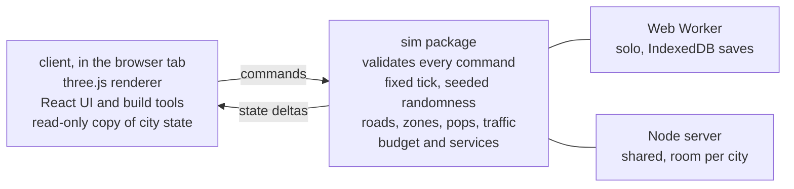

# City Council: Project Map & PRD

Exported from the planning doc on 11 November 2026. Once this file is in the repo, it is the copy to keep current.

## Summary

City Council is a city builder that runs in a desktop browser. One city can be built by several people at once, joined by a shared link. It borrows the feel of Cities: Skylines, with free-form roads, zoning along them, RCI demand, traffic that punishes bad road layouts, and services that cost money.

The plan rests on one bet. The simulation is a headless TypeScript package that takes commands and produces state, and it never touches rendering or the DOM. In single player it runs in a Web Worker. In multiplayer the same package runs on a server. If we hold that line from the first commit, multiplayer becomes a hosting and sync job at the end and not a rewrite.

We build one module at a time, in the order of the roadmap below. Each module ends in something playable and has exit criteria. This doc is the map. When a module starts, it gets its own short spec that links back here.

Four decisions are already made.

| Decision | Choice | What it means |
| --- | --- | --- |
| Map | Procedural terrain | A seed generates land, water and resources. The save file stores the seed, not the heightmap. |
| Roads | Free-form | Straight and curved segments at any angle. Zoning cells grow along road edges. |
| Simulation depth | Grouped pops | Households and workers are grouped into blocks that share a home and a workplace. No per-citizen agents. |
| Multiplayer | One shared city | Everyone edits the same city with one treasury. The owner sets roles. |

## Vision and design pillars

The player is someone who likes Cities: Skylines and wants to build a city with friends without installing anything. They open a link and are placing roads within a minute.

**Roads are the game.** Layout decisions should show up as traffic, land value and commute times. If a player cannot see why a junction is jammed, the traffic module has failed.

**Readable over realistic.** Every number the sim produces must be explainable in an overlay or a tooltip. We prefer a simple model the player can reason about to an accurate one they cannot.

**Built for a browser tab.** The game has to load fast, run on a laptop with integrated graphics, and survive a refresh. That rules out per-citizen simulation and pushes us toward pops and aggregate flows.

**Co-op by default.** Every feature is designed as if multiple people were editing the same city, even before multiplayer ships. That means no hidden local state, no actions that only make sense for one cursor, and an activity log from day one.

### What we take from Cities: Skylines

- Free-form road drawing with snapping, and zoning cells that attach to roads
- RCI demand bars that drive what grows
- Info-view overlays for traffic, land value, coverage and so on
- Service buildings with a coverage radius measured along the road network
- Milestones that unlock buildings as population grows

### What we leave out

- Individual citizens with names and life stories
- Per-vehicle traffic simulation and lane-level AI
- Modding, asset editor and Steam Workshop equivalents
- Disasters, tourism, specialised industry chains and the other DLC-sized systems
- Mobile and touch support in v1

## Goals, non-goals and success criteria

v1 is done when two people can open a link, build a working city of 500,000 residents together, and come back the next day to find it as they left it.

### Goals

- A solo player can grow a city from an empty map to 500,000 residents with a balanced budget.
- Traffic responds to road layout, and a transit line measurably takes cars off a parallel road.
- Services have a visible effect on demand, land value and the workforce.
- A city is shareable by link, with owner, editor and viewer roles.
- The city state survives refresh, disconnect and server restart.

### Non-goals for v1

- Competitive play, trading between cities, or a shared region of several cities
- Social features beyond a link and a display name. Payments, accounts and public online hosting. At launch the project owner runs the only server.
- Photorealistic rendering. Buildings are lightly stylised and generated in code, as described under Art direction.
- A city that keeps simulating while nobody is connected

### Proposed targets

These are starting numbers to tune, not measurements.

| Area | Target |
| --- | --- |
| Frame rate | 60 fps on a 2022 laptop with integrated graphics at 500,000 residents |
| Cold load | Under 5 s to an interactive map on broadband |
| Map size | 12 km × 12 km buildable area |
| Sim tick | 10 ticks per second at 1x speed, under 20 ms of worker time per tick |
| Players per city | 8 editing at once |
| Edit latency | A placed road is visible to other players within 250 ms |
| Save size | Under 10 MB compressed for a 500,000 resident city |

## Business model

The game is free to play locally, and anything that needs a server is paid.

|  | Free | Paid |
| --- | --- | --- |
| Full single-player game | Yes | Yes |
| Where the city is stored | In the browser, on that device | Online, reachable from any device |
| Download and import a city file | Yes | Yes |
| Multiplayer by link | No | Yes |
| Account | None needed | Required |

The split follows cost. A free player's sim runs in a worker on their own machine and their city sits in IndexedDB, so they cost almost nothing to serve. Server CPU and storage are only spent on paying players.

The free tier needs one safeguard. Browsers can evict local storage, and a city does not follow a player to a new browser or computer. So a free player can download their city as a file at any time and import it anywhere. The game asks the browser for persistent storage and reminds the player to download a copy now and then.

Upgrading is a small step. The player's local city uploads to the server and carries on from where it was, which works because the server runs the same sim package.

Only the host of a shared city pays. Friends join by link for free and need no account. Every invite then shows the game to someone new at no cost to them.

The paid tier is a monthly subscription, because the server costs it pays for are ongoing. The price is not set yet. It has to cover one host's share of server time and storage with room to spare, and that share is measured at M5.

If a subscription lapses, the host's online cities become read-only. The host and their guests can still open and look around them, and the host can download each one as a file and carry on playing it locally for free. Nothing is deleted. Resubscribing makes the cities editable again.

**Timing.** Monetisation is not a priority. This section records the intended model so nothing built earlier blocks it, and billing itself is deferred. At launch there is no online tier for the public. The project owner runs the only server and is the only host, and friends join those cities by link. Public hosting, accounts and subscriptions come later.

## Technical architecture

The code splits into three packages. `sim` owns all game state and rules, `client` draws it and collects input, and `server` hosts `sim` for shared cities. `sim` imports nothing from the other two.

The client only sends commands and receives state. Whether the sim sits in a worker or on a server, that exchange is the same.

### Stack

| Layer | Choice | Why |
| --- | --- | --- |
| Language | TypeScript, strict mode | One language across sim, client and server. slop-newyork uses plain JS modules, which is fine for a demo but not for a sim this size. |
| Build | Vite, pnpm workspace | Fast dev server, worker bundling built in |
| Rendering | three.js `WebGPURenderer` with TSL shaders, pinned to `three@0.187.0` (exact, from npm) | Same renderer as [slop-newyork](https://github.com/mrdoob/slop-newyork/). It falls back to WebGL 2 where WebGPU is missing, and `?webgl` forces the fallback. slop-newyork loads the unpinned dev build from a CDN. We pin a version. |
| UI | React over the canvas, Zustand for UI state | Panels, budget tables and toolbars are ordinary web UI |
| Sim runtime | Web Worker in single player, Node on the server | Same package, two hosts |
| Local saves | IndexedDB | No backend needed until multiplayer |
| Server | Node with WebSockets, one room per city | See the multiplayer section for the hosting options |
| Tests | Vitest for sim, Playwright for client walkthroughs | The sim is headless, so most tests need no browser |

### Rules the sim follows

1. **Commands in, state out.** The only way to change the city is a command such as `BuildRoad`, `ZoneCells` or `SetTaxRate`. The UI never mutates state. Every command carries the player id and is validated before it applies.
2. **Fixed tick.** The sim advances in fixed steps, independent of frame rate. Slow systems such as demand, land value and traffic assignment run every N ticks on a stagger, so no single tick is expensive. The heaviest run in background workers, and their results are applied on a fixed later tick so the outcome never depends on timing.
3. **Seeded randomness.** All random numbers come from one seeded generator stored in the state. The same seed and the same command log give the same city on the same machine. That gives us replay tests and bug reports that reproduce.
4. **Flat data.** Roads, cells, buildings and pops live in typed arrays indexed by id, not in object graphs. Snapshots are then a handful of buffers that copy to a worker, a file or a socket with no serialisation step.
5. **State is serialisable at every tick.** No closures, class instances or DOM references in sim state. Save, load and join-in-progress all use the same snapshot format.
6. **The client is a view.** It keeps a read-only copy of state, applies deltas, and interpolates for smooth motion. Cars on screen are drawn by the client along routes the sim has already assigned. The sim does not move them.

### Why this keeps multiplayer cheap

Single player already talks to the sim through a message channel, because the sim is in a worker. Multiplayer swaps that channel for a WebSocket and moves the worker to a server. The client code path is the same.

The message types live in `sim` (`protocol.ts`) and both ends import them. Every message carries a protocol version `v`. The client sends `command` and `requestSnapshot`. The sim sends `snapshot`, `delta` and `commandResult`. A delta carries only what changed: in M0 that is the tick, the speed and new log entries, plus the host's per-system timing of its last step for the debug panel. In the client, a `SimTransport` with `send` and `onMessage` hides whether the other end is a worker or a socket, and a `SimMirror` holds the read-only copy of state. The host steps from real time at 10 Hz times the speed and, after a stall, catches up by at most 8 steps and drops the rest of the missed time. The server is authoritative and sends state deltas, so clients do not need to agree bit for bit and we avoid lockstep.

Build tools show a local preview while a command is in flight, and the server's answer confirms or rejects it. That preview is the only client-side prediction we need.

## Module roadmap

Twelve milestones, built in order. Each one ends in a build you can play, and the next does not start until the exit test passes.

Your list put Map & Zoning first. I split it. With free-form roads, zoning cells only exist along a road, so roads have to come before zoning. Terrain moves into the foundation milestone.

| # | Milestone | Depends on | Exit test |
| --- | --- | --- | --- |
| M0 | Foundation and terrain | none | A seeded map renders with camera controls. The sim runs in a worker, accepts a no-op command, and the state saves and reloads from IndexedDB. |
| M1 | Road networks | M0 | Draw straight and curved roads that snap and form intersections. Delete and upgrade work. Undo works. A pathfinder returns a route between any two connected points. Rail (tram, subway, heavy rail) should be kept in mind so road tools can be reused when rail is going to be implemented. |
| M2 | Zoning and buildings | M1 | Paint R, C, I, O, and M on cells along roads. Buildings appear on zoned cells at a fixed rate and disappear when the road is removed. Each zone can have a level 1-3 which indicates density & impact |
| M3 | Demand | M2 | Growth follows four demand bars for residential, commercial, office and industrial. Pops move in, take jobs, and leave when there are none. An all-residential city stalls. Each cell builds at the density it is zoned for. A first land value orders which lots fill. |
| M4 | Economy | M3 | Taxes, upkeep and construction costs hit one treasury. A monthly budget panel balances. Running out of money blocks building. Allow borrowing. Demolishing an occupied building charges compensation. Property and business taxes and development charges work. The first population milestones unlock density 2 and pay grants. |
| M5 | Traffic | M3 | Commutes load onto roads. A traffic overlay shows congested segments. Widening a road or adding a bypass visibly changes the overlay. Long commutes lower demand. Decorative cars visualize the traffic levels. Assignment stays inside its time budget on a 500,000 resident test city. |
| M6 | Public transport: buses | M5 | Draw a bus line with stops. Pops choose it when it beats driving. Road volume on the parallel route drops. Fares show in the budget. Bike lanes on a street shift short trips from cars to cycling. |
| M7 | Rail transport | M1, M6 | Lay tram, subway and commuter rail track with the same tools as roads. Stations, tunnels and elevated track work. Lines, mode choice and fares from M6 also work for heavy (commuter) rail, trams, and subways. A subway line carries more people per hour than the avenue above it. Off-street bike paths work, and a station reached by bike lanes draws riders from further away. |
| M8 | Services | M4, M5 | Clinics, schools, childcare, fire and police have capacity and network coverage. Each changes a number the player can see, such as health, education level or the share of parents who work. |
| M9 | Utilities | M8 | Power, water and sewage plants are placed on the map and add capacity, with no grid to draw. A shortage lowers demand across the city. Pollution from plants feeds land value and satisfaction. |
| M10 | Multiplayer | M4 minimum | Two browsers edit one city through a server. Roles work. A third player joins mid-game and sees the same city. The project owner moves a local city online. No accounts or payments yet. |
| M11 | Polish and launch | all | Tutorial, sound, a performance pass against the targets above at 500,000 residents, public link. |

M10 is listed late but it can start any time after M4. I would run a short spike right after M1. Host the sim in a Node process, connect two tabs and draw roads together. It costs a few days and tells us early if any sim rule broke the architecture.

There are no dates on these, by choice. The order is the plan, and nobody has been promised a delivery date.

## Module specs: foundation, roads and zoning

### M0 Foundation and terrain

The world unit is one metre. The map is a 12 km square with a heightmap at 16 m resolution, which is 750 × 750 samples. A 4 km map cannot hold 500,000 people at a believable density. A seed generates height, water level, and resource masks for fertile land, forest and ore. Layered noise with an erosion pass is enough for v1.

The ground is coloured by height and slope only. The resource masks are not painted on it; a resources overlay will show them. Forest shows as decorative trees, and open lowland gets grass tufts near the camera. Decoration is placed from the seed by the client, so it is the same on every load and for every player. It is not sim state and nothing in the game reads it.

This milestone also builds the parts every later module leans on.

- The command bus and the worker message protocol
- The snapshot format, with save and load to IndexedDB
- The tick loop with speed controls for pause, 1x, 2x and 4x
- Camera with orbit, pan and zoom, plus ground picking
- A debug panel that shows tick time per system, toggled with the backquote key. The UI shell is React over the canvas, with Zustand for UI state only; components read sim state through the `SimMirror` and a lint rule stops them importing anything that writes state
- Download a city as a file and import it back, so a free player can move browsers or keep a backup

The random generator is xoshiro128**, seeded from the city's 32-bit seed with splitmix32. Its four words of state live in the sim state, so a snapshot carries it.

A snapshot is one byte layout used for local saves, city files and, later, for sending a city to a player who joins. It starts with a 40-byte header: the magic bytes `CITY`, the file format version, the state version (`SNAPSHOT_VERSION`), the seed, the tick, the body length and a 64-bit FNV-1a checksum of the body. The body is a list of named sections, each on an 8-byte boundary. Every typed array in state gets its own section, named by its path, and everything else goes in a JSON section with references to those arrays. A second JSON section holds the log entries that have left live state, so the save keeps the whole activity log. `serialize` and `deserialize` live in `sim`. `deserialize` migrates old state versions up to the current one, and it refuses a save from a newer build, a cut-short save and a damaged one, each with a message a player can read. No compression yet.

In single player the worker loads the most recently opened city from IndexedDB at start (for saves that never recorded an open, the most recently saved), and new cities start from seed 1 until a new-city screen exists. Terrain is rebuilt from the seed. The worker autosaves every 30 seconds, and it also saves when the tab is hidden and when the player presses Save. Each city keeps its latest snapshot and the good one before it. A damaged latest snapshot is reported and the one before it is loaded. A save from a newer version is reported and left untouched, and a new city starts under a new id so nothing writes over it. The page asks for persistent storage and says so when the browser declines.

A city file is the snapshot bytes unchanged, in one file named after the city with the extension `.city`. The worker writes it from live state, so a download works even when IndexedDB does not. Import decodes the whole file before storing anything: a file that is not a city, is cut short, is damaged or is from a newer version is refused with a message and nothing changes. An accepted file is stored under a new id, never over an existing city, and is named after the file, with a number added if the name is taken, so importing one file twice gives two cities. The page then reloads into the imported city. The page reminds the player to download a copy when a city has gone three days of real time without one, counted from the last download or from when the city was first stored. The interval is `EXPORT_REMINDER_INTERVAL_MS` in the client's save config.

Speed is part of the sim state and changes only through the `SetSpeed` command, since in multiplayer there is one sim and one speed. While paused the host keeps stepping at the 1x rate: queued commands still apply, including the one that unpauses, but the tick counter and the systems do not move.

No terraforming in v1. The terrain is fixed after generation, which keeps the save small and removes a class of sync problems.

Terrain is gradient noise on an integer hash: a lowland layer tilted toward a sea on one of eight sides, ridged mountains under a noise mask, and a thermal erosion pass. The water surface sits at the height that leaves 20 percent of the map under water. If less than 45 percent of the map is dry and no steeper than 10 percent, the relief is scaled down and the map shaped again. These numbers live in `packages/sim/balance/terrain.json`. The code in `packages/sim/src/terrain/` uses only exact operations, and lint bans the other `Math` functions there. The same seeds hash the same in Node, Chromium and JavaScriptCore, so the save stores only the seed and the fallback of saving the heightmap is not needed.

### M1 Road networks

Roads are a graph of nodes and segments. A segment is a straight line or a single curve between two nodes, with a road type. Each type sets the lane count, speed, capacity, cost and upkeep.

| Road type | Lanes | Notes |
| --- | --- | --- |
| Street | 2 | Zonable on both sides |
| Avenue | 4 | Zonable, higher capacity |
| One-way | 2 | Zonable, needed for sane junction design |
| Highway and ramps | 3 per direction | Not zonable. Lands with traffic in M5. |

The build tool needs most of the work here.

- Straight, curved and continuous drawing modes
- Snapping to nodes, segments, angles, the terrain grid and existing zoning cells
- Splitting a segment when a new road crosses it, which creates an intersection
- Slope limits against terrain, and automatic bridges over water above a height
- Upgrade in place, bulldoze, and a cost preview before the click

The sim side stores the graph in typed arrays and keeps a spatial index for snapping and picking. It also derives a routing graph with one edge per direction per segment. That is enough for pops and aggregate traffic, so we do not model individual lanes.

The map has two or three fixed highway connections at its edge. They are where new residents and outside trade arrive.

### M2 Zoning and buildings

Every zonable segment generates 8 m cells along both sides, six cells deep. Where two roads compete for the same ground, the older segment keeps its cells. Cells are blocked by water, steep slopes and other roads.

The player paints cells with a zone type. v1 has five, each at three densities.

| Zone | Low density (1) | Medium density (2) | High density (3) |
| --- | --- | --- | --- |
| Residential | Houses | Mid Rise Apartments / Townhomes | High Rise Towers |
| Commercial (selling goods and services) | Corner store / Small business / Bars & Restaurants | Retail and mixed blocks / Small shopping malls / Strip malls / Small office parks | Large retail complexes |
| Office (producing services) | Small offices (dentist / accountant / lawyer / hair salon) | Mid-rise office towers  | High Rise office towers |
| Industrial (producing goods) | Small factory | Medium factory | Large factory |
| Mixed | Small 2-3 story buildings with commercial on the ground and residential above | Mid Rise towers with commercial on the lower levels and residential above | High rise towers with commercial and office space in the lower levels and residential up top |

A building is a rectangle of same-zone cells from 1 × 1 up to 6 × 6, with a level from 1 to 3. The grower picks a free lot beside a road, picks a footprint that fits, and spawns a building when demand for that zone is positive. Meshes are generated boxes with a few roof and facade variants per zone and level, drawn with instancing.

#### Residential building types

Each residential zone spawns its own kinds of housing, and the size of the lot decides which kind. A lot is a rectangle of free cells with the same zone and density, fronting a road. Width runs along the road and depth runs back from it.

Lots are counted in cells, and a cell is 8 m on a side. A 2 × 4 lot is 16 m by 32 m, a 4 × 4 lot is 32 m by 32 m, and the largest, 6 × 6, is 48 m by 48 m, or about 2,300 m².

| Zone | Building | Lot, width × depth in cells | Residents |
| --- | --- | --- | --- |
| R1 | Single family home | 1 to 2 wide, 2 to 4 deep | 1 to 4 |
| R1 | Duplex, triplex or fourplex | 3 wide, 3 to 5 deep | 8 to 16 |
| R2 | Townhomes, a row of one to five | 1 to 5 wide, 2 to 3 deep | 4 to 20, at 4 per home |
| R2 | Low-rise to mid-rise apartments | 3 to 4 wide, 4 to 6 deep | 50 on the smallest lot, rising to 100 |
| R3 | Low tower | 4 × 4 up to 4 × 6 | 300 to about 550 |
| R3 | High tower | 5 × 5 up to 6 × 6 | about 600 up to 1,000 |

The lot sizes are my starting proposal. The resident numbers are fixed by design.

How the grower chooses:

1. It finds the free zoned cells beside a road and takes the largest lot that fits a building type for that zone.
2. The lot's shape picks the type. In R1 a wide lot gets a plex and a narrow one gets a house. In R2 a shallow lot gets townhomes and a deep one gets apartments. In R3 a bigger lot gets a taller tower.
3. Within a type, residents scale with lot area between the low and high figure. For a single family home the number is drawn per building, so a street of houses holds households of different sizes.

So the player shapes housing through how they lay out blocks and how deep they paint. Shallow R2 strips along a street become townhomes. A deep R2 block becomes apartments. An R3 lot smaller than 4 × 4 is too small for a tower and stays empty, and the zoning overlay marks it so the player can see why.

Per cell, this runs from about 0.3 residents for a house, through about 4 to 6 for apartments, to about 20 to 28 for towers. A city of houses alone tops out far below 500,000 on this map, which is intended.

**Note on tower height.** A residential tower's floor plate is around 750 m², which fits a 48 m lot with room for a podium. At that size, 1,000 residents takes roughly 55 storeys. That is the top of the range, and most R3 buildings should sit well below it.

**Note on large commercial and industrial lots, to settle in the M2 spec.** The 6 × 6 cap is fine for housing and offices but too small for a big-box store, a mall or a large factory, and zoning is only six cells deep. The proposed fix is a through-lot. When a block between two parallel roads carries the same zone and density on both sides, the grower may merge the two back-to-back strips into one lot up to 12 cells deep, which is 96 m. Large commercial and industrial buildings may then use lots up to 12 × 12 cells. Zoning depth stays at six cells.

Removing a road removes its cells and their buildings. The pops inside are displaced and look for a new home or job.

#### Art direction

The look to aim for is the first Cities: Skylines. That means clean, lightly stylised buildings with readable shapes and soft colours, not photorealism. We build our own models in that spirit and do not copy its assets.

**Colour variation.** One house model appears in many colours, as it does in that game. Each model marks which of its surfaces can be tinted, such as brick, siding, roof and trim. Each building picks a tint for each from a small palette that suits the building type. The pick comes from the building's id, so the same house is the same colour for every player and after every reload. With instanced drawing this is one extra colour per building and costs almost nothing.

**Themes.** A theme is a data pack of models, palettes and street furniture, kept apart from the sim. v1 ships one North American theme. A European theme is planned for v2 and should need no code changes.

| Zone | North American theme, v1 |
| --- | --- |
| Residential | Detached houses with driveways, townhomes and mid-rise apartments, glass and concrete condo towers |
| Commercial | Corner stores, strip malls with parking in front, big-box retail and malls |
| Office | Converted houses and low office blocks, mid-rise slabs, glass towers |
| Industrial | Workshops, warehouses, large plants with yards |
| Mixed | Brick walk-ups over shops, podium towers with retail at the base |

The model count stays small. Three or four models per zone and density, each with a few palettes, already give a varied street. They can start as simple shapes in M2 and be replaced with better models later without touching the sim.

**Where the models come from.** Claude generates them, as code. Each building type is a small generator function that builds its geometry from parameters such as footprint, floors, roof shape, window rhythm and porch or storefront. Surface detail like brick, siding and glass comes from shaders, not image files.

This suits the project in three ways. The models are text in the repo, so they are MIT like everything else and anyone can review or change one in a pull request. The download stays tiny, because no mesh or texture files ship. And one generator yields many buildings, since changing its parameters gives a different house.

The limit is worth stating plainly. Code-built models are clean and regular, which fits this art direction at district and city zoom. Up close they will look simpler than hand-modelled assets. If street-level detail later matters more, authored models can replace individual generators, because the theme pack is the only thing that knows where a model came from.

#### Rezoning

Rezoning changes what is permitted on a cell. It does not remove what already stands there.

| Situation | What happens | Cost to the city |
| --- | --- | --- |
| Empty zoned land | Builds at its zoned density as soon as demand is above zero | None |
| Built land, zoned up to a higher density | The existing building stays. Each one redevelops on its own over time, sooner where land value and demand are high. | None |
| Built land, zoned down or to another use | The existing building stays indefinitely as a permitted existing use. The new zoning applies only once the building is abandoned or cleared. | None |
| Built land, cleared by the player | The building is demolished and the lot rebuilds under its current zoning straight away | Eminent domain, priced in M4 |

The rezoning command itself is free and instant. The player then chooses between waiting for owners to redevelop, which is cheap and slow, and paying to force it, which is expensive and immediate.

Redevelopment is the one place a land-value check applies to construction. A building is replaced when the new one would be worth clearly more than the old. Tenants of a redeveloped building are displaced and look for a new home or job, at no cost to the city.

Rezoning has to stay cheap. Every city starts at density 1, because densities 2 and 3 unlock later. If built land could only densify through expropriation, growth toward 500,000 would stall.

## Module specs: demand and economy

### M3 Demand

A pop is a block of people who share a home building, a workplace and a profile. It is the unit the whole sim counts in.

| Pop field | Values | Used by |
| --- | --- | --- |
| Home building | building id | Traffic origin, service coverage |
| Workplace | building id, or none if unemployed | Traffic destination, demand |
| Size | 1 to about 100 people, set by the home building's density | Everything |
| Education | Low, medium, high | Which jobs it can take |
| Wealth | Low, medium, high | Taxes, value of time in mode choice |
| Has children | yes or no | Schools and childcare in M8 |
| Satisfaction | 0 to 100 | Whether the pop stays, demand, land value. Specified in M8. |

Pop size is what makes 500,000 residents affordable. A house is one small pop. A plex or a townhome row is a few pops. A tower of 1,000 residents is ten or more pops of up to 100 people each, split by where they work. A full-size city is then between about 40,000 and 150,000 pops, more when it is mostly houses and fewer when it is mostly towers. Either fits in a small typed array, and traffic works on zones and not on pops.

#### What each zone supplies

The five zones from M2 play different parts in the economy.

| Zone | Holds | Jobs it offers | What density changes |
| --- | --- | --- | --- |
| Residential | Pops | None | People per cell, pop size, traffic generated |
| Commercial, selling goods and services | Shops | Low and medium education | Customers served, freight received, traffic attracted |
| Office, producing services | Offices | Medium and high education | Jobs per cell. Almost no freight. |
| Industrial, producing goods | Factories | Low and medium education | Jobs per cell, freight shipped, pollution radius |
| Mixed | Pops above, shops below. Offices too at density 3. | Same as commercial, plus office at density 3 | Both of the above. Many trips stay inside the building or the block. |

Your table gives each zone a density from 1 to 3, set by the player. So density is zoned, not grown. What you zone is what gets built. That holds for empty land. Built land follows the rezoning rules in M2, where existing buildings stay until their owners redevelop or the city clears them. The "impact" half of your note is the last column. Higher density means more traffic, more service load and more noise per cell.

#### Four demand bars

Each runs from -100 to 100 and is recomputed about once per game day.

- **Residential** rises with open jobs and falls with unemployment, high residential tax, long commutes and poor services.
- **Commercial** rises with resident spending power and available workers, and falls when shops outnumber customers.
- **Office** rises with the supply of educated workers and with the number of residents and businesses that buy services. Newcomers arrive with a mix of education levels, so small offices can grow from the start. Large office districts need local schools to raise that mix.
- **Industrial** rises with unemployed low and medium education workers, with commercial buildings that need goods, and with a good outside connection for exports.

Mixed has no bar of its own. A mixed building grows when residential and commercial demand are both positive, and it satisfies some of each.

Positive demand lets the grower spawn buildings in that zone and brings pops in through the outside connections. Negative demand makes pops leave and buildings go vacant, then get abandoned.

Which density gets built depends only on the zoning. A cell zoned R3 gets an R3 building as soon as residential demand is above zero. There is no climb through densities 1 and 2, and no check on how strong demand is. The one gate is a population milestone that unlocks painting density 2 and density 3 in the first place.

#### Job matching

Job matching borrows from [Subway Builder](https://www.subwaybuilder.com/simulation), which assigns workplaces with a distance-based gravity model. A pop looking for work picks among open jobs it qualifies for, weighted toward nearer ones by travel time. This gives realistic cross-town commutes without hand tuning.

One correction to the question I asked you at the start. I described Subway Builder as using grouped pops. Its page says it simulates millions of individual commuters. We borrow its demand and mode-choice ideas, not its agent model. At 500,000 residents, pops matter even more.

Before M5 exists, commute length uses free-flow travel time from the M1 pathfinder.

### M4 Economy

One treasury per city. The budget closes once per game month.

| Income | Expenses |
| --- | --- |
| Residential tax on property value | Road and rail upkeep per metre by type |
| Commercial tax | Service and utility building upkeep |
| Office tax | Transit operating cost |
| Industrial tax | Loan repayments and interest |
| Transit fares, from M6 | Construction, charged at placement |
| Milestone grants |  |
| Development charges, a lump sum per new building |  |

Each zone type has a tax slider, and each feeds back into that zone's demand. The base differs by zone.

- **Residential** pays a yearly rate on property value. Property value comes from building size and land value, so dense and desirable homes pay more.
- **Commercial** pays a rate on sales, which follow the customers a shop serves.
- **Office** pays a rate on output, which follows the jobs it has filled.
- **Industrial** pays a rate on output, which follows the goods it ships.
- **Mixed** buildings pay property tax on their homes and sales tax on their shops.

Business tax follows activity. A shop customers cannot reach, or a factory stuck behind congestion, pays less, so traffic problems show up in the budget. Rates and their ranges live in the balance file. Service budgets are a slider per service that scales capacity and cost together.

**Development charges.** When a private building is constructed, its developer pays the city a lump sum. The charge scales with the building's size, so a tower pays many times what a house pays. Redevelopment pays only on the floor space it adds.

The player sets the rate with one slider per zone type. A higher rate brings in more per building but slows construction in that zone, because fewer projects are worth building. At zero the city grows fastest and collects nothing.

This money arrives when the city grows and stops when growth stops. A fast-growing city can fund new roads and schools from charges alone, then find its yearly budget does not cover their upkeep once building slows. That is a real trap for real cities, and it pairs with the suburb subsidy below. The budget panel shows charges on their own line, apart from recurring tax, so the player can see how much of their income depends on growth.

Tax scales with density. Cost to serve mostly does not. A street costs the same to maintain whether it fronts ten houses or ten towers, and the same goes for the bus that runs along it and the clinic at the end of it.

So low density roughly breaks even and the dense core carries the city, as in real life. Starting ratios to tune:

| Density | Tax per cell | Net after its share of roads and services |
| --- | --- | --- |
| 1 | 1x | About zero. Slightly negative on long cul-de-sacs and wide roads. |
| 2 | About 10x | Clearly positive |
| 3 | About 50x | The city's main income, but only where transit and services keep it full |

This comes from the cost model and not from a penalty on suburbs. Upkeep is charged per metre of road and per service building, and tax is collected per resident and per job. A suburb simply has few taxpayers per metre of road. A compact low-density grid can still pay for itself, and a sprawling one cannot.

A budget overlay shows net income per block, tax minus the upkeep of the roads and services that block uses. The player can see which districts pay for which.

One thing to watch is the early game. A new city is all density 1, so it must be able to break even before density 2 unlocks. The starting grant covers the first roads, and density 2 unlocks at a low population.

**Borrowing.** The city can take loans. Each loan has a principal, an interest rate and a term, and repays monthly. The credit limit grows with population and with the last year's tax income, so a large city can borrow for a subway line and a small one cannot. Two or three loans can be open at once.

#### Eminent domain

Demolishing an occupied private building is expensive. The city pays compensation, and the price appears in the tool preview before the click.

| What is removed | Cost |
| --- | --- |
| Occupied home, shop, office or factory | Building value, plus a relocation payment per displaced resident or job, plus a premium on top |
| Abandoned or vacant building | Demolition cost only |
| City-owned building, road or track | Demolition cost only, with part of the build cost refunded |
| Empty zoned cells | Free |

Building value rises with density and land value, so clearing a block of towers downtown costs many times what a row of houses costs at the edge.

The charge applies however the building goes. Bulldozing it directly, removing the road it fronts, widening a road into its lot and driving a highway or rail line through it all count. Rezoning does not, because it only changes what is permitted. The existing building stays until its owner redevelops, and nobody is expropriated. Forcing a rezoned lot to change now means demolishing it, and that is charged.

This changes how the game plays, and that is the point.

- Reserving a corridor for a future avenue or rail line while land is empty is cheap. Cutting one through a built-up district later is not.
- Subways cost more to dig than surface rail, but they pass under buildings without buying them. In a dense core that often makes the tunnel the cheaper option.
- In multiplayer, one player cannot casually flatten a district. The cost hits the shared treasury and the activity log names who spent it.

**Satisfaction.** Expropriation should also hurt politically. Satisfaction is a per-pop score, specified in M8. Displaced pops and their neighbours within a few blocks take a hit to it that fades over a game year or so, scaled by how many people were moved. The sim records every expropriation with its location and the number displaced, so the hit can be traced in the overlay.

#### Prices in 2026 dollars

Money in the game is real money. Build costs, upkeep, taxes and budgets are set from published North American figures and shown in in-game dollars. The currency is not tied to a real one, so US and Canadian sources sit side by side with no conversion. A subway line costs billions and the player feels it.

The reference figures below are the starting point. They come from different years and some rest on a single project, so each row says what it is.

| Item | Reference figure | Basis | Source |
| --- | --- | --- | --- |
| Urban arterial, 4 to 6 lanes | $2.8M to $4.2M per km | 2023 costs, one city's fee study | [City of Phoenix](https://web-prod.phoenix.gov/content/dam/phoenix/pddsite/documents/impact-fees/2025-if-update/Major%20Arterial%20IIP%20Final.pdf) |
| Urban freeway | $3M to $12M per lane-km, more with bridges and interchanges | Undated, no primary source. Low confidence. | [The Pricer](https://www.thepricer.org/how-much-does-a-lane-of-highway-cost/) |
| Transit bus | About $500,000 diesel, about $1.1M battery-electric | US median prices, 2024 | [Brookings](https://www.brookings.edu/wp-content/uploads/2025/09/Paying-Less-for-Public-Transit-Buses.pdf) |
| Light rail | About $520M per km | Austin Phase 1, $8.23B for 15.8 km. One project, on the high side. | [FTA project profile](https://www.transit.dot.gov/sites/fta.dot.gov/files/2025-11/TX-Austin-Light-Rail-Phase-1-Profile-AR26-11-19-25.pdf) |
| Subway, tunnelled | About $320M per km for a US example. $80M to $200M per km in lower-cost countries. | Boston Red Line extension, and international projects in 2020 dollars | [Transit Costs Project](https://transitcosts.com/?p=14795) |
| Elementary school | About $51M each | North Carolina contract average, 2025, three schools | [NC DPI](https://www.dpi.nc.gov/documents/schoolplanning/nc-school-construction-costs-year-2020-2025/download) |
| High school | About $105M each | Same source, 2025, two schools | [NC DPI](https://www.dpi.nc.gov/documents/schoolplanning/nc-school-construction-costs-year-2020-2025/download) |
| Hospital | $1.5M to $3M per bed | Industry guide, not checked against primary data | [iRecruit guide](https://www.irecruit.co/guides/hospital-construction-cost-per-bed) |
| Power plant | Gas $1,176 to $1,330 per kW, solar $1,448, onshore wind $2,098 | 2022 dollars | [EIA](https://www.eia.gov/aeo/assumptions/pdf/elec_cost_perf.pdf) |
| Water treatment plant | About $2.5M per million gallons a day | One project, $50M for 20 MGD | [EPA](https://www.epa.gov/node/242229) |
| City operating budget | Toronto C$18.9B for 2026, Chicago $16.6B for FY2026 | Adopted budgets | [City of Toronto](https://www.toronto.ca/news/city-of-torontos-2026-budget-now-final-focuses-on-affordability-service-stability-and-financial-sustainability/), [Civic Federation](https://civicfed.org/chicagos-fy2026-adopted-budget) |

Older figures need raising. The US highway construction cost index rose about 59 percent from mid 2021 to the end of 2025, according to the [Eno Center](https://enotrans.org/?p=72173). The balance file stores each price with its source year and applies one escalation factor to reach 2026.

Still to price, because the research found no usable source: local two-lane streets, commuter rail per km, bus operating cost per hour and household property tax.

What this does to the game:

- **Income has to be real too.** Toronto's budget works out to roughly C$6,000 per resident a year. A 500,000 resident city at that rate has a budget near $3B a year, most of it already spoken for by upkeep and services.
- **Big projects cannot be paid from cash.** A 10 km subway at $320M per km is $3.2B, about a year of the whole city's budget. Loans from the Borrowing section become the normal way to build rail, hospitals and freeways.
- **Grants from above.** Real cities rarely pay for rapid transit alone. Higher levels of government fund part of the city, and the grants are part of progression. Each population milestone pays a one-time grant. Later milestones add standing programs that cover a share of rail, freeway and hospital projects. Without them, rail may never be affordable at honest prices.
- **Upkeep is a share of build cost.** Each asset's yearly upkeep is a fixed percentage of what it cost to build, tuned per type. Cheap roads laid everywhere become the suburb subsidy described above.
- **Numbers need short forms.** The UI shows $3.2B and $480M, never a row of zeros.

Construction is instant in v1, and the full price is charged at the click. Construction that takes time and is paid in stages is deferred to v2.

The treasury cannot go below a small overdraft. Past that, building and zoning commands fail with a clear message, and upkeep keeps running. There is no game over in v1. A broke city shrinks until it balances.

Game time starts at one game day per 10 seconds at 1x, which is 100 ticks, so a month is about five minutes and a budget cycle fits in a play session. The calendar has 365-day years with no leap years and starts on 1 January, Year 1. The date is worked out from the tick alone (`gameDate` in `sim`, numbers in `balance/time.json`), so every host shows the same date. We tune the day length once M4 is playable.

**Pacing.** The target is 500,000 residents after about three weeks of playing one to two hours a day. That is roughly 30 hours of play, or about 17,000 new residents per hour, when demand is healthy. At one game year per hour it is about 30 game years. Growth is never guaranteed. It follows demand, so a badly run city grows slower or shrinks.

## Module specs: traffic, buses and rail

### M5 Traffic

Traffic is computed as flows on road segments, not as vehicles. Each pop with a job produces a commute. Households produce shopping trips to commercial and mixed buildings. Industry ships freight to commercial buildings and to the outside connections. Offices produce almost no freight.

The day is split into four periods, which are morning peak, midday, evening peak and night. Each period has its own share of trips. Commutes go to work in the morning peak and home in the evening peak.

The screen shows permanent daylight in v1. The four periods are still computed, because peak traffic is what breaks a road network. The traffic overlay and the cars on screen show the morning peak by default, and a picker switches to the other periods. A visible day and night cycle is deferred to v2.

#### Traffic zones

A 500,000 resident city has around 100,000 buildings. Routing between every pair of them is out of reach, so trips are grouped first. The map is cut into traffic zones about 250 m across, which is roughly 2,300 zones on a 12 km map. Every building belongs to one zone, and each zone connects to its nearest road nodes.

Most zone pairs have no trips between them, so the trip table is stored sparse. A short trip inside one zone loads straight onto the local streets.

#### Assignment

Assignment runs per period.

1. Collect trips into origin and destination pairs between traffic zones.
2. Route each pair on the routing graph with current travel times.
3. Add the pair's volume to every segment on its route.
4. Recompute each segment's travel time from its volume and capacity with the standard BPR curve, `t = t0 × (1 + 0.15 × (v/c)^4)`.
5. Repeat with a share of trips re-routed each pass until volumes settle.

Three things keep this inside the budget at full size.

- It runs in its own worker thread, apart from the main sim tick, and hands back finished segment volumes about once per game day.
- Only pairs touched by a road change, a new line or a shifted pop get re-routed.
- Long trips route on a coarse graph of arterials and highways, then on local streets only at each end.

Intersections add a fixed delay by type. Signals cost more than a priority junction, and a roundabout or a grade-separated ramp costs less. That is what makes junction design matter without lane simulation.

What the player sees:

- A traffic overlay that colours segments by volume over capacity
- A click on any segment that shows where its traffic comes from and goes to
- Cars that each stand for a real pop. When the camera is at street level, the client picks trips passing through the view in proportion to volume. Each car drives the route the assignment gave that trip, from the pop's home to its workplace, slower where the road is congested. Clicking a car shows who it is and where it is going, and the camera can follow it.

The cars are still drawn by the client and not simulated. The sim already knows each pop's home, workplace, mode and assigned route, so the client only has to look them up and animate along them. A pop of 80 people may show as a few cars, not 80. Transit riders and cyclists appear the same way once M6 exists, so a followed commuter can walk to a stop, ride and transfer.

What it feeds back into:

- Average commute time lowers residential demand
- Congestion near a building lowers its land value
- Freight delay lowers industrial and commercial demand

Roads alone cannot carry a dense city. A density 3 district produces more peak trips than any avenue can move, and that is deliberate. It is what makes M6 and M7 necessary and not optional extras.

### M6 Public transport: buses

This milestone builds everything transit needs except track. A line is an ordered list of stops with a vehicle count. Headway comes from line length and vehicle count, and capacity from the vehicle type.

Mode choice follows Subway Builder's method. For each trip, compare the perceived time and money cost of driving, transit and walking, and split the pop's trips between them. Its page publishes perceived-time weights relative to riding a train, and they are a sensible starting table.

| Activity | Perceived time, relative to riding |
| --- | --- |
| Riding transit | 1.0 |
| Walking | 1.39 |
| Waiting at a stop | 1.37 |
| Driving in congestion | 1.33 |
| Parking | 1.6 |

Money converts to time through the pop's wealth band, so wealthy pops need a much faster line before they leave the car. Subway Builder does the same with per-commuter income. Parking gets scarcer and dearer as density rises, which pushes dense districts toward transit.

Subway Builder routes on real timetables with the RAPTOR algorithm. We do not need timetables. A frequency-based transit graph is enough, where boarding a line costs half its headway and a transfer costs a walk plus another wait. If a pop splits 60/40 between car and bus, 60 percent of its trips load onto roads and the rest onto the line.

Lines have capacity. An overloaded line adds waiting time, which pushes riders back to cars on the next assignment pass. Buses use the road graph, so they sit in the congestion they are meant to relieve unless the player builds bus lanes. Bus lanes are a road type added in this milestone.

The overlay shows riders per line and per stop, and the budget shows fares against operating cost.

#### Cycling

Cycling is a fourth mode in the same comparison as driving, transit and walking. It has no vehicles to simulate. It is one more share of each pop's trips.

Every road segment gets a cycling attribute. It is a property of the segment and not a new road type, so the road list does not double.

| Cycling attribute | Cost | Effect |
| --- | --- | --- |
| None | Free | Cycling is possible but carries a comfort penalty that grows with the road's speed and traffic |
| Painted lane | Low | Small penalty |
| Protected lane | Moderate | No penalty. Takes road width, so on a narrow street it replaces a car lane or parking. |

Cycling time is distance over a fixed speed, plus the comfort penalty along the route and a steep penalty for hills. It competes mainly for trips under about 5 km. Those trips only exist where homes, shops and jobs are close, so cycling pays off in mixed and dense districts and does little in sprawl.

At honest prices a bike lane costs a tiny fraction of a rail line. That gives a small or broke city a real way to cut traffic.

The Subway Builder table has no cycling weight. The cycling weight, the comfort penalties and the 5 km range are my starting guesses and need a source before balancing.

The cycling overlay shows riders per segment and where the lane network has gaps.

### M7 Rail transport

Rail is what lets a city pass a few hundred thousand residents. One subway line moves more people per hour than several avenues, and it does not share their congestion.

Track is a second network type in the same graph that holds roads. It uses the M1 tools for drawing, snapping, curves, splitting, upgrading and bulldozing. For that to work, M1 has to keep three things general from the start.

- Segments carry a network type of road, rail or path, so the pathfinder can filter by it
- Segments carry a vertical level, so tunnels and elevated sections are data and not special cases
- Curve and slope limits come from the segment type, since rail needs wider curves and gentler grades than a street

| Mode | Runs on | Stops | Capacity and cost | Role |
| --- | --- | --- | --- | --- |
| Tram | Track in the street, or its own surface strip | Close together | Medium capacity, cheap | Dense corridors inside districts |
| Subway | Tunnels and elevated track | Stations with entrances at street level | High capacity, expensive to dig | The backbone of a large city |
| Commuter rail | Its own surface right-of-way | Far apart, large stations | High capacity, fast | Suburbs to the centre, and the outside connection |

Lines, headways, mode choice, capacity and fares all come from M6 unchanged. A rail line is a line whose vehicles run on track. What M7 adds:

- Track segment types, with tunnel and elevated variants and their costs
- An underground view for laying and inspecting tunnels
- Stations as placed buildings that join track to the street network, with a walking catchment
- Depots, which cap how many vehicles a line can run
- Transfers between lines and modes at shared or nearby stations
- A rail connection at the map edge, so commuters and new residents can arrive by train

M7 also finishes cycling with two additions that need the network work done here.

- **Off-street paths.** A third network type beside road and rail, drawn with the same tools. Paths are cheap and not zonable, and they can cut through parks and along water where no road goes.
- **Bike to transit.** A station's catchment grows from walking distance to cycling distance wherever lanes or paths reach it. Each station then serves far more people, which is the most valuable thing cycling does for a large city.

Stations raise land value around them. That is the player's cue to rezone the blocks around a stop to a higher density.

Freight rail and passenger capacity on the same track is a tempting addition. I would leave it until after v1.

## Module specs: services and the rest

### M8 Services

Every service building has a capacity, an upkeep cost and a catchment measured in travel time along the road network. A clinic across a river with no bridge serves nobody on the far bank. One shared coverage system handles all services, so adding a new one is mostly data.

| Service | Buildings | Serves | Effect when covered | Effect when missing |
| --- | --- | --- | --- | --- |
| Healthcare | Clinic, hospital | All pops | Health score up, which raises land value and residential demand | Pops lose work days, then leave |
| Education | Elementary, high school, university | Pops with children, then young adults | Pops gain education level over time and qualify for office jobs | The workforce depends on educated newcomers, and office demand stays low |
| Childcare | Daycare | Pops with children | Both parents can work, which raises labour supply and household income | Half the pop's workers stay home |
| Fire | Fire station, fire headquarters | All buildings within response time | Fires are put out before a building is lost. Land value up. | Buildings burn down and their pops are displaced. Industry and dense blocks are most at risk. |
| Police | Police station, police headquarters | All buildings within response time | Crime stays low, which holds up land value and commercial demand | Crime rises with unemployment and density. Shops close and residents leave. |

Childcare is the unusual one and worth getting right, because it turns a service into a labour-market lever. Few city builders model it.

It is also the cheapest of the three to build. It uses the shared coverage check, and its whole effect is one multiplier on how many people in a pop with children can hold a job. If balancing it proves awkward, it can be cut without touching anything else.

Density sets the load. A density 3 residential block needs many times the school and clinic capacity of a block of houses on the same land. Each service therefore comes in a small and a large building, so a big city is not carpeted with 400 clinics.

School trips load onto the traffic model like commutes, so a school on a cul-de-sac causes the jam it would in real life. Older students can ride transit.

Fire and police are in v1. Both use response time and not a simple radius, so a station behind a jammed road covers less ground, and congestion becomes a safety problem as well as a commute problem. Fires are random events weighted by building type, and crime is a per-cell value. Parks use the same coverage system and are also in M8, because they are nearly free to build. Garbage collection comes after v1.

#### Satisfaction

Satisfaction is a score from 0 to 100 held by each pop. It is per pop because everything that feeds it depends on where the pop lives and works.

| Input | Comes from | Arrives in |
| --- | --- | --- |
| Has a job, and one that fits its education | Job matching | M3 |
| Tax rate on its home | Economy | M4 |
| Commute time, and congestion on its street | Traffic and mode choice | M5 to M7 |
| Coverage by clinic, school, childcare, fire and police | Services | M8 |
| Parks nearby | Services | M8 |
| Pollution and noise at home | Industry, plants, busy roads | M9 |
| Power and water shortages | Utilities | M9 |
| Recent displacement of itself or neighbours | Eminent domain and redevelopment | M4 on |

The score is a weighted sum of these, recomputed about once per game day. Weights differ by profile. A pop with children weighs schools and childcare heavily, and a wealthy pop weighs taxes and noise more than a poor one does.

The field exists on every pop from M3 with only the job input. Each later milestone adds its inputs, so there is never a separate satisfaction build.

What it drives:

- **Staying or leaving.** A pop whose score stays low for long enough moves out. This replaces the separate leave rules scattered through earlier modules.
- **Demand.** Average satisfaction of residents feeds residential demand, so a well-run city attracts people faster.
- **Land value.** Blocks full of satisfied pops are worth more.
- **An overlay and a click-through.** The map colours homes by satisfaction. Clicking a building lists what is pulling its residents' score up and down, which is the readable-over-realistic pillar applied to people.

The city-wide average is shown as an approval rating in the top bar. It is only a summary of the pops and has no logic of its own. If council votes arrive after v1, they can read from it.

### M9 Utilities

#### Utilities

Power and water are buildings you place on the map. Nothing connects them. There are no power lines, pipes or substations to draw.

Each plant adds to a city-wide supply. Each building adds to city-wide demand according to its zone and density. If supply covers demand, every building is served, wherever it stands.

| Utility | Buildings | Placement rule | Local effect |
| --- | --- | --- | --- |
| Power | Coal or gas plant, wind farm, solar farm, and a larger plant unlocked later | Any flat land with road access. Wind and solar need open ground. | Fuel plants pollute and lower land value nearby |
| Water | Pumping station, water tower | Pumping station on a shoreline. Tower anywhere. | None for towers. Pumps downstream of a sewage outlet lose capacity. |
| Sewage | Outlet, treatment plant | Outlet on a shoreline | Outlets pollute water. Treatment plants cost more and do not. |

So the decisions left to the player are how much capacity to buy, which type, and where to put it. Placement still matters because of pollution, noise and the land the plant takes up.

A shortage is city-wide and shows as a warning with the size of the gap. It lowers demand and land value everywhere until capacity catches up. At 500,000 residents the player will have built many plants, and larger plant types unlock with milestones so the count stays manageable.

### Land value and progression

Neither is a milestone. Both start small in M3 and M4 and gain inputs as modules ship, the same way satisfaction does.

#### Land value

A per-cell value computed from service coverage, parks, transit stations, congestion, pollution and distance to water. It does two jobs.

- It sets the order lots fill in. When demand is positive, the highest-value zoned lots get built on first. It does not change which density is built on empty land. On rezoned built land, it decides how soon an owner redevelops.
- It sets the wealth of pops a residential building attracts and the tax a building pays.

| Land value input | Arrives in |
| --- | --- |
| Road access, distance to water and to the city centre, pollution from industry | M3 |
| Congestion and road noise nearby | M5 |
| Bus stops, then rail stations | M6, M7 |
| Service coverage, parks, crime, satisfaction of residents | M8 |
| Pollution from power and sewage plants, utility shortages | M9 |

#### Progression

The milestone system is built in M4, where its first jobs are the starting grant and unlocking density 2. Each later module registers its own unlocks. Population milestones unlock road types, densities, rail modes, services, larger plants and bigger loans. Each one also pays a grant from a higher level of government, and the later ones open cost-sharing programs for rail, freeways and hospitals. They pace the tutorial and stop the build menu overwhelming a new player. With a 500,000 ceiling there is room for about ten milestones, with density 3 and subways arriving in the middle of the curve.

### Running through every milestone

These are not milestones of their own. Each module adds its piece.

- **Overlays.** Every sim value that affects growth gets an info view. This is how the readable-over-realistic pillar is enforced.
- **Activity log.** Every command is recorded with who issued it and when. It is the undo stack in single player, and in multiplayer it answers the question of who bulldozed the hospital. Live state keeps the newest 4,096 entries and drops the oldest 1,024 at a time past that. The host reads new entries after each step and keeps the full log in the save, so a replay always has every command. To make that safe, the sim refuses a command once 1,024 are already queued for the next step, so no single step can push entries out before the host has read them.
- **Save format versioning.** Each module that adds state bumps `SNAPSHOT_VERSION` and adds a migration to the registry in `packages/sim/src/migrate.ts`, with a test. A change to the byte layout itself bumps `SNAPSHOT_FORMAT_VERSION` instead. Committed snapshot fixtures for each version keep old saves loading.
- **Balance data in files.** Costs, capacities and weights live in JSON, not in code, so tuning does not need a developer.
- **Scale checkpoints.** Each milestone from M3 on is measured on generated test cities of 50,000, 200,000 and 500,000 residents before it closes.

### After v1

Policies and districts fit the name. A council vote on a tax change or a large spend would be a good multiplayer feature once the base game holds up. Also on the list are construction that takes time and is paid in stages, a visible day and night cycle, a European building theme, subscriptions and billing, garbage collection, terraforming, freight rail, ferries and airports, a region of several cities, and real-world maps.

## Multiplayer (M10)

Each player owns their cities. Sharing a city's link lets friends join it, and everyone edits one city with one treasury. The server runs the sim and is the only authority on state.

### How a session works

1. The owner chooses to move a city online. The client uploads its snapshot and the server takes over.
2. The owner copies an invite link. The link carries a token that grants a role.
3. A friend opens the link, picks a display name and receives the current snapshot.
4. Each client sends commands. The server validates each one against the sender's role and the current state, applies it on the next tick, and broadcasts the resulting delta to everyone.
5. Clients also send cursor position and current tool a few times a second, so players can see what the others are doing.
6. When the last player leaves, the server saves a snapshot and stops the sim. The city does not run while empty.

Once a city moves online it stays online. The server copy is the only live copy from then on, and the browser keeps no second version that could drift from it. The city is reachable at its link at any hour, and any editor can open it and play without the owner being there. The owner can still download a file copy as a backup.

### Roles

| Role | Can do |
| --- | --- |
| Owner | Everything, plus manage links, change roles, kick players and delete the city |
| Editor | Build, zone, bulldoze, set budgets and taxes, change game speed |
| Viewer | Look around and open overlays. No commands. |

### Conflicts

The server applies commands in arrival order. If two players build on the same ground in the same tick, the first succeeds and the second gets a rejection, and its preview disappears. With commands this coarse, that is enough. We do not need CRDTs or operational transforms.

Shared money needs one guard. A command reserves its cost when the server accepts it, so two players cannot spend the same dollar.

Game speed is shared, since there is one sim. Any editor can change it and the change shows in the activity log. If that causes fights in playtests, restrict it to the owner.

Undo is per player and only reverses that player's own commands, and only while the result is still valid.

### Hosting

A small city costs a few milliseconds of CPU per tick. A 500,000 resident city is heavier, because traffic assignment wants a worker thread of its own. Plan for up to one CPU core per large active city and measure the real figure at M5. Two options were considered.

| Option | For | Against |
| --- | --- | --- |
| One Node process with rooms, on Fly.io or a small VPS | Simplest. The sim package runs unchanged. Easy to debug. | You manage scaling and restarts yourself |
| Cloudflare Durable Objects, one per city | Each city is isolated, scales to zero, WebSockets built in | CPU and memory limits per object may be tight for the traffic assignment. Needs a spike. |

The hosting budget is $5 to $10 a month until paying players cover more. That settles it for launch. We start with one Node process on a small server, with snapshots and city metadata in SQLite on the same machine and a nightly backup elsewhere. A server at that price has one or two shared CPU cores, so it can run only a few large cities at the same time. That is enough to launch, because the project owner is the only host at launch, and the server stops each city's sim when the last player leaves. Each paid plan has to cover its own share of a bigger server, which is the input to the pricing question below.

### Identity

Free local play needs no identity at all. Online storage and hosting a shared city need an account, so the server knows who owns a city. Sign-in is by email link or an existing Google or Apple login, so we store no passwords. When billing is built, it goes through a payment provider such as Stripe. Until then, the project owner is the only host and no accounts are built. Guests who join by link pick a display name and need no account, because only the host pays.

## Performance and testing

### Where the time goes

Three things can blow the budget, and each has a known answer.

- **Draw calls.** About 100,000 buildings at full size, plus cars and trains. Use instanced meshes per building variant, merge road geometry per map chunk, and rebuild a chunk only when a road in it changes. slop-newyork imports three.js geometry merging helpers, which points the same way, though I could not read its source files to confirm how it uses them.
- **Traffic assignment.** It grows with the number of origin and destination pairs. Group buildings into traffic zones, re-route only affected pairs, and run it in its own worker thread.
- **State transfer.** Sending the whole city to the main thread every tick would stall it. Send deltas for what changed, and share large read-only buffers with the renderer where the browser allows it.

The debug panel from M0 shows per-system tick time. A system that exceeds its share of the 20 ms tick budget gets fixed before the next module starts.

### What 500,000 residents changes

A city ten times larger does not need a different architecture, but four parts have to be built for it from the start. Retrofitting any of them is expensive.

- **The map is chunked.** The 12 km map is cut into chunks of about 500 m. Rendering, spatial lookups, dirty tracking and network deltas all work per chunk. Only chunks near the camera hold full geometry.
- **Buildings have levels of detail.** Near the camera a building is an instanced mesh with a facade. Far away it is a plain box in one merged mesh per chunk. Cars, trains and street detail are drawn only near the camera.
- **Slow systems run off the tick.** Traffic assignment, land value and coverage each run in a background worker on a copy of the data they need, and post results back. Each job starts on a set tick and its result is applied on a set later tick, waiting if the worker has not finished. A replay then gives the same city however fast the machine is. The tick itself only moves pops, grows buildings and counts money.
- **Joining streams the city.** A late joiner gets the chunks around their camera first and the rest in the background, so a large city opens in seconds and not after one long download.

Memory is the quiet limit. Budget about 500 MB for the tab at full size and track it in the soak test.

### Zoom bands

What gets drawn depends on how far out the camera is. Three bands, with a short fade between them so nothing pops.

| Band | Camera height, to tune | Buildings | Cars, buses and trains | Roads and traffic |
| --- | --- | --- | --- | --- |
| Street | Under about 500 m | Full meshes with facades | Drawn and moving | Lane markings and street detail |
| District | About 500 m to 3 km | Plain boxes, merged per chunk | Trains and trams only. No cars. | Road surfaces. Traffic shows as colour on the road. |
| City | Above about 3 km | Flat blocks coloured by zone and density | None | Arterials, highways and rail lines only, as coloured lines |

Camera height is measured from the ground directly below the camera. The thresholds live in `packages/client/src/camera/config.ts`.

Cars vanish early on purpose. From district height a car is smaller than a pixel, and the traffic colour on the road tells the player more than dots would.

The bands also cap the work. At street level only a few chunks are in view, so full detail is affordable. At city level everything is in view, but each chunk is one cheap mesh.

Overlays work in every band. In the city band the map reads much like an info view by default, which suits planning a 12 km map.

### Testing

- **Unit tests on sim systems.** Given this state and this command, expect that state. They run headless in Vitest.
- **Replay tests.** A recorded command log plus a seed must produce the same state hash on every run. This catches accidental nondeterminism and most regressions. The hash is 64-bit FNV-1a over every field of state, typed arrays as raw bytes, object keys in sorted order.
- **Scenario tests.** Scripted cities that assert outcomes. A city with no jobs must lose population. A bus line beside a jammed road must take riders.
- **Soak test.** A bot that plays for an hour of game time at 4x and reports tick time and memory.
- **Playwright walkthroughs.** One per milestone exit test, with screenshots attached to the pull request.
- **Balance checks.** A script that runs a standard city for ten game years and prints population, treasury and average commute, so a tuning change shows its effect.

## Risks and open questions

### Risks

| Risk | Why it matters | What we do about it |
| --- | --- | --- |
| The road tool takes far longer than planned | Free-form roads with clean intersections, snapping and zoning cells are the hardest client work in the project | Ship straight roads and four-way junctions first, then curves. Keep the sim graph independent of the mesh so the visuals can improve later. |
| Pops make the city feel lifeless | No citizens to follow | Every car, bus rider and cyclist on screen stands for a real pop and follows the route that pop's trip was assigned. Click one to see its home, its workplace and its commute time, and follow it there. |
| Traffic assignment is too slow or unstable | Flows that swing between two routes every day look broken | Damp re-routing so only a share of trips moves per pass. Test at 500,000 residents before M6 builds on it. |
| The sim drifts into the client | One shortcut that reads sim state from a React component, and multiplayer becomes a rewrite | A lint rule that bans imports between `sim` and `client`, plus the early two-tab spike |
| WebGPU support is uneven | Some browsers and older machines still lack it | three.js falls back to WebGL 2. Test both paths in CI and avoid WebGPU-only features. |
| Balance eats the schedule | Every module adds feedback loops into demand | Balance data in JSON, the ten-year balance script, and a rule that each module ships with only one or two new inputs to demand |

### Team and repo

One person builds this with Claude, in a public repository that others can join once the project is announced. That shapes how the work is organised.

The repository is [bunge12/city-council](https://github.com/bunge12/city-council). The project owner also hosts the only public copy of the game. Where its static files are served from is chosen in M0.

- **Milestones stay small.** Each one is cut into pull requests that a single session can finish and test. The module order above is also the order of work, with no parallel tracks to coordinate.
- **The repo explains itself.** This doc lives in the repo as the project map, each milestone gets a short spec beside it, and a CONTRIBUTING file covers setup, the command-in and state-out rule, and how to run the replay tests. A newcomer or a fresh Claude session can then start without a briefing.
- **Tests are the gate.** With no second reviewer, the replay tests, scenario tests and Playwright walkthroughs decide whether a change merges. They run in CI on every pull request, including ones from outside contributors.
- **Secrets stay out.** The game and the server code are public. Payment keys, hosting config and the production database are not, and live in the host's environment settings.

The repo is MIT licensed, the same licence three.js uses. It is the simplest for contributors and puts no conditions on self-hosting. It also means anyone may run their own server, paid or free, or keep a closed fork. That is an accepted trade. What players pay for is the hosted service, and the server code is mostly the sim package anyway. Assets need the same check as code, so any model or sound we bring in must carry a licence that allows it to sit in an MIT repo.

### Open questions

- [x] How many hours a week go into this, and is it you alone with Claude or a team? The roadmap has no dates until this is answered.
- [x] I raised the map from 4 km to 12 km a side for the 500,000 target. Is that the right size?
- [x] Day and night cycle. Is it visual only, or should it drive the traffic periods on screen?
- [x] Art direction. Flat-shaded generated boxes are the cheap default. Do you want something more distinctive?
- [x] Should a shared city ever run while everyone is offline? The plan says no.
- [x] Hosting budget for M10, the multiplayer milestone. How much are you willing to spend a month on servers before paying players cover it, and does Cloudflare or a plain Node server suit you better?
- [x] Which licence for the public repo? It decides whether others can run a paid server, and which three.js add-ons and assets we can use.
- [x] Garbage in v1, or after? Fire and police are now in.
- [x] Satisfaction has no home yet. Is it a per-pop value that feeds demand and belongs in M8 with services, or a city-wide approval rating that could later drive council votes?
- [x] Does only the host pay, with guests joining free? I suggest yes.
- [ ] It is a subscription. At what monthly price? Not urgent, since billing is deferred. Server cost per active city, measured at M5, should set the floor.
- [x] What happens to an online city when a subscription lapses? I suggest it becomes read-only and stays downloadable.
- [x] Where do the building models come from? The options are a parametric generator written in code, free-licence asset packs, or commissioned models.
- [x] Land value and progression are specified in M9 but used from M3 and M4, for lot order, redevelopment, building value, density unlocks and grants. I suggest both start small in M3 and M4 and grow each milestone, as satisfaction does, and M9 becomes Utilities only.
- [x] What is a tax slider a percentage of? I suggest a yearly rate on building value, like property tax, so tax follows density and land value without extra rules.
- [x] Is sewage in v1? I added it beside power and water without being asked.
- [x] How many hours of play should an empty map to 500,000 residents take? It sets growth rates, prices against income, and milestone spacing.
- [x] Where does the repo live and what is it called, and where is the free game hosted? The local game is static files, so GitHub Pages or Cloudflare Pages would do.
- [x] At launch, who may host an online city while billing does not exist? The doc says invited hosts only.
- [ ] Jobs per building are not set for commercial, office, industrial and mixed. Residents per building now are, so jobs need the same table before M3.
- [ ] Are the proposed lot sizes for each housing type right? See the table under M2.

## Sources

- [Subway Builder, How the Simulation Works](https://www.subwaybuilder.com/simulation). Demand data, gravity-model workplaces, perceived-time weights, RAPTOR routing. Read 11 November 2026.
- [mrdoob/slop-newyork](https://github.com/mrdoob/slop-newyork/). Repo page and `index.html` only. three.js `WebGPURenderer`, TSL, plain JS modules, unpinned dev build from a CDN. The files under `js/` were not readable from this session, so its scene structure and data pipeline are unverified.
