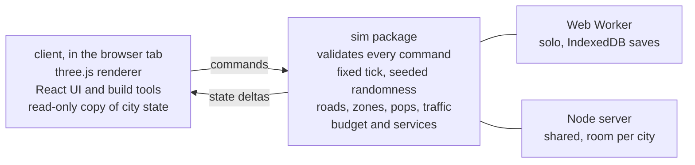

# City Council: Project Map & PRD

Exported from the planning doc on 11 November 2026. Once this file is in the repo, it is the copy to keep current.

## Summary

City Council is a city builder that runs in a desktop browser. One city can be built by several people at once, joined by a shared link. It borrows the feel of Cities: Skylines, with free-form roads, zoning along them, RCI demand, traffic that punishes bad road layouts, and services that cost money.

The plan rests on one bet. The simulation is a headless TypeScript package that takes commands and produces state, and it never touches rendering or the DOM. In single player it runs in a Web Worker. In multiplayer the same package runs on a server. If we hold that line from the first commit, multiplayer becomes a hosting and sync job at the end and not a rewrite.

We build one module at a time, in the order of the roadmap below. Each module ends in something playable and has exit criteria. This doc is the map. When a module starts, it gets its own short spec that links back here.

Four decisions are already made.

| Decision | Choice | What it means |
| --- | --- | --- |
| Map | Procedural terrain | A seed generates land, water and resources. The save file stores the seed, not the heightmap. |
| Roads | Free-form | Straight and curved segments at any angle. Zoning cells grow along road edges. |
| Simulation depth | Grouped pops | Households and workers are grouped into blocks that share a home and a workplace. No per-citizen agents. |
| Multiplayer | One shared city | Everyone edits the same city with one treasury. The owner sets roles. |

## Vision and design pillars

The player is someone who likes Cities: Skylines and wants to build a city with friends without installing anything. They open a link and are placing roads within a minute.

**Roads are the game.** Layout decisions should show up as traffic, land value and commute times. If a player cannot see why a junction is jammed, the traffic module has failed.

**Readable over realistic.** Every number the sim produces must be explainable in an overlay or a tooltip. We prefer a simple model the player can reason about to an accurate one they cannot.

**Built for a browser tab.** The game has to load fast, run on a laptop with integrated graphics, and survive a refresh. That rules out per-citizen simulation and pushes us toward pops and aggregate flows.

**Co-op by default.** Every feature is designed as if multiple people were editing the same city, even before multiplayer ships. That means no hidden local state, no actions that only make sense for one cursor, and an activity log from day one.

### What we take from Cities: Skylines

- Free-form road drawing with snapping, and zoning cells that attach to roads
- RCI demand bars that drive what grows
- Info-view overlays for traffic, land value, coverage and so on
- Service buildings with a coverage radius measured along the road network
- Milestones that unlock buildings as population grows

### What we leave out

- Individual citizens with names and life stories
- Per-vehicle traffic simulation and lane-level AI
- Modding, asset editor and Steam Workshop equivalents
- Disasters, tourism, specialised industry chains and the other DLC-sized systems
- Mobile and touch support in v1

## Goals, non-goals and success criteria

v1 is done when two people can open a link, build a working city of 500,000 residents together, and come back the next day to find it as they left it.

### Goals

- A solo player can grow a city from an empty map to 500,000 residents with a balanced budget.
- Traffic responds to road layout, and a transit line measurably takes cars off a parallel road.
- Services have a visible effect on demand, land value and the workforce.
- A city is shareable by link, with owner, editor and viewer roles.
- The city state survives refresh, disconnect and server restart.

### Non-goals for v1

- Competitive play, trading between cities, or a shared region of several cities
- Social features beyond a link and a display name. Payments, accounts and public online hosting. At launch the project owner runs the only server.
- Photorealistic rendering. Buildings are lightly stylised and generated in code, as described under Art direction.
- A city that keeps simulating while nobody is connected

### Proposed targets

These are starting numbers to tune, not measurements.

| Area | Target |
| --- | --- |
| Frame rate | 60 fps on a 2022 laptop with integrated graphics at 500,000 residents |
| Cold load | Under 5 s to an interactive map on broadband |
| Map size | 12 km × 12 km buildable area |
| Sim tick | 10 ticks per second at 1x speed, under 20 ms of worker time per tick |
| Players per city | 8 editing at once |
| Edit latency | A placed road is visible to other players within 250 ms |
| Save size | Under 10 MB compressed for a 500,000 resident city |

## Business model

The game is free to play locally, and anything that needs a server is paid.

|  | Free | Paid |
| --- | --- | --- |
| Full single-player game | Yes | Yes |
| Where the city is stored | In the browser, on that device | Online, reachable from any device |
| Download and import a city file | Yes | Yes |
| Multiplayer by link | No | Yes |
| Account | None needed | Required |

The split follows cost. A free player's sim runs in a worker on their own machine and their city sits in IndexedDB, so they cost almost nothing to serve. Server CPU and storage are only spent on paying players.

The free tier needs one safeguard. Browsers can evict local storage, and a city does not follow a player to a new browser or computer. So a free player can download their city as a file at any time and import it anywhere. The game asks the browser for persistent storage and reminds the player to download a copy now and then.

Upgrading is a small step. The player's local city uploads to the server and carries on from where it was, which works because the server runs the same sim package.

Only the host of a shared city pays. Friends join by link for free and need no account. Every invite then shows the game to someone new at no cost to them.

The paid tier is a monthly subscription, because the server costs it pays for are ongoing. The price is not set yet. It has to cover one host's share of server time and storage with room to spare, and that share is measured at M5.

If a subscription lapses, the host's online cities become read-only. The host and their guests can still open and look around them, and the host can download each one as a file and carry on playing it locally for free. Nothing is deleted. Resubscribing makes the cities editable again.

**Timing.** Monetisation is not a priority. This section records the intended model so nothing built earlier blocks it, and billing itself is deferred. At launch there is no online tier for the public. The project owner runs the only server and is the only host, and friends join those cities by link. Public hosting, accounts and subscriptions come later.

## Technical architecture

The code splits into three packages. `sim` owns all game state and rules, `client` draws it and collects input, and `server` hosts `sim` for shared cities. `sim` imports nothing from the other two.

The client only sends commands and receives state. Whether the sim sits in a worker or on a server, that exchange is the same.

### Stack

| Layer | Choice | Why |
| --- | --- | --- |
| Language | TypeScript, strict mode | One language across sim, client and server. slop-newyork uses plain JS modules, which is fine for a demo but not for a sim this size. |
| Build | Vite, pnpm workspace | Fast dev server, worker bundling built in |
| Rendering | three.js `WebGPURenderer` with TSL shaders, pinned to `three@0.187.0` (exact, from npm) | Same renderer as [slop-newyork](https://github.com/mrdoob/slop-newyork/). It falls back to WebGL 2 where WebGPU is missing, and `?webgl` forces the fallback. slop-newyork loads the unpinned dev build from a CDN. We pin a version. |
| UI | React over the canvas, Zustand for UI state | Panels, budget tables and toolbars are ordinary web UI |
| Sim runtime | Web Worker in single player, Node on the server | Same package, two hosts |
| Local saves | IndexedDB | No backend needed until multiplayer |
| Static hosting | GitHub Pages, deployed by a workflow on every push to `main` | Free, next to the repo, no extra account. It cannot set response headers, which matters only if we want `SharedArrayBuffer` (see M0). |
| Server | Node with WebSockets, one room per city | See the multiplayer section for the hosting options |
| Tests | Vitest for sim, Playwright for client walkthroughs | The sim is headless, so most tests need no browser |

### Rules the sim follows

1. **Commands in, state out.** The only way to change the city is a command such as `BuildRoad`, `ZoneCells` or `SetTaxRate`. The UI never mutates state. Every command carries the player id and is validated before it applies.
2. **Fixed tick.** The sim advances in fixed steps, independent of frame rate. Slow systems such as demand, land value and traffic assignment run every N ticks on a stagger, so no single tick is expensive. The heaviest run in background workers, and their results are applied on a fixed later tick so the outcome never depends on timing.
3. **Seeded randomness.** All random numbers come from one seeded generator stored in the state. The same seed and the same command log give the same city on the same machine. That gives us replay tests and bug reports that reproduce.
4. **Flat data.** Roads, cells, buildings and pops live in typed arrays indexed by id, not in object graphs. Snapshots are then a handful of buffers that copy to a worker, a file or a socket with no serialisation step.
5. **State is serialisable at every tick.** No closures, class instances or DOM references in sim state. Save, load and join-in-progress all use the same snapshot format.
6. **The client is a view.** It keeps a read-only copy of state, applies deltas, and interpolates for smooth motion. Cars on screen are drawn by the client along routes the sim has already assigned. The sim does not move them.
7. **Derived data is rebuilt, never saved.** Some structures are only a faster way to read state: the terrain, the road spatial index, from issue 15 the routing graph, and from issue 18 the blocks. They live outside `SimState` and are never saved, hashed or sent. The terrain is cached by seed, because it depends on nothing else; commands that check the ground, such as `BuildRoad`, read it through that cache, so a worker, a server and a replay check against the same map. The others are cached by the state object they come from. Each is built from the graph arrays the first time it is asked for, then kept current by the functions that change the graph. A city loaded from a save, cloned or replayed is a new object, so it builds its own. A host calls `prepareDerived` after it creates or loads a city, so the rebuild lands at load and not inside a tick. A derived structure must give the same answers whether it was kept current through a city's whole history or built a moment ago, and every structure has a test that proves it. Every list inside one stays sorted by id and every query breaks ties by the lower id, so nothing depends on the order changes arrived in.

### Why this keeps multiplayer cheap

Single player already talks to the sim through a message channel, because the sim is in a worker. Multiplayer swaps that channel for a WebSocket and moves the worker to a server. The client code path is the same.

The message types live in `sim` (`protocol.ts`) and both ends import them. Every message carries a protocol version `v`. The client sends `command` and `requestSnapshot`. The sim sends `snapshot`, `delta` and `commandResult`. A delta carries only what changed: the tick, the speed, new log entries and, from M1, the road nodes and segments added, changed or removed, plus the host's per-system timing of its last step for the debug panel. Road changes go as whole rows read when the delta is built, so an id removed and reused between two deltas arrives once, as the new row. The sim records which ids a step touched in a list kept outside state, like the spatial index, so it is never hashed or saved, and the host drains it after each step. Deltas are numbered and a snapshot says which number comes next, so a client that misses one asks for a snapshot. The mirror tells its listeners which 500 m chunks the road rows touched. In the client, a `SimTransport` with `send` and `onMessage` hides whether the other end is a worker or a socket, and a `SimMirror` holds the read-only copy of state. A host knows who is on each connection and stamps that player id on every command, ignoring the id the message claims, so no client can act in another player's name. The worker stamps its one player, `local`. The host steps from real time at 10 Hz times the speed and, after a stall, catches up by at most 8 steps and drops the rest of the missed time. The server is authoritative and sends state deltas, so clients do not need to agree bit for bit and we avoid lockstep.

Build tools show a local preview while a command is in flight, and the server's answer confirms or rejects it. That preview is the only client-side prediction we need.

## Module roadmap

Twelve milestones, built in order. Each one ends in a build you can play, and the next does not start until the exit test passes.

Your list put Map & Zoning first. I split it. With free-form roads, zoning cells only exist along a road, so roads have to come before zoning. Terrain moves into the foundation milestone.

| # | Milestone | Depends on | Exit test |
| --- | --- | --- | --- |
| M0 ✓ | Foundation and terrain | none | A seeded map renders with camera controls. The sim runs in a worker, accepts a no-op command, and the state saves and reloads from IndexedDB. |
| M1 ✓ | Road networks | M0 | Draw straight and curved roads that snap and form intersections. Delete and upgrade work. Undo works. A pathfinder returns a route between any two connected points. Blocks enclosed by roads are detected. Angle guides hold a road at 90 degrees, and the grid tool lays out a block grid in one action. Roads at different levels cross without forming an intersection. Rail (tram, subway, heavy rail) should be kept in mind so road tools can be reused when rail is going to be implemented. |
| M2 | Zoning and buildings | M1 | Paint R, C, I, O, and M on cells along roads. Buildings appear on zoned cells at a fixed rate and disappear when the road is removed. Each zone can have a level 1-3 which indicates density & impact |
| M3 | Demand | M2 | Growth follows four demand bars for residential, commercial, office and industrial. Pops move in, take jobs, and leave when there are none. An all-residential city stalls. Each cell builds at the density it is zoned for. A first land value orders which lots fill. |
| M4 | Economy | M3 | Taxes, upkeep and construction costs hit one treasury. A monthly budget panel balances. Running out of money blocks building. Allow borrowing. Demolishing an occupied building charges compensation. Property and business taxes and development charges work. The first population milestones unlock density 2 and pay grants. |
| M5 | Traffic | M3 | Commutes load onto roads. A traffic overlay shows congested segments. Widening a road or adding a bypass visibly changes the overlay. Long commutes lower demand. Decorative cars visualize the traffic levels. Assignment stays inside its time budget on a 500,000 resident test city. Roads can be raised and lowered, with ramps, overpasses and tunnels, so a highway interchange can be built. |
| M6 | Public transport: buses | M5 | Draw a bus line with stops. Pops choose it when it beats driving. Road volume on the parallel route drops. Fares show in the budget. Bike lanes on a street shift short trips from cars to cycling. |
| M7 | Rail transport | M1, M6 | Lay tram, subway and commuter rail track with the same tools as roads. Stations, tunnels and elevated track work. Lines, mode choice and fares from M6 also work for heavy (commuter) rail, trams, and subways. A subway line carries more people per hour than the avenue above it. Off-street bike paths work, and a station reached by bike lanes draws riders from further away. |
| M8 | Services | M4, M5 | Clinics, schools, childcare, fire and police have capacity and network coverage. Parks and recreation raise satisfaction and land value within walking distance. Each changes a number the player can see, such as health, education level or the share of parents who work. |
| M9 | Utilities | M8 | Power, water and sewage plants are placed on the map and add capacity, with no grid to draw. A shortage lowers demand across the city. Pollution from plants feeds land value and satisfaction. |
| M10 | Multiplayer | M4 minimum | Two browsers edit one city through a server. Roles work. A third player joins mid-game and sees the same city. The project owner moves a local city online. No accounts or payments yet. |
| M11 | Polish and launch | all | Tutorial, sound, a performance pass against the targets above at 500,000 residents, public link. |

M10 is listed late but it can start any time after M4. I would run a short spike right after M1. Host the sim in a Node process, connect two tabs and draw roads together. It costs a few days and tells us early if any sim rule broke the architecture.

There are no dates on these, by choice. The order is the plan, and nobody has been promised a delivery date.

## Module specs: foundation, roads and zoning

### M0 Foundation and terrain

The world unit is one metre. The map is a 12 km square with a heightmap at 16 m resolution, which is 750 × 750 samples. A 4 km map cannot hold 500,000 people at a believable density. A seed generates height, water level, and resource masks for fertile land, forest and ore. Layered noise with an erosion pass is enough for v1.

The ground is coloured by height and slope only. The resource masks are not painted on it; a resources overlay will show them. Forest shows as decorative trees within 3.5 km of the camera, and open lowland gets grass tufts near the camera. Further out, where trees are not drawn, forest ground takes a canopy green that fades in from 1.5 km, so the map still reads as wooded from the city band (issue 47). Decoration is placed from the seed by the client, so it is the same on every load and for every player. It is not sim state and nothing in the game reads it.

This milestone also builds the parts every later module leans on.

- The command bus and the worker message protocol
- The snapshot format, with save and load to IndexedDB
- The tick loop with speed controls for pause, 1x, 2x and 4x
- Camera with orbit, pan and zoom, plus ground picking
- A debug panel that shows tick time per system, toggled with the backquote key. The UI shell is React over the canvas, with Zustand for UI state only; components read sim state through the `SimMirror` and a lint rule stops them importing anything that writes state
- Download a city as a file and import it back, so a free player can move browsers or keep a backup

The random generator is xoshiro128**, seeded from the city's 32-bit seed with splitmix32. Its four words of state live in the sim state, so a snapshot carries it.

A snapshot is one byte layout used for local saves, city files and, later, for sending a city to a player who joins. It starts with a 40-byte header: the magic bytes `CITY`, the file format version, the state version (`SNAPSHOT_VERSION`), the seed, the tick, the body length and a 64-bit checksum of the body. The body is a list of named sections, each on an 8-byte boundary. Every typed array in state gets its own section, named by its path, and everything else goes in a JSON section with references to those arrays. A second JSON section holds the log entries that have left live state, so a snapshot can carry the whole activity log. File format 2 lets a snapshot leave that section out, for a host that keeps those entries itself (`serializeDetached`); a snapshot that carries them is still written as format 1. Formats 1 and 2 use FNV-1a as the checksum, a byte at a time. File format 3 changes only the checksum, to two 32-bit sums taken four bytes at a time, which is several times faster. A snapshot without its paged log is written as format 3, since that is the one an autosave writes while the city runs; a build from before format 3 refuses it as a save from a newer version. `serialize` and `deserialize` live in `sim`, with `serializeSteps` and `serializeDetachedSteps`, which write the same bytes a part at a time. `deserialize` migrates old state versions up to the current one, and it refuses a save from a newer build, a cut-short save and a damaged one, each with a message a player can read. No compression yet.

In single player the worker loads the most recently opened city from IndexedDB at start (for saves that never recorded an open, the most recently saved), and with nothing saved it starts a city from seed 1. The city menu starts a new city from any seed and switches between saved cities; either one saves the running city, stores or marks the other, and reloads the page into it. Terrain is rebuilt from the seed. The worker autosaves every 30 seconds, and it also saves when the tab is hidden and when the player presses Save. An autosave must not hold up the ticks of a running city, so the worker copies the city on the tick the save is due (`captureState`: the typed arrays are copied, and log entries and undo records, which never change once made, are shared) and writes the copy in four parts with a pump between each. Every other save is written at once, because the player is waiting or the tab is going away and its timers may not run again. Such a save also ends the pauses of an autosave still being written, so it is never held behind one. Each city keeps its latest snapshot and the good one before it. A local save holds only the live part of the activity log, at most 4,096 entries. Entries leave live state 1,024 at a time, and the worker writes each such page to IndexedDB once, in the same transaction as the first save that needs it, so the cost of a save does not grow with the age of the city. Both snapshots read the same pages. A save whose pages are missing counts as damaged. Saves from before log pages, and imported files, have the log inside the snapshot; they load as they are and move to pages on their next save. The worker still holds the whole log in memory, for city files. A damaged latest snapshot is reported and the one before it is loaded. A save from a newer version is reported and left untouched, and a new city starts under a new id so nothing writes over it. The page asks for persistent storage and says so when the browser declines.

One tab runs a city at a time. Each tab has its own worker and its own copy of the sim, so two tabs on one city would save over each other. The worker takes a Web Lock named after the city before it hosts it and holds it until the tab closes or reloads. A tab that cannot get the lock runs nothing and saves nothing: it says the city is open in another tab and offers to try again, start a new city, open another saved city or import a file. A tab remembers its city for as long as it lives, so a reload comes back to it whatever other tabs have opened since; a new tab opens the most recently opened city. A browser without Web Locks runs unguarded. Joining a city from a second tab or a second browser is multiplayer and waits for M10, where the server runs the one sim and a link lets others in.

A city file is a snapshot with the whole activity log inside, in one file named after the city with the extension `.city`. The worker writes it from live state, so a download works even when IndexedDB does not. Import decodes the whole file before storing anything: a file that is not a city, is cut short, is damaged or is from a newer version is refused with a message and nothing changes. An accepted file is stored under a new id, never over an existing city, and is named after the file, with a number added if the name is taken, so importing one file twice gives two cities. The page then reloads into the imported city. The page reminds the player to download a copy when a city has gone three days of real time without one, counted from the last download or from when the city was first stored. The interval is `EXPORT_REMINDER_INTERVAL_MS` in the client's save config.

Speed is part of the sim state and changes only through the `SetSpeed` command, since in multiplayer there is one sim and one speed. While paused the host keeps stepping at the 1x rate: queued commands still apply, including the one that unpauses, but the tick counter and the systems do not move.

No terraforming in v1. The terrain is fixed after generation, which keeps the save small and removes a class of sync problems.

The game is served from GitHub Pages at <https://bunge12.github.io/city-council/>. A workflow builds the client on every push to `main`, publishes it, and runs the M0 walkthrough against the public address. The build uses relative asset paths, so the same files work at a site root and under the repository path. Cloudflare Pages was the alternative. We would move there only for a response header Pages cannot send. Saves live in the origin's IndexedDB, and on Pages every project of the same GitHub account shares the `bunge12.github.io` origin, so the database name `city-council` must stay unique among them.

`SharedArrayBuffer` is not used. The worker sends deltas and moves snapshot buffers with `postMessage` transfer, which costs little at M0 sizes. Shared memory needs the page to be cross-origin isolated, which takes two response headers (COOP and COEP) that GitHub Pages cannot set. If a later module wants it, most likely M5 for traffic assignment in background workers, the choice is between a service worker that adds the headers (it costs one reload on the first visit) and a move to Cloudflare Pages with a `_headers` file. That decision waits until something needs shared memory.

M0 exit numbers, measured by the walkthrough on the production build. Cold load to an interactive map on a throttled 25 Mbit/s line with 20 ms latency, with the HTTP cache off: about 1.0 s from navigation start to the first frame with terrain, on both WebGPU and WebGL 2, and under 2 s measured from outside the page. The soak run (`pnpm soak`) hosts a city at 4x for one hour of game time, 36,000 ticks with a NoOp every 4 ticks: no step near the 20 ms budget (worst about 1 to 2 ms), heap back to about 11 MB after GC, and a replay of the 9,000-entry log gives the live city's hash. An autosave in that run writes about 0.7 MB and takes about 13 ms of worker time, outside the step timings, and stays there however long the log gets; writing the whole log each time took 27 ms at 9,000 entries and grew with every command. The soak fails if more than 5 of its 36,000 steps pass the budget. It failed on any one until issue 91: on a shared CI runner a single step landed 1 to 2 ms over in three runs of five, with the mean at 0.006 ms and the 99th percentile at 0.05 ms. One late step delays the next tick by that much and changes nothing else, and a step that is too slow in earnest passes the budget every time its command comes round, about 150 times a run.

Terrain is gradient noise on an integer hash: a lowland layer tilted toward a sea on one of eight sides, ridged mountains under a noise mask, and a thermal erosion pass. The water surface sits at the height that leaves 20 percent of the map under water. If less than 45 percent of the map is dry and no steeper than 10 percent, the relief is scaled down and the map shaped again. These numbers live in `packages/sim/balance/terrain.json`. The code in `packages/sim/src/terrain/` uses only exact operations, and lint bans the other `Math` functions there. The same seeds hash the same in Node, Chromium and JavaScriptCore, so the save stores only the seed and the fallback of saving the heightmap is not needed.

### M1 Road networks

Roads are a graph of nodes and segments. A segment is a straight line or a single curve between two nodes, with a road type. Each type sets the lane count, speed, capacity, cost and upkeep.

| Road type | Lanes | Notes |
| --- | --- | --- |
| Street | 2 | Zonable on both sides |
| Avenue | 4 | Zonable, higher capacity |
| One-way | 2 | Zonable, needed for sane junction design |
| Highway and ramps | 3 per direction | Not zonable. Lands with traffic in M5. |

The build tool needs most of the work here.

- Straight, curved and continuous drawing modes
- Snapping to nodes, segments, angles and the terrain grid. Snapping to zoning cells moved to M2, since the cells arrive there
- Splitting a segment when a new road crosses it, which creates an intersection
- Slope limits against terrain, and automatic bridges over water, with the deck a set height above it
- Upgrade in place, bulldoze, and a cost preview before the click

**Building a straight road.** `BuildRoad` carries a start, an end and a road type id. The sim rounds both ends to a 1/8 m grid, so two points are either the same node or apart and no later check needs a tolerance. An end within 4 m of an existing road node joins that node. Then it refuses, with a reason the player reads: a type that is not buildable (highway, until M5), an end off the map, a road under 10 m, a duplicate of an existing segment, an angle under 25 degrees against a segment at a shared node, an end in water, and ground too steep. These numbers live under `build` in `roads.json`. A check that passes at submit can fail when the command applies, because of an earlier command in the same tick, and is then dropped and not logged.

**Intersections.** A new road splits every segment on its own network and level that it crosses, and becomes a chain of segments in order along the line. An end that is not within 4 m of a node but is within 4 m of a segment's body joins that segment at the nearest grid point, which splits it into a T-junction. A split keeps the type, network and level of the segment it splits. Segments on another network or level do not split and are not split. The crossing point is computed from the two segments with their ends put in a fixed order, then rounded to the 1/8 m grid, so it lands in the same place whichever road was drawn first. A crossing that would leave a piece under 10 m moves to the node or road end it is near when that is within 4 m, and is refused otherwise. A crossing under 25 degrees is refused. A command's new ids are handed out in a fixed order: new nodes from start to end, then each split segment's two pieces, then the new road's pieces from start to end.

**Curves.** `BuildRoad` takes an optional control point. With one, the road is a single quadratic curve from its start through that point to its end; a control point on the line between the ends makes a straight road. A quadratic needs only add, subtract, multiply, divide and `Math.sqrt`, so curves keep the sim to exact arithmetic. A segment always stores a control point, and a straight one has it exactly at its midpoint. A curve's length is measured on a fixed 16-piece polyline, so every machine gets the same number. Its tightest radius has a closed form, and a curve tighter than its type's `minCurveRadius` in `roads.json` is refused with the radius in the reason. Issue 47 relaxed these to 12 m for a street and a one-way and 25 m for an avenue, from 20 m and 40 m, so a player can bend a road round the map's features; rail in M7 sets wider limits on its own types. Slope and water are sampled along the curve, not its chord. Where a curve meets another segment, both are cut in halves a fixed way until each piece is within 0.1 mm of its chord, and the chords are met, which finds every crossing, two where a curve crosses a line or another curve twice. A split curve becomes curves that take the control points of their parts, so they trace the original. Its split point is the exact point on the curve, not rounded to the grid, because rounding would bend the pieces off the path by up to 9 cm. Crossings of two straight segments are rounded to the grid as before. The spatial index files a curve under every cell its shape touches, and nearest-point queries refine a fixed set of samples with a fixed number of Newton steps.

**Bridges.** The roadmap line "automatic bridges over water above a height" came to mean this, in issue 11: where a road crosses water, that stretch becomes a bridge with its deck a set height above the water, and there is no bridge tool. Bridging a dry valley, tunnels and elevated roads wait for M5, which builds them for highways, and M7 reuses them for track (see "Levels and grade separation"). The sim samples the ground along each piece of a new road at the points the slope check uses. Each run of wet samples becomes one segment with its level set to bridge, between a new node on each bank. The deck runs level at `bridgeClearance`, 5 m, above the water. At each end a ramp at the type's `maxSlope` joins it to the bank node, which sits on the ground like any other node. The sim puts each bank node at the sample nearest the water from which that ramp reaches the deck by the shore. On a low bank that moves the node back from the water; a bank high above the water needs room for the ramp down. If no such point is left before the road's end or the junction before it, the road is refused with the grade the ramp would need. Two runs of water with too little ground between them for a ramp down and up share one bridge. A bridge's length, ramps included, may not pass its type's `bridge.maxLength`. Issue 47 set that to 38.4 km for every type, the Lake Pontchartrain Causeway, the longest bridge over water. That is longer than the 12 km map, so no bridge on the map is too long for its type; the check stays for a type that needs a shorter limit later. A metre of bridge costs `bridge.costMultiplier` times the type's price per metre. Both are per type in `roads.json`. The multipliers come from Arkansas DOT's 2023 average of $339.54 per square foot of deck, for a deck as wide as the road plus 2 m of barriers, so a street bridge costs 31 times as much a metre as the street. The deck height is not stored: it follows from the water level, the bank nodes' heights and the slope limit, and the renderer gets it from the same sim function. A road may not start or end in water, and a junction may not form there, so nothing branches off a bridge between its banks. Only ground segments split each other, so a bridge is never split. Since issue 22 a road that meets a bridge away from a shared node is held to the crossing rule in "Levels and grade separation": the deck stands only 5 m over the water and the bank is above it, so a ground road never clears one and is refused with the gap in the reason, and two bridges that cross over water meet at the same height and are refused too. Ships and bridge height classes are not planned. The renderer draws the deck at its height, a fascia and railing along each edge, and piers at most 36 m apart under the level deck, down to the ground or the lake bed. The road tool's preview marks the bridge part in violet and shows its length beside the cost.

**How a road meets the ground.** A road follows the terrain; there is no terraforming. Its nodes take the ground height, and the slope check samples the ground along the path at most 8 m apart and refuses the road if the grade between any two samples passes its type's `maxSlope`. Issue 47 relaxed that to 16 percent for a street and a one-way and 13 percent for an avenue, from 12 and 10; the highway stays at 6. So a road can climb a hill only where every stretch of it is gentle enough, which is what a draped road needs to look right. If draped roads look wrong on rolling ground once they render (issue 06), the fallback is a straight grade between node heights with short embankments drawn by the client, which changes the check but not the graph. Issue 06 draws them draped, with a cross-section at most every 8 m, and they sit cleanly on the ground in the fixture city, so the fallback stays unused for now.

**Bulldozing and upgrading.** `BulldozeRoad` takes a list of segment ids and removes them. Each end node left with no segments goes too. A node left joining exactly two segments stays where it is, unmerged, so a bulldoze never moves or joins anything the player did not name. Segments go in ascending id order, then nodes, so the free lists come out the same whatever order the list was in. A segment flagged fixed (`SEG_FIXED`, for the outside connections in issue 16) cannot be bulldozed or changed, and a fixed node stays when its segments go. `UpgradeRoad` takes a list of segment ids and a buildable type and changes their type in place: the id, shape, nodes and level stay, and in M1 only the width changes. It is refused with a reason when the new type breaks a limit the old one met on that segment: the ground's slope, the curve radius, or on a bridge its length and the grade of its ramps. A limit the old type already broke, as a piece split off a longer road can by a hair, does not count. A one-way runs from its node A to its node B. An upgrade to a one-way runs each segment from node A unless the optional `from` list names node B, and upgrading a one-way to its own type reverses it by swapping its ends, which keeps every node's list of segments in the same order. A command that names a missing segment, or one segment twice, is refused whole. So is one that names more than `editMaxSegments` segments, 5,000 in `roads.json`: that many apply in about 15 ms on the 30,000 segment city, inside the tick budget, where the whole city took 100 ms (M1 review, issue 80). No drag reaches the cap, so the tools do not split a list. Both commands price themselves from `roads.json`, and nothing is charged until M4. A bulldoze costs the type's `demolitionCostPerMetre`, times the bridge multiplier on a bridge. An upgrade costs the full price of the new type less `upgradeCredit`, a half, of the old type's build price, never below zero; reversing a one-way costs nothing. Both numbers are placeholders until M4 prices demolition and refunds. `planBulldoze` and `planUpgrade` return the plan and price without changing anything, for the tools in issue 13.

**The bulldoze and upgrade tools.** Decided in issue 13. N turns the bulldoze tool on and off and V the upgrade tool, which upgrades to the type in the road type picker, so Z, X and C pick the type for it as they do for drawing. Hovering a road marks it: orange for a bulldoze, and for an upgrade the road as it would look, at the new type's width. A readout by the cursor gives the price from `planBulldoze` or `planUpgrade` on the mirror's copy of the roads, or the sim's reason, and a click the preview refuses sends nothing. A fixed road reads as one that cannot be removed or changed. A click sends one command for one segment; a left drag with either tool collects every segment the pointer passes over and sends one command on release, so one log entry. While either tool is on, a left drag picks roads instead of panning; Shift and a drag still orbits and the keys still pan. A drag leaves out a segment it could not act on alone, a fixed one or one already the type picked, so one such road does not refuse the whole drag. A right-click with the upgrade tool reverses a one-way. Picking is in screen pixels: the spatial index finds the segments near the ground under the pointer and near where the pointer's ray meets the bridge deck level, and each is measured on screen at the height it is drawn at, so a curve is picked along its curve and a bridge at its deck. Of two roads under the pointer the nearer centre line wins, and a drag keeps the segment it took last while the pointer is still on it, so a drag along a road over a junction does not take the roads crossing it. The pick distance and drag step are in `packages/client/src/tools/config.ts`. Undo in issue 14 is the safety net, so there is no confirmation dialog.

**Undo.** Decided in issue 14. An `Undo` command carries no target: the sim takes back its sender's newest road change that has not been undone. Each `BuildRoad`, `BuildRoadGrid`, `BulldozeRoad` and `UpgradeRoad` that applies leaves an undo record in `SimState.undo`, tied to its log entry by index. The record is a journal of every change the command made to the road graph, written as plain data while it applied: each node and segment added, with whether its id came off the free list or grew the arrays; each one removed, with its fields and its place in its nodes' lists; and each type change. Ids are reused, so an id in a record can come to name a different road. Since snapshot version 7 a removed segment therefore also records where its two end nodes stood, and a type change the two ends the segment had, and an undo is refused when they no longer match: a bulldozed road is not put back between other junctions that took its nodes' ids, and an upgrade or a reverse is not taken back on one piece of a road someone has since split (M1 review, issue 80). The version 7 migration fills these in from the save. Undo runs the reverse of each, newest first. A command of any size is one record, so `BuildRoadGrid` in issue 20 needs no new shape. A node or segment a command removed and did not hand out again is held: its row is zeroed but its id stays off the free list until its record is undone or forgotten, so no one else can take it and it comes back under the same id. Ids a command frees and reuses itself, as a split does, are handed out as before. Built and then undone with nothing in between, the network is byte for byte what it was, arrays and free lists included, so the state hash matches apart from the log and the history. An undo that takes back the newest ids shrinks the arrays again, so a road delta's id limits can go down. Each player keeps the newest `undoSteps` records, 50, in `roads.json`; past that the oldest is forgotten and frees what it held. `SetSpeed` leaves no record, and there is no redo. The undo is checked first on a copy of the rows it touches and refused whole with a reason when the network has moved on: someone else changed or bulldozed a road it would remove, another road now joins a junction it would remove, or a road built since crosses or touches one it would put back. **A refused undo stays at the top of the player's history.** A refusal changes nothing, like every refused command, so the player clears what is in the way, or the other player undoes it, and tries again. Dropping it instead would let a player reach the step below, but that step often depends on the one dropped, and a refusal that silently ate history would be hard to read. Ctrl+Z or Cmd+Z, or the undo button in the top bar, sends `Undo`. The button is grey when the player has nothing to undo, and a refusal's reason shows under the build bar until the history next changes. The host sends the whole history in a delta when it changes.

**How roads are drawn.** The client builds road meshes from its read-only copy of the graph; the sim knows nothing about them. Each segment is a strip as wide as its type, cut back at each end by the junction there. A junction is one polygon round its node that meets every strip's cut exactly, so strips and junctions cover the road once, with no gaps and no overlaps. Between two roads under 180 degrees apart the kerbs meet at a corner and both roads are cut back to clear it. Where a narrow road meets a wide one nearly head on, the narrow one tapers into the wide one. Round the outside of a bend the kerbs join at a miter point, or at a bevel when the miter would reach more than 2.5 half-widths from the node. A dead end stops square and flush at its node. A curved segment is drawn along the true curve, cut into straight pieces that each turn at most 0.05 radians on the surface and 0.25 radians in the city band's lines, so it looks smooth at street level and costs less from far away. A junction measures how far to cut back a curved arm along its curved kerbs, and its polygon meets the strip's cut edge on the curve, so curved arms join with no gap. Strips split at chunk lines, so each 500 m chunk has one merged mesh per layer, and a delta rebuilds only the chunks its changed rows reach: where each changed segment was and is, and how far each junction at a changed node or segment end can cut back its roads. Surfaces sit a little above the terrain, more with distance from the camera, which the vertex shader adds, so roads never flicker against coarser terrain levels. Decorative trees and grass are left out within a few metres of a road. A one-way runs from its node A to its node B, and its arrows point that way.

**The road tool.** A click sets the start and a second click sends `BuildRoad`; Escape or a right-click drops the road being drawn, and Escape with nothing drawn leaves the tool. B turns the tool on and off, and Z, X and C pick street, avenue and one-way. Clicks are rounded to the build grid before they are sent, so the command and the log carry the point the preview showed. A press that ends a camera drag is not a click. The preview runs `planRoad`, the function the sim validates `BuildRoad` with, on the mirror's copy of the roads, so it shows what the sim would build: the ends where they would join, the road's real width, a marker at every junction it would form, and its length and cost, the length times the type's price, in the short money format. A road the sim would refuse turns red and shows the reason next to the cursor, and a click on it sends nothing. A sent road stays on screen until the answer comes back: a refusal removes it and shows the reason, and an acceptance keeps it until the first delta from a step after it, which carries the real road. A server answers later than the worker, and the tool does not change for it. Tool state lives in the UI store and never touches sim state. The mirror copies road rows in place, past the network's observer hooks, so `applyRoadDelta` keeps a spatial index the copy already has current itself.

**Drawing modes.** The road tool has three modes, picked in the build bar or with T, Y and U: straight, curved and continuous. Switching mode, or leaving the tool, drops the road being drawn; changing the road type does not. Curved takes three clicks: the start, a point that sets the direction, which becomes the curve's control point, and the end. Until the direction is set a line shows it; after, the preview runs `planRoad` with the control point, so a curve that is too tight turns red with its radius in the reason, and the length and cost are measured along the curve. A curve started from the end of a road, a node with one road segment, holds its control point on the line that road carries straight on along, so it leaves with no kink; holding the free-hand key lets it go. The end of a curve snaps to nodes, segments and the grid but not to angle or length guides, which measure a straight road. Continuous mode draws straight segments end to end, each its own `BuildRoad` and its own log entry. The next segment starts where the last one ended, at the node it joined if it joined one. A segment is not sent until the one before it is built, because the sim checks a command against the city as it stands, and the next segment must be checked against the last, for the angle where they meet among other things; until then it waits on screen. Escape, a right-click, a double click or a click back on the end just built ends the road. A segment the preview or the sim refuses also ends it: the segments before it stay built, and any clicked after it and still waiting are dropped.

By zoom band: the street band draws surfaces, lane markings and one-way arrows; the district band draws surfaces coloured by type, with markings and arrows while the camera is below 1,400 m; the city band draws avenues and highways only, as grey and red lines of a fixed width on screen. Issue 47 kept avenues grey there, as on the ground, and drew markings further out. The bands switch without the fade the zoom band table below describes; that waits until there is more on the map to fade.

#### Angle and spacing guides

Free-form roads make tidy layouts hard without help, so the road tool guides the cursor while leaving it free to ignore the guide.

| Guide | What it does |
| --- | --- |
| Angle snap | A road started from another road or a node snaps to 90 and 45 degrees from it, with lighter snaps at 15 degree steps. A right-angle marker shows when it is square. |
| Guide lines | Faint lines run perpendicular and parallel from nearby roads and nodes. The cursor snaps to them, so a new street lines up with one two blocks away. |
| Parallel offset | Drawing beside an existing road snaps to offsets that zone cleanly. The main one is twelve cells between roads, which is two back-to-back strips of six with no gap. |
| Length snap | Segment length snaps to multiples of 8 m, so zoning cells fit the frontage exactly. |
| Readout | The cursor shows the angle to the source road and the length in metres and in cells. |

Each guide has a toggle in the toolbar, and holding one key suspends them all for a free-hand segment.

How snapping works, decided in issue M1-08. The snap is a list of sources tried in priority order, and the first that catches the cursor gives the point: an existing node, then a point on an existing segment, then an angle guide, then the 16 m terrain grid. On a segment, the point where the new road would meet it square wins over the nearest point when the cursor is near it. Length snap comes after, and only moves a point from an angle guide or from no snap at all, along the road's direction. Angle snap measures from every road at the start node, or from the segment a road starts on, and never offers a direction the sim would refuse as too sharp. 90, 45 and straight on reach 14 pixels, the 15 degree steps 6, and a strong step wins when both reach. Snap distances are screen pixels turned into metres at the cursor, so they feel the same at every zoom. The free-hand key is Alt. It turns every guide off, but node and segment markers still show inside the sim's 4 m merge distance, because the sim joins those whatever the client sends. Angle and length snap start on and the terrain grid starts off. The toggles live in the UI store for the page's life. The distances and steps are in `packages/client/src/tools/config.ts`, since they are feel, not balance.

Guide lines and parallel offset, decided in issue M1-19. Both are sources in the same list, and the full order is: node, segment, crossing, angle, offset, guide line, terrain grid. A crossing is where two guides meet: two guide lines, a guide line and an offset, or either of those and the angle ray from the start; it reaches 14 pixels. Angle comes before offset and guide line because it is measured from the road the new one starts on, which is the clearest sign of what the player means, and an offset or a guide line on its own only fixes one coordinate. Where the angle ray crosses one of them, the crossing wins, so a street drawn square off a road ends exactly on the line of the next parallel street or in line with a node two blocks away. Length snap does not move a crossing, an offset or a guide line point. Guide lines run through each road node within 260 m of the cursor, one in line with each road there and one square to it, but not through the road's own start. A curve gives the line of its tangent at each end node. They show only while a road is being drawn. At most four lines are tried, nearest the cursor first, and only the one or two that catch are drawn, in faint blue, from their node through the point. A guide line reaches 10 pixels. The parallel offset works beside straight roads, and up to 48 m past their ends. It offers gaps between the two road edges of two zoning strips, twelve cells or 96 m, and one strip, six cells. The strip depth is read from the zoning depth in the tool config, so if M2 changes the six-cell depth the offsets follow. The centre distance adds half of each road's width from `roads.json`, so a street beside a street sits 106 m out and an avenue beside a street 110 m. The twelve-cell offset reaches 14 pixels and the six-cell one 8, and twelve wins when both reach. The offset also catches a road's first click, so both ends of a parallel street land on it. It is drawn in orange along the road with a line across the gap, and the readout gives the gap in cells. It is off for a curve's end. Both start on, each has a toolbar toggle, and the free-hand key suspends both.

#### Grid tool

The grid tool lays out a whole street grid in one action.

1. Drag out a rectangle. Started on an existing road, it takes that road's angle. Started on open ground, it can be rotated.
2. Set the block size in cells, by default twelve deep, and the road type.
3. A preview shows every street, the total cost, and anything in the way.
4. Confirm, and the streets are built and joined to the roads they touch.

The grid bends to what is there. Streets stop at water and at slopes too steep to build, and the preview marks those cuts before the click. If the rectangle covers existing buildings, the preview shows the eminent domain cost.

One grid is one command. It costs the sum of its streets, it is validated as a whole, and one undo removes it. That matters in multiplayer, where a half-built grid would be a mess for everyone else.

**The grid command.** Decided in issue 20. `BuildRoadGrid` carries three corners on the build grid (`origin`, `along` and `across`, so the two sides run from `origin`), a block `depth` and `width` in metres between road edges, and a road type. The client works out the rectangle's angle and the sim takes the corners as they come, so it needs no trigonometry: each lattice point is the origin plus a share of each side. The corners must make a rectangle to within a degree, every block must be at least 10 m each way, and the grid at least one block each way. Street centre lines are a block plus a road width apart. The last block along each side takes what is left, and if that is under `gridMinBlockShare`, a half, of a block, it joins its neighbour, so leftovers land on the sides away from the origin. A grid may have at most `gridMaxStreets` grid lines, counted before anything cuts them; both numbers are under `build` in `roads.json`.

`planRoadGrid`, exported from the sim entry, turns the command into straight streets without changing anything, so the grid tool runs it on the mirror and previews what the sim builds. Each grid line is cut into links where it meets the lines across it. A link on water or on ground too steep for the type, by the ground check `BuildRoad` uses, is dropped, and a stub reaches from the last junction toward the water as far as the ground allows, stopping at least 10 m short of the next line across. So every street ends at a grid junction or well clear of one, and the plan marks each end the ground cut. A link that lies along an existing ground road, within 4 m of one running within 25 degrees of it, is left out, so a grid started on a road joins that road and builds nothing on top of it; a link the road covers only part of starts at the road's end node. The plan reports the length and the cost, which is not charged until M4.

The sim builds the grid one link at a time through `planRoad` and `buildRoad`, the lines along the origin to `along` side first, from the origin out, then the lines across. Each link joins the node the link before it made, so grid junctions come out exact, the grid splits and joins existing roads as a hand-drawn street would, and new ids come out in a set order. Every link must pass `planRoad`. Water and steep ground only cut streets, but anything else that refuses a link, such as a crossing under 25 degrees, refuses the whole grid with the reason and the street it came from, as "Street 3 of 10 in the grid: ...". A link that would need a bridge refuses the grid too, since a grid never builds one. To check the whole grid, `submit` rehearses it on the live network with the undo journal open, then reverses every change, which leaves the network byte for byte as it was. The step does not rehearse and then build again: a command may define `applyIfValid`, which checks and applies in one pass and leaves state as it was if it refuses, and the grid's builds with the journal open and reverses it if a link is refused. A refused grid is dropped and not logged, like any command made invalid within its tick. The undo record is the journal of the whole grid, so one `Undo` takes it all back and rejoins the roads it split, and no snapshot change was needed.

The cap comes from timing (`pnpm bench`, on the development container), on the 30,000-segment network with the spatial index, routing graph and blocks all kept current. A link costs about one `BuildRoad`, and a link that splits an existing street costs several times one on open ground. The worst case is a grid laid over a street grid at the same spacing, half a block off, so every link splits a street. At 40 lines that step took about 50 ms, and at 20 lines about 25 ms, both over the 20 ms tick. **The cap is 14 lines, a 6 by 6 block grid**, which takes about 11 ms laid over streets and 3 ms on open ground. Undoing a 20-line grid laid over streets took under 4 ms. Bigger areas take several grids.

**The build dock.** Decided in issue 47. With no road tool on, the dock at the bottom shows only the road button and the hint. Any road tool, the grid included, opens the road menu above that button, in labelled groups: Actions (upgrade and bulldoze), Road type, Build mode (straight, curved, continuous and grid) and Snapping. Upgrade shows only Actions and Road type, and bulldoze only Actions. The grid shows Actions, Road type and Build mode, with its sizes below them. Pressing an action or the grid while it is on goes back to drawing roads rather than closing the menu. The keys are unchanged.

**The grid tool.** Decided in issue 21. G turns it on and off. Its button was beside the road tool's; since issue 47 it is a build mode in the road menu. A drag lays out the rectangle from the corner pressed to the corner released; a press that does not move does nothing. Both corners snap to road nodes and segments as the road tool's do. Started on a road, the rectangle's first side runs along that road, its tangent where a curve is pressed, or the first road at a node, and it cannot be turned. Started on open ground, it is square to the map, and holding Alt during the drag turns it around the first corner in whole degrees, keeping its size, so the far corner follows the pointer; let go of Alt and the drag sizes it at the new angle. Alt also turns the corner snaps off, as it does for the road tool. The rectangle's first side is `along`, so block width runs along the road the drag started on and block depth away from it. The build bar takes the depth and width in whole cells, 2 to 100, starting at 12 deep, two zoning strips back to back, and 24 wide. The street type is the one picked in the road type picker. The preview runs `planRoadGrid` on the mirror and then `planRoad` on each link, which finds the junctions with existing roads and the refusals `BuildRoadGrid` would give, named by street the same way. The sim checks each link on a network the links before it have changed, which the client cannot do without writing its copy, so in rare cases the sim refuses a grid the preview passed, and its reason shows under the build bar as for any refused command. At the cap the preview takes about a millisecond on open ground, so it runs on every pointer move with no delay. The preview draws the streets, a disc at each junction with an existing road, the rectangle's outline, and a red cross at each street end that water or steep ground cuts. The build bar shows the street count, length, cost and junctions and how many street ends are cut, or the reason in red. Confirm or Enter, also from a size field, sends one `BuildRoadGrid`; a refused grid greys out Confirm and Enter only shows the reason. Escape or a right-click drops the rectangle, and Escape with none leaves the tool. A sent grid stays on screen until the delta from the step after it, as a sent road does.

The guides come first in M1, since ordinary road drawing needs them. The grid tool follows once straight roads and intersections are solid.

#### Levels and grade separation

Roads can pass over and under each other. The work is split across three milestones so that M1, already the heaviest, takes only the part that is painful to add later.

| Milestone | What is built |
| --- | --- |
| M1, after bridges are complete | Every segment stores a vertical level. Segments at different levels cross without forming an intersection. |
| M5, with highways | The control to raise and lower a road, ramps, overpasses, underpasses, road tunnels and the underground view |
| M7 | Rail reuses all of it for elevated track and subway tunnels |

The M1 part follows the bridge work, which is done. A bridge is the first elevated segment, with its level set automatically by the water beneath it. Once bridges are done, the same level field is made general.

| Piece | Rule |
| --- | --- |
| Levels | Tunnel, ground, and two elevated levels. The height of each is a config value. |
| Crossing | Where two segments cross, the tool compares their heights at that point. With enough clearance they pass with no intersection. At the same height they split and join as now. In between, the build is refused with a message. |
| Ramps | A ramp is a segment that changes level along its length, held to the slope limit of its road type. It is what joins a highway to the street below. |
| Zoning | Elevated segments, tunnels and ramps get no zoning cells. |
| Blocks | Only segments wholly at ground level bound a block. |
| Routing | Nothing changes. Segments connect only where they share a node, so an overpass is simply two roads that do not share one. |

Decided in issue 22:

- **Five level values.** A segment stores a level at each end, `segLevelA` and `segLevelB`, in snapshot version 6. The values are ground 0, bridge 1, tunnel 2, elevated 1 3 and elevated 2 4, so the bridge and tunnel values saves already held keep their meaning. The two ends differ only on a ramp, which M5 builds. M1 builds none, but the field is there so M5 needs no new save version. Height above the ground under a ramp runs evenly from one end's level to the other's along the curve's parameter, a placeholder until M5 shapes ramps to the slope limit. A bridge is a bridge at both ends.
- **The bridge keeps its own value.** Its deck height comes from the water and its bank nodes, as issue 11 set out, so it is not one of the fixed-height levels. Its ramps run down to bank nodes on the ground, so a ground road joins a bank node as before.
- **Heights.** In `levels` in `roads.json`, in metres above the ground under the segment: tunnel -10, ground 0, elevated 1 at 7.5 and elevated 2 at 15. An elevated road follows the ground at that height rather than running level. All placeholders, chosen so each level clears the one below it.
- **Clearance.** `levels.clearance` is 6.5 m between the two road surfaces: FHWA's 16 ft (4.9 m) vertical clearance for Interstates plus 1.6 m of deck, the deck depth a placeholder. Where a new road meets a segment it does not split, away from a node they share, the sim compares the two surfaces' heights there using only exact arithmetic. 6.5 m or more apart, they pass with no node. Closer, the road is refused with the gap and the clearance in the reason. A meeting at the same height with a segment the road cannot split, a bridge or a ramp, is refused the same way.
- **What splits.** A road splits and joins only segments with its own level at both ends, and joins only nodes where a segment has its level. A ground road also joins a bridge's bank nodes. Different levels never share a node in M1.
- **Building at a level.** `BuildRoad` takes an optional `level`: `ground`, `tunnel`, `elevated1` or `elevated2`. No player tool sends it in M1. Tests and a road level picker in the debug panel do, so an overpass is an ordinary logged command that saves and replays. A road at any level but the ground makes no bridges and is refused over water.
- **Index filter.** The spatial index queries take a level filter beside the network filter. A segment matches by either end's level and a node by the level of any segment at it. The road tool's snapping looks at ground-level roads only, as the sim joins them.
- **Drawing.** A segment on another level is drawn as a deck at its height, with the bridge's fascia and railing and plain piers at most 36 m apart where it stands above the ground. A junction whose roads all share a level is drawn at that height. A tunnel is drawn below the ground, where the terrain hides it until the underground view in M5.
- **Cost.** A raised road costs what the same road on the ground does until elevated roads and tunnels are priced.
- **Speed.** On the 30,000 segment grid, planning a 5 km elevated road over 52 streets takes about 0.2 ms with its 52 height checks, against about 2.6 ms for the same road on the ground, which splits them all (`pnpm bench`). The check asks the spatial index once per road for segments on other levels only, so on a city mostly at one level it finds nothing and costs next to nothing.

The M5 additions, their costs and their side effects are specified under M5.

The sim side stores the graph in typed arrays and keeps a spatial index for snapping and picking. The index is a grid with one cell per 500 m chunk, the grid the renderer uses. Each cell lists the nodes inside it and the segments that touch it, and positions off the map fall in the nearest edge cell. It answers three queries, each with a network type filter: the nearest node within a radius, the nearest point on any segment within a radius, and every segment that touches a box. The queries are pure functions exported from the sim entry, so the client runs the same ones on its read-only copy. On a 30,000 segment network a nearest-segment query averages about 0.006 ms at a 50 m radius and 0.02 ms at 250 m, and rebuilding the whole index takes about 13 ms (`pnpm bench`, on the development container). It also derives a routing graph with one edge per direction per segment. That is enough for pops and aggregate traffic, so we do not model individual lanes.

The routing graph (issue 15) gives each edge a travel time in seconds, worked out by an edge cost function kept apart from the search. M1 uses free-flow time: the segment's length over its road type's speed. Rail and path have no types yet, so each gets one placeholder speed from `packages/sim/balance/routing.json`. A one-way has only its A to B edge. M5 swaps the cost function for congested time and the search stays as it is. The search is Dijkstra over a binary heap, with a network type filter. Ties break by id: the heap pops the lower node id first, and of two equally quick ways into a node the one over the lower segment id wins, so a route never depends on build order or on the machine. `findRoute` goes between two nodes. `findRouteBetween` goes between two points: each joins the nearest segment on the filtered networks and may leave it either way the segment allows, and a start and end on the same segment go straight along it unless going round is quicker or a one-way forces it. Both return the segments in order with their direction, the nodes passed, the distance and the time, or "no route". Each route takes a few milliseconds on a 30,000 segment network: corner to corner on a 123 by 123 street grid averages about 7 ms, and between random points on the grid about 5.5 ms. Between random points on the random network the spatial index bench uses, it averages about 11 ms, with the slowest near 25 ms; those are mostly searches that run through a whole fragment before they report no route. Rebuilding the whole graph takes about 13 ms (`pnpm bench`, on the development container). The debug panel has a route tool that highlights the route between two clicked points with its length and time, run on the client's read-only copy.

The sim also derives blocks from the graph (issue 18). Roads split wherever they cross, so the ground-level road segments form a planar graph and every area fully enclosed by them is one bounded face of it. Bridges, tunnels, rail and paths are left out, so they neither split a block nor close one. The faces come from a walk over half-edges, one per direction per segment, numbered like the routing graph's edges: `2 * seg` from node A to node B and `2 * seg + 1` back. Around each node the half-edges are ordered by the direction they leave in, a curve by its tangent, using exact comparisons only: the half plane, then a cross product, then for two that leave on the same tangent, which bends further. A face with positive area is a block. The outside of each separate piece of network and a piece with no loop come out with negative or no area, so the unbounded face and an area closed partly by water or the map edge are never blocks. A dead end inside a block is walked out and back, so it stays in the boundary and adds no area. A curve adds the area between its chord and itself, two thirds of the triangle made by its ends and control point. Each block has an id, its boundary as an ordered loop of segments with their direction, and its area in square metres.

**Block ids come from the geometry.** A block's id is the lowest half-edge on its boundary, and the loop starts there. Both follow from the graph alone, so a block kept current through a city's history and one rebuilt after a reload get the same id, and M8 can name a block in a command or a save without saving the block list. A road through a block makes two new blocks, and one of them may keep the old id if it keeps the old lowest half-edge. One limit to settle when M8 needs it: a separate network that sits inside a block without joining its roads is a block or a tree of its own, and the block around it does not subtract its area.

Blocks are derived data like the spatial index and the routing graph. A change only marks the faces at the nodes it touches, and the next read walks those faces again. On the 123 by 123 street grid of 30,000 segments, one `BuildRoad` across a block with the blocks brought up to date takes about 0.14 ms, against 0.011 ms for the same road with no blocks. Listing all 14,884 blocks takes about 0.26 ms and rebuilding them all about 49 ms (`pnpm bench`, on the development container). The debug panel has a toggle that outlines every block on the client's read-only copy and shows its area. Blocks are used by whole-block parks in M8, by through-lots for large buildings, and by the per-block overlays.

The map has two or three fixed highway connections at its edge. They are where new residents and outside trade arrive.

**Outside connections** (issue 16). Each connection is a fixed node on the map edge and one fixed highway segment, 200 m long, running straight in to a node the player builds from. A new city has no other roads. `SimState.connections` lists the edge nodes in the order they were placed. Placement is a function of the seed alone, with its own generator seeded from it rather than the one in state, so it uses only exact arithmetic and gives the same places on every machine. Candidates sit every 64 m along each side, at least 600 m from a corner. One qualifies when its whole stub is dry, a metre or more above the water, and no steeper than 5 percent at every ground sample, and passes the highway's own grade check. The seed picks the count, two or three, and an order of the four sides. Each side in turn gives one qualifying candidate at random that is at least 2.5 km from those already chosen, and only once every side has had a turn does a side give a second. The coast lies on one side, so some cities have all their connections on two or three sides. If too few qualify the slope limit relaxes to the highway's 6 percent. The numbers are in `packages/sim/balance/connections.json`. The player cannot bulldoze or upgrade a stub, and a new road may not join a stub's edge node or meet the stub anywhere but its inner end. `reachesOutside` and `nearestOutside` say whether, and which, connection a node reaches by road, one-ways included. A save from before version 5 gains its connections in the migration: placed as a new city of its seed would place them, but clear of the roads it already has, under new ids. Its command log was recorded without them, so it no longer replays to the migrated state. The client marks each connection with a blue disc and an arrow pointing in, sized in screen pixels so it shows from the city band, and the camera opens on the first connection, looking in along its stub from beyond the edge. Issue 16 opened it in the city band to spare software rendering the trees; issue 47 moved it down to the district band, about 2 km up, because from the city band a player had to zoom in before doing anything.

**M1 exit numbers** (issue M1-17). Every number here was measured, not estimated, on one generated city: `buildScaleCity` in the sim builds 30,000 segments on seed 2026 through ordinary commands, so the city has a log and replays from its seed. It is 217 street grids at the 14-street cap, avenues joining them, a curved one-way through some of their blocks, avenues along the middle of their blocks and 13 bridges. That gives 777 curved segments and 11,826 blocks. Nothing in the game calls it; the bench, the sim tests, the soak run and the e2e scale test do. On the development container (`pnpm bench`):

| Measurement | Result | Budget |
| --- | --- | --- |
| One `BuildRoad` that splits ten segments, with the spatial index, routing graph and blocks kept current | 3.2 to 3.6 ms, including taking it back | 20 ms tick |
| One `BuildRoadGrid` at the cap over existing streets | 12.7 ms at worst as the step that applies it, timed in the soak; 24 ms including taking it back in the bench | 20 ms tick |
| A route across the map, from the north-west grid to the south-east one, 22 km over 312 segments | 10 to 19 ms. Not part of a tick in M1: the route tool runs it on the client's copy | none in M1 |
| Bringing the blocks up to date after one `BuildRoad` through a block | about 0.8 ms | 20 ms tick |
| A tick with nothing queued | under 0.001 ms. M1 has no per-tick systems | 20 ms tick |
| Snapshot of the city | 3.3 MB, serialised in about 9 ms. An autosave writes it in parts, the slowest 3 to 4 ms once warm | 20 ms tick, each part |

The soak run now hosts this city for one hour of game time at 4x and sends a road command every 40 ticks in a fixed cycle: a street through a grid's blocks, a grid at the cap, an upgrade, two bulldozes and an undo. It picks the segments to change from a `SimMirror` fed by the host's messages, as the page does, and times the step that applies each command on its own. In that run no step passed the budget (worst 12.7 ms, a grid), the city ended about 1,800 segments larger, the heap stayed under 80 MB and came back to about 29 MB after GC, and a replay of the full log, the city's own commands included, gave the live city's hash. An autosave of this city writes 3.6 MB and took 60 ms of worker time at the median, three ticks in one block (issue #83). About 45 ms of that was the FNV-1a checksum, taken with a function call per byte. With the format 3 checksum, the JSON written without copying the log and undo records first, and the save written in parts from a copy, an autosave takes about 10 ms in all at the median, and the longest the sim waits on one is its slowest part: 7 to 11 ms on the first save of a run, before the engine has compiled the code, and 3 to 4 ms after. The soak fails if any part of any autosave passes the tick budget. A save of this city taken half way through a scripted session of builds, grids, upgrades, bulldozes and undos, loaded into a new state and run on, ends on the same hash as the same session run straight through (`scale.test.ts`).

In the browser (`e2e/scale.spec.ts`, which loads the same city as a city file), the road layer builds 435 chunk meshes holding 33,158 segment pieces in about 1 s at load. On the development container, which has no GPU and draws WebGL 2 in software, a frame takes 300 to 430 ms in every zoom band with or without the city, so the roads add nothing that software rendering can separate from the terrain; the test only fails if the roads triple the empty map's frame. A machine with a GPU is needed to put a real number on frame time, and the guides and road rendering tests from issues 06 and 19 already hold it on the same 30,000 segments. The JavaScript heap after GC is 44.5 MB in the page and 7.2 MB in the worker with the city loaded, against 33 MB and 1.6 MB on the empty map. Those figures leave out typed-array storage, which for the road arrays is about the 3.3 MB the snapshot takes, so the tab is far inside the 500 MB budget.

The M1 walkthrough (`e2e/m1-walkthrough.spec.ts`) runs the thirteen exit test steps in M1.md on the production build, on WebGPU where the browser has an adapter and on WebGL 2, with a screenshot of each step. CI runs it on a runner of its own beside the M0 walkthrough, and the deploy workflow runs both against the public address.

**M1 review** (issue 80). The exit test was run from a clean clone on WebGPU and on WebGL 2 and passed on both. A scripted session of 1,000 ticks on the 30,000 segment city, saved and reloaded half way, ends on the same hash as one run straight through (`packages/sim/test/scale.test.ts`). The soak's slowest step was 13 to 15 ms and the slowest part of an autosave 17 to 19 ms, against the 20 ms budget, on a container with nothing else running; with other work on the machine one step passed the budget in one run of four.

The review fixed four things in the sim. A `BuildRoad` whose control point was finite but astronomically large overflowed in the grid snap and never returned; a control point more than one map width off the map is now refused as off the map, which no curve on the map needs. Two undos went to the wrong road after ids were reused, described under "Undo" above. Closing a command's journal copied the free list once for each id the command removed, so a bulldoze of the whole 30,000 segment city took 720 ms to apply; it now takes about 100 ms, and 15 ms for 5,000 segments.

It also found that the road screenshots in `e2e/roads.spec.ts` could not see a change of colour: they still passed against baselines from before the forest canopy and the grey avenues. The baselines are redrawn and the per-pixel threshold is 0.1, down from 0.25, at which the old baselines fail. The line of a single avenue is still too few pixels to fail the 1 percent ratio on its own. In CI the walkthroughs and the road screenshots now fail if the default backend is not WebGPU, where before they would have passed on WebGL 2 twice.

What the review leaves for the two-tab spike, because each is a protocol decision and none can go wrong with one player:

- **A command accepted is not a command applied.** See "Conflicts" under M10. The tools take any later delta to mean their command was built or dropped, so with two players a continuous road can carry on from a segment that was never built.
- **Bulldoze and upgrade name segments by id.** A split leaves a segment's id on one of its pieces, so a command sent while another player's crossing road is in flight acts on half the road the player saw. The payload needs something the sim can check, such as the segment's ends.
- **The host is one connection.** `SimHost` lives in the client package, stamps one player id and sends every message to one transport. The protocol has no message that tells a client its player id.
- **The whole undo history rides in every delta that changes it**, for every player, though the client only reads whether its own player has anything to undo.
- **Limits on what one player can send.** The queue holds 1,024 commands a tick for everyone together, and a payload has no byte cap (see the open questions). A bulldoze or upgrade is capped at `editMaxSegments` segments.

Decided after the review. `BuildRoad` goes on taking `tunnel`, `elevated1` and `elevated2` from any sender: M5 builds them, so the sim does not refuse them in the meantime, and the debug panel keeps its level picker. The first two items above, the dropped command and the stale segment id, are one ticket for the spike (issue 94). Grey avenue lines over forest in the city band are fine as they are.

**The balance stamp.** A city is its seed and its log played under one set of balance numbers. Issue 47 changed a slope limit and a bridge in a recorded log landed its bank node somewhere else, so that log no longer replayed to its city. Since snapshot version 8 a city carries `balance`, a hash over every file in `packages/sim/balance/` taken when the city was created, and `replaysUnderThisBalance` says whether the build running it has the same numbers. The hash covers numbers and switches only: keys that start with an underscore and a price's `source`, `sourceUrl` and `note` are left out, so rewording a note does not move it. A save from before version 8 gets an empty stamp, since it does not say what it was made under. The stamp never changes after creation, and a city loaded under other numbers plays on under them; the stamp only says its log is no longer a way to rebuild it. The stamp is part of the state hash, so a balance change moves every replay fixture's hash. Each fixture records the stamp it was made under, and the failure says whether the new numbers changed what the commands built or only the stamp.

Two things it leaves for M2. A segment has no age, and "the older segment keeps its cells" needs one, so M2 adds an array and a snapshot version. The zoning cell size and depth are client constants in `tools/config.ts` today and become sim balance data.

### M2 Zoning and buildings

Every zonable segment generates 8 m cells along both sides, six cells deep. Where two roads compete for the same ground, the older segment keeps its cells. Cells are blocked by water, steep slopes and other roads.

The road tool snaps to existing zoning cells once they exist. This was in the M1 list but moved here, since M1 has no cells. It joins the snap sources from M1 ("How snapping works" under M1) as one more source, and the parallel offset already reads its strip depth from the zoning depth, so a change to the six-cell depth carries over.

The player paints cells with a zone type. v1 has five, each at three densities.

| Zone | Low density (1) | Medium density (2) | High density (3) |
| --- | --- | --- | --- |
| Residential | Houses | Mid Rise Apartments / Townhomes | High Rise Towers |
| Commercial (selling goods and services) | Corner store / Small business / Bars & Restaurants | Retail and mixed blocks / Small shopping malls / Strip malls / Small office parks | Large retail complexes |
| Office (producing services) | Small offices (dentist / accountant / lawyer / hair salon) | Mid-rise office towers  | High Rise office towers |
| Industrial (producing goods) | Small factory | Medium factory | Large factory |
| Mixed | Small 2-3 story buildings with commercial on the ground and residential above | Mid Rise towers with commercial on the lower levels and residential above | High rise towers with commercial and office space in the lower levels and residential up top |

A building is a rectangle of same-zone cells from 1 × 1 up to 6 × 6, with a level from 1 to 3. The grower picks a free lot beside a road, picks a footprint that fits, and spawns a building when demand for that zone is positive. Meshes are generated boxes with a few roof and facade variants per zone and level, drawn with instancing.

#### Residential building types

Each residential zone spawns its own kinds of housing, and the size of the lot decides which kind. A lot is a rectangle of free cells with the same zone and density, fronting a road. Width runs along the road and depth runs back from it.

Lots are counted in cells, and a cell is 8 m on a side. A 2 × 4 lot is 16 m by 32 m, a 4 × 4 lot is 32 m by 32 m, and the largest, 6 × 6, is 48 m by 48 m, or about 2,300 m².

| Zone | Building | Lot, width × depth in cells | Residents |
| --- | --- | --- | --- |
| R1 | Single family home | 1 to 2 wide, 2 to 4 deep | 1 to 4 |
| R1 | Duplex, triplex or fourplex | 3 wide, 3 to 5 deep | 8 to 16 |
| R2 | Townhomes, a row of one to five | 1 to 5 wide, 2 to 3 deep | 4 to 20, at 4 per home |
| R2 | Low-rise to mid-rise apartments | 3 to 4 wide, 4 to 6 deep | 50 on the smallest lot, rising to 100 |
| R3 | Low tower | 4 × 4 up to 4 × 6 | 300 to about 550 |
| R3 | High tower | 5 × 5 up to 6 × 6 | about 600 up to 1,000 |

The lot sizes are my starting proposal. The resident numbers are fixed by design.

How the grower chooses:

1. It finds the free zoned cells beside a road and takes the largest lot that fits a building type for that zone.
2. The lot's shape picks the type. In R1 a wide lot gets a plex and a narrow one gets a house. In R2 a shallow lot gets townhomes and a deep one gets apartments. In R3 a bigger lot gets a taller tower.
3. Within a type, residents scale with lot area between the low and high figure. For a single family home the number is drawn per building, so a street of houses holds households of different sizes.

So the player shapes housing through how they lay out blocks and how deep they paint. Shallow R2 strips along a street become townhomes. A deep R2 block becomes apartments. An R3 lot smaller than 4 × 4 is too small for a tower and stays empty, and the zoning overlay marks it so the player can see why.

Per cell, this runs from about 0.3 residents for a house, through about 4 to 6 for apartments, to about 20 to 28 for towers. A city of houses alone tops out far below 500,000 on this map, which is intended.

**Note on tower height.** A residential tower's floor plate is around 750 m², which fits a 48 m lot with room for a podium. At that size, 1,000 residents takes roughly 55 storeys. That is the top of the range, and most R3 buildings should sit well below it.

**Note on large commercial and industrial lots, to settle in the M2 spec.** The 6 × 6 cap is fine for housing and offices but too small for a big-box store, a mall or a large factory, and zoning is only six cells deep. The proposed fix is a through-lot. When a block between two parallel roads carries the same zone and density on both sides, the grower may merge the two back-to-back strips into one lot up to 12 cells deep, which is 96 m. Large commercial and industrial buildings may then use lots up to 12 × 12 cells. Zoning depth stays at six cells.

Removing a road removes its cells and their buildings. The pops inside are displaced and look for a new home or job.

#### Art direction

The look to aim for is the first Cities: Skylines. That means clean, lightly stylised buildings with readable shapes and soft colours, not photorealism. We build our own models in that spirit and do not copy its assets.

**Colour variation.** One house model appears in many colours, as it does in that game. Each model marks which of its surfaces can be tinted, such as brick, siding, roof and trim. Each building picks a tint for each from a small palette that suits the building type. The pick comes from the building's id, so the same house is the same colour for every player and after every reload. With instanced drawing this is one extra colour per building and costs almost nothing.

**Themes.** A theme is a data pack of models, palettes and street furniture, kept apart from the sim. v1 ships one North American theme. A European theme is planned for v2 and should need no code changes.

| Zone | North American theme, v1 |
| --- | --- |
| Residential | Detached houses with driveways, townhomes and mid-rise apartments, glass and concrete condo towers |
| Commercial | Corner stores, strip malls with parking in front, big-box retail and malls |
| Office | Converted houses and low office blocks, mid-rise slabs, glass towers |
| Industrial | Workshops, warehouses, large plants with yards |
| Mixed | Brick walk-ups over shops, podium towers with retail at the base |

The model count stays small. Three or four models per zone and density, each with a few palettes, already give a varied street. They can start as simple shapes in M2 and be replaced with better models later without touching the sim.

**Where the models come from.** Claude generates them, as code. Each building type is a small generator function that builds its geometry from parameters such as footprint, floors, roof shape, window rhythm and porch or storefront. Surface detail like brick, siding and glass comes from shaders, not image files.

This suits the project in three ways. The models are text in the repo, so they are MIT like everything else and anyone can review or change one in a pull request. The download stays tiny, because no mesh or texture files ship. And one generator yields many buildings, since changing its parameters gives a different house.

The limit is worth stating plainly. Code-built models are clean and regular, which fits this art direction at district and city zoom. Up close they will look simpler than hand-modelled assets. If street-level detail later matters more, authored models can replace individual generators, because the theme pack is the only thing that knows where a model came from.

#### Rezoning

Rezoning changes what is permitted on a cell. It does not remove what already stands there.

| Situation | What happens | Cost to the city |
| --- | --- | --- |
| Empty zoned land | Builds at its zoned density as soon as demand is above zero | None |
| Built land, zoned up to a higher density | The existing building stays. Each one redevelops on its own over time, sooner where land value and demand are high. | None |
| Built land, zoned down or to another use | The existing building stays indefinitely as a permitted existing use. The new zoning applies only once the building is abandoned or cleared. | None |
| Built land, cleared by the player | The building is demolished and the lot rebuilds under its current zoning straight away | Eminent domain, priced in M4 |

The rezoning command itself is free and instant. The player then chooses between waiting for owners to redevelop, which is cheap and slow, and paying to force it, which is expensive and immediate.

Redevelopment is the one place a land-value check applies to construction. A building is replaced when the new one would be worth clearly more than the old. Tenants of a redeveloped building are displaced and look for a new home or job, at no cost to the city.

Rezoning has to stay cheap. Every city starts at density 1, because densities 2 and 3 unlock later. If built land could only densify through expropriation, growth toward 500,000 would stall.

## Module specs: demand and economy

### M3 Demand

A pop is a block of people who share a home building, a workplace and a profile. It is the unit the whole sim counts in.

| Pop field | Values | Used by |
| --- | --- | --- |
| Home building | building id | Traffic origin, service coverage |
| Workplace | building id, or none if unemployed | Traffic destination, demand |
| Size | 1 to about 100 people, set by the home building's density | Everything |
| Education | Low, medium, high | Which jobs it can take |
| Wealth | Low, medium, high | Taxes, value of time in mode choice |
| Has children | yes or no | Schools and childcare in M8 |
| Satisfaction | 0 to 100 | Whether the pop stays, demand, land value. Specified in M8. |

Pop size is what makes 500,000 residents affordable. A house is one small pop. A plex or a townhome row is a few pops. A tower of 1,000 residents is ten or more pops of up to 100 people each, split by where they work. A full-size city is then between about 40,000 and 150,000 pops, more when it is mostly houses and fewer when it is mostly towers. Either fits in a small typed array, and traffic works on zones and not on pops.

#### What each zone supplies

The five zones from M2 play different parts in the economy.

| Zone | Holds | Jobs it offers | What density changes |
| --- | --- | --- | --- |
| Residential | Pops | None | People per cell, pop size, traffic generated |
| Commercial, selling goods and services | Shops | Low and medium education | Customers served, freight received, traffic attracted |
| Office, producing services | Offices | Medium and high education | Jobs per cell. Almost no freight. |
| Industrial, producing goods | Factories | Low and medium education | Jobs per cell, freight shipped, pollution radius |
| Mixed | Pops above, shops below. Offices too at density 3. | Same as commercial, plus office at density 3 | Both of the above. Many trips stay inside the building or the block. |

Your table gives each zone a density from 1 to 3, set by the player. So density is zoned, not grown. What you zone is what gets built. That holds for empty land. Built land follows the rezoning rules in M2, where existing buildings stay until their owners redevelop or the city clears them. The "impact" half of your note is the last column. Higher density means more traffic, more service load and more noise per cell.

#### Four demand bars

Each runs from -100 to 100 and is recomputed about once per game day.

- **Residential** rises with open jobs and falls with unemployment, high residential tax, long commutes and poor services.
- **Commercial** rises with resident spending power and available workers, and falls when shops outnumber customers.
- **Office** rises with the supply of educated workers and with the number of residents and businesses that buy services. Newcomers arrive with a mix of education levels, so small offices can grow from the start. Large office districts need local schools to raise that mix.
- **Industrial** rises with unemployed low and medium education workers, with commercial buildings that need goods, and with a good outside connection for exports.

Mixed has no bar of its own. A mixed building grows when residential and commercial demand are both positive, and it satisfies some of each.

Positive demand lets the grower spawn buildings in that zone and brings pops in through the outside connections. Negative demand makes pops leave and buildings go vacant, then get abandoned.

Which density gets built depends only on the zoning. A cell zoned R3 gets an R3 building as soon as residential demand is above zero. There is no climb through densities 1 and 2, and no check on how strong demand is. The one gate is a population milestone that unlocks painting density 2 and density 3 in the first place.

#### Job matching

Job matching borrows from [Subway Builder](https://www.subwaybuilder.com/simulation), which assigns workplaces with a distance-based gravity model. A pop looking for work picks among open jobs it qualifies for, weighted toward nearer ones by travel time. This gives realistic cross-town commutes without hand tuning.

One correction to the question I asked you at the start. I described Subway Builder as using grouped pops. Its page says it simulates millions of individual commuters. We borrow its demand and mode-choice ideas, not its agent model. At 500,000 residents, pops matter even more.

Before M5 exists, commute length uses free-flow travel time from the M1 pathfinder.

### M4 Economy

One treasury per city. The budget closes once per game month.

| Income | Expenses |
| --- | --- |
| Residential tax on property value | Road and rail upkeep per metre by type |
| Commercial tax | Service and utility building upkeep |
| Office tax | Transit operating cost |
| Industrial tax | Loan repayments and interest |
| Transit fares, from M6 | Construction, charged at placement |
| Milestone grants |  |
| Development charges, a lump sum per new building |  |

Each zone type has a tax slider, and each feeds back into that zone's demand. The base differs by zone.

- **Residential** pays a yearly rate on property value. Property value comes from building size and land value, so dense and desirable homes pay more.
- **Commercial** pays a rate on sales, which follow the customers a shop serves.
- **Office** pays a rate on output, which follows the jobs it has filled.
- **Industrial** pays a rate on output, which follows the goods it ships.
- **Mixed** buildings pay property tax on their homes and sales tax on their shops.

Business tax follows activity. A shop customers cannot reach, or a factory stuck behind congestion, pays less, so traffic problems show up in the budget. Rates and their ranges live in the balance file. Service budgets are a slider per service that scales capacity and cost together.

**Development charges.** When a private building is constructed, its developer pays the city a lump sum. The charge scales with the building's size, so a tower pays many times what a house pays. Redevelopment pays only on the floor space it adds.

The player sets the rate with one slider per zone type. A higher rate brings in more per building but slows construction in that zone, because fewer projects are worth building. At zero the city grows fastest and collects nothing.

This money arrives when the city grows and stops when growth stops. A fast-growing city can fund new roads and schools from charges alone, then find its yearly budget does not cover their upkeep once building slows. That is a real trap for real cities, and it pairs with the suburb subsidy below. The budget panel shows charges on their own line, apart from recurring tax, so the player can see how much of their income depends on growth.

Tax scales with density. Cost to serve mostly does not. A street costs the same to maintain whether it fronts ten houses or ten towers, and the same goes for the bus that runs along it and the clinic at the end of it.

So low density roughly breaks even and the dense core carries the city, as in real life. Starting ratios to tune:

| Density | Tax per cell | Net after its share of roads and services |
| --- | --- | --- |
| 1 | 1x | About zero. Slightly negative on long cul-de-sacs and wide roads. |
| 2 | About 10x | Clearly positive |
| 3 | About 50x | The city's main income, but only where transit and services keep it full |

This comes from the cost model and not from a penalty on suburbs. Upkeep is charged per metre of road and per service building, and tax is collected per resident and per job. A suburb simply has few taxpayers per metre of road. A compact low-density grid can still pay for itself, and a sprawling one cannot.

A budget overlay shows net income per block, tax minus the upkeep of the roads and services that block uses. The player can see which districts pay for which.

One thing to watch is the early game. A new city is all density 1, so it must be able to break even before density 2 unlocks. The starting grant covers the first roads, and density 2 unlocks at a low population.

**Borrowing.** The city can take loans. Each loan has a principal, an interest rate and a term, and repays monthly. The credit limit grows with population and with the last year's tax income, so a large city can borrow for a subway line and a small one cannot. Two or three loans can be open at once.

#### Eminent domain

Demolishing an occupied private building is expensive. The city pays compensation, and the price appears in the tool preview before the click.

| What is removed | Cost |
| --- | --- |
| Occupied home, shop, office or factory | Building value, plus a relocation payment per displaced resident or job, plus a premium on top |
| Abandoned or vacant building | Demolition cost only |
| City-owned building, road or track | Demolition cost only, with part of the build cost refunded |
| Empty zoned cells | Free |

Building value rises with density and land value, so clearing a block of towers downtown costs many times what a row of houses costs at the edge.

The charge applies however the building goes. Bulldozing it directly, removing the road it fronts, widening a road into its lot and driving a highway or rail line through it all count. Rezoning does not, because it only changes what is permitted. The existing building stays until its owner redevelops, and nobody is expropriated. Forcing a rezoned lot to change now means demolishing it, and that is charged.

This changes how the game plays, and that is the point.

- Reserving a corridor for a future avenue or rail line while land is empty is cheap. Cutting one through a built-up district later is not.
- Subways cost more to dig than surface rail, but they pass under buildings without buying them. In a dense core that often makes the tunnel the cheaper option.
- In multiplayer, one player cannot casually flatten a district. The cost hits the shared treasury and the activity log names who spent it.

**Satisfaction.** Expropriation should also hurt politically. Satisfaction is a per-pop score, specified in M8. Displaced pops and their neighbours within a few blocks take a hit to it that fades over a game year or so, scaled by how many people were moved. The sim records every expropriation with its location and the number displaced, so the hit can be traced in the overlay.

#### Prices in 2026 dollars

Money in the game is real money. Build costs, upkeep, taxes and budgets are set from published North American figures and shown in in-game dollars. The currency is not tied to a real one, so US and Canadian sources sit side by side with no conversion. A subway line costs billions and the player feels it.

The reference figures below are the starting point. They come from different years and some rest on a single project, so each row says what it is.

| Item | Reference figure | Basis | Source |
| --- | --- | --- | --- |
| Urban arterial, 4 to 6 lanes | $2.8M to $4.2M per km | 2023 costs, one city's fee study | [City of Phoenix](https://web-prod.phoenix.gov/content/dam/phoenix/pddsite/documents/impact-fees/2025-if-update/Major%20Arterial%20IIP%20Final.pdf) |
| Urban freeway | $3M to $12M per lane-km, more with bridges and interchanges | Undated, no primary source. Low confidence. | [The Pricer](https://www.thepricer.org/how-much-does-a-lane-of-highway-cost/) |
| Road bridge | $339.54 per square foot of deck, about $3,655 per square metre | Arkansas DOT, off-NHS bridges let in the 2023 federal fiscal year, 15 bridges. One state. | [ARDOT](https://media.ark.org/ardot/Bridge-Cost-2023.pdf) |
| Transit bus | About $500,000 diesel, about $1.1M battery-electric | US median prices, 2024 | [Brookings](https://www.brookings.edu/wp-content/uploads/2025/09/Paying-Less-for-Public-Transit-Buses.pdf) |
| Light rail | About $520M per km | Austin Phase 1, $8.23B for 15.8 km. One project, on the high side. | [FTA project profile](https://www.transit.dot.gov/sites/fta.dot.gov/files/2025-11/TX-Austin-Light-Rail-Phase-1-Profile-AR26-11-19-25.pdf) |
| Subway, tunnelled | About $320M per km for a US example. $80M to $200M per km in lower-cost countries. | Boston Red Line extension, and international projects in 2020 dollars | [Transit Costs Project](https://transitcosts.com/?p=14795) |
| Elementary school | About $51M each | North Carolina contract average, 2025, three schools | [NC DPI](https://www.dpi.nc.gov/documents/schoolplanning/nc-school-construction-costs-year-2020-2025/download) |
| High school | About $105M each | Same source, 2025, two schools | [NC DPI](https://www.dpi.nc.gov/documents/schoolplanning/nc-school-construction-costs-year-2020-2025/download) |
| Hospital | $1.5M to $3M per bed | Industry guide, not checked against primary data | [iRecruit guide](https://www.irecruit.co/guides/hospital-construction-cost-per-bed) |
| Power plant | Gas $1,176 to $1,330 per kW, solar $1,448, onshore wind $2,098 | 2022 dollars | [EIA](https://www.eia.gov/aeo/assumptions/pdf/elec_cost_perf.pdf) |
| Water treatment plant | About $2.5M per million gallons a day | One project, $50M for 20 MGD | [EPA](https://www.epa.gov/node/242229) |
| City operating budget | Toronto C$18.9B for 2026, Chicago $16.6B for FY2026 | Adopted budgets | [City of Toronto](https://www.toronto.ca/news/city-of-torontos-2026-budget-now-final-focuses-on-affordability-service-stability-and-financial-sustainability/), [Civic Federation](https://civicfed.org/chicagos-fy2026-adopted-budget) |

Older figures need raising. The US highway construction cost index rose about 59 percent from mid 2021 to the end of 2025, according to the [Eno Center](https://enotrans.org/?p=72173). The balance file stores each price with its source year and applies one escalation factor to reach 2026. The factor is yearly: 59 percent over 4.5 years is 1.1085 a year, applied once for each year between the source year and 2026. The road prices in `packages/sim/balance/roads.json` work this way. The avenue starts from the low end of the Phoenix figure. The highway uses the low end of the freeway range for six lanes, and because that source has no date it is taken as a 2026 price. Upkeep has no source yet, so every upkeep figure is a placeholder.

Still to price, because the research found no usable source: local two-lane streets (FDOT's cost-per-mile models price a two-lane urban arterial, which is a bigger road, so the street is a placeholder scaled from Phoenix by lane count), elevated roads and road tunnels, road upkeep, road demolition and the credit an upgrade gets for the old road, commuter rail per km, bus operating cost per hour and household property tax.

What this does to the game:

- **Income has to be real too.** Toronto's budget works out to roughly C$6,000 per resident a year. A 500,000 resident city at that rate has a budget near $3B a year, most of it already spoken for by upkeep and services.
- **Big projects cannot be paid from cash.** A 10 km subway at $320M per km is $3.2B, about a year of the whole city's budget. Loans from the Borrowing section become the normal way to build rail, hospitals and freeways.
- **Grants from above.** Real cities rarely pay for rapid transit alone. Higher levels of government fund part of the city, and the grants are part of progression. Each population milestone pays a one-time grant. Later milestones add standing programs that cover a share of rail, freeway and hospital projects. Without them, rail may never be affordable at honest prices.
- **Upkeep is a share of build cost.** Each asset's yearly upkeep is a fixed percentage of what it cost to build, tuned per type. Cheap roads laid everywhere become the suburb subsidy described above.
- **Numbers need short forms.** The UI shows $3.2B and $480M, never a row of zeros.

Construction is instant in v1, and the full price is charged at the click. Construction that takes time and is paid in stages is deferred to v2.

The treasury cannot go below a small overdraft. Past that, building and zoning commands fail with a clear message, and upkeep keeps running. There is no game over in v1. A broke city shrinks until it balances.

Game time starts at one game day per 10 seconds at 1x, which is 100 ticks, so a month is about five minutes and a budget cycle fits in a play session. The calendar has 365-day years with no leap years and starts on 1 January, Year 1. The date is worked out from the tick alone (`gameDate` in `sim`, numbers in `balance/time.json`), so every host shows the same date. We tune the day length once M4 is playable.

**Pacing.** The target is 500,000 residents after about three weeks of playing one to two hours a day. That is roughly 30 hours of play, or about 17,000 new residents per hour, when demand is healthy. At one game year per hour it is about 30 game years. Growth is never guaranteed. It follows demand, so a badly run city grows slower or shrinks.

## Module specs: traffic, buses and rail

### M5 Traffic

Traffic is computed as flows on road segments, not as vehicles. Each pop with a job produces a commute. Households produce shopping trips to commercial and mixed buildings. Industry ships freight to commercial buildings and to the outside connections. Offices produce almost no freight.

The day is split into four periods, which are morning peak, midday, evening peak and night. Each period has its own share of trips. Commutes go to work in the morning peak and home in the evening peak.

The screen shows permanent daylight in v1. The four periods are still computed, because peak traffic is what breaks a road network. The traffic overlay and the cars on screen show the morning peak by default, and a picker switches to the other periods. A visible day and night cycle is deferred to v2.

#### Traffic zones

A 500,000 resident city has around 100,000 buildings. Routing between every pair of them is out of reach, so trips are grouped first. The map is cut into traffic zones about 250 m across, which is roughly 2,300 zones on a 12 km map. Every building belongs to one zone, and each zone connects to its nearest road nodes.

Most zone pairs have no trips between them, so the trip table is stored sparse. A short trip inside one zone loads straight onto the local streets.

#### Assignment

Assignment runs per period.

1. Collect trips into origin and destination pairs between traffic zones.
2. Route each pair on the routing graph with current travel times.
3. Add the pair's volume to every segment on its route.
4. Recompute each segment's travel time from its volume and capacity with the standard BPR curve, `t = t0 × (1 + 0.15 × (v/c)^4)`.
5. Repeat with a share of trips re-routed each pass until volumes settle.

Three things keep this inside the budget at full size.

- It runs in its own worker thread, apart from the main sim tick, and hands back finished segment volumes about once per game day.
- Only pairs touched by a road change, a new line or a shifted pop get re-routed.
- Long trips route on a coarse graph of arterials and highways, then on local streets only at each end.

Intersections add a fixed delay by type. Signals cost more than a priority junction, and a roundabout or a grade-separated ramp costs less. That is what makes junction design matter without lane simulation.

#### Overpasses, underpasses and tunnels

Highways need grade separation, so the tools for it arrive here. They build on the level field and the crossing rule from M1.

- **Raise and lower.** A key steps the road's level up or down while drawing. The cursor shows the height, and the preview shows pillars or a tunnel mouth.
- **Ramps.** Changing level partway along a road creates a ramp over the length its slope limit needs. The preview shows where the ramp starts and lands.
- **Underground view.** A view that hides buildings and shows tunnels, for laying and inspecting them. Rail reuses it in M7.

|  | Ground road | Elevated road | Road tunnel |
| --- | --- | --- | --- |
| Cost | 1x | Several times a ground road | Much more again |
| Land beneath | Its own right-of-way | Must be clear of buildings | Passes under buildings with no eminent domain |
| Noise and land value nearby | Normal for the road type | Worse than a ground road | None along the tunnel, some at each mouth |
| Zoning along it | Yes, where the type allows | No | No |
| Cycling and walking | Yes | Only where the road type allows | No |

The cost multiples are placeholders until elevated roads and tunnels are priced.

This gives the player a real choice in a built-up district. An elevated road is cheaper but needs a cleared strip and drags down the blocks beside it. A tunnel costs far more and disturbs nothing above. An interchange is built from ramps and overpasses by hand, with no prefabricated pieces in v1.

In traffic assignment a grade-separated crossing has no intersection delay, which is the whole reason to build one.

What the player sees:

- A traffic overlay that colours segments by volume over capacity
- A click on any segment that shows where its traffic comes from and goes to
- Cars that each stand for a real pop. When the camera is at street level, the client picks trips passing through the view in proportion to volume. Each car drives the route the assignment gave that trip, from the pop's home to its workplace, slower where the road is congested. Clicking a car shows who it is and where it is going, and the camera can follow it.

The cars are still drawn by the client and not simulated. The sim already knows each pop's home, workplace, mode and assigned route, so the client only has to look them up and animate along them. A pop of 80 people may show as a few cars, not 80. Transit riders and cyclists appear the same way once M6 exists, so a followed commuter can walk to a stop, ride and transfer.

What it feeds back into:

- Average commute time lowers residential demand
- Congestion near a building lowers its land value
- Freight delay lowers industrial and commercial demand

Roads alone cannot carry a dense city. A density 3 district produces more peak trips than any avenue can move, and that is deliberate. It is what makes M6 and M7 necessary and not optional extras.

### M6 Public transport: buses

This milestone builds everything transit needs except track. A line is an ordered list of stops with a vehicle count. Headway comes from line length and vehicle count, and capacity from the vehicle type.

Mode choice follows Subway Builder's method. For each trip, compare the perceived time and money cost of driving, transit and walking, and split the pop's trips between them. Its page publishes perceived-time weights relative to riding a train, and they are a sensible starting table.

| Activity | Perceived time, relative to riding |
| --- | --- |
| Riding transit | 1.0 |
| Walking | 1.39 |
| Waiting at a stop | 1.37 |
| Driving in congestion | 1.33 |
| Parking | 1.6 |

Money converts to time through the pop's wealth band, so wealthy pops need a much faster line before they leave the car. Subway Builder does the same with per-commuter income. Parking gets scarcer and dearer as density rises, which pushes dense districts toward transit.

Subway Builder routes on real timetables with the RAPTOR algorithm. We do not need timetables. A frequency-based transit graph is enough, where boarding a line costs half its headway and a transfer costs a walk plus another wait. If a pop splits 60/40 between car and bus, 60 percent of its trips load onto roads and the rest onto the line.

Lines have capacity. An overloaded line adds waiting time, which pushes riders back to cars on the next assignment pass. Buses use the road graph, so they sit in the congestion they are meant to relieve unless the player builds bus lanes. Bus lanes are a road type added in this milestone.

The overlay shows riders per line and per stop, and the budget shows fares against operating cost.

#### Cycling

Cycling is a fourth mode in the same comparison as driving, transit and walking. It has no vehicles to simulate. It is one more share of each pop's trips.

Every road segment gets a cycling attribute. It is a property of the segment and not a new road type, so the road list does not double.

| Cycling attribute | Cost | Effect |
| --- | --- | --- |
| None | Free | Cycling is possible but carries a comfort penalty that grows with the road's speed and traffic |
| Painted lane | Low | Small penalty |
| Protected lane | Moderate | No penalty. Takes road width, so on a narrow street it replaces a car lane or parking. |

Cycling time is distance over a fixed speed, plus the comfort penalty along the route and a steep penalty for hills. It competes mainly for trips under about 5 km. Those trips only exist where homes, shops and jobs are close, so cycling pays off in mixed and dense districts and does little in sprawl.

At honest prices a bike lane costs a tiny fraction of a rail line. That gives a small or broke city a real way to cut traffic.

The Subway Builder table has no cycling weight. The cycling weight, the comfort penalties and the 5 km range are my starting guesses and need a source before balancing.

The cycling overlay shows riders per segment and where the lane network has gaps.

### M7 Rail transport

Rail is what lets a city pass a few hundred thousand residents. One subway line moves more people per hour than several avenues, and it does not share their congestion.

Track is a second network type in the same graph that holds roads. It uses the M1 tools for drawing, snapping, curves, splitting, upgrading and bulldozing. For that to work, M1 has to keep three things general from the start.

- Segments carry a network type of road, rail or path, so the pathfinder can filter by it
- Segments carry a vertical level, so tunnels and elevated sections are data and not special cases
- Curve and slope limits come from the segment type, since rail needs wider curves and gentler grades than a street

| Mode | Runs on | Stops | Capacity and cost | Role |
| --- | --- | --- | --- | --- |
| Tram | Track in the street, or its own surface strip | Close together | Medium capacity, cheap | Dense corridors inside districts |
| Subway | Tunnels and elevated track | Stations with entrances at street level | High capacity, expensive to dig | The backbone of a large city |
| Commuter rail | Its own surface right-of-way | Far apart, large stations | High capacity, fast | Suburbs to the centre, and the outside connection |

Lines, headways, mode choice, capacity and fares all come from M6 unchanged. A rail line is a line whose vehicles run on track. What M7 adds:

- Track segment types, with tunnel and elevated variants and their costs
- Track in the underground view that M5 built for road tunnels
- Stations as placed buildings that join track to the street network, with a walking catchment
- Depots, which cap how many vehicles a line can run
- Transfers between lines and modes at shared or nearby stations
- A rail connection at the map edge, so commuters and new residents can arrive by train

M7 also finishes cycling with two additions that need the network work done here.

- **Off-street paths.** A third network type beside road and rail, drawn with the same tools. Paths are cheap and not zonable, and they can cut through parks and along water where no road goes.
- **Bike to transit.** A station's catchment grows from walking distance to cycling distance wherever lanes or paths reach it. Each station then serves far more people, which is the most valuable thing cycling does for a large city.

Stations raise land value around them. That is the player's cue to rezone the blocks around a stop to a higher density.

Freight rail and passenger capacity on the same track is a tempting addition. I would leave it until after v1.

## Module specs: services and the rest

### M8 Services

Every service building has a capacity, an upkeep cost and a catchment measured in travel time along the road network. A clinic across a river with no bridge serves nobody on the far bank. One shared coverage system handles all services, so adding a new one is mostly data.

| Service | Buildings | Serves | Effect when covered | Effect when missing |
| --- | --- | --- | --- | --- |
| Healthcare | Clinic, hospital | All pops | Health score up, which raises land value and residential demand | Pops lose work days, then leave |
| Education | Elementary, high school, university | Pops with children, then young adults | Pops gain education level over time and qualify for office jobs | The workforce depends on educated newcomers, and office demand stays low |
| Childcare | Daycare | Pops with children | Both parents can work, which raises labour supply and household income | Half the pop's workers stay home |
| Fire | Fire station, fire headquarters | All buildings within response time | Fires are put out before a building is lost. Land value up. | Buildings burn down and their pops are displaced. Industry and dense blocks are most at risk. |
| Police | Police station, police headquarters | All buildings within response time | Crime stays low, which holds up land value and commercial demand | Crime rises with unemployment and density. Shops close and residents leave. |

Childcare is the unusual one and worth getting right, because it turns a service into a labour-market lever. Few city builders model it.

It is also the cheapest of the three to build. It uses the shared coverage check, and its whole effect is one multiplier on how many people in a pop with children can hold a job. If balancing it proves awkward, it can be cut without touching anything else.

Density sets the load. A density 3 residential block needs many times the school and clinic capacity of a block of houses on the same land. Each service therefore comes in a small and a large building, so a big city is not carpeted with 400 clinics.

School trips load onto the traffic model like commutes, so a school on a cul-de-sac causes the jam it would in real life. Older students can ride transit.

Fire and police are in v1. Both use response time and not a simple radius, so a station behind a jammed road covers less ground, and congestion becomes a safety problem as well as a commute problem. Fires are random events weighted by building type, and crime is a per-cell value. Parks and recreation are also in M8 and have their own section below. Garbage collection comes after v1.

#### Parks and recreation

Green space is its own system in M8. It differs from the other services in one way. People walk to a park, so its catchment is walking distance and not travel time by road.

| Kind | How it is placed | Serves | Notes |
| --- | --- | --- | --- |
| Park cells | Painted on zoning cells like a zone, in any shape | Homes within a short walk | Covers pocket parks, playgrounds, plazas and neighbourhood parks. Good use for a leftover lot too small to build on. |
| Recreation facilities | Placed buildings: sports fields, community centre, pool, arena | A wider catchment, weighted toward pops with children | Each has a capacity, like a school |
| Natural areas | A free-form area drawn anywhere on the map | Homes nearby, and the whole city a little | Protects forest and shoreline from building. No facilities, very low upkeep. |
| Street trees | An attribute on a road segment, like the cycling attribute | Buildings along that street | Cheap. Softens road noise for the homes beside it. |

**Whole-block parks.** A block is an area fully enclosed by roads. If a block has zoning cells and every one of them is zoned as park, the entire block becomes park. The fill covers the whole polygon between the roads, including the corners and the middle that square cells never reach, whatever the block's shape or size.

This is also how to make a large park. Enclose a wide area with roads, paint its cells as park, and the interior beyond six cells deep fills too. The full area of the polygon counts as park space for nearby residents, and upkeep is charged on that area.

| Situation | What happens |
| --- | --- |
| One cell in the block is rezoned to another use | The fill goes away and the block returns to ordinary park cells |
| A new road is drawn through a filled park | It becomes two blocks, and each stays filled if all its cells are still park |
| A dead-end street runs into the block | Still one block. Cells along the dead end count like any others |
| The block has no zoning cells, such as one ringed by highways | The rule cannot apply. A natural area can be drawn there |
| A bridge, tunnel or off-street path crosses it | These do not split a block. Only roads at ground level do |
| The block is bounded partly by water or the map edge | Not enclosed by roads, so it does not fill |

What green space does:

- **Satisfaction.** Each pop scores the park area it can walk to, shared among everyone else who can walk to it. A pocket park that delights a street of houses does little for three towers.
- **Land value.** Homes near green space are worth more, most of all beside large parks and water.
- **Health.** A small boost, on top of clinics.

So demand for park space rises with density. A density 3 district needs real parkland within walking distance or its residents' satisfaction sags, however good its transit is.

What it costs:

- **Land.** Park cells pay no tax and hold no homes or jobs. In a dense core that is the most expensive land in the city.
- **Timing.** Painting a park on empty land costs little. Making one in a built-up district means clearing buildings at eminent domain prices. Like transit corridors, parks reward planning ahead.
- **Upkeep.** A yearly cost per cell, higher for recreation facilities.

Forest already on the map counts as green space while it stands. Building over it removes that benefit, and drawing a natural area around it keeps it.

The overlay shows park area per resident by block, so underserved districts stand out. Stadiums, zoos and other one-off attractions wait until after v1.

#### Satisfaction

Satisfaction is a score from 0 to 100 held by each pop. It is per pop because everything that feeds it depends on where the pop lives and works.

| Input | Comes from | Arrives in |
| --- | --- | --- |
| Has a job, and one that fits its education | Job matching | M3 |
| Tax rate on its home | Economy | M4 |
| Commute time, and congestion on its street | Traffic and mode choice | M5 to M7 |
| Coverage by clinic, school, childcare, fire and police | Services | M8 |
| Parks nearby | Services | M8 |
| Pollution and noise at home | Industry, plants, busy roads | M9 |
| Power and water shortages | Utilities | M9 |
| Recent displacement of itself or neighbours | Eminent domain and redevelopment | M4 on |

The score is a weighted sum of these, recomputed about once per game day. Weights differ by profile. A pop with children weighs schools and childcare heavily, and a wealthy pop weighs taxes and noise more than a poor one does.

The field exists on every pop from M3 with only the job input. Each later milestone adds its inputs, so there is never a separate satisfaction build.

What it drives:

- **Staying or leaving.** A pop whose score stays low for long enough moves out. This replaces the separate leave rules scattered through earlier modules.
- **Demand.** Average satisfaction of residents feeds residential demand, so a well-run city attracts people faster.
- **Land value.** Blocks full of satisfied pops are worth more.
- **An overlay and a click-through.** The map colours homes by satisfaction. Clicking a building lists what is pulling its residents' score up and down, which is the readable-over-realistic pillar applied to people.

The city-wide average is shown as an approval rating in the top bar. It is only a summary of the pops and has no logic of its own. If council votes arrive after v1, they can read from it.

### M9 Utilities

#### Utilities

Power and water are buildings you place on the map. Nothing connects them. There are no power lines, pipes or substations to draw.

Each plant adds to a city-wide supply. Each building adds to city-wide demand according to its zone and density. If supply covers demand, every building is served, wherever it stands.

| Utility | Buildings | Placement rule | Local effect |
| --- | --- | --- | --- |
| Power | Coal or gas plant, wind farm, solar farm, and a larger plant unlocked later | Any flat land with road access. Wind and solar need open ground. | Fuel plants pollute and lower land value nearby |
| Water | Pumping station, water tower | Pumping station on a shoreline. Tower anywhere. | None for towers. Pumps downstream of a sewage outlet lose capacity. |
| Sewage | Outlet, treatment plant | Outlet on a shoreline | Outlets pollute water. Treatment plants cost more and do not. |

So the decisions left to the player are how much capacity to buy, which type, and where to put it. Placement still matters because of pollution, noise and the land the plant takes up.

A shortage is city-wide and shows as a warning with the size of the gap. It lowers demand and land value everywhere until capacity catches up. At 500,000 residents the player will have built many plants, and larger plant types unlock with milestones so the count stays manageable.

### Land value and progression

Neither is a milestone. Both start small in M3 and M4 and gain inputs as modules ship, the same way satisfaction does.

#### Land value

A per-cell value computed from service coverage, parks, transit stations, congestion, pollution and distance to water. It does two jobs.

- It sets the order lots fill in. When demand is positive, the highest-value zoned lots get built on first. It does not change which density is built on empty land. On rezoned built land, it decides how soon an owner redevelops.
- It sets the wealth of pops a residential building attracts and the tax a building pays.

| Land value input | Arrives in |
| --- | --- |
| Road access, distance to water and to the city centre, pollution from industry | M3 |
| Congestion and road noise nearby | M5 |
| Bus stops, then rail stations | M6, M7 |
| Service coverage, parks, crime, satisfaction of residents | M8 |
| Pollution from power and sewage plants, utility shortages | M9 |

#### Progression

The milestone system is built in M4, where its first jobs are the starting grant and unlocking density 2. Each later module registers its own unlocks. Population milestones unlock road types, densities, rail modes, services, larger plants and bigger loans. Each one also pays a grant from a higher level of government, and the later ones open cost-sharing programs for rail, freeways and hospitals. They pace the tutorial and stop the build menu overwhelming a new player. With a 500,000 ceiling there is room for about ten milestones, with density 3 and subways arriving in the middle of the curve.

### Running through every milestone

These are not milestones of their own. Each module adds its piece.

- **Overlays.** Every sim value that affects growth gets an info view. This is how the readable-over-realistic pillar is enforced.
- **Activity log.** Every command is recorded with who issued it and when. Each road change in it has an undo record in state, tied to its entry (see "Undo" under M1), and in multiplayer it answers the question of who bulldozed the hospital. Live state keeps the newest 4,096 entries and drops the oldest 1,024 at a time past that. The host reads new entries after each step and keeps the full log in the save, so a replay always has every command. To make that safe, the sim refuses a command once 1,024 are already queued for the next step, so no single step can push entries out before the host has read them.
- **Save format versioning.** Each module that adds state bumps `SNAPSHOT_VERSION` and adds a migration to the registry in `packages/sim/src/migrate.ts`, with a test. A change to the byte layout itself bumps `SNAPSHOT_FORMAT_VERSION` instead. Committed snapshot fixtures for each version keep old saves loading.
- **Balance data in files.** Costs, capacities and weights live in JSON, not in code, so tuning does not need a developer.
- **Scale checkpoints.** Each milestone from M3 on is measured on generated test cities of 50,000, 200,000 and 500,000 residents before it closes.

### After v1

Policies and districts fit the name. A council vote on a tax change or a large spend would be a good multiplayer feature once the base game holds up. Also on the list are construction that takes time and is paid in stages, a visible day and night cycle, a European building theme, subscriptions and billing, garbage collection, terraforming, freight rail, ferries and airports, a region of several cities, and real-world maps.

## Multiplayer (M10)

Each player owns their cities. Sharing a city's link lets friends join it, and everyone edits one city with one treasury. The server runs the sim and is the only authority on state.

### How a session works

1. The owner chooses to move a city online. The client uploads its snapshot and the server takes over.
2. The owner copies an invite link. The link carries a token that grants a role.
3. A friend opens the link, picks a display name and receives the current snapshot.
4. Each client sends commands. The server validates each one against the sender's role and the current state, applies it on the next tick, and broadcasts the resulting delta to everyone.
5. Clients also send cursor position and current tool a few times a second, so players can see what the others are doing.
6. When the last player leaves, the server saves a snapshot and stops the sim. The city does not run while empty.

Once a city moves online it stays online. The server copy is the only live copy from then on, and the browser keeps no second version that could drift from it. The city is reachable at its link at any hour, and any editor can open it and play without the owner being there. The owner can still download a file copy as a backup.

### Roles

| Role | Can do |
| --- | --- |
| Owner | Everything, plus manage links, change roles, kick players and delete the city |
| Editor | Build, zone, bulldoze, set budgets and taxes, change game speed |
| Viewer | Look around and open overlays. No commands. |

### Conflicts

The server applies commands in arrival order. If two players build on the same ground in the same tick, the first succeeds and the second gets a rejection, and its preview disappears. Today the second player is not told: `submit` answers when the command is queued, and a command that an earlier one in the same tick made invalid is dropped at the step with no message. The two-tab spike adds that message (see "M1 review" under M1). With commands this coarse, that is enough. We do not need CRDTs or operational transforms.

Shared money needs one guard. A command reserves its cost when the server accepts it, so two players cannot spend the same dollar.

Game speed is shared, since there is one sim. Any editor can change it and the change shows in the activity log. If that causes fights in playtests, restrict it to the owner.

Undo is per player and only reverses that player's own commands, and only while the result is still valid. An undo that is no longer valid is refused and stays at the top of that player's history (see "Undo" under M1).

### Hosting

A small city costs a few milliseconds of CPU per tick. A 500,000 resident city is heavier, because traffic assignment wants a worker thread of its own. Plan for up to one CPU core per large active city and measure the real figure at M5. Two options were considered.

| Option | For | Against |
| --- | --- | --- |
| One Node process with rooms, on Fly.io or a small VPS | Simplest. The sim package runs unchanged. Easy to debug. | You manage scaling and restarts yourself |
| Cloudflare Durable Objects, one per city | Each city is isolated, scales to zero, WebSockets built in | CPU and memory limits per object may be tight for the traffic assignment. Needs a spike. |

The hosting budget is $5 to $10 a month until paying players cover more. That settles it for launch. We start with one Node process on a small server, with snapshots and city metadata in SQLite on the same machine and a nightly backup elsewhere. A server at that price has one or two shared CPU cores, so it can run only a few large cities at the same time. That is enough to launch, because the project owner is the only host at launch, and the server stops each city's sim when the last player leaves. Each paid plan has to cover its own share of a bigger server, which is the input to the pricing question below.

### Identity

Free local play needs no identity at all. Online storage and hosting a shared city need an account, so the server knows who owns a city. Sign-in is by email link or an existing Google or Apple login, so we store no passwords. When billing is built, it goes through a payment provider such as Stripe. Until then, the project owner is the only host and no accounts are built. Guests who join by link pick a display name and need no account, because only the host pays.

## Performance and testing

### Where the time goes

Three things can blow the budget, and each has a known answer.

- **Draw calls.** About 100,000 buildings at full size, plus cars and trains. Use instanced meshes per building variant, merge road geometry per map chunk, and rebuild a chunk only when a road in it changes. slop-newyork imports three.js geometry merging helpers, which points the same way, though I could not read its source files to confirm how it uses them.
- **Traffic assignment.** It grows with the number of origin and destination pairs. Group buildings into traffic zones, re-route only affected pairs, and run it in its own worker thread.
- **State transfer.** Sending the whole city to the main thread every tick would stall it. Send deltas for what changed, and share large read-only buffers with the renderer where the browser allows it.

The debug panel from M0 shows per-system tick time. A system that exceeds its share of the 20 ms tick budget gets fixed before the next module starts.

### What 500,000 residents changes

A city ten times larger does not need a different architecture, but four parts have to be built for it from the start. Retrofitting any of them is expensive.

- **The map is chunked.** The 12 km map is cut into chunks of about 500 m. Rendering, spatial lookups, dirty tracking and network deltas all work per chunk. Only chunks near the camera hold full geometry.
- **Buildings have levels of detail.** Near the camera a building is an instanced mesh with a facade. Far away it is a plain box in one merged mesh per chunk. Cars, trains and street detail are drawn only near the camera.
- **Slow systems run off the tick.** Traffic assignment, land value and coverage each run in a background worker on a copy of the data they need, and post results back. Each job starts on a set tick and its result is applied on a set later tick, waiting if the worker has not finished. A replay then gives the same city however fast the machine is. The tick itself only moves pops, grows buildings and counts money.
- **Joining streams the city.** A late joiner gets the chunks around their camera first and the rest in the background, so a large city opens in seconds and not after one long download.

Memory is the quiet limit. Budget about 500 MB for the tab at full size and track it in the soak test.

### Zoom bands

What gets drawn depends on how far out the camera is. Three bands, with a short fade between them so nothing pops.

| Band | Camera height, to tune | Buildings | Cars, buses and trains | Roads and traffic |
| --- | --- | --- | --- | --- |
| Street | Under about 500 m | Full meshes with facades | Drawn and moving | Lane markings and street detail |
| District | About 500 m to 3 km | Plain boxes, merged per chunk | Trains and trams only. No cars. | Road surfaces. Traffic shows as colour on the road. |
| City | Above about 3 km | Flat blocks coloured by zone and density | None | Arterials, highways and rail lines only, as coloured lines |

Camera height is measured from the ground directly below the camera. The thresholds live in `packages/client/src/camera/config.ts`.

Cars vanish early on purpose. From district height a car is smaller than a pixel, and the traffic colour on the road tells the player more than dots would.

The bands also cap the work. At street level only a few chunks are in view, so full detail is affordable. At city level everything is in view, but each chunk is one cheap mesh.

Overlays work in every band. In the city band the map reads much like an info view by default, which suits planning a 12 km map.

### Testing

- **Unit tests on sim systems.** Given this state and this command, expect that state. They run headless in Vitest.
- **Replay tests.** A recorded command log plus a seed must produce the same state hash on every run. This catches accidental nondeterminism and most regressions. The hash is 64-bit FNV-1a over every field of state, typed arrays as raw bytes, object keys in sorted order.
- **Scenario tests.** Scripted cities that assert outcomes. A city with no jobs must lose population. A bus line beside a jammed road must take riders.
- **Soak test.** A bot that plays for an hour of game time at 4x and reports tick time and memory. Since M1 it plays on the scale city and builds, upgrades, bulldozes and undoes roads as it goes.
- **Benchmarks.** `pnpm bench` times hot sim queries on the M1 scale network and fails when one passes its target. CI runs it and keeps the report. `scale.bench.ts` takes the M1 exit measurements on the generated scale city.
- **Playwright walkthroughs.** One per milestone exit test, with screenshots attached to the pull request.
- **Balance checks.** A script that runs a standard city for ten game years and prints population, treasury and average commute, so a tuning change shows its effect.

## Risks and open questions

### Risks

| Risk | Why it matters | What we do about it |
| --- | --- | --- |
| The road tool takes far longer than planned | Free-form roads with clean intersections, snapping and zoning cells are the hardest client work in the project | Ship straight roads and four-way junctions first, then curves. Keep the sim graph independent of the mesh so the visuals can improve later. |
| Pops make the city feel lifeless | No citizens to follow | Every car, bus rider and cyclist on screen stands for a real pop and follows the route that pop's trip was assigned. Click one to see its home, its workplace and its commute time, and follow it there. |
| Traffic assignment is too slow or unstable | Flows that swing between two routes every day look broken | Damp re-routing so only a share of trips moves per pass. Test at 500,000 residents before M6 builds on it. |
| The sim drifts into the client | One shortcut that reads sim state from a React component, and multiplayer becomes a rewrite | A lint rule that bans imports between `sim` and `client`, plus the early two-tab spike |
| WebGPU support is uneven | Some browsers and older machines still lack it | three.js falls back to WebGL 2. Test both paths in CI and avoid WebGPU-only features. |
| Balance eats the schedule | Every module adds feedback loops into demand | Balance data in JSON, the ten-year balance script, and a rule that each module ships with only one or two new inputs to demand |

### Team and repo

One person builds this with Claude, in a public repository that others can join once the project is announced. That shapes how the work is organised.

The repository is [bunge12/city-council](https://github.com/bunge12/city-council). The project owner also hosts the only public copy of the game. Its static files are served from GitHub Pages (see M0).

- **Milestones stay small.** Each one is cut into pull requests that a single session can finish and test. The module order above is also the order of work, with no parallel tracks to coordinate.
- **The repo explains itself.** This doc lives in the repo as the project map, each milestone gets a short spec beside it, and a CONTRIBUTING file covers setup, the command-in and state-out rule, and how to run the replay tests. A newcomer or a fresh Claude session can then start without a briefing.
- **Tests are the gate.** With no second reviewer, the replay tests, scenario tests and Playwright walkthroughs decide whether a change merges. They run in CI on every pull request, including ones from outside contributors.
- **Secrets stay out.** The game and the server code are public. Payment keys, hosting config and the production database are not, and live in the host's environment settings.

The repo is MIT licensed, the same licence three.js uses. It is the simplest for contributors and puts no conditions on self-hosting. It also means anyone may run their own server, paid or free, or keep a closed fork. That is an accepted trade. What players pay for is the hosted service, and the server code is mostly the sim package anyway. Assets need the same check as code, so any model or sound we bring in must carry a licence that allows it to sit in an MIT repo.

### Open questions

- [x] How many hours a week go into this, and is it you alone with Claude or a team? The roadmap has no dates until this is answered.
- [x] I raised the map from 4 km to 12 km a side for the 500,000 target. Is that the right size?
- [x] Day and night cycle. Is it visual only, or should it drive the traffic periods on screen?
- [x] Art direction. Flat-shaded generated boxes are the cheap default. Do you want something more distinctive?
- [x] Should a shared city ever run while everyone is offline? The plan says no.
- [x] Hosting budget for M10, the multiplayer milestone. How much are you willing to spend a month on servers before paying players cover it, and does Cloudflare or a plain Node server suit you better?
- [x] Which licence for the public repo? It decides whether others can run a paid server, and which three.js add-ons and assets we can use.
- [x] Garbage in v1, or after? Fire and police are now in.
- [x] Satisfaction has no home yet. Is it a per-pop value that feeds demand and belongs in M8 with services, or a city-wide approval rating that could later drive council votes?
- [x] Does only the host pay, with guests joining free? I suggest yes.
- [ ] It is a subscription. At what monthly price? Not urgent, since billing is deferred. Server cost per active city, measured at M5, should set the floor.
- [x] What happens to an online city when a subscription lapses? I suggest it becomes read-only and stays downloadable.
- [x] Where do the building models come from? The options are a parametric generator written in code, free-licence asset packs, or commissioned models.
- [x] Land value and progression are specified in M9 but used from M3 and M4, for lot order, redevelopment, building value, density unlocks and grants. I suggest both start small in M3 and M4 and grow each milestone, as satisfaction does, and M9 becomes Utilities only.
- [x] What is a tax slider a percentage of? I suggest a yearly rate on building value, like property tax, so tax follows density and land value without extra rules.
- [x] Is sewage in v1? I added it beside power and water without being asked.
- [x] How many hours of play should an empty map to 500,000 residents take? It sets growth rates, prices against income, and milestone spacing.
- [x] Where does the repo live and what is it called, and where is the free game hosted? The local game is static files, so GitHub Pages or Cloudflare Pages would do.
- [x] At launch, who may host an online city while billing does not exist? The doc says invited hosts only.
- [ ] Jobs per building are not set for commercial, office, industrial and mixed. Residents per building now are, so jobs need the same table before M3.
- [ ] Are the proposed lot sizes for each housing type right? See the table under M2.
- [ ] How large may a command's payload be? Nothing limits it today. The sim refuses a payload that is not plain JSON, but one of any size is accepted, logged and kept in every save and city file from then on. That is fine while the only sender is the player's own page. It needs a byte cap in `validateCommand` before a server takes commands from other people, so settle the number by the two-tab spike.

## Sources

- [Subway Builder, How the Simulation Works](https://www.subwaybuilder.com/simulation). Demand data, gravity-model workplaces, perceived-time weights, RAPTOR routing. Read 11 November 2026.
- [mrdoob/slop-newyork](https://github.com/mrdoob/slop-newyork/). Repo page and `index.html` only. three.js `WebGPURenderer`, TSL, plain JS modules, unpinned dev build from a CDN. The files under `js/` were not readable from this session, so its scene structure and data pipeline are unverified.
